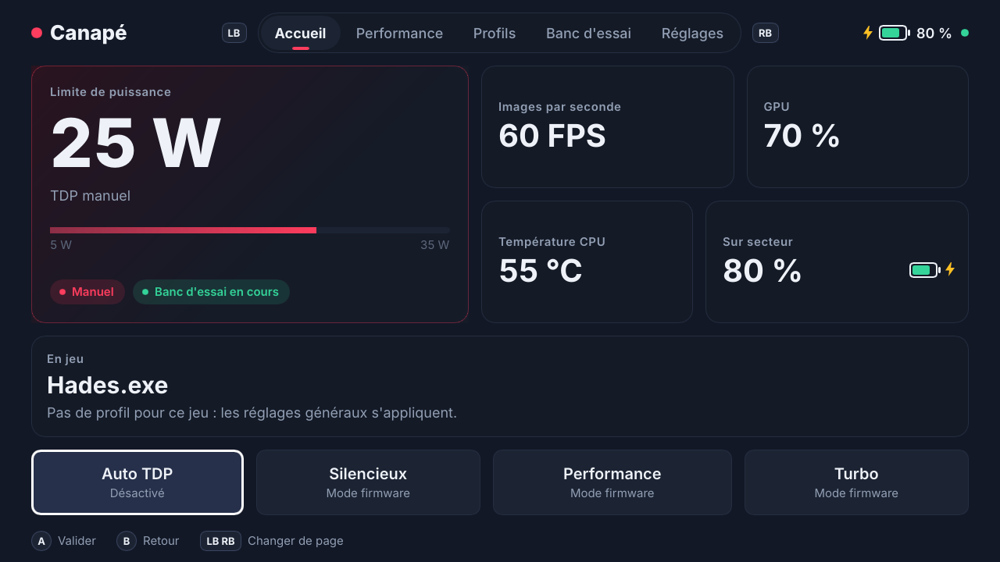
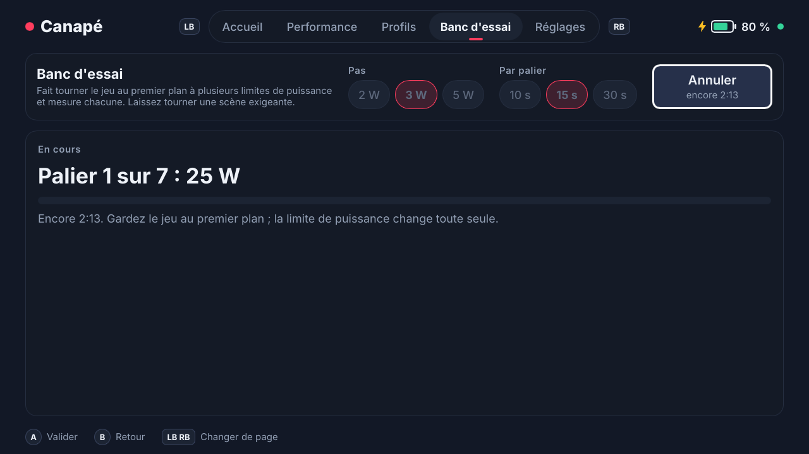
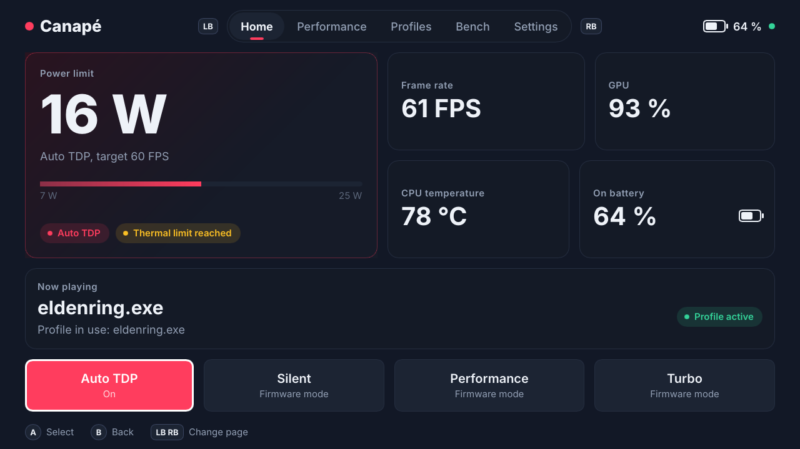
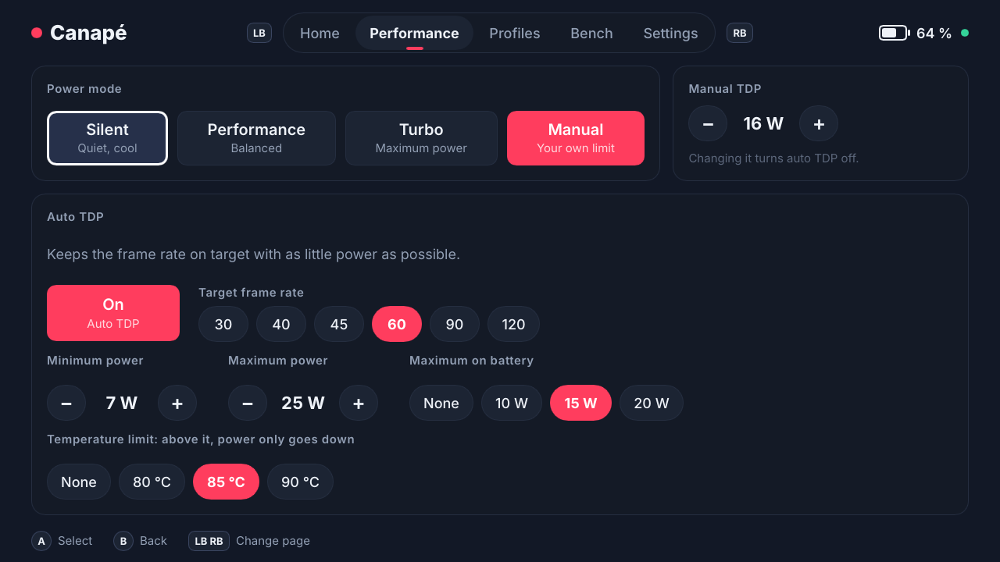
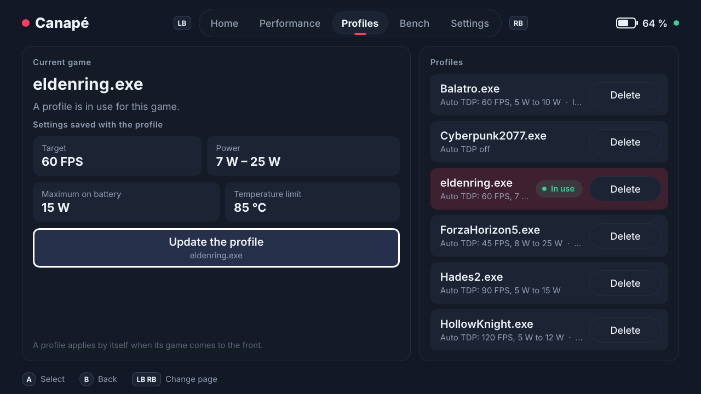
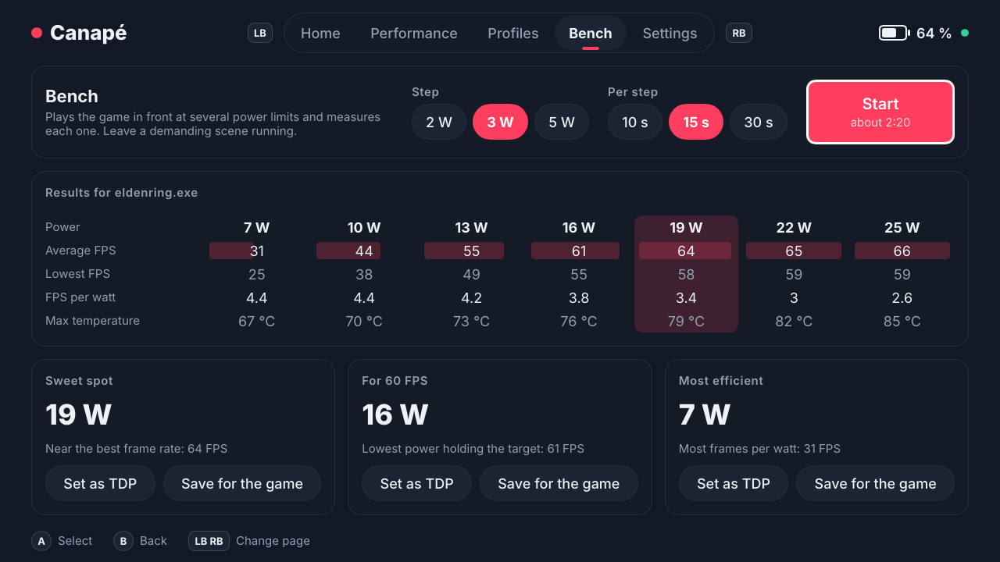

<div align="center">

# Canapé

**Un accueil léger, façon console, pour la ROG Ally.**<br>
**A light, console-style home for the ROG Ally.**

[🇫🇷 Français](#français) · [🇬🇧 English](#english) · [📚 Documentation](docs/README.md)



</div>

---

## Français

Canapé est une app d'accueil écrite en Rust pour la ROG Ally. Elle démarre dans l'**expérience plein écran (FSE)** de Windows à la place de l'accueil Xbox, se pilote entièrement à la manette, règle le matériel de la console à travers un **service Windows privilégié** et ajuste le **TDP automatiquement** pour tenir un objectif d'images par seconde avec le moins de watts possible.

Objectif n° 1 : **rester le plus léger possible.** Pas de navigateur embarqué, pas de runtime async, rendu logiciel. Mesuré sur l'Ally en release : 1,4 Mo de mémoire privée pour le service, 11 Mo pour l'interface.

> [!NOTE]
> Canapé est un projet personnel en développement. Il s'installe en **mode développeur** avec un certificat auto-signé ; il n'existe pas d'installateur grand public. Voir l'[état d'avancement](#état-davancement).

### Fonctionnalités

| | |
|---|---|
| 🎮 **Accueil du FSE** | Choisi dans Paramètres → Jeux → Expérience plein écran ; lancé par Windows au démarrage. Une seule instance, plein écran immédiat. |
| 🕹️ **100 % manette** | LB / RB pour changer de page, croix ou stick pour se déplacer, A pour valider, B pour revenir à l'accueil. |
| ⚡ **Modes et TDP** | Modes firmware ASUS (Silencieux, Performance, Turbo) ou limite manuelle en watts (sPPT, SPL, fPPT écrits ensemble). |
| 🤖 **Auto TDP** | Tient l'objectif FPS (30 à 120) avec le moins de watts possible : FPS et charge GPU lus dans le pilote AMD, plafond sur batterie, limite de température, anti-oscillation. |
| 🎯 **Profils par jeu** | Le profil du jeu au premier plan s'applique tout seul, puis rend la main aux réglages généraux. Canapé retient les watts où l'auto TDP se stabilise. |
| 📊 **Banc d'essai** | Balaye plusieurs limites de puissance sur le jeu en cours et propose trois recommandations : meilleur compromis, puissance pour l'objectif, le plus efficace. |
| 🪟 **Widget Xbox Game Bar** | Réglages rapides en jeu : mode, ±1 W, auto TDP et objectif, FPS, température, batterie, progression du banc d'essai. |
| 🌍 **13 langues** | English, Français, Español, Deutsch, Italiano, Português, Nederlands, Polski, Русский, Türkçe, 日本語, 한국어, 简体中文. Langue de Windows par défaut, ou choix manuel. |
| 💾 **Réglages persistants** | Le service réapplique au démarrage le dernier état (le firmware ne sait pas le relire). |

### Captures

| Accueil | Banc d'essai en cours |
|---|---|
|  |  |

<sub>Captures du shell rendues sous Linux avec le simulateur matériel (valeurs fictives). D'autres captures dans le [guide d'utilisation](docs/user-guide.fr.md).</sub>

### Démarrage rapide

1. Activer le **mode développeur** de Windows sur l'Ally.
2. Dans un Terminal **administrateur**, à la racine du dépôt :
   ```powershell
   powershell -ExecutionPolicy Bypass -File packaging\install-dev.ps1
   ```
3. Choisir **Canapé** dans Paramètres → Jeux → Expérience plein écran, puis redémarrer.

Tout le détail (binaires de la CI, widget, retour à Winhanced ou à l'app Xbox, dépannage) est dans le **[guide d'utilisation](docs/user-guide.fr.md)**.

### État d'avancement

Légende : ✅ validé sur l'Ally · 🧪 écrit et testé sans matériel, pas encore essayé sur l'Ally · ⏳ à faire

| Étape | Contenu | État |
|---|---|---|
| M0 | Squelette du dépôt, protocole, algorithme d'auto TDP testé | ✅ |
| M1 | `canape-shell.exe` démarre comme accueil du FSE ([rapport](docs/m1-report.md)) | ✅ |
| M2 | Service Windows + named pipe, backend ATKACPI, shell Slint à la manette, instance unique ([rapport](docs/m2-report.md)) | ✅ |
| M2.5 | État persistant, journal des écritures, détection des conflits, rendu logiciel, XInput direct, CI | ✅ ([rapport](docs/m4-report.md)) |
| M3 | Widget Game Bar relié au service ([rapport](docs/m3-report.md)) | ✅ première version · 🧪 nouvelle version 13 langues pas encore compilée |
| M4 | Auto TDP réel : FPS et charge GPU via AMD ADL ([rapport](docs/m4-report.md)) | ✅ jusqu'à `99cad07` · 🧪 optimisations suivantes |
| — | Profils par jeu, banc d'essai, shell 5 pages en 13 langues | 🧪 |
| M5 | Ventilateurs, fréquence de l'écran, boutons spéciaux, bibliothèque de jeux | ⏳ |

### Organisation du dépôt

| Dossier | Contenu |
|---|---|
| [`crates/canape-core`](crates/canape-core) | Protocole IPC, réglages, profils, banc d'essai (types partagés) |
| [`crates/canape-autotdp`](crates/canape-autotdp) | Algorithme d'auto TDP, fonction pure testée sans matériel |
| [`crates/canape-hw`](crates/canape-hw) | Trait `Device` : backend Ally (ATKACPI + ADL) et simulateur |
| [`crates/canape-ipc`](crates/canape-ipc) | Transport : named pipe sous Windows, socket Unix ailleurs |
| [`crates/canape-service`](crates/canape-service) | Service privilégié : matériel, auto TDP, profils, banc d'essai, serveur IPC |
| [`crates/canape-shell`](crates/canape-shell) | App d'accueil du FSE (Slint, rendu logiciel) |
| [`crates/canape-ctl`](crates/canape-ctl) | Client en ligne de commande du service |
| [`widget/`](widget) | Widget Xbox Game Bar (C# UWP) |
| [`packaging/`](packaging) | Paquet d'identité MSIX « sparse », scripts d'installation |
| [`docs/`](docs/README.md) | Documentation, rapports d'étape, captures |

### Documentation

- 📖 [Guide d'utilisation](docs/user-guide.fr.md) : installer, utiliser, dépanner, désinstaller
- 🤖 [Auto TDP et banc d'essai](docs/auto-tdp.fr.md) : fonctionnement détaillé et réglages
- 🛠️ [Guide du développeur](docs/developer-guide.fr.md) : architecture, protocole, compilation, traductions
- 📚 [Index de toute la documentation](docs/README.md)

---

## English

Canapé is a Rust home app for the ROG Ally. It boots in Windows' **full-screen experience (FSE)** in place of the Xbox home, is driven entirely with the gamepad, controls the handheld's hardware through a **privileged Windows service**, and **adjusts the TDP automatically** to hold a frame-rate target with as few watts as possible.

Goal number one: **stay as light as possible.** No embedded browser, no async runtime, software rendering. Measured on the Ally in release: 1.4 MB of private memory for the service, 11 MB for the UI.

> [!NOTE]
> Canapé is a personal project under development. It installs in **Developer Mode** with a self-signed certificate; there is no consumer installer. See the [project status](#project-status).

### Features

| | |
|---|---|
| 🎮 **FSE home app** | Picked in Settings → Gaming → Full screen experience; launched by Windows at boot. Single instance, full screen right away. |
| 🕹️ **Gamepad first** | LB / RB to change page, D-pad or stick to move, A to select, B to go back to Home. |
| ⚡ **Modes and TDP** | ASUS firmware modes (Silent, Performance, Turbo) or a manual limit in watts (sPPT, SPL and fPPT written together). |
| 🤖 **Auto TDP** | Holds the FPS target (30 to 120) with the fewest watts: frame rate and GPU load read from the AMD driver, battery ceiling, temperature limit, anti-oscillation. |
| 🎯 **Per-game profiles** | The profile of the game in front applies by itself, then hands back to the global settings. Canapé remembers the wattage auto TDP settles on. |
| 📊 **Bench** | Sweeps several power limits on the running game and gives three recommendations: sweet spot, power for the target, most efficient. |
| 🪟 **Xbox Game Bar widget** | Quick in-game settings: mode, ±1 W, auto TDP and target, FPS, temperature, battery, bench progress. |
| 🌍 **13 languages** | English, Français, Español, Deutsch, Italiano, Português, Nederlands, Polski, Русский, Türkçe, 日本語, 한국어, 简体中文. Windows language by default, or a manual choice. |
| 💾 **Persistent settings** | The service re-applies the last state at startup (the firmware cannot report it back). |

### Screenshots

| Home | Performance |
|---|---|
|  |  |
| **Profiles** | **Bench** |
|  |  |

<sub>Shell screenshots rendered on Linux with the hardware simulator (made-up values). More in the [user guide](docs/user-guide.en.md).</sub>

### Quick start

1. Turn on Windows **Developer Mode** on the Ally.
2. In an **elevated** Terminal, at the repository root:
   ```powershell
   powershell -ExecutionPolicy Bypass -File packaging\install-dev.ps1
   ```
3. Pick **Canapé** in Settings → Gaming → Full screen experience, then reboot.

All the details (CI binaries, the widget, going back to Winhanced or the Xbox app, troubleshooting) are in the **[user guide](docs/user-guide.en.md)**.

### Project status

Legend: ✅ validated on the Ally · 🧪 written and tested without hardware, not tried on the Ally yet · ⏳ planned

| Milestone | Scope | Status |
|---|---|---|
| M0 | Repository skeleton, protocol, tested auto TDP algorithm | ✅ |
| M1 | `canape-shell.exe` boots as the FSE home app ([report](docs/m1-report.md)) | ✅ |
| M2 | Windows service + named pipe, ATKACPI backend, gamepad Slint shell, single instance ([report](docs/m2-report.md)) | ✅ |
| M2.5 | Persistent state, write log, conflict detection, software rendering, direct XInput, CI | ✅ ([report](docs/m4-report.md)) |
| M3 | Game Bar widget talking to the service ([report](docs/m3-report.md)) | ✅ first version · 🧪 new 13-language version not built yet |
| M4 | Real auto TDP: FPS and GPU load through AMD ADL ([report](docs/m4-report.md)) | ✅ up to `99cad07` · 🧪 later optimizations |
| — | Per-game profiles, bench, 5-page shell in 13 languages | 🧪 |
| M5 | Fans, display refresh rate, special buttons, game library | ⏳ |

### Repository map

| Folder | Contents |
|---|---|
| [`crates/canape-core`](crates/canape-core) | IPC protocol, settings, profiles, bench (shared types) |
| [`crates/canape-autotdp`](crates/canape-autotdp) | Auto TDP algorithm, a pure function tested without hardware |
| [`crates/canape-hw`](crates/canape-hw) | `Device` trait: Ally backend (ATKACPI + ADL) and simulator |
| [`crates/canape-ipc`](crates/canape-ipc) | Transport: named pipe on Windows, Unix socket elsewhere |
| [`crates/canape-service`](crates/canape-service) | Privileged service: hardware, auto TDP, profiles, bench, IPC server |
| [`crates/canape-shell`](crates/canape-shell) | FSE home app (Slint, software rendering) |
| [`crates/canape-ctl`](crates/canape-ctl) | Command-line client for the service |
| [`widget/`](widget) | Xbox Game Bar widget (C# UWP) |
| [`packaging/`](packaging) | Sparse MSIX identity package, install scripts |
| [`docs/`](docs/README.md) | Documentation, milestone reports, screenshots |

### Documentation

- 📖 [User guide](docs/user-guide.en.md): install, use, troubleshoot, uninstall
- 🤖 [Auto TDP and bench](docs/auto-tdp.en.md): how it works in detail, and how to tune it
- 🛠️ [Developer guide](docs/developer-guide.en.md): architecture, protocol, building, translations
- 📚 [Index of all documentation](docs/README.md)

---

<div align="center"><sub>MIT · Canapé n'est affilié ni à ASUS, ni à Microsoft, ni à AMD · Canapé is not affiliated with ASUS, Microsoft or AMD.</sub></div>
