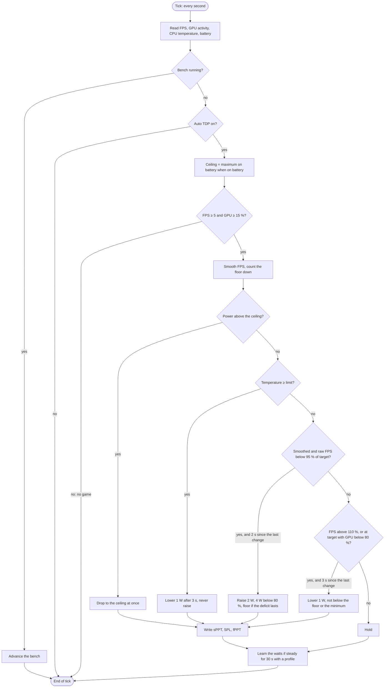
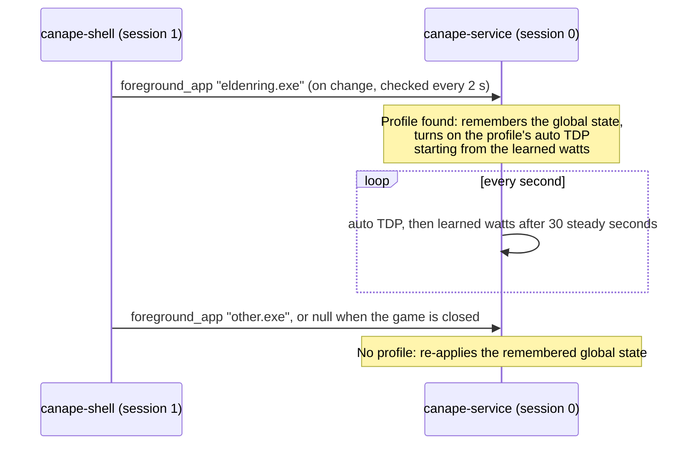

# Auto TDP and bench

[🇫🇷 Version française](auto-tdp.fr.md) · [📚 Documentation index](README.md)

This page explains how Canapé sets the ROG Ally's power on its own: first in a few lines for players, then precisely, with the values from the code (`crates/canape-autotdp`, `crates/canape-service/src/handler.rs`, `crates/canape-core/src/bench.rs`).

> [!IMPORTANT]
> **Measured on the Ally**: auto TDP as of version `99cad07` (see [Measured results](#measured-results-on-the-ally)). **Not measured yet**: the later optimizations (single-stall filter, floor release, battery ceiling, temperature limit, learned watts), per-game profiles (including their fan curves and frame rate limit) and the bench. They are covered by unit tests and a simulation, not by a real measurement.

## Contents

- [In short](#in-short)
- [Settings and defaults](#settings-and-defaults)
- [Where the measurements come from](#where-the-measurements-come-from)
- [One second of auto TDP](#one-second-of-auto-tdp)
- [How power goes up and down](#how-power-goes-up-and-down)
  - [FPS smoothing](#fps-smoothing)
  - [Raising](#raising)
  - [Lowering](#lowering)
  - [The frame cap and the idle GPU rule](#the-frame-cap-and-the-idle-gpu-rule)
  - [Cooldowns](#cooldowns)
  - [Floors, and a growing hold after failed probes](#floors-and-a-growing-hold-after-failed-probes)
  - [Single-stall filter](#single-stall-filter)
  - [Floor release when the load drops](#floor-release-when-the-load-drops)
  - [Battery ceiling](#battery-ceiling)
  - [Temperature limit](#temperature-limit)
  - [The "no game" guard](#the-no-game-guard)
  - [Starting point](#starting-point)
- [Per-game profiles](#per-game-profiles)
  - [Frame rate limit and auto TDP](#frame-rate-limit-and-auto-tdp)
- [The bench](#the-bench)
- [Persistence: `state.json`](#persistence-statejson)
- [Measured results on the Ally](#measured-results-on-the-ally)
- [Tuning tips](#tuning-tips)
- [Known limits](#known-limits)

## In short

The **TDP** is the power, in watts, that the Ally's processor is allowed to draw. More watts means more frames per second… up to a point, but also more heat, more noise and a battery that drains faster.

With **auto TDP**, you pick a **frame-rate target** (for example 60) and every second Canapé looks for the lowest power that holds it:

- the game falls **below the target** → Canapé **raises** power by 2 W (4 W when far behind);
- the game has **headroom** → Canapé **lowers** it by 1 W to see whether it still holds;
- a **failed** lowering (the frame rate drops) → Canapé raises again and waits longer and longer before trying again, so it does not yo-yo.

On top of that you can set a **battery ceiling** and a **temperature limit**, and each game can have its own **profile** that applies by itself when it comes to the foreground. The **bench** measures a game at several power levels and tells you how many watts it really needs.

**Quick recipe**

1. Cap the frame rate at the target: the game's limiter, vsync, or the **frame rate limit** of the Hardware page.
2. **Performance** page: turn auto TDP on, pick the target; keep 7 W – 25 W to begin with.
3. On battery, pick a **maximum on battery** (15 W is a good start).
4. Once per game: run a **bench** in a demanding scene, then **Save for the game** on the recommendation you like.

## Settings and defaults

These are the settings you change in the shell or the widget (`AutoTdpSettings`). There is one global set and one per profile.

| Setting | Default | Choices in the shell | Purpose |
|---|---|---|---|
| Enabled | no | On / Off | Picking a target also turns it on. |
| Target FPS | 60 | 30, 40, 45, 60, 90, 120 | What auto TDP tries to hold. |
| Minimum power | 7 W | the model's range, 1 W steps | Never below. |
| Maximum power | 25 W | the model's range, 1 W steps | Never above. |
| Maximum on battery | none | none, 10, 15, 20 W | A lower ceiling, only on battery. |
| Temperature limit | none | none, 80, 85, 90 °C | Above it, power only goes down. |

The service brings the minimum, the maximum and the maximum on battery into the detected model's range: the adjusted values are the ones saved and shown in the shell and the widget. It also reports that range in its status (`tdp_min_watts`, `tdp_max_watts`), and the shell's − / + buttons, like the widget's ±1 W, stay within it (5 to 35 W in the shell when an older service does not report it):

| Model | Code | TDP range |
|---|---|---|
| ROG Ally | RC71L | 5 to 30 W |
| ROG Ally X | RC72LA | 5 to 30 W |
| ROG Xbox Ally | RC73YA | 5 to 35 W (not confirmed by ASUS) |
| ROG Xbox Ally X | RC73XA | 5 to 35 W (not confirmed by ASUS) |

Rejected settings (minimum above maximum after that adjustment, or a target of 0) return the `invalid auto TDP settings` error.

The algorithm's **internal constants** (`canape_autotdp::Config::default()`) cannot be changed from the UI:

| Constant | Value | Effect (60 FPS target) |
|---|---|---|
| Period | 1 s (one "tick") | One decision per second. |
| `tolerance` | 5 % | Below 57 FPS, the game is short of power. |
| `headroom` | 10 % | Above 66 FPS, there is power to spare. |
| "At target" threshold | 98 % | 58.8 FPS and above count as "at target". |
| "Big deficit" threshold | 80 % | Below 48 FPS, power rises twice as fast. |
| `step_up_watts` | 2 W | Raise step (4 W in a big deficit). |
| `step_down_watts` | 1 W | Lowering step. |
| `gpu_idle_threshold` | 80 % | Below this activity, a GPU at the frame cap has slack. |
| `cooldown_up_ticks` | 2 | At least 2 s after a change before raising. |
| `cooldown_down_ticks` | 3 | At least 3 s after a change before lowering. |
| `fps_smoothing` | 0.4 | Weight of the new sample in the smoothed average. |
| `floor_hold_ticks` | 30 | Base duration of a floor: 30 s. |
| `floor_hold_max_ticks` | 480 | Longest floor: 8 min. |
| `SETTLED_TICKS` | 30 | 30 s without a change: the power counts as "settled" (learned watts). |
| `MIN_GAME_FPS` | 5 FPS | Below this, no game is running. |

## Where the measurements come from

| Measurement | Source | Note |
|---|---|---|
| FPS | AMD driver, `ADL2_Adapter_FrameMetrics_Get` | Screen frame rate as the driver sees it, with no injection into the game: no anti-cheat risk. Counting must be **armed from the user session**: the shell does it at startup, and the service (session 0) then reads the values. |
| GPU activity | AMD driver, `ADL2_New_QueryPMLogData_Get`, sensor 19 | Works from the service. On the Ally it stays around 50 % even when the frame rate depends on power (see [m4-report.md](m4-report.md)). |
| CPU temperature | ASUS firmware, ATKACPI `0x00120094` | Values outside 1 to 124 °C are ignored. |
| Battery, AC | `GetSystemPowerStatus` | |


## One second of auto TDP

Every second, the service's `tick` thread does this:



After the tick, the service saves `state.json` if something changed outside a request (learned watts, end of a bench) and pushes the status to subscribed clients (shell, widget, `canape-ctl watch`).

## How power goes up and down

The examples below assume a 60 FPS target.

### FPS smoothing

A single second can lie (loading, autosave). The controller keeps a **smoothed average**: `smoothed ← smoothed + 0.4 × (sample − smoothed)`. After a sudden change, the average has covered 40 % of it after one second, 64 % after two, 78 % after three.

Decisions look both at the smoothed value and at the raw sample of the second, to react neither too fast nor too late.

### Raising

Power goes up when:

- the **smoothed** frame rate is below 57 FPS (target − 5 %),
- **and** this second's raw sample is too,
- **and** at least 2 s have passed since the last change (time for the smoothed average to catch up with the previous change, to avoid overshooting).

The step is **+2 W**, or **+4 W** when the smoothed frame rate is below 48 FPS (80 % of the target). Power never goes above the maximum (nor the battery ceiling).

### Lowering

Power goes down by **1 W** when at least 3 s have passed since the last change **and**:

- the smoothed frame rate is above 66 FPS (target + 10 %): clearly too much power;
- **or** the game sits **at its frame cap with an idle GPU** (next section).

It never goes below the minimum, nor below an active [floor](#floors-and-a-growing-hold-after-failed-probes).

Between 57 and 66 FPS, without an idle GPU, nothing moves: that is the balance zone.

### The frame cap and the idle GPU rule

A game capped at 60 FPS (limiter or vsync) never goes above 66 FPS: the "above 110 %" rule never applies. To still take back the power it does not need, Canapé also lowers when:

- the smoothed **and** raw frame rates are at least 98 % of the target (58.8 FPS),
- **and** GPU activity is known and **below 80 %**.

That is the only case where GPU activity is used to lower. Below the target it is ignored: on the Ally it reads about 50 % even when the frame rate depends on power, and trusting it made power saw between 16 and 24 W (see [Measured results](#measured-results-on-the-ally)).

### Cooldowns

| After a change | Before raising | Before lowering |
|---|---|---|
| Minimum wait | 2 s | 3 s |

On the very first tick, auto TDP may raise power at once.

### Floors, and a growing hold after failed probes

Each lowering is a **probe**: "does 1 W less still hold?". If power has to go back up right after, the probe **failed**.

To avoid a sawtooth, a raise caused by a **lasting deficit** (at least two seconds in a row below 57 FPS) turns the new wattage into a **floor**: for a while, auto TDP does not go below it.

- A floor lasts **30 s** at first.
- If the raise follows a failed probe, the duration **doubles**: 60 s, 120 s, 240 s, then **480 s (8 min)** at most. A plain raise (game start, heavier scene) does not double it.
- The duration stays doubled for the next floors: the more probes fail, the rarer they get, instead of yo-yoing.

### Single-stall filter

A single very low second (loading, hitch, autosave) raises power — the game may need it — but **sets no floor**: if the frame rate comes back to the target, power can come down normally.

> [!NOTE]
> This filter fixes the problem seen in the `99cad07` retest: a stall at 20.8 FPS had raised power to 24 W, and the floor kept it there for about 4 minutes. It has not been measured on the Ally yet.

### Floor release when the load drops

When the smoothed frame rate is above 110 % of the target **and** GPU activity is below 80 %, the load has clearly dropped (menu, lighter scene): the current floor is **removed** and the floor duration goes back to 30 s. Power can then come down by 1 W every 3 s.

When GPU activity is unknown, this release does not happen.

### Battery ceiling

On battery, when a **maximum on battery** is set, the ceiling becomes the smaller of that maximum and the maximum power (but never below the minimum power).

- If power is above it, it **drops to the ceiling at once**, with no cooldown, even when no game runs (unplugged on the desktop).
- Raises stop at the ceiling.
- On AC, the ceiling goes away and raises can resume.

### Temperature limit

When a temperature limit is set and the CPU temperature reaches or exceeds it:

- power **no longer goes up**, even if the frame rate is below the target;
- it **goes down by 1 W every 3 s**, down to the minimum, ignoring floors;
- the status reports `thermal_limited`: "Thermal limit reached" badge in the shell, "Throttled" caption in the widget.

The normal rules resume only once the temperature is **3 °C below the limit** (hysteresis), so power does not climb back at the first degree gained.

### The "no game" guard

Auto TDP only makes a decision when a game seems to be running:

- the frame rate is known and **at least 5 FPS**,
- **and** GPU activity is unknown or **at least 15 %**.

Otherwise (desktop, still menu, shell in front with no game) the tick is skipped: power stays where it is. Without this guard, auto TDP would see "0 FPS, target missed" and climb to the maximum in front of the desktop.

### Starting point

When auto TDP turns on, the controller starts, in this order, from:

1. the game profile's **learned watts**, if any;
2. otherwise the current **manual TDP**;
3. otherwise the **maximum power** (the case of a firmware mode, whose TDP is unknown).

The value is brought between the minimum and the maximum and **applied at once**.

> [!NOTE]
> Any change to an auto TDP setting (target, minimum, maximum, battery, temperature) recreates the controller from the current power: the smoothed average, the floors and their duration start over.

## Per-game profiles

A profile ties an executable name (compared case-insensitively) to auto TDP settings and, optionally, to **learned watts**, **fan curves** and a **frame rate limit** (the last two saved from the shell's Hardware page).



- **Detection**: the service, in session 0, cannot see windows. The shell tells it which program is in the foreground (see the [user guide](user-guide.en.md#profiles)). After reconnecting to the service, the shell sends the last known program again.
- **Activation**: when a game that has a profile comes to the foreground, the service remembers the global state (mode, TDP, auto TDP, fan curves, frame rate limit), then applies the profile's auto TDP starting from the learned watts. A profile whose auto TDP is off turns auto TDP off and keeps the current power. Then come the profile's fan curves and frame rate limit; what the profile does not set follows the global settings. Only what differs is written.
- **While the profile is active**: changing the target or another auto TDP option changes **the profile**, not the global settings. Fans and the frame rate limit follow the same rule only if the profile has its own (each one separately); otherwise the change is global and stays after the game.
- **End**: when the game leaves the foreground (another program, or the game is closed), the service re-applies the remembered global state, fans and frame rate limit included. So a mode or manual TDP picked while the profile was active only lasts as long as the game.
- **Learned watts**: once the power has not moved for 30 ticks with a game detected, it is saved in the active profile (and in `state.json`). The next session starts right there, instead of starting from the maximum again.
- **Saving from the shell** (Profiles page): the current auto TDP settings, plus the current power as learned watts if auto TDP is on. The profile's fan curves and frame rate limit are kept.
- **Saving from the Hardware page** (**Keep fans and limit for this game**): the current fan curves and frame rate limit, the rest of the profile unchanged (or, without a profile, a new one with the current auto TDP settings). Fans on the firmware's curves are saved as such: that game will use them even when a preset is in use elsewhere. No limit is saved as "follow the global limit".
- **Deleting** the active profile hands back to the global state at once.

### Frame rate limit and auto TDP

The frame rate limit (Hardware page) is a cap in the AMD driver: the game cannot go above it. Auto TDP, for its part, regulates power to reach its **target**. The two must agree:

| Limit vs. target | What happens |
|---|---|
| Limit **equal** to the target (for example 60 and 60) | Ideal: the game sits at its cap, and the [idle GPU rule](#the-frame-cap-and-the-idle-gpu-rule) takes back the watts it does not need. |
| Limit **above** the target (90 and 60) | Auto TDP works as without a limit; the limit only cuts in when the game would run faster anyway, for example a light game at the minimum power. |
| Limit **below** the target (40 and 60) | To avoid: the frame rate can never reach the target, auto TDP sees a deficit and raises power up to its maximum for nothing. |

The shell recalls this under the limit: "With auto TDP, set its target at or below the limit." Neither the shell nor the service corrects a mismatch.

## The bench

The bench plays the foreground game at several power limits and measures what each one delivers.

### Plan

| Parameter | Default | Choices in the shell |
|---|---|---|
| From | 25 W | fixed |
| To | 7 W | fixed |
| Step | 3 W | 2, 3 or 5 W |
| Settling per step | 5 s | fixed |
| Measuring per step | 15 s | 10, 15 or 30 s |

Steps go from the highest to the lowest power. They are aligned **on the lowest** (7 W), and the highest is always included:

| Step | Wattages | Duration (15 s measuring) |
|---|---|---|
| 2 W | 25, 23, 21, 19, 17, 15, 13, 11, 9, 7 | 3:20 |
| 3 W | 25, 22, 19, 16, 13, 10, 7 | 2:20 |
| 5 W | 25, 22, 17, 12, 7 | 1:40 |

Total time = number of steps × (settling + measuring). The service brings "from" and "to" into the model's range.

### How a run goes

1. **Start**: a game must be running (last sample ≥ 5 FPS), otherwise `no frame rate: start a game before the bench`. The service remembers the current state, turns auto TDP off and applies the first step.
2. **Each step**: the first 5 seconds are ignored (time for the frame rate to settle), then for the measuring time, every second, the service records the frame rate, GPU activity and temperature. Seconds below 5 FPS (game paused, alt-tabbed) are not counted.
3. **End of a step**: it records a point, then moves to the next step. A step without a single frame-rate sample is left out.
4. **During a bench**: changing the mode, the TDP or auto TDP, or starting another bench, returns `a bench is running: cancel it first`. Profiles do not apply.
5. **End or cancel**: the report is kept (marked incomplete on cancel), the previous state is re-applied (mode, TDP, auto TDP), then the foreground game's profile takes over again if there is one. The report is saved in `state.json`.

### What is recorded

For each step (`BenchPoint`):

| Field | Contents |
|---|---|
| `watts` | The step's power |
| `fps_avg` | Average frame rate over the measuring window |
| `fps_low` | The lowest second: stutters show up here |
| `gpu_avg` | Average GPU activity, when known |
| `temp_max` | Highest CPU temperature, when known |
| `samples` | Number of seconds measured |

The report (`BenchReport`) also keeps the foreground game at the start, the start time, the plan and the `completed` flag. Only the last report is kept.

### The three recommendations

Computed by the shell from the report and the current auto TDP target:

| Recommendation | Computation |
|---|---|
| **Sweet spot** | The lowest power whose average frame rate reaches **95 %** of the best result. |
| **For N FPS** | The lowest power whose average frame rate reaches the target. None if the target is never reached. |
| **Most efficient** | The power with the most FPS per watt. |

Example (the unit test in `bench.rs`):

| Power | 7 W | 10 W | 13 W | 16 W | 19 W | 22 W | 25 W |
|---|---|---|---|---|---|---|---|
| Average FPS | 31 | 44 | 55 | 61 | 64 | 65 | 65.5 |
| FPS per watt | 4.4 | 4.4 | 4.2 | 3.8 | 3.4 | 3.0 | 2.6 |

- Sweet spot: 95 % of 65.5 = 62.2 FPS → **19 W**.
- For 60 FPS: **16 W** (61 FPS).
- Most efficient: **7 W** (4.43 FPS/W).

### Applying a recommendation

| Button | Effect |
|---|---|
| **Set as TDP** | Manual TDP at that power; auto TDP is turned off. |
| **Save for the game** | Creates or replaces the profile of the report's game (or, failing that, the foreground game). |

The profile created by **Save for the game** contains:

| Field | Value |
|---|---|
| Auto TDP | on |
| Target | the frame rate measured at that power, rounded **down** to an offered target (30, 40, 45, 60, 90, 120); below 30, the value itself |
| Maximum power | the recommended power |
| Minimum power | the smallest of the current minimum, the lowest measured step and the recommended power |
| Maximum on battery, temperature limit | the current ones |
| Learned watts | the recommended power |
| Fan curves, frame rate limit | those of the game's existing profile, if any |

With the example above, **Save for the game** on the sweet spot gives: target 60 FPS, 7 to 19 W, starting at 19 W.

## Persistence: `state.json`

The firmware cannot report the mode or the limits back. So the service keeps the last state in `%ProgramData%\Canape\state.json` and re-applies it when it starts (profiles and last bench, then mode or TDP, then auto TDP, then fan curves and frame rate limit, then the charge limit and the controller mode).

```json
{
  "mode": "manual",
  "tdp_watts": 12,
  "auto_tdp": {
    "enabled": true,
    "target_fps": 60,
    "min_watts": 7,
    "max_watts": 25,
    "battery_max_watts": 15,
    "max_temp_c": 85
  },
  "battery_limit": 80,
  "profiles": [
    {
      "exe": "eldenring.exe",
      "auto_tdp": { "enabled": true, "target_fps": 60, "min_watts": 7, "max_watts": 19, "battery_max_watts": 15, "max_temp_c": 85 },
      "learned_watts": 16,
      "fan_curves": { "cpu": [[40,10],[50,18],[58,26],[65,34],[72,42],[78,50],[85,62],[92,75]], "gpu": [[40,10],[50,18],[58,26],[65,34],[72,42],[78,50],[85,62],[92,75]], "mid": null },
      "fps_limit": 60
    }
  ],
  "last_bench": null,
  "accent": "#2563eb",
  "fan_curves": { "cpu": null, "gpu": null, "mid": null },
  "fps_limit": null,
  "controller_mode": "gamepad"
}
```

- The file is rewritten after every successful request that changes the state, when learned watts change, and at the end of a bench.
- It always holds the **global state**, even during a profile or a bench: restarting the service does not keep a temporary setting.
- Every field is optional when reading; an unreadable file is ignored (an `ignoring …` line in `service.log`).

## Measured results on the Ally

Measurements from the [M4 report](m4-report.md), on a ROG Ally RC71L, with WebGL Aquarium in Edge (120 Hz screen, vsync), target 60 FPS. No real game has been measured yet.

### Heavy load (30,000 fish, 5 min)

| | Before (`c617cf3`) | After (`99cad07`) |
|---|---|---|
| After settling | Sawtooth between 16 and 24 W | **18 W 87 % of the time** (104 samples out of 120); 16–17 W ×5, 19–20 W ×5, 24 W ×6 |
| Power changes | ~30 in 80 s | **13 in 5 min** (4 of them at startup: 12 → 19 W in 6 s) |
| FPS | 55 to 71 | Average **60.6**; 5 samples below 57 (the probes) |

What changed between the two versions: lowering below the target only happens at the frame cap with an idle GPU, a raise becomes a floor held longer after each failed probe, and a raise waits 2 s. Probes come back about every 2 minutes (18 → 17 → 16 W, back to 18 W within 2 to 4 s).

### Light load

| | Before (`c617cf3`) | After (`99cad07`) |
|---|---|---|
| From 12 W down to the minimum (7 W) | 16 s, then steady at 120 FPS | 48 s (1 W every 2 to 4 s) once the floor was released |
| After a heavy load | — | **Stuck at 24 W for ~4 min** because of a floor set by a single stall |

The optimizations in `fceaf22` target these two defects (a single stall sets no floor, floor release when the load drops, lowering at the cap only when the raw sample is at the target too). A simulation of the M4 case (`power_limited_game_settles_without_sawtooth`) checks that after settling the power stays within a 3 W range with at most 12 changes in 13 minutes, for an average of at least 57 FPS. **These optimizations have not been measured on the Ally yet.**

## Tuning tips

> [!TIP]
> **Cap the game's frame rate at the target.** An uncapped game hovers around the target; a capped game lets the idle GPU rule take back the watts it does not need. The game's own limiter, vsync or the Hardware page's frame rate limit all work; never a limit below the target (see [Frame rate limit and auto TDP](#frame-rate-limit-and-auto-tdp)).

- **Picking the target**: one the game can hold at the maximum power. If the bench says "Target not reached in this run", lower the target. The Ally's screen runs at 120 Hz: 40 or 60 FPS divide it evenly.
- **Minimum power**: 7 W suits most games. Raise it if a game stutters when the load jumps (climbing 2 W per 2 s takes visible time); lower it towards 5 W for very light games.
- **Maximum power**: capping it lowers heat and noise. The bench's sweet spot is a good value: past it, watts buy almost nothing.
- **On battery**: 15 W is a good balance; 10 W for light games.
- **Temperature limit**: 85 °C leaves some margin. Power climbs again only once the temperature is 3 °C below it.
- **Profiles**: save the profile after a session where auto TDP settled; the next one will start at the learned watts.
- **Bench**: in a demanding, steady scene (not a menu or a cutscene). Use 30 s per step for games whose frame rate varies a lot.
- **Check the frame rate** on Home: if it stays at "—", auto TDP does nothing (see [troubleshooting](user-guide.en.md#common-problems)).

## Known limits

- Everything after `99cad07` (filters, battery ceiling, temperature limit, profiles, learned watts, bench) has not been measured on the Ally yet. The fan curves and the driver frame rate limit have not even been written to a real Ally yet.
- The frame rate is the screen's as reported by the AMD driver, not a specific process's.
- A game profile cannot force "no frame rate limit" while a global limit is set: a profile saved with None follows the global limit.
- The ETW fallback (PresentMon's approach) mentioned in [`architecture.md`](architecture.md) is not implemented: without ADL there is no frame rate, so no auto TDP.
