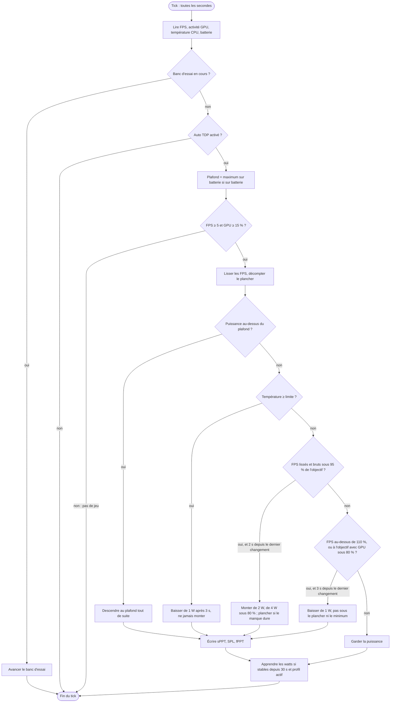

# Auto TDP et banc d'essai

[🇬🇧 English version](auto-tdp.en.md) · [📚 Index de la documentation](README.md)

Cette page explique comment Canapé règle tout seul la puissance de la ROG Ally : d'abord en quelques lignes pour les joueurs, puis précisément, avec les valeurs du code (`crates/canape-autotdp`, `crates/canape-service/src/handler.rs`, `crates/canape-core/src/bench.rs`).

> [!IMPORTANT]
> **Ce qui a été mesuré sur l'Ally** : l'auto TDP de la version `99cad07` (voir [Résultats mesurés](#résultats-mesurés-sur-lally)). **Ce qui ne l'a pas encore été** : les optimisations suivantes (filtre de l'à-coup isolé, libération du plancher, plafond sur batterie, limite de température, watts appris), les profils par jeu et le banc d'essai. Ils sont couverts par des tests unitaires et une simulation, pas par une mesure réelle.

## Sommaire

- [En bref](#en-bref)
- [Réglages et valeurs par défaut](#réglages-et-valeurs-par-défaut)
- [D'où viennent les mesures](#doù-viennent-les-mesures)
- [Une seconde d'auto TDP](#une-seconde-dauto-tdp)
- [Comment la puissance monte et baisse](#comment-la-puissance-monte-et-baisse)
  - [Lissage des FPS](#lissage-des-fps)
  - [Monter](#monter)
  - [Baisser](#baisser)
  - [Le plafond de FPS et la règle du GPU au repos](#le-plafond-de-fps-et-la-règle-du-gpu-au-repos)
  - [Délais entre deux changements](#délais-entre-deux-changements)
  - [Planchers et maintien croissant après une sonde ratée](#planchers-et-maintien-croissant-après-une-sonde-ratée)
  - [Filtre de l'à-coup isolé](#filtre-de-là-coup-isolé)
  - [Libération du plancher quand la charge baisse](#libération-du-plancher-quand-la-charge-baisse)
  - [Plafond sur batterie](#plafond-sur-batterie)
  - [Limite de température](#limite-de-température)
  - [Garde « pas de jeu »](#garde--pas-de-jeu-)
  - [Point de départ](#point-de-départ)
- [Profils par jeu](#profils-par-jeu)
- [Le banc d'essai](#le-banc-dessai)
- [Persistance : `state.json`](#persistance--statejson)
- [Résultats mesurés sur l'Ally](#résultats-mesurés-sur-lally)
- [Conseils de réglage](#conseils-de-réglage)
- [Limites connues](#limites-connues)

## En bref

Le **TDP** est la puissance, en watts, que le processeur de l'Ally a le droit de consommer. Plus de watts, c'est plus d'images par seconde… jusqu'à un certain point, mais aussi plus de chaleur, de bruit et une batterie qui fond plus vite.

Avec l'**auto TDP**, vous choisissez un **objectif d'images par seconde** (par exemple 60) et Canapé cherche, chaque seconde, la puissance la plus basse qui le tient :

- le jeu passe **sous l'objectif** → Canapé **monte** de 2 W (4 W si le retard est grand) ;
- le jeu a **de la marge** → Canapé **baisse** de 1 W pour voir si ça tient toujours ;
- une baisse **ratée** (les FPS chutent) → Canapé remonte et attend de plus en plus longtemps avant de réessayer, pour ne pas faire le yo-yo.

Par-dessus, vous pouvez fixer un **plafond sur batterie** et une **limite de température**, et chaque jeu peut avoir son **profil** qui s'applique tout seul quand il passe au premier plan. Le **banc d'essai** mesure un jeu à plusieurs puissances et vous dit combien de watts il lui faut vraiment.

**Recette rapide**

1. Dans le jeu, limitez les FPS à l'objectif (limiteur du jeu ou synchronisation verticale).
2. Page **Performance** : activez l'auto TDP, choisissez l'objectif ; gardez 7 W – 25 W au début.
3. Sur batterie, choisissez un **maximum sur batterie** (15 W est un bon départ).
4. Une fois par jeu : lancez un **banc d'essai** dans une scène exigeante, puis **Profil du jeu** sur la recommandation qui vous convient.

## Réglages et valeurs par défaut

Ces réglages sont ceux que vous changez dans le shell ou le widget (`AutoTdpSettings`). Ils existent en un jeu global et un par profil.

| Réglage | Défaut | Choix dans le shell | Rôle |
|---|---|---|---|
| Activé | non | Activé / Désactivé | Choisir un objectif l'active aussi. |
| Objectif FPS | 60 | 30, 40, 45, 60, 90, 120 | Ce que l'auto TDP cherche à tenir. |
| Puissance minimale | 7 W | 5 à 35 W, pas de 1 W | Jamais en dessous. |
| Puissance maximale | 25 W | 5 à 35 W, pas de 1 W | Jamais au-dessus. |
| Maximum sur batterie | aucun | aucun, 10, 15, 20 W | Plafond plus bas, seulement sur batterie. |
| Limite de température | aucune | aucune, 80, 85, 90 °C | Au-delà, la puissance ne fait que baisser. |

Le service ramène le minimum et le maximum dans la plage du modèle détecté, sans modifier les valeurs affichées :

| Modèle | Code | Plage de TDP |
|---|---|---|
| ROG Ally | RC71L | 5 à 30 W |
| ROG Ally X | RC72LA | 5 à 30 W |
| ROG Xbox Ally | RC73YA | 5 à 35 W (non confirmé par ASUS) |
| ROG Xbox Ally X | RC73XA | 5 à 35 W (non confirmé par ASUS) |

Un réglage refusé (minimum au-dessus du maximum après cette correction, ou objectif à 0) renvoie l'erreur `invalid auto TDP settings`.

Les **constantes internes** de l'algorithme (`canape_autotdp::Config::default()`) ne se règlent pas depuis l'interface :

| Constante | Valeur | Effet (objectif 60 FPS) |
|---|---|---|
| Période | 1 s (un « tick ») | Une décision par seconde. |
| `tolerance` | 5 % | Sous 57 FPS, le jeu manque de puissance. |
| `headroom` | 10 % | Au-dessus de 66 FPS, il y a de la puissance en trop. |
| Seuil « à l'objectif » | 98 % | 58,8 FPS et plus comptent comme « à l'objectif ». |
| Seuil « gros retard » | 80 % | Sous 48 FPS, on monte deux fois plus vite. |
| `step_up_watts` | 2 W | Pas de montée (4 W en gros retard). |
| `step_down_watts` | 1 W | Pas de baisse. |
| `gpu_idle_threshold` | 80 % | Sous ce taux d'activité, un GPU au plafond de FPS a de la marge. |
| `cooldown_up_ticks` | 2 | Au moins 2 s après un changement avant de monter. |
| `cooldown_down_ticks` | 3 | Au moins 3 s après un changement avant de baisser. |
| `fps_smoothing` | 0,4 | Poids de la nouvelle mesure dans la moyenne lissée. |
| `floor_hold_ticks` | 30 | Durée de base d'un plancher : 30 s. |
| `floor_hold_max_ticks` | 480 | Durée maximale d'un plancher : 8 min. |
| `SETTLED_TICKS` | 30 | 30 s sans changement : la puissance est « stabilisée » (watts appris). |
| `MIN_GAME_FPS` | 5 FPS | En dessous, aucun jeu ne tourne. |

## D'où viennent les mesures

| Mesure | Source | Remarque |
|---|---|---|
| FPS | Pilote AMD, `ADL2_Adapter_FrameMetrics_Get` | Taux d'images de l'écran vu par le pilote, sans injection dans le jeu : aucun risque avec les anti-triche. Le comptage doit être **activé depuis la session utilisateur** : le shell le fait à son démarrage, et le service (session 0) lit ensuite les valeurs. |
| Activité GPU | Pilote AMD, `ADL2_New_QueryPMLogData_Get`, capteur 19 | Fonctionne depuis le service. Sur l'Ally, elle reste vers 50 % même quand les FPS dépendent de la puissance (voir [m4-report.md](m4-report.md)). |
| Température CPU | Firmware ASUS, ATKACPI `0x00120094` | Valeurs hors 1 à 124 °C ignorées. |
| Batterie, secteur | `GetSystemPowerStatus` | |


## Une seconde d'auto TDP

Chaque seconde, le thread `tick` du service fait ceci :



Après le tick, le service enregistre `state.json` si quelque chose a changé hors requête (watts appris, fin du banc d'essai) et pousse le statut aux clients abonnés (shell, widget, `canape-ctl watch`).

## Comment la puissance monte et baisse

Les exemples suivants supposent un objectif de 60 FPS.

### Lissage des FPS

Une seconde isolée peut mentir (chargement, sauvegarde automatique). Le contrôleur garde une **moyenne lissée** : `lissé ← lissé + 0,4 × (mesure − lissé)`. Après un changement brutal, la moyenne en a parcouru 40 % au bout d'une seconde, 64 % au bout de deux, 78 % au bout de trois.

Les décisions regardent à la fois la valeur lissée et la mesure brute de la seconde, pour ne réagir ni trop vite ni trop tard.

### Monter

La puissance monte quand :

- les FPS **lissés** sont sous 57 FPS (objectif − 5 %),
- **et** la mesure brute de cette seconde aussi,
- **et** au moins 2 s se sont écoulées depuis le dernier changement (le temps que la moyenne lissée rattrape l'effet du changement précédent, pour ne pas trop monter).

Le pas est de **+2 W**, ou de **+4 W** si les FPS lissés sont sous 48 FPS (80 % de l'objectif). La puissance ne dépasse jamais le maximum (ni le plafond sur batterie).

### Baisser

La puissance baisse de **1 W** quand au moins 3 s se sont écoulées depuis le dernier changement **et** que :

- les FPS lissés dépassent 66 FPS (objectif + 10 %) : il y a nettement trop de puissance ;
- **ou** le jeu est **à son plafond de FPS avec un GPU au repos** (section suivante).

Elle ne descend jamais sous le minimum, ni sous un [plancher](#planchers-et-maintien-croissant-après-une-sonde-ratée) en cours.

Entre 57 et 66 FPS, sans GPU au repos, rien ne bouge : c'est la zone d'équilibre.

### Le plafond de FPS et la règle du GPU au repos

Un jeu limité à 60 FPS (limiteur ou synchronisation verticale) ne dépasse jamais 66 FPS : la règle « au-dessus de 110 % » ne s'applique pas. Pour quand même rendre la puissance inutile, Canapé baisse aussi quand :

- les FPS lissés **et** bruts sont à au moins 98 % de l'objectif (58,8 FPS),
- **et** l'activité GPU est connue et **sous 80 %**.

Ce n'est que dans ce cas que l'activité GPU sert à baisser. Sous l'objectif, elle n'est pas prise en compte : sur l'Ally, elle lit environ 50 % même quand les FPS dépendent de la puissance, et s'y fier faisait osciller la puissance entre 16 et 24 W (voir [Résultats mesurés](#résultats-mesurés-sur-lally)).

### Délais entre deux changements

| Après un changement | Avant de monter | Avant de baisser |
|---|---|---|
| Délai minimal | 2 s | 3 s |

Au tout premier tick, l'auto TDP peut monter tout de suite.

### Planchers et maintien croissant après une sonde ratée

Chaque baisse est une **sonde** : « est-ce que 1 W de moins tient encore ? ». Si la puissance doit remonter juste après, la sonde a **raté**.

Pour éviter les dents de scie, une montée due à un **manque qui dure** (au moins deux secondes de suite sous 57 FPS) transforme la nouvelle puissance en **plancher** : pendant un certain temps, l'auto TDP ne baisse plus en dessous.

- Le plancher dure **30 s** au départ.
- Si la montée suit une sonde ratée, la durée **double** : 60 s, 120 s, 240 s, puis **480 s (8 min)** au maximum. Une simple montée (début de partie, scène plus lourde) ne la double pas.
- La durée reste doublée pour les planchers suivants : plus les sondes ratent, plus elles deviennent rares, au lieu de faire le yo-yo.

### Filtre de l'à-coup isolé

Une seule seconde très basse (chargement, à-coup, sauvegarde) fait monter la puissance — le jeu en a peut-être besoin — mais **ne crée pas de plancher** : si les FPS reviennent à l'objectif, la puissance peut redescendre normalement.

> [!NOTE]
> Ce filtre corrige le problème vu lors du retest de `99cad07` : un à-coup à 20,8 FPS avait fait monter la puissance à 24 W, et le plancher l'y avait gardée environ 4 minutes. Il n'a pas encore été mesuré sur l'Ally.

### Libération du plancher quand la charge baisse

Quand les FPS lissés dépassent 110 % de l'objectif **et** que l'activité GPU est sous 80 %, la charge a clairement baissé (menu, scène plus légère) : le plancher en cours est **supprimé** et la durée des planchers revient à 30 s. La puissance peut alors redescendre d'1 W toutes les 3 s.

Si l'activité GPU est inconnue, cette libération n'a pas lieu.

### Plafond sur batterie

Sur batterie, si un **maximum sur batterie** est réglé, le plafond devient le plus petit de ce maximum et de la puissance maximale (mais jamais sous la puissance minimale).

- Si la puissance est au-dessus, elle **descend tout de suite au plafond**, sans délai.
- Les montées s'arrêtent au plafond.
- Sur secteur, le plafond disparaît et les montées peuvent reprendre.

### Limite de température

Si une limite de température est réglée et que la température CPU l'atteint ou la dépasse :

- la puissance **ne monte plus**, même si les FPS sont sous l'objectif ;
- elle **baisse de 1 W toutes les 3 s**, jusqu'au minimum, en ignorant les planchers ;
- le statut signale `thermal_limited` : badge « Limite thermique atteinte » dans le shell, légende « Bridé » dans le widget.

Dès que la température repasse sous la limite, les règles normales reprennent.

### Garde « pas de jeu »

L'auto TDP ne prend une décision que si un jeu semble tourner :

- FPS connus et **au moins 5 FPS**,
- **et** activité GPU inconnue ou **au moins 15 %**.

Sinon (bureau, menu immobile, shell au premier plan sans jeu), le tick est ignoré : la puissance reste où elle est. Sans cette garde, l'auto TDP verrait « 0 FPS, objectif raté » et monterait au maximum devant le bureau.

### Point de départ

Quand l'auto TDP s'active, le contrôleur part, dans l'ordre :

1. des **watts appris** du profil du jeu, s'il y en a ;
2. sinon du **TDP manuel** en cours ;
3. sinon de la **puissance maximale** (cas d'un mode firmware, dont le TDP est inconnu).

La valeur est ramenée entre le minimum et le maximum et **appliquée tout de suite**.

> [!NOTE]
> Tout changement de réglage de l'auto TDP (objectif, minimum, maximum, batterie, température) recrée le contrôleur à partir de la puissance actuelle : la moyenne lissée, les planchers et leur durée repartent de zéro.

## Profils par jeu

Un profil associe un nom d'exécutable (comparé sans tenir compte de la casse) à des réglages d'auto TDP et, éventuellement, à des **watts appris**.

```mermaid
sequenceDiagram
    participant Shell as canape-shell (session 1)
    participant Service as canape-service (session 0)
    Shell->>Service: foreground_app "eldenring.exe" (au changement, vérifié toutes les 2 s)
    Note over Service: Profil trouvé : mémorise l'état général,<br/>active l'auto TDP du profil<br/>en partant des watts appris
    loop chaque seconde
        Service->>Service: auto TDP ; après 30 s stables, watts appris
    end
    Shell->>Service: foreground_app "autre.exe", ou null quand le jeu est fermé
    Note over Service: Pas de profil : réapplique l'état général mémorisé
```

- **Détection** : le service, en session 0, ne voit pas les fenêtres. Le shell lui signale le programme au premier plan (voir le [guide d'utilisation](user-guide.fr.md#profils)). Après une reconnexion au service, le shell renvoie le dernier programme connu.
- **Activation** : quand un jeu qui a un profil arrive au premier plan, le service mémorise l'état général (mode, TDP, auto TDP), puis applique l'auto TDP du profil en partant des watts appris. Un profil dont l'auto TDP est désactivé coupe l'auto TDP et garde la puissance actuelle.
- **Pendant le profil** : changer l'objectif ou une autre option de l'auto TDP modifie **le profil**, pas les réglages généraux.
- **Fin** : quand le jeu quitte le premier plan (autre programme, ou jeu fermé), le service réapplique l'état général mémorisé. Un mode ou un TDP manuel choisi pendant le profil ne dure donc que le temps du jeu.
- **Watts appris** : quand la puissance n'a pas bougé pendant 30 ticks avec un jeu détecté, elle est enregistrée dans le profil actif (et dans `state.json`). La prochaine session commence directement là, sans repartir du maximum.
- **Enregistrer depuis le shell** (page Profils) : les réglages d'auto TDP en cours, plus la puissance actuelle comme watts appris si l'auto TDP est actif.
- **Supprimer** le profil actif rend aussitôt la main à l'état général.

## Le banc d'essai

Le banc d'essai fait tourner le jeu au premier plan à plusieurs limites de puissance et mesure ce que chacune donne.

### Plan

| Paramètre | Défaut | Choix dans le shell |
|---|---|---|
| De | 25 W | fixe |
| À | 7 W | fixe |
| Pas | 3 W | 2, 3 ou 5 W |
| Stabilisation par palier | 5 s | fixe |
| Mesure par palier | 15 s | 10, 15 ou 30 s |

Les paliers vont de la plus haute à la plus basse puissance. Ils sont alignés **sur la plus basse** (7 W) et la plus haute est toujours incluse :

| Pas | Paliers | Durée (mesure 15 s) |
|---|---|---|
| 2 W | 25, 23, 21, 19, 17, 15, 13, 11, 9, 7 | 3:20 |
| 3 W | 25, 22, 19, 16, 13, 10, 7 | 2:20 |
| 5 W | 25, 22, 17, 12, 7 | 1:40 |

Durée totale = nombre de paliers × (stabilisation + mesure). Le service ramène « de » et « à » dans la plage du modèle.

### Déroulement

1. **Démarrage** : il faut qu'un jeu tourne (dernière mesure ≥ 5 FPS), sinon `no frame rate: start a game before the bench`. Le service mémorise l'état actuel, coupe l'auto TDP et applique le premier palier.
2. **Chaque palier** : les 5 premières secondes sont ignorées (le temps que les FPS se stabilisent), puis pendant la durée de mesure, chaque seconde, le service relève les FPS, l'activité GPU et la température.
3. **Fin du palier** : il enregistre un point, puis passe au palier suivant. Un palier sans aucune mesure de FPS est omis.
4. **Pendant le banc d'essai** : changer de mode, de TDP ou d'auto TDP, ou lancer un autre banc d'essai, renvoie `a bench is running: cancel it first`. Les profils ne s'appliquent pas.
5. **Fin ou annulation** : le rapport est conservé (marqué incomplet en cas d'annulation), l'état d'avant est réappliqué (mode, TDP, auto TDP), puis le profil du jeu au premier plan reprend la main s'il y en a un. Le rapport est enregistré dans `state.json`.

### Ce qui est enregistré

Pour chaque palier (`BenchPoint`) :

| Champ | Contenu |
|---|---|
| `watts` | Puissance du palier |
| `fps_avg` | Moyenne des FPS sur la mesure |
| `fps_low` | La seconde la plus basse : les à-coups se voient ici |
| `gpu_avg` | Activité GPU moyenne, si connue |
| `temp_max` | Température CPU maximale, si connue |
| `samples` | Nombre de secondes mesurées |

Le rapport (`BenchReport`) garde aussi le jeu au premier plan au démarrage, l'heure, le plan et l'indicateur `completed`. Seul le dernier rapport est conservé.

### Les trois recommandations

Calculées par le shell à partir du rapport et de l'objectif actuel de l'auto TDP :

| Recommandation | Calcul |
|---|---|
| **Meilleur compromis** | La plus petite puissance dont les FPS moyens atteignent **95 %** du meilleur résultat. |
| **Pour N FPS** | La plus petite puissance dont les FPS moyens atteignent l'objectif. Aucune si l'objectif n'est jamais atteint. |
| **Le plus efficace** | La puissance qui donne le plus de FPS par watt. |

Exemple (le test unitaire de `bench.rs`) :

| Puissance | 7 W | 10 W | 13 W | 16 W | 19 W | 22 W | 25 W |
|---|---|---|---|---|---|---|---|
| FPS moyens | 31 | 44 | 55 | 61 | 64 | 65 | 65,5 |
| FPS par watt | 4,4 | 4,4 | 4,2 | 3,8 | 3,4 | 3,0 | 2,6 |

- Meilleur compromis : 95 % de 65,5 = 62,2 FPS → **19 W**.
- Pour 60 FPS : **16 W** (61 FPS).
- Le plus efficace : **7 W** (4,43 FPS/W).

### Appliquer une recommandation

| Bouton | Effet |
|---|---|
| **Régler le TDP** | TDP manuel à cette puissance ; l'auto TDP est désactivé. |
| **Profil du jeu** | Crée ou remplace le profil du jeu du rapport (ou, à défaut, du jeu au premier plan). |

Le profil créé par **Profil du jeu** contient :

| Champ | Valeur |
|---|---|
| Auto TDP | activé |
| Objectif | les FPS mesurés à cette puissance, arrondis **vers le bas** à un objectif proposé (30, 40, 45, 60, 90, 120) ; sous 30, la valeur elle-même |
| Puissance maximale | la puissance recommandée |
| Puissance minimale | la plus petite du minimum actuel, du plus bas palier mesuré et de la puissance recommandée |
| Maximum sur batterie, limite de température | ceux en cours |
| Watts appris | la puissance recommandée |

Avec l'exemple ci-dessus, **Profil du jeu** sur le meilleur compromis donne : objectif 60 FPS, 7 à 19 W, départ à 19 W.

## Persistance : `state.json`

Le firmware ne sait pas relire le mode ni les limites. Le service garde donc le dernier état dans `%ProgramData%\Canape\state.json` et le réapplique à son démarrage (profils et dernier banc d'essai, puis mode ou TDP, puis auto TDP, puis limite de charge).

```json
{
  "mode": "manual",
  "tdp_watts": 12,
  "auto_tdp": {
    "enabled": true,
    "target_fps": 60,
    "min_watts": 7,
    "max_watts": 25,
    "battery_max_watts": 15,
    "max_temp_c": 85
  },
  "battery_limit": 80,
  "profiles": [
    {
      "exe": "eldenring.exe",
      "auto_tdp": { "enabled": true, "target_fps": 60, "min_watts": 7, "max_watts": 19, "battery_max_watts": 15, "max_temp_c": 85 },
      "learned_watts": 16
    }
  ],
  "last_bench": null
}
```

- Le fichier est réécrit après chaque requête qui modifie l'état et réussit, quand des watts appris changent, et à la fin d'un banc d'essai.
- Il contient toujours l'**état général**, même pendant un profil ou un banc d'essai : un redémarrage du service ne garde pas un réglage temporaire.
- Tous les champs sont facultatifs à la lecture ; un fichier illisible est ignoré (ligne `ignoring … ` dans `service.log`).

## Résultats mesurés sur l'Ally

Mesures du [rapport M4](m4-report.md), sur ROG Ally RC71L, avec WebGL Aquarium dans Edge (écran 120 Hz, synchronisation verticale), objectif 60 FPS. Aucun vrai jeu n'a encore été mesuré.

### Charge lourde (30 000 poissons, 5 min)

| | Avant (`c617cf3`) | Après (`99cad07`) |
|---|---|---|
| Après stabilisation | Dents de scie entre 16 et 24 W | **18 W 87 % du temps** (104 échantillons sur 120) ; 16–17 W ×5, 19–20 W ×5, 24 W ×6 |
| Changements de puissance | ~30 en 80 s | **13 en 5 min** (dont 4 au démarrage : 12 → 19 W en 6 s) |
| FPS | 55 à 71 | Moyenne **60,6** ; 5 échantillons sous 57 (les sondes) |

Le changement entre les deux versions : la baisse sous l'objectif n'a plus lieu qu'au plafond de FPS avec un GPU au repos, une montée devient un plancher maintenu plus longtemps après chaque sonde ratée, et une montée attend 2 s. Les sondes reviennent environ toutes les 2 minutes (18 → 17 → 16 W, retour à 18 W en 2 à 4 s).

### Charge légère

| | Avant (`c617cf3`) | Après (`99cad07`) |
|---|---|---|
| Descente de 12 W au minimum (7 W) | 16 s, puis stable à 120 FPS | 48 s (1 W toutes les 2 à 4 s) une fois le plancher libéré |
| Après une charge lourde | — | **Bloqué à 24 W pendant ~4 min** à cause d'un plancher créé par un à-coup isolé |

Les optimisations de `fceaf22` visent ces deux défauts (à-coup isolé sans plancher, libération du plancher quand la charge baisse, baisse au plafond seulement si la mesure brute est aussi à l'objectif). Une simulation du cas M4 (`power_limited_game_settles_without_sawtooth`) vérifie qu'après stabilisation la puissance reste dans une plage de 3 W avec au plus 12 changements en 13 minutes, pour une moyenne d'au moins 57 FPS. **Ces optimisations n'ont pas encore été mesurées sur l'Ally.**

## Conseils de réglage

> [!TIP]
> **Limitez les FPS du jeu à l'objectif.** Un jeu non limité oscille autour de l'objectif ; un jeu limité permet à la règle du GPU au repos de rendre les watts inutiles.

- **Choisir l'objectif** : un objectif que le jeu peut tenir à la puissance maximale. Si le banc d'essai affiche « Objectif non atteint pendant cet essai », baissez l'objectif. L'écran de l'Ally est en 120 Hz : 40 ou 60 FPS se divisent bien.
- **Puissance minimale** : 7 W convient à la plupart des jeux. Remontez-la si un jeu saccade quand la charge augmente d'un coup (le temps de remonter de 2 W par 2 s se voit) ; baissez-la vers 5 W pour les jeux très légers.
- **Puissance maximale** : la limiter réduit la chaleur et le bruit. Le meilleur compromis du banc d'essai est une bonne valeur : au-delà, les watts ne servent presque plus.
- **Sur batterie** : 15 W est un bon équilibre ; 10 W pour les jeux légers.
- **Limite de température** : 85 °C laisse de la marge. Il n'y a pas d'hystérésis : la puissance peut remonter dès que la température repasse sous la limite.
- **Profils** : enregistrez le profil après une session où l'auto TDP s'est stabilisé ; la suivante démarrera aux watts appris.
- **Banc d'essai** : dans une scène exigeante et stable (pas un menu ni une cinématique). Prenez 30 s par palier pour les jeux dont les FPS varient beaucoup.
- **Vérifiez les FPS** sur l'Accueil : s'ils restent à « — », l'auto TDP ne fait rien (voir le [dépannage](user-guide.fr.md#problèmes-courants)).

## Limites connues

- Tout ce qui suit `99cad07` (filtres, plafond sur batterie, limite de température, profils, watts appris, banc d'essai) n'a pas encore été mesuré sur l'Ally.
- Les FPS sont ceux de l'écran rapportés par le pilote AMD, pas ceux d'un processus précis.
- Le plafond sur batterie n'est appliqué que lors d'un tick où un jeu est détecté : si l'on débranche sur le bureau, la puissance descend au plafond au premier tick de jeu.
- Pas d'hystérésis sur la limite de température.
- N'importe quel programme au premier plan compte comme un jeu pour les profils et le banc d'essai.
- Le secours par ETW (principe de PresentMon) évoqué dans [`architecture.md`](architecture.md) n'est pas implémenté : sans ADL, pas de FPS, donc pas d'auto TDP.
