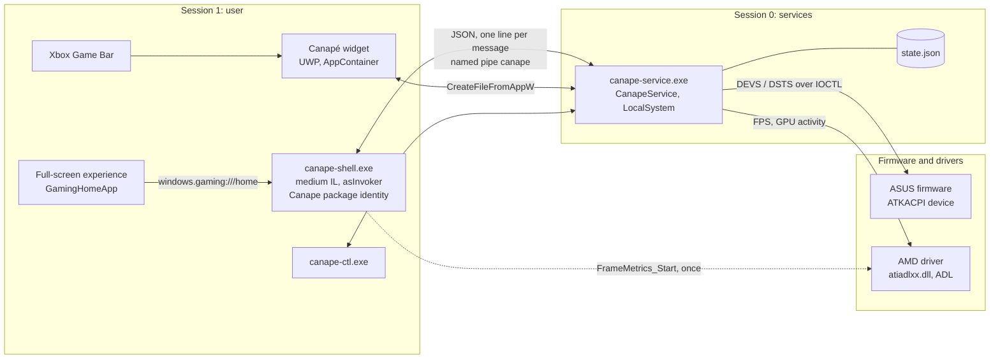
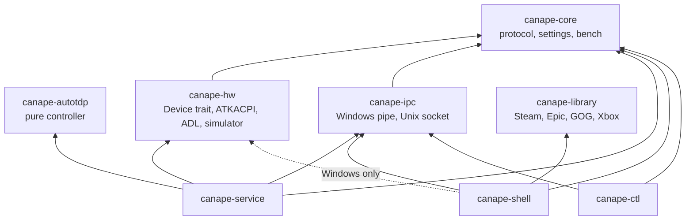
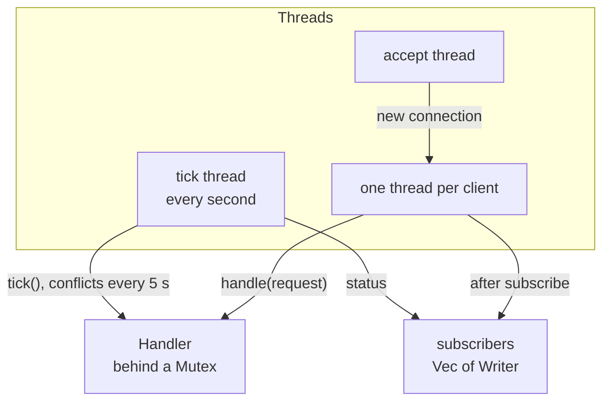
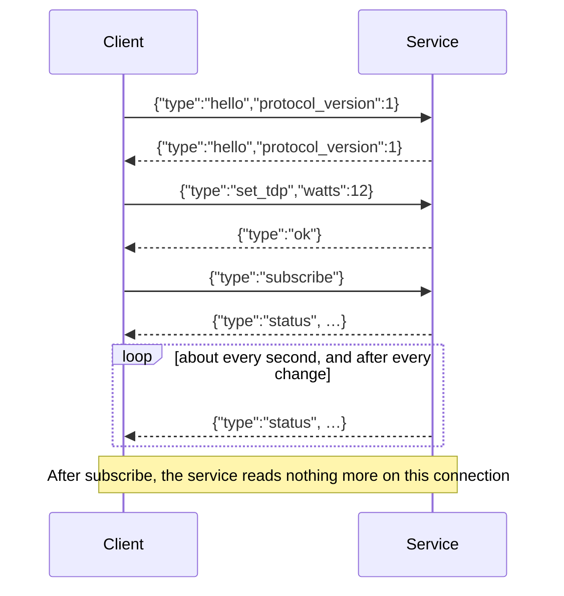
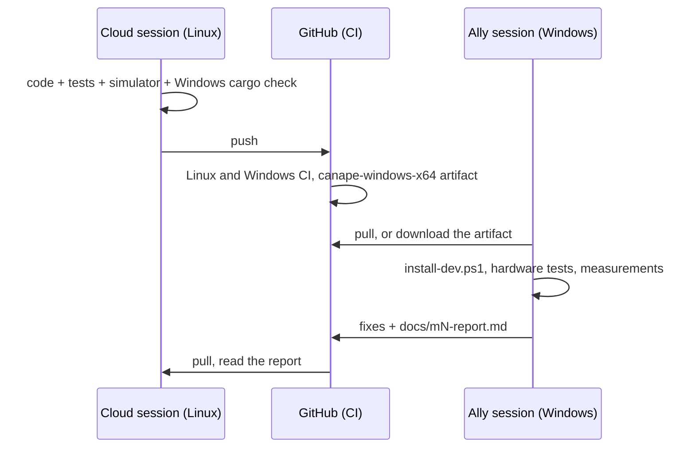

# Developer guide

[🇫🇷 Version française](developer-guide.fr.md) · [📚 Documentation index](README.md)

This guide describes Canapé's architecture, the protocol between its components, how to build and test (on Linux without hardware as well as on the Ally), packaging, the widget, translations and the project's rules.

## Contents

- [Architecture](#architecture)
  - [Processes, sessions and integrity levels](#processes-sessions-and-integrity-levels)
  - [Crates](#crates)
  - [The game library](#the-game-library)
    - [Installing owned games](#installing-owned-games)
  - [The Hardware page](#the-hardware-page)
  - [Inside the service](#inside-the-service)
- [IPC protocol](#ipc-protocol)
  - [Transport](#transport)
  - [Requests](#requests)
  - [Responses](#responses)
  - [The status](#the-status)
  - [Nested types](#nested-types)
  - [Errors](#errors)
  - [Evolving the protocol](#evolving-the-protocol)
- [Building and testing on Linux](#building-and-testing-on-linux)
  - [Service and shell with the simulator](#service-and-shell-with-the-simulator)
  - [Environment variables](#environment-variables)
  - [Screenshots with Xvfb](#screenshots-with-xvfb)
- [Building and testing on Windows](#building-and-testing-on-windows)
- [Continuous integration](#continuous-integration)
- [Packaging](#packaging)
- [The Game Bar widget](#the-game-bar-widget)
- [Translations](#translations)
- [Hardware notes](#hardware-notes)
- [Conventions](#conventions)
- [Two sessions: the Ally and the cloud](#two-sessions-the-ally-and-the-cloud)

## Architecture

Canapé is made of three programs running at the same time, plus a command-line tool. **Only the service has elevated rights** and touches the hardware; the UI and the widget only send requests.



### Processes, sessions and integrity levels

| Process | Session | Integrity / account | Identity | Started by |
|---|---|---|---|---|
| `canape-service.exe` | 0 | LocalSystem | none | Service manager, at boot (automatic start, restart after a crash: 3 times, 2 s delay) |
| `canape-shell.exe` | 1 | **medium IL** (`asInvoker`) | sparse package `Canape`, AUMID `Canape_<hash>!App` | The FSE, with `windows.gaming:///home`; or `shell:AppsFolder\…` |
| Widget | 1 | AppContainer (low IL) | package `Canape.Widget` | Game Bar |
| `canape-ctl.exe` | 1 | the terminal's | none | By hand |

Consequences:

- The FSE only activates the home app at **medium IL**: the shell must stay `asInvoker` and ask for nothing privileged. Everything that touches the hardware goes through the service.
- The service, in **session 0**, has no display and no windows: it cannot know which game is in the foreground (the shell tells it, `foreground_app`), and the AMD driver refuses to start frame counting from there (the shell starts it, see [Hardware notes](#adl-from-session-0)).
- The widget lives in an AppContainer: it opens the pipe with `CreateFileFromAppW`, and the pipe's DACL explicitly allows it.
- The shell is **single-instance** (mutex `Local\Canape.Shell`): a second activation brings the existing window to the front and exits. The FSE sometimes activates the home app several times at boot (see [m1-report.md](m1-report.md)).

### Crates



| Crate | Kind | Role | Key files |
|---|---|---|---|
| `canape-core` | library | Protocol (`Request`, `Response`, `Status`), settings (`AutoTdpSettings`, `PerformanceMode`, `Profile`, `ControllerMode`), fan curves (validation, presets), bench (`BenchPlan`, `BenchReport` and its recommendations), minimal log | `protocol.rs`, `settings.rs`, `fan.rs`, `bench.rs`, `log.rs` |
| `canape-autotdp` | library | Auto TDP controller: a pure state machine fed one `Sample` per second, with no system dependency | `lib.rs` |
| `canape-hw` | library | `Device` trait; Ally backend (Windows) on top of ATKACPI, ADL and the controller's HID interface; `MockDevice` for everything else | `lib.rs`, `atk.rs`, `pad.rs`, `windows.rs`, `adl.rs`, `hid.rs`, `mock.rs` |
| `canape-ipc` | library | A `Connection` that sends and receives JSON lines; named pipe on Windows, Unix socket elsewhere; the pipe's ACL | `lib.rs`, `windows.rs`, `unix.rs`, `acl.rs` |
| `canape-service` | binary | Windows service: state, auto TDP, profiles, bench, conflict detection, IPC server, persistence | `handler.rs`, `server.rs`, `bench_run.rs`, `conflicts.rs`, `winsvc.rs` |
| `canape-library` | library | Installed games: Steam, Epic, GOG and Xbox scanning, merging and sorting, cover decoding, downloaded covers, launching, the cache files. Owned games and installing them (Steam, Epic through Legendary). Pure parsers tested on Linux; the Windows parts (registry, drives, `ShellExecuteW`, WinHTTP) behind `cfg(windows)` | `lib.rs`, `steam.rs`, `vdf.rs`, `epic.rs`, `gog.rs`, `xbox.rs`, `legendary.rs`, `install.rs`, `tools.rs`, `online.rs`, `http.rs`, `cover.rs`, `cache.rs`, `launch.rs`, `win.rs` |
| `canape-shell` | binary | Slint home app (software rendering): 7 pages (Library, Home, Performance, Hardware, Profiles, Bench, Settings), live power and GPU graphs, fan presets and curve, accent colour picker, XInput gamepad, foreground tracking, 13 languages | `main.rs`, `link.rs`, `library.rs`, `grid.rs`, `hardware.rs`, `ui/*.slint` (one file per large page: `library.slint`, `hardware.slint`; the others in `pages.slint`), `i18n.rs`, `report.rs`, `nav.rs`, `foreground.rs`, `history.rs`, `accent.rs` |
| `canape-ctl` | binary | Sends one JSON request, or `watch` to follow the status; `--pretty` indents the JSON | `main.rs` |

The shell depends on `canape-hw` on Windows only for `arm_frame_metrics()` (starting the AMD driver's frame counting from the user session); it never writes to the firmware.

### The game library

`canape-library` finds the installed games (and the owned ones, see [Installing owned games](#installing-owned-games)) and `canape-shell` shows them (`library.rs`, `ui/library.slint`). Nothing goes through the service: scanning, launching and installing need no rights, and a game launched from the shell must run as the user, at medium integrity, never elevated.

| Store | Where | Parser | Launch | Covers |
|---|---|---|---|---|
| Steam | `HKCU\Software\Valve\Steam\SteamPath`, else `C:\Program Files (x86)\Steam`; `steamapps\libraryfolders.vdf` then every `appmanifest_*.acf`; `userdata\*\config\localconfig.vdf` | `vdf.rs`: KeyValues text format, tolerant (comments, `[$WIN32]`, bare tokens, truncated files). Installed = `StateFlags` bit 4. Tools excluded by appid and name (228980, Proton, Steam Linux Runtime, SteamVR) | `steam://rungameid/<appid>` | `userdata\*\config\grid\<appid>p.*`, then `appcache\librarycache\<appid>_library_600x900.jpg` (old layout) or `<appid>\[<hash>\]library_600x900.jpg` (current), then `library_hero.jpg`, `header.jpg` |
| Epic | `%ProgramData%\Epic\EpicGamesLauncher\Data\Manifests\*.item` (JSON) | `epic.rs`: `AppCategories` must contain `games`; DLC (`MainGameAppName` ≠ `AppName`) and `bIsIncompleteInstall` excluded | `com.epicgames.launcher://apps/<ns>%3A<item>%3A<app>?action=launch&silent=true` | downloaded (`online.rs`) |
| Epic through Legendary | `%USERPROFILE%\.config\legendary\installed.json`, only if `%LOCALAPPDATA%\Canape\tools\legendary.exe` exists (`Roots::legendary`) | `legendary.rs`: `parse_installed`, DLC (`is_dlc`) and empty titles excluded | `legendary.exe launch <app>`, working folder `install_path` | downloaded (`online.rs`) |
| GOG | `HKLM\SOFTWARE\WOW6432Node\GOG.com\Games\<id>` | `gog.rs`: `gameName`, `exe`, `launchParam`, `workingDir` / `path`; keys with `dependsOn` (DLC) excluded | the `exe` directly (working folder `workingDir`, else `path`), else `goggalaxy://openGameView/<id>` | downloaded (`online.rs`) |
| Xbox | `<drive>:\.GamingRoot` (else `<drive>:\XboxGames`), then `<game>\Content\MicrosoftGame.config` and `appxmanifest.xml` | `xbox.rs` + `xml.rs` (attributes of the first matching element). Package family name = `Name` + `_` + publisher id, computed (SHA-256 of the UTF-16LE publisher, 8 bytes, Crockford-like base 32), checked against `8wekyb3d8bbwe` and the Ally's `Canape_84zrj1c9kn010` | `shell:AppsFolder\<PFN>!<AppId>` | `Square480x480Logo` (or its `.scale-NNN` variant), `Square150x150Logo`, `StoreLogo` |

- **Merging** (`merge`): the launch times saved by Canapé (`recent.json`) raise `last_played`; one entry per id, then one per title across stores (letters and digits, lower case: `HADES™` = `Hades`), keeping the copy played last, else Steam > GOG > Epic > Xbox; sorted last played first then by title (`Sort::Recent`) or by title (`Sort::Title`).
- **Startup**: `library.json` (the last raw scan) is shown before the window opens, then a background thread scans, rewrites the cache and posts the result to the event loop. Coming back to the page rescans after 60 s.
- **Covers**: decoded on a worker thread (`zune-jpeg`, `png`, pure Rust) straight to the tile's size in physical pixels (box filter), with rounded corners baked in (the software renderer does not clip images to a rounded rectangle). Only the visible rows and one row on each side are requested; covers more than one further row away are dropped. Landscape or square art is shown whole on a blurred, darkened copy of itself. Measured on Linux (release, 50 games, 1280×720 at scale 1, private memory `RssAnon`): 2.7 MB without games, 6.9 MB on the library with its 18 first covers, 10.8 MB after scrolling to the end and back (glibc with `MALLOC_ARENA_MAX=1`; with its defaults it keeps freed decoding buffers, 9.1 / 14 MB). A cover costs width × height × 4 bytes: about 210 KB at 1280×720, 470 KB on the Ally at 150 %. To measure on Windows.
- **Downloaded covers** (`online.rs`, `http.rs`): after each scan, games still without art go through `online::download_missing` (at most 60 per scan, sequential): Steam games first try Steam's store CDN (`library_600x900.jpg`), then, with `steamgriddb_key` set in `shell.json`, SteamGridDB (`/grids/steam/<appid>`, or `/search/autocomplete/<title>` then `/grids/game/<id>`, portrait static JPEG/PNG only). Files land in `%LOCALAPPDATA%\Canape\covers` as `<id with non-alphanumerics as _>.jpg|png`, written to `.part` then renamed; a game with no art gets an empty `.miss` marker retried after 7 days. `online::attach` gives every scan the covers already downloaded. The transport is the `Http` trait: WinHTTP on Windows (system proxy, redirects, 5–15 s timeouts, 8 MB cap), nothing elsewhere; the logic is tested with a fake transport. The key is only sent as a bearer token to `www.steamgriddb.com/api/v2`, never to a CDN (tested).
- **Navigation**: the grid is one `FocusScope` with a selected index; the moves are computed in Rust (`grid.rs`, `Library.grid-move`). While the library has the focus, `gamepad.rs` sends the arrow keys instead of Tab / Shift+Tab (`library::arrow_navigation()`), with the same repeat. Up from the first row reaches the filter bar.
- **Launching**: `canape_library::launch` calls `ShellExecuteW` (COM initialised on the calling thread) on a short-lived thread, records the launch in `recent.json`, shows "Launching…" for 5 s, then re-sorts.

> [!WARNING]
> **Not tried on Windows yet.** Everything above compiles for `x86_64-pc-windows-msvc` and the parsers are tested on Linux against fixtures (`crates/canape-library/tests/fixtures`), but registry reads, Steam / Epic / GOG on a real machine, `ShellExecuteW` from the FSE and the whole Xbox part (written from the documented formats, without an Xbox game to try) are still to be checked on the Ally. Known limit: Xbox app games installed outside an `XboxGames` folder (in `WindowsApps`) are not found.

**Fake library for development**: `python3 tools/fake-library.py <out>` builds one with 14 made-up games across the four stores, generated covers (ImageMagick), play times, and the Epic and GOG covers placed as if downloaded; it prints the two variables to set (`LOCALAPPDATA` and `CANAPE_LIBRARY_FIXTURE`). In a debug build, `CANAPE_LIBRARY_FIXTURE=<dir>` replaces the real stores with `<dir>/steam` (a Steam folder), `<dir>/epic` (manifests), `<dir>/gog.json` (a JSON array of `{"key": …, "values": {"gameName": …, "exe": …}}`, like the registry) and `<dir>/xbox` (an `XboxGames` folder). The script adds 7 owned but not installed games (4 Steam, 3 Epic) in `<dir>/owned.json`, in the cache format, with their covers in `covers-fixture`: that is the To install list. Nothing is launched (the launch only shows), and the cache files become `library-fixture.json`, `recent-fixture.json` and `owned-fixture.json`. Release builds ignore the variable.

#### Installing owned games

The library's **To install** mode lists the Steam and Epic games that are owned but not installed; A installs them without opening Steam's interface or the Epic launcher. The starting analysis is in [`game-install-study.md`](game-install-study.md) (French); GOG and Xbox are not covered yet.

| Module | Role |
|---|---|
| `install.rs` | `Install` (`Steam { appid }` or `Epic { app }`, serialised with a `store` tag); `install::run`, blocking (run it on its own thread), which reports `Event`s: `Progress(0..1)`, `Done`, `Failed(message)`. The Legendary commands: `epic_account` (`status --json --offline`), `epic_owned` (`list --json`), `epic_login` (`auth`). |
| `steam.rs` | `steam_id`: the `MostRecent` account of `config/loginusers.vdf`, else the latest `Timestamp`. `owned_url`: `IPlayerService/GetOwnedGames/v1` with `include_appinfo` and `include_played_free_games`. `parse_owned` (tools excluded as in the scan). `parse_download` / `download`: where an install stands according to its manifest, looked up in every library folder. |
| `legendary.rs` | `config_dir`, `scan` / `parse_installed` (see the table above), `parse_list` (games managed by another store, `ThirdPartyManagedApp` or `ThirdPartyManagedProvider`, are excluded; the `https://` `DieselGameBoxTall` image becomes the cover link, requested at 600×900), `parse_progress`, `parse_account`. |
| `tools.rs` | The Legendary download (see below). |
| `lib.rs` | `Launch::Install { install }` for an owned game that is not installed (`launch` refuses it); `not_installed`: owned minus installed, by id or by normalised title. |
| `online.rs` | `download_missing` takes the art links the stores gave (`art`: id → URL) and tries them before Steam's CDN and SteamGridDB. `Http::get_limited` sets a size limit other than `get`'s 8 MB. |
| `canape-shell/src/library.rs` | `to_install` mode, `refresh_owned` / `fetch_owned`, `install` / `install_event`, `epic_login`. |
| `ui/library.slint`, `ui/pages.slint`, `ui/app.slint` | Installed / To install switch (bar cursor: modes 0–1, filters 2–6, orders 7–8), progress bar on the tile, empty state with the Epic sign-in button, the Settings row, the "A Install" hint. |

- **Owned list** (`refresh_owned`): never at startup; when switching to To install if the last list is more than 10 min old (`OWNED_REFRESH`), and forced after an Epic sign-in. On a thread: Steam if `steam_api_key` is set in `shell.json` (Windows only: local SteamID, `GetOwnedGames` over WinHTTP, `parse_owned`), then Epic if `legendary.exe` is there and an account is signed in. The result is written to `owned.json` (same format as `library.json`) and shown; missing covers are then downloaded with Epic's links, and the list is published again. Errors go to `shell.log` and to the header for 10 s (`show_error`, `ERROR_SHOWN`); after an error `owned.json` is not overwritten. In To install mode, `rebuild` shows `not_installed(owned, all)`, filtered and sorted as usual.
- **Steam** (`run_steam`): `steam.exe -silent steam://install/<appid>` through `ShellExecuteW` (the bare URI if `steam.exe` is missing). `-silent` starts Steam in the notification area if it is not running; if it is, the URI goes to the client. The `appmanifest_<appid>.acf` manifest is then read every 2 s: `StateFlags` at 4, or bit 4 with `BytesDownloaded >= BytesToDownload > 0`, means installed; otherwise the share `BytesDownloaded / BytesToDownload` (0 while Steam prepares). No manifest after 10 min (`STEAM_START`, the user did not confirm): `Steam did not start the download`; a manifest that disappears after showing up: `cancelled in Steam`.
- **Epic** (`run_legendary`): `legendary install <app> -y --skip-sdl` without a console (`CREATE_NO_WINDOW`), stdin closed, stdout ignored. Progress comes from the `= Progress: 12.34%` lines on stderr; on a non-zero exit code, the last other non-empty line becomes the error message.
- **End**: `Event::Done` rescans; the installed game leaves the To install list since it has the same id (`steam:<appid>`, `epic:<app>`). `Event::Failed` writes `<title>: <message>` into `Library.install-error`, cleared when the next install starts.
- **Epic sign-in** (`epic_login`): downloads Legendary if missing, runs `legendary auth` with its console visible (without WebView2, Legendary asks for a code there), waits for it to end, then forces the list. An error off Windows.
- **Lightness**: nothing runs all the time. Legendary only runs for a list request (`status` then `list`, only when the To install list is refreshed), a sign-in or an install.

**Legendary download** (`tools.rs`): `fetch_legendary` asks `api.github.com/repos/derrod/legendary/releases/latest` for the latest release and takes the `legendary.exe` asset. It refuses a link outside `https://github.com/derrod/legendary/releases/download/`, and an asset without a `sha256:` `digest` of 64 hex characters. The file (80 MB at most) is downloaded, its SHA-256 computed (`sha256.rs`) and compared; if it matches, it is written to `.part` then renamed in `%LOCALAPPDATA%\Canape\tools`. A file that does not match is never written (tested with a fake transport). Legendary (GPL-3) stays a separate program that Canapé runs: nothing is bundled in the repository or the install.

**Development**: with `CANAPE_LIBRARY_FIXTURE`, the owned list comes from `<fixture>/owned.json`, the cache becomes `owned-fixture.json`, nothing goes online, and A simulates a one-minute install (120 steps of 0.5 s) then rescans. Since the fake game is not really installed, it stays in the list. The `library-install.png` screenshots show this simulated install.

> [!WARNING]
> **None of this has been tried on Windows.** The code compiles for `x86_64-pc-windows-msvc`; the parsers (`GetOwnedGames`, manifests mid-download, `legendary list` / `status`, its progress, the GitHub release) and the SHA-256 check are tested on Linux against recorded answers, and the UI with the fake library. Still to check on the Ally: the Steam Web API call, `steam.exe -silent steam://install` and its window with the gamepad, the `legendary.exe` download over WinHTTP, `legendary auth` / `install` / `launch` from the shell and the FSE.

### The Hardware page

Page 3 (`ui/hardware.slint`) only sends requests: the service validates and writes, and the page redraws from the next status.

| Control | Callback (`main.rs`) | Request |
|---|---|---|
| Fan tiles | `set-fan-preset(key)` | `""` (Automatic): `reset_fan_curves`; `silent`, `balanced`, `max-cooling`: one `set_fan_curve` per fan, CPU then GPU, with `FanPreset::curve()` (`canape-core/src/fan.rs`) |
| Frame rate limit chips | `set-fps-limit(fps)` | `set_fps_limit`, `0` → `null` (None); chips 30, 40, 45, 60, 90, 120 |
| Keep these settings for this game | `save-hardware-profile()` | `save_profile` for `status.foreground`: the existing profile (or a new one with `status.auto_tdp`) with `fan_curves: Some(status.fan_curves)` (an empty set means "the firmware's curves" for that game), `fps_limit: status.fps_limit` and `refresh_hz` (the screen's current rate) |
| Screen chips | `set-refresh(hz)` | none: the shell switches the screen itself (`screen.rs`, `canape_hw::display::Screen`) and saves `refresh_hz` in `shell.json` |
| Controller tiles | `set-controller(mode)` | `set_controller_mode` |

- `hardware.rs`: `preset_name()` maps `status.fan_curves` to the selected tile: `""` when empty (firmware curves), a preset key when every custom curve equals that preset, `custom` otherwise. `curve_paths()` turns the CPU curve into the line and area `Path` commands of the panel (viewbox 90 × 100: one unit per °C from 20 to 110 °C, one per percent), held flat before the first and after the last point. Both are unit-tested.
- `link.rs` (`status_view`): `cpu_fan_rpm` / `gpu_fan_rpm` (−1 when unknown), the preset name, the CPU curve paths (empty without a custom CPU curve), `fps_limit` (0 for none) and `controller_mode` (`""` when Canapé has not set it, so no tile is selected). `tdp_floor()` / `tdp_ceiling()` read `tdp_min_watts` / `tdp_max_watts` (fallback `MIN_WATTS` 5 and `MAX_WATTS` 35 in `main.rs`) and bound every wattage stepper of the shell.
- The Profiles page and the bench's **Save for the game** keep the `fan_curves`, `fps_limit` and `refresh_hz` of an existing profile.
- **Screen refresh rate** (`screen.rs`): display modes belong to the user's session, so the shell, not the service, switches them. `canape_hw::display::Screen::internal()` picks the active path whose output technology is internal or embedded DisplayPort (`QueryDisplayConfig`, then the source's GDI name), `rates()` lists the rates at the current resolution and depth (`EnumDisplaySettingsExW`), `set_refresh()` calls `ChangeDisplaySettingsExW` with `CDS_UPDATEREGISTRY`. `Profile::refresh_hz` is only stored by the service; at each status push the shell looks up the active profile's rate and `screen::follow` switches on a change of profile only (`Follow::step`, unit-tested): entering a profile remembers the rate it replaces, leaving it goes back to the rate picked on the page (`shell.json` `refresh_hz`, 0 = none) or to that remembered rate. The page re-reads the current rate every 5 pushes. Off Windows, `CANAPE_MOCK_SCREEN=60,120` fakes a screen for screenshots.
- **Ally buttons** (`buttons.rs`, Windows): a thread runs `canape_hw::listen_buttons`, which opens the same HID interface as the controller mode (VID `0x0B05`, PID `0x1ABE`/`0x1B4C`, feature report `0x5A`), sends the wake-up report, then reads input reports: code 166 Command Center, 56 or 147 Armoury, 165 / 0 back paddles down / up, 236 ignored (`pad::parse_input`, unit-tested). Armoury → `instance::bring_to_front()` (a synthetic Alt tap, then `SetForegroundWindow`) or the library page when already in front; Command Center → Win+G (`SendInput`). Unknown codes are logged. After an error the thread retries every 5 s, every 60 s when no interface exists. `shell.json` `ally_buttons: false` turns the actions off.

> [!WARNING]
> Every write behind this page is **untested on the device** (see [Hardware notes](#hardware-notes)). The page and its wiring are tested with `MockDevice` only.

### Inside the service



- `Handler` (`handler.rs`) holds all the state and handles requests, independently of the transport; it is tested with `MockDevice`.
- The **tick** thread calls `Handler::tick()` every second (measurements, bench, auto TDP), looks for conflicting programs every 5 ticks, saves `state.json` if learned watts or a bench changed the state, then pushes the status to subscribers.
- Each **client** has its own thread. A request that changes the state is logged (`SetTdp { watts: 12 } -> Ok`), followed by a save of `state.json` when the response is `ok`, then by a status push to every subscriber.
- `canape-service.exe` arguments:

| Argument | Effect |
|---|---|
| *(none)* | Started by the service manager; launched by hand on Windows, falls back to `--console`. |
| `--console` | Serves the pipe (or socket) in the foreground, on any OS; logs to stderr. |
| `--stdio` | Reads JSON requests on stdin and answers on stdout, without the tick thread (no auto TDP, no status pushes). For quick checks. |
| `install` / `uninstall` | Windows, elevated: registers (and starts) or removes the `CanapeService` service. |

## IPC protocol

The types are defined in [`crates/canape-core/src/protocol.rs`](../crates/canape-core/src/protocol.rs). The C# widget mirrors them by hand in `widget/CanapeWidget/CanapeLink.cs`.

### Transport

| | Windows | Linux, macOS (development) |
|---|---|---|
| Channel | Named pipe `\\.\pipe\canape` | Unix socket: `$CANAPE_SOCKET`, else `$XDG_RUNTIME_DIR/canape.sock`, else `<tmp>/canape.sock` |
| Format | One JSON object per line (UTF-8, ending with `\n`) | same |
| Security | DACL `D:P(A;;GA;;;SY)(A;;GA;;;BA)(A;;GRGW;;;IU)(A;;GRGW;;;<widget SID>)S:(ML;;NW;;;LW)`: full control for SYSTEM and administrators, read / write for the interactive user and **the Canapé widget's AppContainer only**, low integrity label so the widget can write. If the widget SID cannot be derived, `AC` (every AppContainer) stands in. The service logs which one at startup (`pipe: …`). Remote clients rejected, exclusive first instance (no one else can serve this name). See [Pipe ACL](#pipe-acl). | Socket file permissions |

Messages are internally tagged Serde enums: the `type` field names the variant in `snake_case`, the other fields sit next to it. An empty `Option` is written `null`.

**Life of a connection**



- Every client **should** start with `hello`. The service does not enforce it, but rejects any version other than `1`.
- A request gets exactly one response, in order.
- After `subscribe`, the connection only receives. The reason: on Windows, I/O on a synchronous pipe is serialized on the same file object; a pending read would block the tick thread's writes (bug found in M2, see [m2-report.md](m2-report.md)). So clients use **one subscription connection and one or more command connections** (the shell keeps one open, the widget opens one per command).
- A line that is not valid JSON closes the connection (a `client error: …` log line); only `--stdio` mode answers with an `error`.
- The Windows client retries for 2 s when every pipe instance is busy.

### Requests

| Request | Fields | Response | Effect |
|---|---|---|---|
| `hello` | `protocol_version: u32` | `hello` or `error` | Checks the version (currently `1`). |
| `get_status` | — | `status` | Current status. |
| `subscribe` | — | `status`, then a `status` about every second | The connection becomes push-only. |
| `set_performance_mode` | `mode`: `silent` \| `performance` \| `turbo` \| `manual` | `ok` / `error` | Turns auto TDP off. A firmware mode resets `tdp_watts` to `null`. The firmware drops custom fan curves on a mode write: the service writes them again (a curve it cannot write again is forgotten). Rejected during a bench. |
| `set_tdp` | `watts: u32` | `ok` / `error` | Manual TDP (sPPT, SPL, fPPT), `manual` mode, auto TDP off. Rejected outside the model's range and during a bench. |
| `set_auto_tdp` | `settings: AutoTdpSettings` | `ok` / `error` | Turns auto TDP on (or off with `enabled: false`). `min_watts`, `max_watts` and `battery_max_watts` are clamped to the model's range; the status and the profile keep the clamped values. During a profile, changes the profile. Rejected during a bench. |
| `set_battery_charge_limit` | `percent: u8` (40 to 100) | `ok` / `error` | Battery charge limit. |
| `foreground_app` | `exe: string \| null` | `ok` | Foreground program (sent by the shell); applies or leaves the matching profile. |
| `save_profile` | `profile: Profile` | `ok` / `error` | Creates or replaces the profile for `profile.exe` (case-insensitive); re-applies it if active. |
| `delete_profile` | `exe: string` | `ok` | Deletes the profile; hands back to the global state if it was active. |
| `list_profiles` | — | `profiles` | All profiles. |
| `start_bench` | `plan: BenchPlan` | `ok` / `error` | Starts a bench (needs at least 5 FPS). The plan is clamped to the model's range; step and durations at least 1. |
| `cancel_bench` | — | `ok` / `error` | Stops the bench, keeping a partial report. |
| `get_bench_report` | — | `bench` | The last finished or cancelled report (during a bench, the previous one). |
| `set_accent` | `color: string` (`#rrggbb`) | `ok` / `error` | UI accent colour shared by the shell and the widget. Validated (`#` and six hex digits, else an error), stored in lower case, saved in `state.json` and pushed in `status.accent`. |
| `set_fan_curve` | `fan`: `cpu` \| `gpu` \| `mid`, `curve: FanCurve` | `ok` / `error` | Custom curve for one fan, [validated](#fan-curves) (safety floor included). Kept across mode changes, saved in `state.json`. During a profile that has its own curves, changes the profile; otherwise the global curves. |
| `get_fan_curves` | — | `fan_curves` | The custom curves and the firmware's own curves for the current mode (starting point for an editor). |
| `set_fps_limit` | `fps: u32 \| null` (30 to 120) | `ok` / `error` | AMD driver frame rate cap (AC and battery, every game); `null` removes it. Saved; during a profile that has its own cap, changes the profile. **Untested from the service's session 0.** |
| `set_controller_mode` | `mode`: `gamepad` \| `wasd` \| `mouse` | `ok` / `error` | Mode of the built-in controller (HID). Saved and re-applied at startup. Global, not per profile. **Untested on the device.** |

Examples:

```json
{"type":"set_performance_mode","mode":"turbo"}
{"type":"set_auto_tdp","settings":{"enabled":true,"target_fps":60,"min_watts":7,"max_watts":25,"battery_max_watts":15,"max_temp_c":85}}
{"type":"set_battery_charge_limit","percent":80}
{"type":"foreground_app","exe":"eldenring.exe"}
{"type":"foreground_app","exe":null}
{"type":"save_profile","profile":{"exe":"eldenring.exe","auto_tdp":{"enabled":true,"target_fps":60,"min_watts":7,"max_watts":19,"battery_max_watts":null,"max_temp_c":null},"learned_watts":16}}
{"type":"delete_profile","exe":"eldenring.exe"}
{"type":"start_bench","plan":{"from_watts":25,"to_watts":7,"step_watts":3,"settle_secs":5,"measure_secs":15}}
{"type":"set_accent","color":"#14b8a6"}
{"type":"set_fan_curve","fan":"cpu","curve":[[40,10],[50,18],[58,26],[65,34],[72,42],[78,50],[85,62],[92,75]]}
{"type":"reset_fan_curves"}
{"type":"get_fan_curves"}
{"type":"set_fps_limit","fps":40}
{"type":"set_fps_limit","fps":null}
{"type":"set_controller_mode","mode":"mouse"}
```

### Responses

| Response | Fields | Example |
|---|---|---|
| `hello` | `protocol_version` | `{"type":"hello","protocol_version":1}` |
| `status` | the [status](#the-status) fields, flattened | `{"type":"status","tdp_watts":16,…}` |
| `ok` | — | `{"type":"ok"}` |
| `error` | `message` (English, not translated) | `{"type":"error","message":"a bench is running: cancel it first"}` |
| `profiles` | `profiles: [Profile]` | `{"type":"profiles","profiles":[…]}` |
| `bench` | `report: BenchReport \| null` | `{"type":"bench","report":null}` |
| `fan_curves` | `custom: FanCurves`, `defaults: FanCurves` | `{"type":"fan_curves","custom":{"cpu":null,"gpu":null,"mid":null},"defaults":{"cpu":[[58,8],[61,17],…],"gpu":[…],"mid":null}}` |

### The status

```json
{
  "type": "status",
  "tdp_watts": 16,
  "performance_mode": "manual",
  "auto_tdp": {"enabled": true, "target_fps": 60, "min_watts": 7, "max_watts": 25, "battery_max_watts": 15, "max_temp_c": 85},
  "fps": 61.2,
  "gpu_util": 0.93,
  "power_watts": 14.6,
  "cpu_temp_c": 78.0,
  "battery_percent": 64,
  "conflicts": [],
  "foreground": "eldenring.exe",
  "active_profile": "eldenring.exe",
  "on_battery": true,
  "thermal_limited": false,
  "bench": null,
  "accent": "#ff3d5e",
  "tdp_min_watts": 5,
  "tdp_max_watts": 30,
  "cpu_fan_rpm": 3400,
  "gpu_fan_rpm": 3100,
  "fan_curves": {"cpu": [[40,10],[50,18],[58,26],[65,34],[72,42],[78,50],[85,62],[92,75]], "gpu": null, "mid": null},
  "fps_limit": 40,
  "controller_mode": "gamepad"
}
```

| Field | Type | Meaning |
|---|---|---|
| `tdp_watts` | `u32 \| null` | Limit applied by Canapé. `null` in a firmware mode (the firmware does not report it) or before anything was set. |
| `performance_mode` | `string \| null` | `silent`, `performance`, `turbo`, `manual`, or `null` if nothing was applied yet. |
| `auto_tdp` | `AutoTdpSettings` | Settings in effect: global, or the active profile's. Wattages clamped to the model's range when applied. |
| `fps` | `f32 \| null` | Frame rate of the last tick (AMD driver). |
| `gpu_util` | `f32 \| null` | GPU activity between 0 and 1. |
| `power_watts` | `f32 \| null` | What the APU actually draws, in watts (`tdp_watts` is only its limit). Drawn against the limit in the shell's and the widget's graphs. Optional on input. |
| `cpu_temp_c` | `f32 \| null` | CPU temperature in °C. |
| `battery_percent` | `u8 \| null` | Battery charge. |
| `foreground` | `string \| null` | Foreground program reported by the shell. |
| `active_profile` | `string \| null` | `exe` of the profile applied. |
| `on_battery` | `bool \| null` | `true` on battery, `false` on AC. |
| `thermal_limited` | `bool` | Auto TDP is holding power down because of the temperature limit. |
| `bench` | `BenchProgress \| null` | Progress of the running bench. |
| `accent` | `string \| null` | UI accent colour `#rrggbb`, once a client set one (`set_accent`). The shell adopts it when it changes elsewhere, and gives its own to a service that has none; the widget follows it. Optional on input. |
| `tdp_min_watts`, `tdp_max_watts` | `u32 \| null` | The model's sustained power range (5–30 W on RC71L / RC72LA, 5–35 W on RC73; 7–30 W in the simulator): the bounds of a TDP stepper. `null` from an older service. |
| `cpu_fan_rpm`, `gpu_fan_rpm` | `u32 \| null` | Fan speeds, in steps of 100 RPM; `null` when the firmware gives no valid reading. |
| `fan_curves` | `FanCurves` | Custom curves in effect (global or the active profile's); a `null` fan follows the mode's curve. |
| `fps_limit` | `u32 \| null` | Frame rate cap set through Canapé (`null`: none set by Canapé; the AMD software may still have one). |
| `controller_mode` | `string \| null` | `gamepad`, `wasd`, `mouse`, or `null` if Canapé has not set it. |

### Nested types

**`AutoTdpSettings`**

| Field | Type | Default | |
|---|---|---|---|
| `enabled` | `bool` | `false` | |
| `target_fps` | `u32` | `60` | 0 rejected |
| `min_watts` | `u32` | `7` | |
| `max_watts` | `u32` | `25` | |
| `battery_max_watts` | `u32 \| null` | `null` | optional on input |
| `max_temp_c` | `u32 \| null` | `null` | optional on input |

**`Profile`**: `exe` (string, compared case-insensitively), `auto_tdp` (`AutoTdpSettings`), `learned_watts` (`u32 | null`, optional), `fan_curves` (`FanCurves | null`, optional: `null` keeps the global curves), `fps_limit` (`u32 | null`, optional: `null` keeps the global cap; a profile cannot force "no cap" while a global one is set).

```json
{"exe":"eldenring.exe","auto_tdp":{"enabled":true,"target_fps":40,"min_watts":7,"max_watts":20},"learned_watts":14,"fan_curves":{"cpu":[[30,35],[40,45],[50,55],[60,65],[70,80],[75,90],[80,100],[85,100]]},"fps_limit":40}
```

**`FanCurve`**: eight `[temperature °C, duty %]` pairs, CPU or GPU fan alike. The rules (`FanCurve::validate` in `canape-core/src/fan.rs`, also checked by the Ally backend before writing):

- duties 0–100 %, never decreasing;
- **safety floor**: the duty of the last point at or below 80 °C must be at least 25 %, at 90 °C at least 30 %, at 100 °C at least 40 %; no point at or below one of these temperatures counts as 0 %. That lower bound holds whether the firmware interpolates or steps between points. The values sit just under ASUS's own Silent curves (28 / 34 / 41 % on the CPU fan): a curve may be as quiet as the factory Silent mode, never quieter when hot. So 0 % at 90 °C is impossible.

**`FanCurves`**: `{"cpu": FanCurve | null, "gpu": FanCurve | null, "mid": FanCurve | null}`, every field optional. `mid` only exists on some laptops: the Ally rejects it.

**Presets** (`FanPreset` in `canape-core`, data for UIs, valid by construction):

| Preset | Points |
|---|---|
| `silent` | `[[30,0],[45,0],[55,10],[62,15],[68,20],[75,26],[85,34],[95,45]]` |
| `balanced` | `[[40,10],[50,18],[58,26],[65,34],[72,42],[78,50],[85,62],[92,75]]` |
| `max_cooling` | `[[30,35],[40,45],[50,55],[60,65],[70,80],[75,90],[80,100],[85,100]]` |

**`ControllerMode`**: `gamepad` (XInput), `wasd` (keyboard), `mouse` (desktop).

**`BenchPlan`**: `from_watts` (25), `to_watts` (7), `step_watts` (3), `settle_secs` (5), `measure_secs` (15).

**`BenchProgress`**: `step` (from 1), `steps`, `watts`, `seconds_left`. Example: `{"step":2,"steps":7,"watts":22,"seconds_left":110}`.

**`BenchReport`**

```json
{
  "exe": "eldenring.exe",
  "started_unix": 1792615847,
  "plan": {"from_watts": 25, "to_watts": 7, "step_watts": 3, "settle_secs": 5, "measure_secs": 15},
  "points": [
    {"watts": 7, "fps_avg": 31.0, "fps_low": 25.0, "gpu_avg": 0.98, "temp_max": 67.0, "samples": 15},
    {"watts": 10, "fps_avg": 44.0, "fps_low": 38.0, "gpu_avg": 0.97, "temp_max": 70.0, "samples": 15}
  ],
  "completed": true
}
```

`points` is sorted by ascending power. The recommendations (`sweet_spot`, `watts_for`, `most_efficient`) are `BenchReport` methods, computed on the client side; see [Auto TDP and bench](auto-tdp.en.md#the-three-recommendations).

### Errors

| Message | Cause |
|---|---|
| `unsupported protocol version N, expected 1` | `hello` with another version |
| `a bench is running: cancel it first` | `set_performance_mode`, `set_tdp`, `set_auto_tdp` or `start_bench` during a bench |
| `invalid auto TDP settings` | Minimum above maximum after clamping to the model, or a target of 0 |
| `a profile needs an executable name` | `save_profile` with an empty `exe` |
| `no bench is running` | `cancel_bench` with no bench |
| `no frame rate: start a game before the bench` | `start_bench` below 5 FPS |
| `not a #RRGGBB colour: …` | `set_accent` with anything other than `#` and six hex digits |
| `fan curve: …` | `set_fan_curve` breaking a [rule](#nested-types) (order, range, decreasing duty, safety floor) |
| `frame rate limit not in 30..=120 FPS` | `set_fps_limit` out of range |
| `not supported on this device: …` | No mid fan, no AMD driver, no controller HID interface, or the simulator lacks the feature |
| `GPU driver refused: ADL2_FPS_Settings_Set(…) on adapter … returned …` | The AMD driver refused the cap (code in the message) |
| `fan curves reset, but the TDP was not applied again: …` | `reset_fan_curves` in manual mode, TDP write failed |
| `value out of range: …` | Watts outside the model's range, charge limit outside 40 to 100 %, invalid curve reaching the backend |
| `firmware refused: DEVS 0x… = … returned …` | The firmware did not return 1 (for a fan curve, the mode is then written again to get the defaults back) |
| `device I/O failed: …` | `DeviceIoControl` failed |

### Evolving the protocol

- A new field in `Status`, `AutoTdpSettings` or `Profile` gets `#[serde(default)]`: older clients ignore it, and an older `state.json` stays readable. `Profile` derives `Default`: Rust clients build it with `..Profile::default()` so that a new field does not break them.
- A new request is a new `Request` variant; remember to add it to the read-only request list in `server.rs` if it changes nothing (otherwise it is logged and triggers a save).
- An incompatible change bumps `PROTOCOL_VERSION`, on the Rust side **and** in `CanapeLink.cs`.
- The widget only rewrites the fields it knows: `set_auto_tdp` sends back the whole `auto_tdp` object it received, changing only `enabled` and `target_fps`.

## Building and testing on Linux

The cloud session has no hardware: everything is tested with the simulator (`MockDevice`).

**Dependencies** (Debian / Ubuntu, as in CI):

```sh
sudo apt-get install -y libxkbcommon-dev libfontconfig1-dev
```

To show the shell you need an X server (the Slint backend is winit + X11, software rendering). The shell enables the Slint feature `software-renderer-path` next to `renderer-software`: without it the software renderer does not draw `Path` elements, so the graphs stay empty.

**Checks before pushing** (project rule):

```sh
cargo fmt --all --check
cargo clippy --all-targets -- -D warnings
cargo test
rustup target add x86_64-pc-windows-msvc   # once
cargo check --target x86_64-pc-windows-msvc --all-targets
```

`cargo test` runs over 90 tests to date: the auto TDP controller (including a simulation of the M4 oscillation case), the service handler (profiles, bench, persistence), the bench, ATKACPI buffers, fan curve rules and presets, controller reports, the pipe SDDL and publisher hash, IPC, gamepad navigation, foreground tracking, languages and catalog completeness. The Windows `cargo check` catches the `#[cfg(windows)]` code that Linux does not compile, without being able to run it.

### Service and shell with the simulator

```sh
# Terminal 1: the service, with a "game" simulated at 60 FPS
CANAPE_MOCK_FPS=60 cargo run -p canape-service -- --console

# Terminal 2: follow the status, send commands
cargo run -p canape-ctl -- watch
cargo run -p canape-ctl -- '{"type":"set_auto_tdp","settings":{"enabled":true,"target_fps":60,"min_watts":7,"max_watts":25}}'
cargo run -p canape-ctl -- --pretty '{"type":"get_fan_curves"}'

# Terminal 3: the shell in a window
CANAPE_WINDOWED=1 cargo run -p canape-shell
```

The simulator: 7 to 30 W range, 70 % GPU activity, 55 °C, battery at 80 % on AC, charge limit 40 to 100 %. Fans: CPU and GPU (no mid), per-mode curves taken from the presets (silent → `silent`, turbo → `max_cooling`, otherwise `balanced`), a mode write drops the custom curves as on the Ally, speed = duty × 6000 RPM. An FPS cap caps the simulated frame rate. The frame rate stays at `CANAPE_MOCK_FPS` whatever the power: auto TDP therefore goes down to the minimum (a 60 target with 60 FPS and 70 % GPU triggers the idle GPU rule).

With a keyboard, the shell works like with the gamepad: Tab / Shift+Tab, Enter or Space, Esc, Page Up / Page Down.

On Linux, the shell does not track the foreground. To simulate a game, send it to the service:

```sh
cargo run -p canape-ctl -- '{"type":"foreground_app","exe":"eldenring.exe"}'
cargo run -p canape-ctl -- '{"type":"start_bench","plan":{"from_watts":25,"to_watts":7,"step_watts":3,"settle_secs":1,"measure_secs":2}}'
```

Off Windows, logs and state go to `<tmp>/Canape/` (`service.log`, `state.json`, `shell.log`, `shell.json`, with `<tmp>` = `$TMPDIR` or `/tmp`). Delete `state.json` to start from a clean state.

### Environment variables

| Variable | Read by | Effect |
|---|---|---|
| `CANAPE_MOCK_FPS` | service (simulator) | Simulated frame rate, for example `60`. Without it, `fps` is `null` and auto TDP does not move. Also applies on Windows when the simulator is in use. |
| `CANAPE_SOCKET` | service, shell, `canape-ctl` (off Windows) | Unix socket path. |
| `CANAPE_WINDOWED` | shell | Present (any value): a window instead of full screen. |
| `CANAPE_PAGE` | shell | Page shown at startup: 0 Library, 1 Home, 2 Performance, 3 Hardware, 4 Profiles, 5 Bench, 6 Settings. |
| `CANAPE_LIBRARY_FIXTURE` | shell (debug builds) | A fake library instead of the installed stores: see [The game library](#the-game-library). |
| `LC_ALL`, `LC_MESSAGES`, `LANGUAGE`, `LANG` | shell (off Windows) | Language in Automatic mode, in this order of priority. |
| `TMPDIR` | all (off Windows) | Temporary folder, hence where `Canape/` lives. |

### Screenshots with Xvfb

The screenshots in `docs/images/` are made this way (verified recipe):

```sh
export TMPDIR=$(mktemp -d) CANAPE_SOCKET=/tmp/doc.sock   # clean state.json and shell.json
Xvfb :99 -screen 0 1280x720x24 &
CANAPE_MOCK_FPS=60 ./target/debug/canape-service --console &
./target/debug/canape-ctl '{"type":"foreground_app","exe":"eldenring.exe"}'   # plus profiles, accent, a short bench…
DISPLAY=:99 CANAPE_WINDOWED=1 CANAPE_PAGE=2 LANG=fr_FR.UTF-8 ./target/debug/canape-shell &
for w in 15 18 22 17 12 9 13 19 …; do ./target/debug/canape-ctl "{\"type\":\"set_tdp\",\"watts\":$w}"; sleep 2.5; done
DISPLAY=:99 import -window root docs/images/fr/performance.png   # ImageMagick
```

- 1280×720 matches the Ally's 1080p screen at 150 %.
- `LANG=<locale>` (or `LANGUAGE=<code>`) picks the language (Automatic mode follows it); otherwise save a choice in `<tmp>/Canape/shell.json` (`{"language":"ja"}`).
- Set up the state with `canape-ctl` (profiles, foreground, accent, bench) before starting the shell. A short bench (`settle_secs` 1, `measure_secs` 2) fills the results page in about 20 s.
- The graphs keep the last minute **in the shell**: leave it running at least 60 s while the TDP changes (the simulator draws 90 % of the limit, with a steady 70 % GPU), otherwise the curves are flat or short.
- The shell is single-instance on Windows only: on Linux, run one Xvfb display per shell to take several pages at once.
- Files: `docs/images/<language>/<page>.png` (`home`, `performance`, `hardware`, `profiles`, `bench-results`, `bench-running`, `settings`, `library` and `library-install` with `tools/fake-library.py`), `docs/images/accent-<colour>.png` for the accent variants. Optimise with `pngquant` then `optipng`.
- A `shell.json` or `state.json` left in `<tmp>/Canape/` changes what shows: use a dedicated `TMPDIR` for reproducible screenshots.

## Building and testing on Windows

**Requirements**: Rust (MSVC toolchain), Visual Studio Build Tools 2022 with the C++ tools and the Windows SDK, Developer Mode.

```powershell
cargo build --release -p canape-shell -p canape-service -p canape-ctl
```

> [!WARNING]
> **Smart App Control** blocks the unsigned build scripts of a fresh build (`os error 4551`). Ways out: retry, build in debug, use the CI binaries, or turn Smart App Control off (hard to turn back on). See [m1-report.md](m1-report.md) and [m2-report.md](m2-report.md).

**Install** on the machine: `packaging\install-dev.ps1` (see the [user guide](user-guide.en.md#installing-canapé)).

**Run the service by hand** to see its log:

```powershell
Stop-Service CanapeService       # only one server can own the pipe
& .\target\release\canape-service.exe --console
```

> [!IMPORTANT]
> Run **without elevation**, or on a PC that is not a recognized Ally, the service cannot open `\\.\ATKACPI` and **silently falls back to the simulator** (`device = mock` in the log). Always check for the `device = ROG Ally` line.

**Windows PowerShell 5.1 pitfalls**:

- the quotes of a JSON argument passed to an `.exe` must be escaped (`'{\"type\":\"get_status\"}'`);
- `if (…) { @("--release") }` returns a string, which splatting passes character by character (fixed in `install-dev.ps1`);
- `Stop-Process` returns before the executable is unlocked: wait with `Wait-Process`.

To test the shell **with the package identity** (as the FSE runs it), go through `install-dev.ps1` then `explorer.exe shell:AppsFolder\Canape_<hash>!App`.

## Continuous integration

[`.github/workflows/ci.yml`](../.github/workflows/ci.yml) runs on every push, pull request or manual dispatch:

| Job | Steps |
|---|---|
| `windows` (windows-latest) | `cargo fmt --all --check`, `cargo clippy --all-targets -- -D warnings`, `cargo test`, `cargo build --release` of the three binaries, **`canape-windows-x64`** artifact (`canape-shell.exe`, `canape-service.exe`, `canape-ctl.exe`) |
| `linux` (ubuntu-latest) | X11 / fontconfig dependencies, `cargo clippy --all-targets -- -D warnings`, `cargo test` |

The artifact installs on the Ally with `install-dev.ps1 -BinariesDir`: that is the way around Smart App Control. The widget is not built by CI.

Release profile (`Cargo.toml`): `opt-level = "s"`, LTO, `codegen-units = 1`, `panic = "abort"`, stripped symbols.

## Packaging


| File | Role |
|---|---|
| [`packaging/identity/AppxManifest.xml`](../packaging/identity/AppxManifest.xml) | Identity `Canape`, publisher `CN=Canape Dev`, Windows 10.0.26100 minimum. `uap10:AllowExternalContent`. Application `App` → `canape-shell.exe`, `uap10:TrustLevel="mediumIL"`, `uap10:RuntimeBehavior="win32App"`. Extension `uap3:AppExtension Name="windows.gamingApp"`. Capabilities `runFullTrust`, `unvirtualizedResources` and `Microsoft.appCategory.gamingHome_8wekyb3d8bbwe`. |
| [`packaging/identity/CustomCapability.SCCD`](../packaging/identity/CustomCapability.SCCD) | Unlocks the `gamingHome` capability. `AllowAny="true"`, catalog `FFFF` (test): **Developer Mode required**. Also copied to the install root. |
| [`crates/canape-shell/canape-shell.exe.manifest`](../crates/canape-shell/canape-shell.exe.manifest) | Embedded in the exe by `build.rs` (MSVC): `msix` element tying the exe to the package (`publisher`, `packageName`, `applicationId` identical to the package manifest), `asInvoker`, PerMonitorV2 DPI. |
| [`packaging/install-dev.ps1`](../packaging/install-dev.ps1) | Builds, installs the service, creates the certificate, `makeappx pack`, `signtool sign`, `Add-AppxPackage -ExternalLocation`, and optionally `GamingHomeApp`. |

**Development certificate**: self-signed, subject `CN=Canape Dev`, code signing usage (`1.3.6.1.5.5.7.3.3`), created in `CurrentUser\My`, exported as `.pfx` (password `canape-dev`) and `.cer` to `$HOME\dev\canape-cert`, the `.cer` imported into `LocalMachine\TrustedPeople`. It signs the identity package and the widget. The publisher of the certificate, the package manifest and the exe manifest must stay identical.

**Picking the home app**: by the user in Settings → Gaming → Full screen experience, or by writing the undocumented value `HKCU\Software\Microsoft\Windows\CurrentVersion\GamingConfiguration\GamingHomeApp = <PFN>!App`. At boot, if `StartupToGamingHome = 1`, Windows activates that AUMID with the `windows.gaming:///home` argument (`args=[]` outside the FSE).

> [!NOTE]
> Distribution outside Developer Mode would need an SCCD signed by Microsoft. That is out of scope while Canapé stays a personal project.

## The Game Bar widget

| Topic | Choice |
|---|---|
| Technology | **C# UWP compiled with .NET Native**: Game Bar only accepts UWP XAML apps (not WinUI 3). Project derived from the official `WidgetSampleCS` sample (MIT). |
| SDK | `Microsoft.Gaming.XboxGameBar` **7.2.240903001** (7.3.x breaks the build). The manifest's `proxyStub` block matches this version. |
| Target | `TargetPlatformVersion` 10.0.26100.0 (the SDK installed on the Ally), `TargetPlatformMinVersion` 10.0.19041.0. `mp:PhoneIdentity` is required by the UWP packaging targets. |
| Pipe | `CreateFileFromAppW` (allowed from an AppContainer since Windows 10 2004). One subscription connection, then one short connection per command, reconnecting every 2 s. |
| Package | `Canape.Widget`, `microsoft.gameBarUIExtension` extension, signed with the development certificate. |
| Files | `widget/CanapeWidget/`: `CanapeLink.cs` (pipe client), `WidgetPage.xaml(.cs)` (UI), `Strings/<language>/Resources.resw`, `Package.appxmanifest`. |

**Build**: workload `Microsoft.VisualStudio.Workload.UniversalBuildTools`, then `packaging\build-widget.ps1` (see the [user guide](user-guide.en.md#the-xbox-game-bar-widget)). The script runs MSBuild (Release x64, sideload, signed), then `Add-AppxPackage` passing **only the frameworks that are missing or older**: reinstalling VCLibs or .NET Native while Game Bar uses them fails with `0x80073D02` ([m3-report.md](m3-report.md)).

The widget only builds on Windows with the UWP tools: neither CI nor the cloud session checks it.

## Translations

### Shell (Slint + gettext)

- Every visible string goes through `@tr("…")` in `crates/canape-shell/ui/*.slint`. Numbers stay numbers until display: the formats (`"{} W"`, `"{} %"`, `"{} °C"`, the decimal separator) are translated themselves.
- Catalogs: `crates/canape-shell/lang/<code>/LC_MESSAGES/canape-shell.po`, bundled into the exe by `build.rs` (`with_bundled_translations("lang")`, no default context: a string is translated once). The only exception: `msgctxt "decimal separator"` for `"."`.
- English is the source language: no catalog.
- `shell.json` (`%LOCALAPPDATA%\Canape\`, `<tmp>/Canape/` off Windows) holds `language` and `accent`. `accent` is now a hex colour `#rrggbb`; the codes of earlier versions (`red`, `blue`, `violet`, `green`, `orange`, `cyan`) are converted on load, anything else falls back to `#ff3d5e`. A pick is saved and sent with `set_accent` after 600 ms without change.
- `i18n.rs` picks the catalog: the choice saved in `shell.json` if bundled, otherwise the first preferred language of Windows (`GetUserPreferredUILanguages`) or of the POSIX environment that is bundled, otherwise English. Matching is by base code (`pt-BR` → `pt`, `zh-*` → `zh_CN`).

**Adding a language to the shell**

1. Add the code (folder name) to `LANGUAGES` in [`i18n.rs`](../crates/canape-shell/src/i18n.rs). If the code does not match the base code of Windows' language tags, adapt `match_locale` (as for `zh_CN`).
2. Copy `lang/fr/LC_MESSAGES/canape-shell.po` to `lang/<code>/LC_MESSAGES/canape-shell.po`, update the header (`Language`, `Plural-Forms`) and translate every `msgstr`. **One line per field**: the test does not read multi-line strings. Keep the same number of `{}`.
3. Add a tile to the `rows` grid of `SettingsPage` ([`pages.slint`](../crates/canape-shell/ui/pages.slint)), with the language's name in that language (two cells are still empty).
4. `cargo test -p canape-shell`: the `every_language_translates_every_string` test checks that every catalog contains every `@tr` of the sources, with no empty translation, the same `{}`, and no stale entry.
5. Take screenshots of every page with Xvfb and `LANGUAGE=<code>`: texts that are too long get cut (`…`).

Adding a string to the UI means adding its entry to all 12 catalogs, otherwise the same test fails.

### Widget (.resw)

- Every string lives in `widget/CanapeWidget/Strings/<tag>/Resources.resw`: `x:Uid` in the XAML (keys `Name.Property`), `ResourceLoader` in the code (keys without a dot), `ms-resource:` in the manifest. The formats (`FormatWatts`, `FormatPercent`, `FormatCelsius`) are resources.
- Default language `en-US`; Windows picks according to the preferred languages.

**Adding a language to the widget**: copy `Strings/en-US/Resources.resw` to `Strings/<BCP-47 tag>/`, translate every `<value>` keeping the keys and the `{0}`, add `<PRIResource Include="Strings\<tag>\Resources.resw" />` to `CanapeWidget.csproj`, rebuild. Details in [`widget/README.md`](../widget/README.md).

There is no automated test for the widget. To check that every language has the same keys as English:

```sh
cd widget/CanapeWidget/Strings
for f in */Resources.resw; do
  diff <(grep -o 'data name="[^"]*"' en-US/Resources.resw | sort) \
       <(grep -o 'data name="[^"]*"' "$f" | sort) > /dev/null || echo "$f differs"
done
```

## Hardware notes

> [!IMPORTANT]

### ATKACPI

The ASUS firmware is reached through `\\.\ATKACPI` (opened read / write, shared), IOCTL `0x0022240C`. Input buffer: `[method u32][argument length u32][arguments u32…]`, little-endian; 16-byte output.

| Method | Value | Use |
|---|---|---|
| `DSTS` | `0x53545344` | Read. Result = value + presence bit `0x00010000`; 0 when the ID does not exist. |
| `DEVS` | `0x53564544` | Write. The firmware returns 1 on success. |

| ID | Name | Use in Canapé |
|---|---|---|
| `0x001200A0` | sPPT (PL2, slow boost) | TDP, written first |
| `0x001200A3` | SPL (PL1, sustained) | TDP, written second |
| `0x001200C1` | fPPT (fast boost) | TDP, written last, only if `DSTS` reports it present |
| `0x00120057` | Charge limit | 40 to 100 % |
| `0x00120094` | CPU temperature | Read, values from 1 to 124 °C |
| `0x00110013` / `0x00110014` | CPU / GPU fan speed | Read, see [Fan curves](#fan-curves) |
| `0x00110031` | Mid fan speed | Read; also its presence test |
| `0x00110024` / `0x00110025` / `0x00110032` | CPU / GPU / mid fan curve | 16-byte write and read, see [Fan curves](#fan-curves) |


### Models

The model is read from `HKLM\HARDWARE\DESCRIPTION\System\BIOS\SystemProductName`:

| Contains | Model | TDP range |
|---|---|---|
| `RC71` | ROG Ally (Z1 / Z1 Extreme) | 5 to 30 W |
| `RC72` | ROG Ally X | 5 to 30 W |
| `RC73YA` | ROG Xbox Ally (Z2 A) | 5 to 35 W |
| `RC73XA` | ROG Xbox Ally X (Z2 Extreme) | 5 to 35 W |


### ADL from session 0

`atiadlxx.dll` (shipped with the AMD driver) is loaded at runtime: no driver means no telemetry, but no error either.

| Call | Service (session 0) | User session |
|---|---|---|
| `ADL2_Main_Control_Create`, adapter list | OK, but no adapter is `present` (no display) | OK |
| `ADL2_Adapter_FrameMetrics_Start(adapter, 0)` | **−1** | 0 |
| `ADL2_Adapter_FrameMetrics_Get` | FPS only **after** a successful `Start` from the user session | OK |
| `ADL2_New_QueryPMLogData_Get`, sensor 19 (GFX activity) | OK | OK |

Hence the fix: at startup the shell calls `canape_hw::arm_frame_metrics()` (a single `FrameMetrics_Start`, an `adl: …` line in `shell.log`); counting is global to the driver, and the service then reads the frame rate. The adapter chosen is the existing integrated AMD iGPU, preferring a `present` one. Detailed diagnosis: [m4-report.md](m4-report.md).

> [!WARNING]

### Fan curves


| Topic | Fact |
|---|---|
| Mid fan | Only if `DSTS 0x00110031` answers (`IsMidFanSupported`). |


> [!CAUTION]
> Writing a curve takes the fans away from ASUS's control. The safety floor prevents a silent curve when hot, and the APU still throttles itself at its temperature limit, but a too-quiet curve makes the device hot to hold. On a firmware error the service writes the mode again so the factory curves come back.

### FPS cap (ADL)


### Controller (HID)

| Topic | Fact |
|---|---|
| Init | `0x5A` + `ASUS Tech.Inc.` in ASCII, once before the first command (`InitInput`). |
| Mode | `[0x5A, 0xD1, 0x01, 0x01, mode]`, `1` gamepad, `2` WASD, `3` mouse, then `HidD_SetFeature`. |


### Pipe ACL

The widget's AppContainer SID is derived by Windows (`DeriveAppContainerSidFromAppContainerName`) from its package family name, which Canapé computes from `widget/CanapeWidget/Package.appxmanifest`: `Canape.Widget` + `_` + the publisher hash of `CN=Canape Dev` (SHA-256 of the UTF-16LE publisher, first 8 bytes, 13 Crockford base32 characters), that is `Canape.Widget_84zrj1c9kn010`, the name seen on the Ally (a unit test checks it). If the derivation fails, the service falls back to `AC` and logs why. Changing the widget's publisher changes the SID: update `WIDGET_PUBLISHER` in `crates/canape-ipc/src/acl.rs`.

### Not implemented yet

| Feature | Planned interface |
|---|---|
| Button remapping (bindings) | ASUS HID (report `0x5A`, `0xD1 0x02` commands) |

The refresh rate and the Armoury / Command Center buttons are done: see [The Hardware page](#the-hardware-page).

## Conventions

From [`CLAUDE.md`](../CLAUDE.md):

| Rule | Details |
|---|---|
| Languages | Documentation and discussion in French (this documentation also exists in English); code, comments and commit messages in English. |
| Lightness first | No embedded browser, no async runtime without a measured need, minimal dependencies. Targets: service < 10 MB and ≈ 0 % CPU at rest, shell < 80 MB. Measured in release (M4): service 1.3 to 1.4 MB private, shell 10.9 to 11.3 MB private and 0.31 % of one core in the foreground. |
| Privileges | Only `canape-service` has elevated rights. `canape-shell` stays `asInvoker`: the FSE activates it at medium IL. |
| Before pushing | `cargo fmt --all --check`, `cargo clippy --all-targets -- -D warnings`, `cargo test`, `cargo check --target x86_64-pc-windows-msvc --all-targets` from Linux. |
| Secrets | Never any `.pfx` / `.cer` / `.msix` in the repository (`.gitignore`). |

## Two sessions: the Ally and the cloud

Two sessions work on the repository and sync through GitHub:

| Session | Machine | Can | Cannot |
|---|---|---|---|
| **Ally** | ROG Ally, Windows | Build on Windows, install, test the hardware, the FSE, Game Bar, measure memory and CPU | — |
| **Cloud** | Linux, no hardware | Write code, tests and documentation; run the simulator, take Xvfb screenshots; `cargo check` for Windows | Run Windows code, touch the hardware |



- **Never claim a Windows behavior works without testing it on the Ally.** What was only checked on Linux is marked as such (see the [project status](../README.md#project-status)).
- Tests on the Ally produce a **milestone report** (`docs/m1-report.md` to `docs/m4-report.md`): configuration tested and starting commit, what works, what was fixed, memory and CPU measurements, problems found, what is still open. Evidence is dated and quantified.
- Changes to the Ally's state (Developer Mode, Smart App Control, FSE home app, pausing Winhanced) are made with the owner's approval and put back at the end of the tests.
