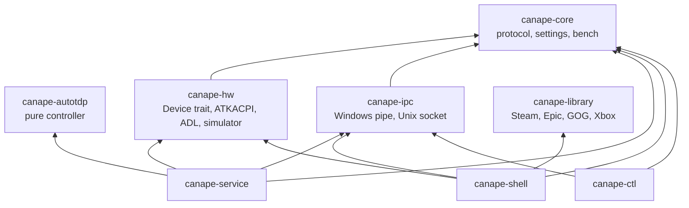
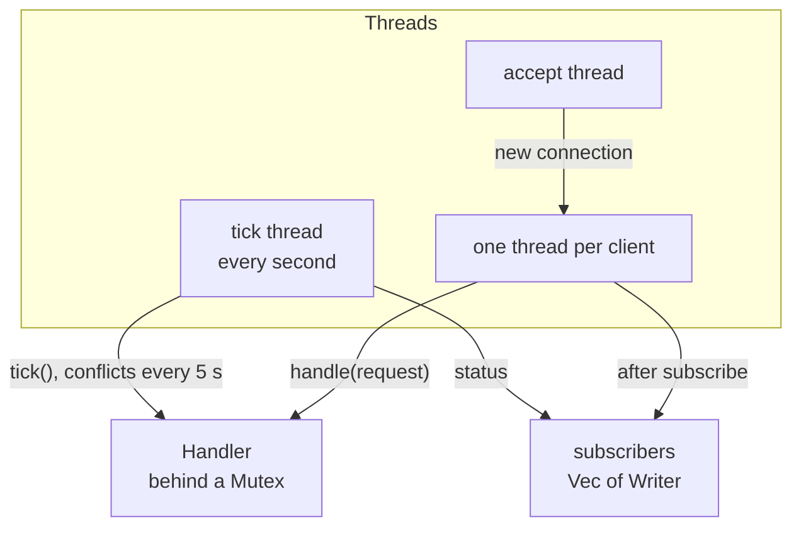
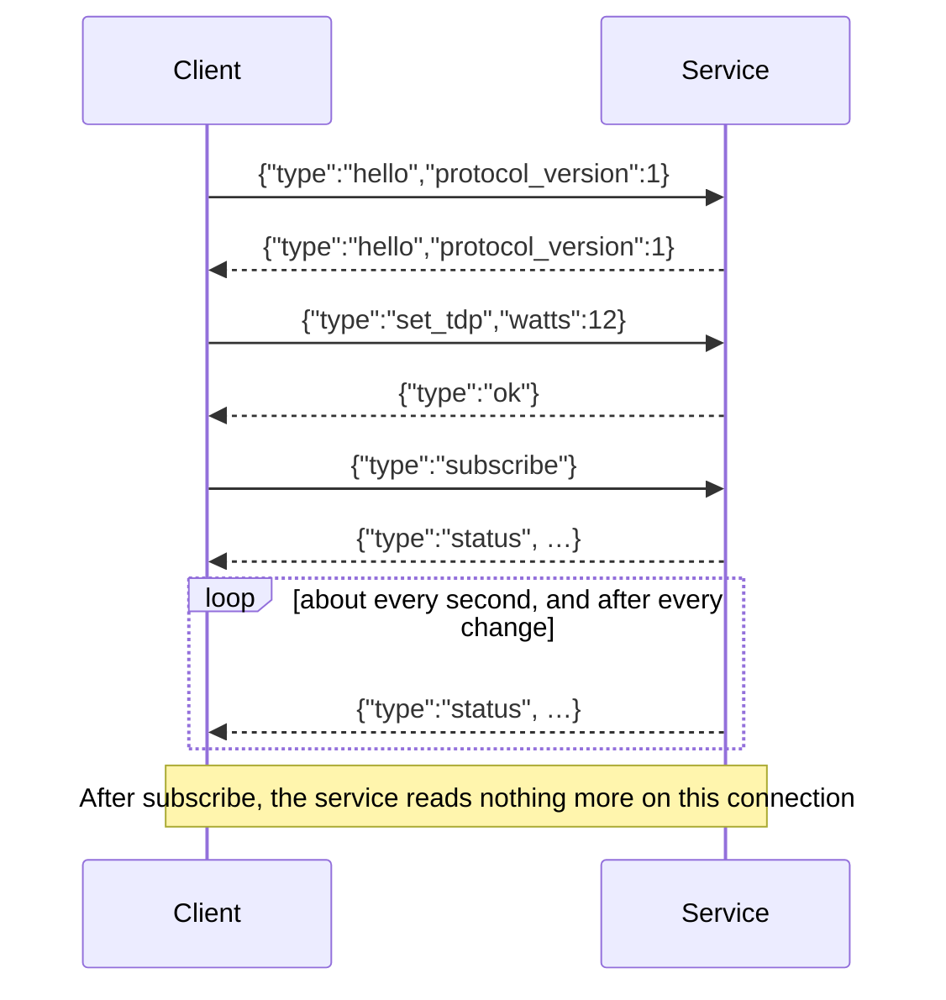
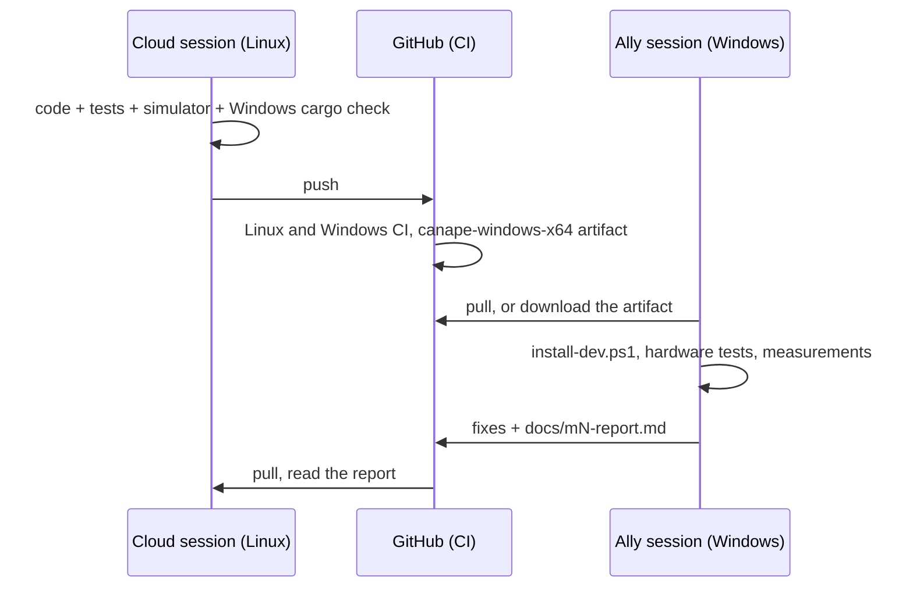

# Developer guide

[🇫🇷 Version française](developer-guide.fr.md) · [📚 Documentation index](README.md)

This guide describes Canapé's architecture, the protocol between its components, how to build and test (on Linux without hardware as well as on the Ally), packaging, the widget, translations and the project's rules.

## Contents

- [Architecture](#architecture)
  - [Processes, sessions and integrity levels](#processes-sessions-and-integrity-levels)
  - [Crates](#crates)
  - [The game library](#the-game-library)
    - [Installing owned games](#installing-owned-games)
  - [The Hardware page](#the-hardware-page)
  - [Inside the service](#inside-the-service)
- [IPC protocol](#ipc-protocol)
  - [Transport](#transport)
  - [Requests](#requests)
  - [Responses](#responses)
  - [The status](#the-status)
  - [Nested types](#nested-types)
  - [Errors](#errors)
  - [Evolving the protocol](#evolving-the-protocol)
- [Building and testing on Linux](#building-and-testing-on-linux)
  - [Service and shell with the simulator](#service-and-shell-with-the-simulator)
  - [Environment variables](#environment-variables)
  - [Screenshots with Xvfb](#screenshots-with-xvfb)
- [Building and testing on Windows](#building-and-testing-on-windows)
- [Continuous integration](#continuous-integration)
- [Packaging](#packaging)
- [The Game Bar widget](#the-game-bar-widget)
- [Translations](#translations)
- [Hardware notes](#hardware-notes)
- [Conventions](#conventions)
- [Two sessions: the Ally and the cloud](#two-sessions-the-ally-and-the-cloud)

## Architecture

Canapé is made of three programs running at the same time, plus a command-line tool. **Only the service has elevated rights** and touches the hardware; the UI and the widget only send requests.


### Processes, sessions and integrity levels

| Process | Session | Integrity / account | Identity | Started by |
|---|---|---|---|---|
| `canape-service.exe` | 0 | LocalSystem | none | Service manager, at boot (automatic start, restart after a crash: 3 times, 2 s delay) |
| `canape-shell.exe` | 1 | **medium IL** (`asInvoker`) | sparse package `Canape`, AUMID `Canape_<hash>!App` | The FSE, with `windows.gaming:///home`; or `shell:AppsFolder\…` |
| Widget | 1 | AppContainer (low IL) | package `Canape.Widget` | Game Bar |
| `canape-ctl.exe` | 1 | the terminal's | none | By hand |

Consequences:

- The FSE only activates the home app at **medium IL**: the shell must stay `asInvoker` and ask for nothing privileged. Everything that touches the hardware goes through the service.
- The service, in **session 0**, has no display and no windows: it cannot know which game is in the foreground (the shell tells it, `foreground_app`), and the AMD driver refuses to start frame counting from there (the shell starts it, see [Hardware notes](#adl-from-session-0)).
- The widget lives in an AppContainer: it opens the pipe with `CreateFileFromAppW`, and the pipe's DACL explicitly allows it.
- The shell is **single-instance** (mutex `Local\Canape.Shell`): a second activation brings the existing window to the front and exits. The FSE sometimes activates the home app several times at boot (see [m1-report.md](m1-report.md)).

### Crates



| Crate | Kind | Role | Key files |
|---|---|---|---|
| `canape-core` | library | Protocol (`Request`, `Response`, `Status`), settings (`AutoTdpSettings`, `PerformanceMode`, `Profile`, `ControllerMode`), fan curves (validation, presets), bench (`BenchPlan`, `BenchReport` and its recommendations), minimal log | `protocol.rs`, `settings.rs`, `fan.rs`, `bench.rs`, `log.rs` |
| `canape-autotdp` | library | Auto TDP controller: a pure state machine fed one `Sample` per second, with no system dependency | `lib.rs` |
| `canape-hw` | library | `Device` trait; Ally backend (Windows) on top of ATKACPI, ADL and the controller's HID interface; `MockDevice` for everything else. For the user session: the screen (`display`) and the gyroscope (`motion`: `Gyro` trait, `MockGyro`, `motion::open()`) | `lib.rs`, `atk.rs`, `pad.rs`, `windows.rs`, `adl.rs`, `hid.rs`, `mock.rs`, `display.rs`, `motion.rs`, `gyro.rs` |
| `canape-ipc` | library | A `Connection` that sends and receives JSON lines; named pipe on Windows, Unix socket elsewhere; the pipe's ACL | `lib.rs`, `windows.rs`, `unix.rs`, `acl.rs` |
| `canape-service` | binary | Windows service: state, auto TDP, profiles, bench, conflict detection, IPC server, persistence | `handler.rs`, `server.rs`, `bench_run.rs`, `conflicts.rs`, `winsvc.rs` |
| `canape-library` | library | Installed games: Steam, Epic, GOG and Xbox scanning, merging and sorting, cover decoding, downloaded covers, launching, the cache files. Owned games and installing them (Steam, Epic through Legendary). Pure parsers tested on Linux; the Windows parts (registry, drives, `ShellExecuteW`, WinHTTP) behind `cfg(windows)` | `lib.rs`, `steam.rs`, `vdf.rs`, `epic.rs`, `gog.rs`, `xbox.rs`, `legendary.rs`, `install.rs`, `tools.rs`, `online.rs`, `igdb.rs`, `achievements.rs`, `http.rs`, `cover.rs`, `cache.rs`, `launch.rs`, `win.rs` |
| `canape-shell` | binary | Slint home app (software rendering): four sections (Games, Performance, Hardware, Settings) and five sub-pages (Game profiles and Add a game from Settings, Bench from Performance, Gyro aiming and Back buttons and lighting from Hardware), status strip (W, FPS, battery, time), live power graph, fan presets and curve, accent colour picker, XInput gamepad, foreground tracking, 13 languages | `main.rs`, `link.rs`, `library.rs`, `addgames.rs` (the Add a game sub-page), `shelves.rs` (shelf composition, pure and tested: Recent, Installed, one per store (installed and to install mixed, Other last), To install (one entry per title across stores, `canape_library::one_per_title`, Steam first; `not_installed` already keeps one per store and title, `one_per_store`); each shelf has its own model and selection, a decoded cover serves every shelf showing the game), `backdrop.rs` (glow in the game's colour behind the library, and `fade_art`, which fades a game's wide art into the background), game page (`GamePage` in `library.slint`; the profile shows through the executable `learn_exe` keeps in `recent.json` (`Recent::exes`) when a full-screen program comes to the front within 2 min of a launch, `canape_library::is_store_program` leaving clients and launchers out; `open_detail` / `close_detail`: size and time played at once, large cover and wide art (Steam's `library_hero.jpg`, or for Epic the `DieselGameBox` key image of Legendary's metadata, downloaded once by `online::wide_art` and cropped by `cover::load_filled`) decoded on a thread, then released 400 ms after closing), `grid.rs`, `clock.rs`, `hardware.rs`, `ui/*.slint`: `app.slint` (frame, sections, hints), `kit.slint` (shared rows, tiles, rulers, setting lines; `Reveal` fades and slides in what an `if` or a `for` creates, since those animate nothing on their own: pages from the LB/RB side; `RevealLine` slides one line in from the left, delayed by its rank, for the lines of the game title; the library backdrop, drawn opaque at the window size by `backdrop.rs` so it is only copied, crossfades on two layers, `backdrop-a` and `backdrop-b`; covers are decoded at the size of a cover not selected, only the selected one is scaled; the software renderer only redraws what changes, so animations touch as little area as they can: a shelf only scrolls at its edge, the selected cover grows on its own spot without pushing the others, and the backdrop only changes once the selection rests, `BACKDROP_DELAY`; it only crossfades after a pause, `BACKDROP_FADE_AFTER`, and switches at once while browsing; its image starts where the glow reaches, `Mask::x`), `fonts/` (embedded Plus Jakarta Sans, OFL licence, tabular digits by default, a wider space; Cyrillic and CJK fall back to the system fonts; the widget links the same files), one page per file (`library.slint`, `performance.slint`, `hardware.slint`, `settings.slint`, sub-pages in `pages.slint`). Every page moves with the arrow keys: each holds the focus in one `FocusScope` and moves its own row and column; `App.arrow-focus` tells the gamepad to send arrows rather than Tab (`library::arrow_navigation`). X and Y arrive as F2 and F3, `i18n.rs`, `report.rs`, `nav.rs` (`Navigator::quiet`: gamepad ignored for 2 s (`keys::FIRST_QUIET`) the first time the shell is in front, held buttons ignored until released), `keys.rs` (`KeyGate`, filters winit's keyboard events (`on_winit_window_event`) with the same rules: a key repeating without having been seen going down was held before the focus; logs every Enter and Escape with its source, `keys: pad` or `keys: keyboard`), `foreground.rs`, `history.rs`, `accent.rs`, `gyro.rs` (gyro aiming, see [The Hardware page](#the-hardware-page)) |
| `canape-ctl` | binary | Sends one JSON request, or `watch` to follow the status; `--pretty` indents the JSON | `main.rs` |

The shell uses `canape-hw` for what belongs to the user session: `arm_frame_metrics()` (starting the AMD driver's frame counting), the screen, the Ally's buttons and the gyroscope. It never writes to the firmware.

### The game library

`canape-library` finds the installed games (and the owned ones, see [Installing owned games](#installing-owned-games)) and `canape-shell` shows them (`library.rs`, `ui/library.slint`). Nothing goes through the service: scanning, launching and installing need no rights, and a game launched from the shell must run as the user, at medium integrity, never elevated.

One exception, asked of the user: the Easy Anti-Cheat setup that Epic and GOG games ship (`eac.rs`). `eac::setup_for` finds `EasyAntiCheat\EasyAntiCheat_EOS_Setup.exe` and the `productid` of `EasyAntiCheat\Settings.json` (pure parser, ids restricted to letters, digits, `-` and `_`) in the folders of the game (Legendary's `installed.json`, the launcher's manifests, gogdl's record, the launch folder and its parent). `eac::service_installed` opens the `EasyAntiCheat_EOS` service (`OpenSCManagerW` + `OpenServiceW`, `SC_MANAGER_CONNECT` / `SERVICE_QUERY_STATUS`; if Windows cannot tell, it counts as installed). When it is missing, `eac::install` runs `install <productid>` through `ShellExecuteExW` with the `runas` verb (one UAC prompt, `ERROR_CANCELLED` = refused), one run at a time, and waits for it (5 minutes at most, exit code 0 = installed). The shell (`library.rs`, `ensure_anticheat`) does it on a thread after an Epic or GOG install shows up in the scan, and before launching such a game; a refusal is not asked again for that game during the session. Never through the service: a SYSTEM process must not start a program an unprivileged user can place. Not yet tried on the Ally.

| Store | Where | Parser | Launch | Covers |
|---|---|---|---|---|
| Steam | `HKCU\Software\Valve\Steam\SteamPath`, else `C:\Program Files (x86)\Steam`; `steamapps\libraryfolders.vdf` then every `appmanifest_*.acf`; `userdata\*\config\localconfig.vdf` | `vdf.rs`: KeyValues text format, tolerant (comments, `[$WIN32]`, bare tokens, truncated files). Installed = `StateFlags` bit 4. Tools excluded by appid and name (228980, Proton, Steam Linux Runtime, SteamVR) | `steam.exe -silent steam://rungameid/<appid>` (`steam::launch`: Steam starts hidden if it was not running), the URI alone without `steam.exe` | `userdata\*\config\grid\<appid>p.*`, then `appcache\librarycache\<appid>_library_600x900.jpg` (old layout) or `<appid>\[<hash>\]library_600x900.jpg` (current), then `library_hero.jpg`, `header.jpg` |
| Epic | `%ProgramData%\Epic\EpicGamesLauncher\Data\Manifests\*.item` (JSON) | `epic.rs`: `AppCategories` must contain `games`; DLC (`MainGameAppName` ≠ `AppName`) and `bIsIncompleteInstall` excluded | `com.epicgames.launcher://apps/<ns>%3A<item>%3A<app>?action=launch&silent=true`, until Legendary takes the game over: after each scan, with an Epic account signed in, `adopt_epic_installs` (shell) hands each launcher install (`epic::installs`, `InstallLocation`) to `install::epic_import` (`legendary import --skip-dlcs`), one try per game and session; `scan` then leaves the launcher's entry out for Legendary's | downloaded (`online.rs`) |
| Epic through Legendary | `%USERPROFILE%\.config\legendary\installed.json`, only if `%LOCALAPPDATA%\Canape\tools\legendary.exe` exists (`Roots::legendary`) | `legendary.rs`: `parse_installed`, DLC (`is_dlc`) and empty titles excluded | `legendary.exe launch <app>`, working folder `install_path` | downloaded (`online.rs`) |
| GOG through gogdl | `%LOCALAPPDATA%\Canape\gog\installed.json`, Canapé's record of its gogdl installs (`Roots::gogdl`) | `gogdl.rs`: `scan` / `installed_game`, then each folder's `goggame-<id>.info` (`parse_game_info`); a folder gone is skipped | the primary `FileTask`'s executable, `arguments`, working folder `workingDir` | downloaded (`online.rs`) |
| GOG | `HKLM\SOFTWARE\WOW6432Node\GOG.com\Games\<id>` | `gog.rs`: `gameName`, `exe`, `launchParam`, `workingDir` / `path`; keys with `dependsOn` (DLC) excluded | the `exe` directly (working folder `workingDir`, else `path`), else `goggalaxy://openGameView/<id>` | downloaded (`online.rs`) |
| Xbox | `<drive>:\.GamingRoot` (else `<drive>:\XboxGames`), then `<game>\Content\MicrosoftGame.config` and `appxmanifest.xml` | `xbox.rs` + `xml.rs` (attributes of the first matching element). Package family name = `Name` + `_` + publisher id, computed (SHA-256 of the UTF-16LE publisher, 8 bytes, Crockford-like base 32), checked against `8wekyb3d8bbwe` and the Ally's `Canape_84zrj1c9kn010` | `shell:AppsFolder\<PFN>!<AppId>` | `Square480x480Logo` (or its `.scale-NNN` variant), `Square150x150Logo`, `StoreLogo` |
| Other (`Source::Other`) | `%LOCALAPPDATA%\Canape\games.json` (`Roots::external`, set by the shell) | `external.rs`: `{"games": [{title, exe, args, dir, cover}]}` or a bare array, byte order mark tolerated; id `other:` + 16 hex digits of the SHA-256 of the lower-cased `exe` and `args` (an emulator listed once per ROM gives one id per game; renaming keeps the history); `dir` defaults to the folder of `exe`; a relative `cover` is joined to the folder of `games.json` and kept only if the file exists. An unreadable file gives no game, is logged at each scan, and is never rewritten | `Launch::Exe` through `ShellExecuteW` (so a `.lnk`, a script or a document works too), `Launch::Uri` when `exe` has a scheme of two characters or more (`itch://…`) | its `cover`, else downloaded (`online.rs`, SteamGridDB title search) |

- **Merging** (`merge`): the launch times saved by Canapé (`recent.json`) raise `last_played`; one entry per id, then one per title across stores (letters and digits, lower case: `HADES™` = `Hades`), keeping the copy played last, else Steam > GOG > Epic > Xbox > Other; sorted last played first then by title (`Sort::Recent`) or by title (`Sort::Title`).
- **Startup**: `library.json` (the last raw scan) is shown before the window opens, then a background thread scans, rewrites the cache and posts the result to the event loop. Coming back to the page rescans after 60 s.
- **Covers**: decoded on a worker thread (`zune-jpeg`, `png`, pure Rust) straight to the tile's size in physical pixels (box filter), with rounded corners baked in (the software renderer does not clip images to a rounded rectangle). Only the visible rows and one row on each side are requested; covers more than one further row away are dropped. Landscape or square art is shown whole on a blurred, darkened copy of itself. Measured on Linux (release, 50 games, 1280×720 at scale 1, private memory `RssAnon`): 2.7 MB without games, 6.9 MB on the library with its 18 first covers, 10.8 MB after scrolling to the end and back (glibc with `MALLOC_ARENA_MAX=1`; with its defaults it keeps freed decoding buffers, 9.1 / 14 MB). A cover costs width × height × 4 bytes: about 210 KB at 1280×720, 470 KB on the Ally at 150 %. To measure on Windows.
- **Downloaded covers** (`online.rs`, `http.rs`): after each scan, games still without art go through `online::download_missing` (at most 60 per scan, sequential): Steam games first try Steam's store CDN (`library_600x900.jpg`), then, with `steamgriddb_key` set in `shell.json`, SteamGridDB (`/grids/steam/<appid>`, or `/search/autocomplete/<title>` then `/grids/game/<id>`, portrait static JPEG/PNG only). Files land in `%LOCALAPPDATA%\Canape\covers` as `<id with non-alphanumerics as _>.jpg|png`, written to `.part` then renamed; a game with no art gets an empty `.miss` marker retried after 7 days. `online::attach` gives every scan the covers already downloaded. The transport is the `Http` trait: WinHTTP on Windows (system proxy, redirects, 5–15 s timeouts, 8 MB cap), nothing elsewhere; the logic is tested with a fake transport. The key is only sent as a bearer token to `www.steamgriddb.com/api/v2`, never to a CDN (tested).
- **Time to beat** (`igdb.rs`, shell `timetobeat.rs`): with `igdb_client_id` and `igdb_client_secret` in `shell.json` (a Twitch application of the user's; both empty: off, nothing asked, no setting), opening a game page whose `igdb.json` entry is missing or old starts one lookup on a thread (one at a time, at most 6 a minute, none for 10 minutes after an error or while the keys are missing). `igdb::Client` gets a client-credentials token (`POST https://id.twitch.tv/oauth2/token`, form body `client_id`, `client_secret`, `grant_type=client_credentials`), kept with its expiry and client id in `igdb-token.json`, renewed an hour before expiry and once on a 401 (`Http::post` maps 401 to `ErrorKind::PermissionDenied`). IGDB queries are `POST https://api.igdb.com/v4/<endpoint>` with `Client-ID`, `Authorization: Bearer` and an Apicalypse body: first `external_games` with the store's id (`igdb::store_ids`): Steam `where uid = "<appid>" & external_game_source = 1`, GOG the product id and source 5, Epic source 26 with `uid = ("<app name>","<catalog item id>","<namespace>")`, the last two from Legendary's `metadata/<app>.json` (`legendary::catalog_ids`); which Epic id IGDB keeps as `uid` is not documented, hence the three, the first one present wins. Falling back to the title when that query fails or finds nothing: `games` (`search "<title>"; fields name,game_type,version_parent`), the same `title_key` first, else a close name (`igdb::base_title`: the title cut at `:` or a dash, and without a trailing edition such as Director's Cut, GOTY, Deluxe Edition…, on either side: "Fall Guys" matches "Fall Guys: Ultimate Knockout", "Death Stranding Director's Cut" matches "Death Stranding", "Hades" never matches "Hades II"), and when the search finds nothing, once more with the base title; main game (`game_type` 0) before remakes / remasters / ports / standalone expansions (4, 8–11), originals before editions (`version_parent`), DLC, bundles, mods, episodes refused; then `game_time_to_beats` (`where game_id = <id>`, fields `hastily`, `normally`, `completely` in seconds, `count`). The game page shows them below the fold (see the game page layout below) as a full-width band of three equal blocks, each a coloured strip with the label over the time: `hastily`, `normally` (else `hastily`) and `completely` (`DetailView.beat-rushed`, `beat-minutes`, `beat-complete`, in minutes, −1 when unknown; `timetobeat::Minutes`), as "~N h", or "~N min" under an hour, "—" for an unknown one. `igdb.json` (`igdb::Cache`, version 2) keeps per Canapé game id the times or `null`, with the date: 30 days for times, 7 for none; a version 1 file keeps its times and drops its misses, so that games missed by the older, exact-title lookup are asked again. `shell.log` says why a page shows no time: `<id> not found on IGDB` or `<id> is IGDB game <n>, without times` (a multiplayer game such as Fall Guys may well have none). Not yet tried on the Ally. A fixture (`-fixture` files) only reads `igdb-fixture.json` and never goes online. The secret and the token are never formatted into a log line (`Credentials` and `Token` are not `Debug`; errors carry the HTTP status only); a test checks the secret only goes to Twitch. **Unverified**: IGDB's documentation was not reachable from the cloud session, so the endpoint and field names (`external_game_source`, `game_type` and their ids, `game_time_to_beats` fields) and the fixtures in `tests/fixtures/igdb` are written from what is known of API v4, not recorded answers; nothing has run on the Ally.
- **Game page layout** (`GamePage` in `library.slint`): two parts. The top is unchanged (cover, title, facts, button, profile card). The second part starts at `fold`, the page's own height, so it sits under the hints until called. `Library.detail-part` (0 top, 1 below the fold, reset by `open_detail`) moves one inner rectangle by `fold` (`animate y`, 260 ms), inside a clipped rectangle 48 px wider than the page on each side so that the cover's shadow is not cut. Down on the top part goes below when `Library.detail-more` (something to show there); Up comes back (from the first row of achievements when there are some); B always closes the page; a wheel or swipe does the same as Down / Up. Below the fold, a 36 px fade then an opaque background: during the scroll the software renderer redraws the page area (no blending of the art underneath), and the Steam wide art (`detail-art`, `app.slint`) fades out while the lower part is shown, so that no picture shows above it. Hints: **More** (Down) on the top part when there is a second part, **Top** below, where A has nothing to do and its hint goes. **Unverified on the Ally** (scroll smoothness on the device).
- **Achievements** (`achievements.rs` in the library, `achievements.rs` in the shell): Steam only. `achievements::fetch`, with `steam_api_key` and `steam::local_steam_id`, asks `GET https://api.steampowered.com/ISteamUserStats/GetSchemaForGame/v2/?key&appid&l` (`availableGameStats.achievements`: `name`, `displayName`, `description` (absent for hidden ones), `hidden`, `icon`, `icongray`; none: the game has no achievements, stop), then `GetPlayerAchievements/v1/?key&steamid&appid&l` (`achieved`, `unlocktime`; a 403 or 400, or `success: false` with an `error`, is "nothing to show": private game details, no stats), then `GetGlobalAchievementPercentagesForApp/v2/?gameid` (no key; `percent` as a number or a string; a failure only drops the rarity). `l` is Steam's name of the interface language (`steam_language`). `merge` puts the unlocked first by date (latest first), then the locked by share (most common first); a hidden one keeps an empty description until unlocked (the page says "Hidden achievement"). `achievements.json` (`achievements::Cache`, version 1) keeps per game id the date, Steam's language and the list, or `null` for nothing to show; fresh for an hour (`FRESH_FOR`) in the same language. The shell (`achievements::open` from `open_detail`, `close` from `close_detail`) shows the cached list at once and, when stale, starts one fetch thread per game (never with a fixture; none for 10 minutes after a network error, which is not cached); "nothing to show" and errors are logged in one line, with Steam's reason or the HTTP status only: the URLs carry the key and are never formatted. Icons: `icon_file` (16 bytes of the URL's SHA-256 in hex, plus its extension) in `achievement-icons/`. `GamePage` reports the tiles in view (`Library.achievements-view(first, count, icon side in pixels)`: the rows in view plus one); the shell replaces the queue with the icons of that window not decoded yet, and 3 threads (`WORKERS`) download them (WinHTTP, at most 512 KB, a `.part` file then renamed) and decode them at the icon's size (`cover::load`, `cover::rounded`), then set them on the model's rows; the images go when the page closes. Layout: under the band (or at the top of the lower part), "Achievements" with unlocked / total · % and a 4 px bar; a grid of `AchievementTile` (52 px icon, name), `max(1, floor((width + 12) / 272))` columns (`LibraryPage.achievement-columns`), as many rows as fit above the hints and the description line (`grid-rows`); the grid only moves by a row when the focus passes an edge (`first-row`, 200 ms) and only the rows in view and next to them are visible; under it the focused one's name, description, "Unlocked on YYYY-MM-DD" (local date) or "Locked", and "N % of players". Keys (LibraryPage, `detail-part` 1): left / right ±1, down one row (or the last tile from the row above the last), up one row, and from the first row back to the top. The fixture: `tools/fake-library.py` writes `achievements-fixture.json` (Ashen Tide 23 / 51, Skyward Drift 12 / 12) and the icons, named as `icon_file` names them. GOG: not done. `gameplay.gog.com/clients/<clientId>/users/<userId>/achievements` needs a token for the game's own client (id and secret from the game's build manifest), obtained with the user's refresh token, which may replace the session gogdl keeps; Epic, Xbox, others: nothing. **Unverified**: `api.steampowered.com` was not reachable from the cloud session, so the answers in `tests/fixtures/steam/achievements` are written from Valve's documentation, not recorded; nothing has run on the Ally.
- **Navigation**: the grid is one `FocusScope` with a selected index; the moves are computed in Rust (`grid.rs`, `Library.grid-move`). While the library has the focus, `gamepad.rs` sends the arrow keys instead of Tab / Shift+Tab (`library::arrow_navigation()`), with the same repeat. Up from the first row reaches the filter bar.
- **Launching**: `canape_library::launch` calls `ShellExecuteW` (COM initialised on the calling thread) on a short-lived thread, records the launch in `recent.json`, shows "Launching…" for 5 s, then re-sorts.

> [!WARNING]
> **Not tried on Windows yet.** Everything above compiles for `x86_64-pc-windows-msvc` and the parsers are tested on Linux against fixtures (`crates/canape-library/tests/fixtures`), but registry reads, Steam / Epic / GOG on a real machine, `ShellExecuteW` from the FSE and the whole Xbox part (written from the documented formats, without an Xbox game to try) are still to be checked on the Ally. Known limit: Xbox app games installed outside an `XboxGames` folder (in `WindowsApps`) are not found. `games.json`, the shortcut search and the `.lnk` reading are not tried on the Ally either (the parser is tested against shortcuts generated from the published format, not ones Windows wrote).

**Games to add from the shell** (`shortcut.rs`, `canape-shell/src/addgames.rs`, `AddGamesPage` in `ui/pages.slint`, page 8 of `app.slint`, line 7 of Settings):

- `shortcut::folders`: `SHGetKnownFolderPath` for `FOLDERID_Programs`, `FOLDERID_CommonPrograms`, `FOLDERID_Desktop`, `FOLDERID_PublicDesktop`; `find` walks them (4 levels, 4,000 files at most) for `.lnk` files.
- `shortcut::parse` reads the Shell Link binary format directly (no COM): header and CLSID checked, ID list skipped, LinkInfo local base path (Unicode offsets when the header is 0x24 bytes or more, else ANSI read as Latin-1) plus common path suffix, then the string data (working folder, arguments), then the `EnvironmentVariableDataBlock` target (`%ProgramFiles%\…`) when there is no LinkInfo; `expand` replaces the `%VARIABLES%`. A shortcut without a file path (Windows apps, advertised installer shortcuts) is skipped. Truncated files are refused without panicking (tested on every prefix).
- `could_be_game`: a `.exe` (or a `.bat`, which some games start with), outside `%SystemRoot%`, outside office, browser, developer tool and Windows app folders (`NOT_GAME_FOLDERS`, `NOT_GAME_FILES`), not a store client (`is_store_program`) nor Canapé, without `uninst`, `setup`, `install`, `update`, `readme`, `manual`, `website`, `support`, `crashreport`, `redist`… in its file or shortcut name; the target must exist. Duplicates (same target and arguments) are kept once, sorted by name.
- `addgames.rs`: on opening, a thread reads `games.json` and the shortcuts; the list is `games.json` (marked added) plus the shortcuts that are not in it and whose title (`title_key`) or program matches no store game. A writes `games.json` at once (`external::save`, through a `.tmp` file) after reading it again (an unreadable file is refused, shown in yellow), then `library::rescan()`; a scan already running is followed by another one (`State::rescan`).
- `Library.store-name` translates "Other" ("Other games"); `StoreLogo` draws a gamepad for it (`fill-rule: evenodd` for the holes).

**Fake library for development**: `python3 tools/fake-library.py <out>` builds one with 14 made-up games across the four stores, generated covers (ImageMagick), play times, and the Epic and GOG covers placed as if downloaded; it prints the two variables to set (`LOCALAPPDATA` and `CANAPE_LIBRARY_FIXTURE`). In a debug build, `CANAPE_LIBRARY_FIXTURE=<dir>` replaces the real stores with `<dir>/steam` (a Steam folder), `<dir>/epic` (manifests), `<dir>/gog.json` (a JSON array of `{"key": …, "values": {"gameName": …, "exe": …}}`, like the registry) and `<dir>/xbox` (an `XboxGames` folder), plus `<dir>/games.json` (two games of the Other shelf, one with a cover in `<dir>/covers`) and, for Add a game, the shortcuts of `<dir>/shortcuts` (targets not checked). The script adds 9 owned but not installed games (4 Steam, 3 Epic, 2 GOG) in `<dir>/owned.json`, in the cache format, with their covers in `covers-fixture`: that is the To install list. Nothing is launched (the launch only shows), and the cache files become `library-fixture.json`, `recent-fixture.json` and `owned-fixture.json`. Release builds ignore the variable.

#### Installing owned games

The library's **To install** shelf lists the Steam, Epic and GOG games that are owned but not installed; A installs them without opening Steam's interface, the Epic launcher or GOG Galaxy. The starting analysis is in [`game-install-study.md`](game-install-study.md) (French); Xbox is not covered.

| Module | Role |
|---|---|
| `install.rs` | `Install` (`Steam { appid }`, `Epic { app }` or `Gog { id }`, serialised with a `store` tag); `install::run`, blocking (run it on its own thread), which reports `Event`s: `Progress(0..1)`, `Done`, `Failed(message)`. The Legendary commands: `epic_account` (`status --json --offline`), `epic_owned` (`list --json`), `epic_login` (`auth`). The gogdl commands: `gog_login`, `gog_credentials`, `gog_info`, `run_gogdl` (see below). |
| `gogdl.rs` | GOG through gogdl: `login_url`, `parse_code`, `parse_credentials`, `owned_url` / `parse_owned_page` / `fetch_owned`, `parse_user`, `parse_info`, `parse_progress`, `parse_game_info`, the install record (`Installed`, `record_install`, `scan`). |
| `steam.rs` | `steam_id`: the `MostRecent` account of `config/loginusers.vdf`, else the latest `Timestamp`. `owned_url`: `IPlayerService/GetOwnedGames/v1` with `include_appinfo` and `include_played_free_games`. `parse_owned` (tools excluded as in the scan). `parse_download` / `download`: where an install stands according to its manifest, looked up in every library folder. |
| `legendary.rs` | `config_dir`, `scan` / `parse_installed` (see the table above), `parse_list` (games managed by another store, `ThirdPartyManagedApp` or `ThirdPartyManagedProvider`, are excluded; the `https://` `DieselGameBoxTall` image becomes the cover link, requested at 600×900), `parse_progress`, `parse_account`. |
| `tools.rs` | The Legendary and gogdl downloads (see below). |
| `disk.rs` | The games folder and free space: `free_space` (`GetDiskFreeSpaceExW` on the folder or its nearest existing parent), `fixed_drives` (`GetLogicalDrives`, `GetDriveTypeW` = `DRIVE_FIXED`), `parents` (the folders holding installed games, fullest first), `default_games_dir`, `choices` / `next_choice` (the Settings line's list), `shortage` (the refusal message). |
| `lib.rs` | `Launch::Install { install }` for an owned game that is not installed (`launch` refuses it); `not_installed`: owned minus installed, by id or by normalised title. |
| `online.rs` | `download_missing` takes the art links the stores gave (`art`: id → URL) and tries them before Steam's CDN and SteamGridDB. `Http::get_limited` sets a size limit other than `get`'s 8 MB; `Http::post` sends a body with extra headers (IGDB). |
| `canape-shell/src/library.rs` | `Kind::ToInstall` shelf, `refresh_owned` / `fetch_owned`, `install` / `install_event`, `epic_login`, `gog_login` / `gog_check_clipboard`. `clipboard.rs` reads the clipboard's text. |
| `ui/library.slint`, `ui/pages.slint`, `ui/app.slint` | Installed / To install switch (bar cursor: modes 0–1, filters 2–6, orders 7–8), progress bar on the tile, empty state with the Epic sign-in button, the Settings row, the "A Install" hint. |

- **Owned list** (`refresh_owned`): at startup, then when reaching the To install shelf if the last list is more than 10 min old (`OWNED_REFRESH`), and forced after an Epic or GOG sign-in. On a thread: Steam if `steam_api_key` is set in `shell.json` (Windows only: local SteamID, `GetOwnedGames` over WinHTTP, `parse_owned`), then Epic if `legendary.exe` is there and an account is signed in, then GOG if gogdl is there and `gog\auth.json` holds a session. The result is written to `owned.json` (same format as `library.json`) and shown; missing covers are then downloaded with Epic's and GOG's links, and the list is published again. Errors go to `shell.log` and to the header for 10 s (`show_error`, `ERROR_SHOWN`); after an error `owned.json` is not overwritten. `rebuild` puts `not_installed(owned, all)`, sorted by name, on the last shelf.
- **Steam** (`run_steam`), first without any Steam window (`queue_steam`, `steam_queue.rs`; **not yet tried on the Ally**): it gives up straight away when `steam.exe` is missing, when the shell sees a game in front (`Tools::game_running`, from the foreground poll), when `HKCU\Software\Valve\Steam\RunningAppID` is not 0 (a Steam game runs) or when any library folder already has an `appmanifest_<appid>.acf` (a paused or broken install: an existing manifest is never touched). Otherwise `steam_queue::write` creates (`create_new`) in the `steamapps` of the library folder with the most free space (`choose_folder`; Steam's own folder on a tie) the manifest of a queued download: `AppState` with `appid`, `Universe` 1, `name`, `StateFlags` 1026 (update required 2 + update started 1024), `installdir`, `LastUpdated`, `SizeOnDisk`, `buildid`, `BytesToDownload`, `BytesDownloaded`, `AutoUpdateBehavior`, `AllowOtherDownloadsWhileRunning` at 0, empty `UserConfig` and `MountedConfig`. `name` and `installdir` come from Steam's cache `appcache/appinfo.vdf` (`appinfo.rs`: binary KeyValues, formats `0x07564428` with inline keys and `0x07564429` with a string table; only the wanted entry is read, the others are skipped by their size), else from the owned list's name with the characters Windows refuses removed (`installdir_from_name`, our own rule: Steam has none to copy). Steam is then started with `-silent` if it was not running (`ActiveProcess\pid` at 0 or not a live `steam.exe`); if it was, it gets 10 s (`STEAM_NOTICE`) to take the manifest by itself, then, checked again that no game runs, `steam.exe -shutdown`, up to 30 s for the process to end (`STEAM_QUIT`), `steam.exe -silent`. Steam has 90 s (`STEAM_TAKE`) to take the download over (it rewrites the manifest or creates `steamapps/downloading/<appid>`); otherwise the manifest is removed if Steam never touched it, the reason goes to `shell.log` (`Event::Note`: `installing steam:<appid>: Steam download not queued (…): opening Steam's install dialog`) and the dialog flow below runs. This is how the Steam client behaves, not a documented interface (manifest fields and flag values as seen in the files Steam writes and in community documentation; Steam reading manifests only at start-up is the common observation). Steam's own download settings (download hours, downloads during games) still apply.
- **Steam**, fallback with Steam's dialog: `steam.exe -silent steam://install/<appid>` through `ShellExecuteW` (the bare URI if `steam.exe` is missing). `-silent` starts Steam in the notification area if it is not running; if it is, the URI goes to the client. In both cases the `appmanifest_<appid>.acf` manifest is then read every 2 s: `StateFlags` at 4, or bit 4 with `BytesDownloaded >= BytesToDownload > 0`, means installed; otherwise the share `BytesDownloaded / BytesToDownload` (0 while Steam prepares). No manifest after 10 min (`STEAM_START`, the user did not confirm): `Steam did not start the download`; a manifest that disappears after showing up: `cancelled in Steam`. On the first progress of a Steam install the shell brings Canapé back to the front (`steam_dialogs`, `instance::bring_to_front`): Steam may have shown its dialog or, after a restart, its start-up window.
- **Games folder and free space** (`disk.rs`, `State::games_dir` in the shell): `shell.json` `games_folder` when set, else the folder holding most games installed by Legendary (`legendary::install_paths`), gogdl (`installed.json`) or the Epic launcher (`epic::installs`), else `Games` on the fixed drive with the most free space, else `%USERPROFILE%\Games`. Settings → Games folder steps through `next_choice` (folders already holding games, then `<drive>\Games` for each fixed drive) and saves the pick. `install::size_needed` asks the store before an install: `legendary info <app> --json` (`manifest.disk_size`, `legendary::parse_info_size`) or `gogdl info` (`disk_size`); Steam: `None`, Steam checks on its own. Opening the page of an Epic or GOG game to install calls it on a thread once per game and session (`State::sizes`, `fetch_size`) and fills `DetailView.size-tenths`; `free-tenths` and `folder` come from `disk::free_space`. The page compares them (`GamePage.short`): when the game does not fit, the line under the button says so in yellow and `act()` does not call `launch`. `run_legendary` and `run_gogdl` check again (`check_space`, `disk::shortage`) right before downloading and fail with `not enough space in <folder>: X GB needed, Y GB free`; Legendary and gogdl also refuse on their own. Sizes in decimal GB (10⁹ bytes), like the rest of the page.
- **Epic** (`run_legendary`): `legendary install <app> -y --skip-sdl --base-path <games folder>` (the game lands in `<games folder>\<its folder>`) without a console (`CREATE_NO_WINDOW`), stdin closed, stdout ignored. Progress comes from the `= Progress: 12.34%` lines on stderr; on a non-zero exit code, the last other non-empty line becomes the error message.
- **End**: `Event::Done` rescans; the installed game leaves the To install list since it has the same id (`steam:<appid>`, `epic:<app>`, `gog:<id>`). `Event::Failed` writes `<title>: <message>` into `Library.install-error`, cleared when the next install starts.
- **Epic sign-in** (`epic_login`, `epic_check_clipboard`): downloads Legendary if missing, opens `legendary::LOGIN_URL` (Epic's sign-in page for Legendary's client, which ends on a JSON answer holding `authorizationCode`) in the browser, then reads the clipboard every second for 10 minutes, as for GOG; `legendary::parse_auth_code` takes that JSON or the code alone (32 hex characters). `install::epic_login` then runs `legendary auth --code <code>` without a window; Legendary's last error line comes back on failure. Then the owned list is asked for again.
- **GOG** (`run_gogdl`): `gogdl info`, the space check, then `gogdl download` into the games folder, stdout and stderr piped (stdout read on its own thread). Progress from stderr; on a non-zero exit code, gogdl's last stdout line (its refusal for lack of space), else its last `ERROR` line, becomes the message. Success without `goggame-<id>.info` in the folder (a cancelled download exits with 0) is a failure; otherwise the install is recorded.
- **Lightness**: nothing runs all the time. Legendary and gogdl only run for a list request (Legendary's `status` then `list`, gogdl's `auth`, only when the To install list is refreshed), a sign-in or an install. The clipboard is only read while GOG's sign-in page is open (10 min at most).

**Legendary download** (`tools.rs`): `fetch_legendary` asks `api.github.com/repos/legendary-gl/legendary/releases/latest` for the latest release and takes the `legendary.exe` asset. It refuses a link outside `https://github.com/legendary-gl/legendary/releases/download/ (or the former `derrod/legendary`)`, and an asset without a `sha256:` `digest` of 64 hex characters. The file (80 MB at most) is downloaded, its SHA-256 computed (`sha256.rs`) and compared; if it matches, it is written to `.part` then renamed in `%LOCALAPPDATA%\Canape\tools`. A file that does not match is never written (tested with a fake transport). Legendary (GPL-3) stays a separate program that Canapé runs: nothing is bundled in the repository or the install.

**gogdl** (`gogdl.rs`, `install.rs`, `tools.rs`): heroic-gogdl, the open-source GOG downloader (GPL-3, run as a separate program, never bundled). Its README warns that its CLI is "not user friendly" and meant for other programs: the commands and output below were read in the source of the pinned version (1.3.1, `gogdl/args.py`, `cli.py`, `auth.py`, `dl/managers/v2.py`, `dl/progressbar.py`, `imports.py`), and must be checked again before moving the pin. Every command runs without a console, with `GOGDL_CONFIG_PATH=%LOCALAPPDATA%\Canape\gog` (its manifests go to `gog\heroic_gogdl\manifests` instead of `%APPDATA%\heroic_gogdl`) and `--auth-config-path %LOCALAPPDATA%\Canape\gog\auth.json` before the command.

| Command | Use in Canapé | Output read |
|---|---|---|
| `auth --code <code>` | Sign-in (`install::gog_login`): gogdl trades the code for tokens (`auth.gog.com/token`, `grant_type=authorization_code`, GOG Galaxy's public client) and writes them in `auth.json` | stdout: the tokens as JSON, `{"error": true}` if refused (`parse_credentials`) |
| `auth` | Before each owned list (`gog_credentials`): the current tokens, refreshed with the `refresh_token` once expired | stdout: `{"access_token", "user_id", "refresh_token", "expires_in", "loginTime", …}`, `null` when nobody is signed in or the refresh failed |
| `info <id> --platform windows --lang en-US --skip-dlcs` | Before an install (`gog_info`) | stdout: `{"size": {"*": {"download_size", "disk_size"}, "en-US": {…}, …}, "folder_name", "buildId", "languages", "dependencies", …}`; `parse_info` adds `*` (files for every language) and `en-US` (else the only other language) |
| `download <id> --platform windows --lang <language> --skip-dlcs --path <games folder>` (language: `gogdl::pick_language`, the interface's when the game has it in `info`'s `size`, else `en-US`, else its only one) | The install (`run_gogdl`) | stderr, once a second: `[PROGRESS] INFO: = Progress: 42.15 2790066118/6619375133, Running for: …` (no `%` sign, unlike Legendary; `parse_progress`). Not enough space: `Unable to proceed, Not enough disk space` on stdout, exit code 2. The game lands in `<games folder>\<folder_name>`, which then holds `goggame-<id>.info` |

Not used: `launch` (Canapé starts the executable itself, see below), `import`, `save-sync`, `redist` (the game's own dependency depots are downloaded into its folder by `download`, but nobody runs their installers: a known limit).

- **Sign-in** (`State::gog_login` in the shell): downloads gogdl if missing, opens `gogdl::login_url()` (`auth.gog.com/auth?client_id=46899977096215655&redirect_uri=https://embed.gog.com/on_login_success?origin=client&response_type=code&layout=client2`) in the default browser through `ShellExecuteW`, then reads the clipboard every second for 10 min (`GOG_POLL`, `GOG_WAIT`, `clipboard.rs`: `OpenClipboard` / `CF_UNICODETEXT`). The redirect is fixed by GOG to `embed.gog.com`: no local server can catch it, the user copies the landing page's address. `gogdl::parse_code` only accepts text holding `on_login_success` and a `code=` parameter of URL-safe characters; the clipboard's text at the start is ignored, so an old address is not reused. A again while waiting reads the clipboard at once, else reopens the page. `Library.gog-waiting` drives the "Waiting for the GOG address…" state and its instruction.
- **Owned list**: `gog_credentials`, then over WinHTTP with the bearer token `embed.gog.com/userData.json` (`parse_user`: `username`, else the `user_id`) and `embed.gog.com/account/getFilteredProducts?mediaType=1&sortBy=title&page=N` page after page (`fetch_owned`, 50 pages at most), keeping products with `worksOn.Windows` and `isGame`; the `image` (`//images-N.gog-statics.com/<hash>`) becomes the art link `https://…<hash>_392.jpg` (landscape, shown whole on its blurred copy; suffix still to check against GOG's servers).
- **Installed games** (`gogdl::scan`, `Roots::gogdl`): gogdl keeps no list of installs, so `run_gogdl` records `{id, path, size}` in `%LOCALAPPDATA%\Canape\gog\installed.json` once `goggame-<id>.info` is in the folder. The scan reads that file of each recorded folder (`parse_game_info`): the primary `FileTask` play task gives the executable (`path`, relative to the folder), its `arguments` and its working folder (`workingDir`, else the game folder). The id is `gog:<id>`, the same as a Galaxy install of the game, so `merge` keeps one.
- **gogdl download** (`tools::fetch_gogdl`): unlike Legendary, the version is pinned: `GOGDL_URL` (`…/heroic-gogdl/releases/download/v1.3.1/gogdl_windows_x86_64.exe`) and `GOGDL_SHA256` (`1866e0ea…2a4c5f`, the digest GitHub shows for the asset, checked on a download of the file). The executable is saved as `gogdl-1.3.1.exe`: moving the pin downloads the new one. Same checked write as Legendary (`fetch_checked`).

**Development**: with `CANAPE_LIBRARY_FIXTURE`, two fake drives (`C:\` with 21.4 GB free, `D:\` with 48.2 GB, `FIXTURE_DRIVES`) stand for the real ones and the size of a game to install is the `size` of its `owned.json` entry (Lumen Drift, 63.1 GB, does not fit); the owned list comes from `<fixture>/owned.json`, the cache becomes `owned-fixture.json`, nothing goes online, and A simulates a one-minute install (120 steps of 0.5 s) then rescans. Since the fake game is not really installed, it stays in the list. The `library-install.png` screenshots show this simulated install.

> [!WARNING]
> **None of this has been tried on Windows.** The code compiles for `x86_64-pc-windows-msvc`; the parsers (`GetOwnedGames`, manifests mid-download, `legendary list` / `status`, its progress, the GitHub release) and the SHA-256 check are tested on Linux against recorded answers, and the UI with the fake library. Still to check on the Ally: the Steam Web API call, `steam.exe -silent steam://install` and its window with the gamepad, the `legendary.exe` download over WinHTTP, `legendary auth` / `install` / `launch` from the shell and the FSE; for GOG, everything: the gogdl download, the browser over the FSE and the clipboard read, `gogdl auth` / `info` / `download`, GOG's web answers (the GOG fixtures in `tests/fixtures/gog` were written from gogdl 1.3.1's source and GOG's known answer shapes, not recorded: GOG's hosts are not reachable from the cloud session), the `_392.jpg` art and launching a game from its `goggame-<id>.info`; for the games folder, `GetDiskFreeSpaceExW` / `GetLogicalDrives` on the Ally, `legendary info --json` and `--base-path`, and the sizes against what the stores really install.

### The Hardware page

Page 3 (`ui/hardware.slint`) only sends requests: the service validates and writes, and the page redraws from the next status.

| Control | Callback (`main.rs`) | Request |
|---|---|---|
| Fan tiles | `set-fan-preset(key)` | `""` (Automatic): `reset_fan_curves`; `silent`, `balanced`, `max-cooling`: one `set_fan_curve` per fan, CPU then GPU, with `FanPreset::curve()` (`canape-core/src/fan.rs`) |
| Frame rate limit chips | `set-fps-limit(fps)` | `set_fps_limit`, `0` → `null` (None); chips 30, 40, 45, 60, 90, 120 |
| Keep these settings for this game | `save-hardware-profile()` | `save_profile` for `status.foreground`: the existing profile (or a new one with `status.auto_tdp`) with `fan_curves: Some(status.fan_curves)` (an empty set means "the firmware's curves" for that game), `fps_limit: status.fps_limit`, `refresh_hz` (the screen's current rate) and `gyro: Some(status.gyro)`; also **X** on the Gyro page |
| Screen chips | `set-refresh(hz)` | none: the shell switches the screen itself (`screen.rs`, `canape_hw::display::Screen`) and saves `refresh_hz` in `shell.json` |
| Controller tiles | `set-controller(mode)` | `set_controller_mode` |
| Charge limit chips | `set-charge-limit(percent)` | `set_battery_charge_limit`; chips 60, 80, 100 |
| Gyro aiming line | `open-gyro()` | none: opens page 6, the Gyro aiming sub-page (`GyroPage` in `pages.slint`) |
| Gyro page lines | `set-gyro-activation(name)`, `change-gyro-sensitivity(delta)`, `toggle-gyro-roll()`, `toggle-gyro-invert()` | `set_gyro` with `status.gyro` changed (`update_gyro`) |
| Back buttons and lighting line | `open-controller()` | none: opens sub-page 7, `ui/controller.slint` (B goes back to the Hardware page) |
| M1 / M2 lines (sub-page) | `set-back-button(button, index)` | `set_back_button` with `ButtonTarget::ALL[index]`. A on the line opens the grid of targets (`TargetPicker`, `ui/targets.slint`, over the page): one chip per target in the order of `ButtonTarget::ALL`, rows Default / Disabled, Gamepad (two), Keyboard (two), Mouse, Media; arrows move within a row or to the same column of the next one, A sends the focused target (one write), B closes without writing. Icons are drawn with `Path` (`TargetIcon`): `PadGlyph` for A B X Y and stick clicks (round) and bumpers / triggers (square), the D-pad with the arm filled, keycaps with their label or a drawing, mouse and media drawings; the focused target's name shows under the grid. |
| Restore the default buttons (sub-page) | `reset-back-buttons()` | `reset_back_buttons` |
| Brightness, Effect and Speed lines (sub-page) | `set-lighting(level, color, effect, speed)` | `set_lighting` on A only: left / right change the value shown (`level-pick`, `effect-pick`, `speed-pick`), drawn as pending (`SettingLine.pending`: accent dot, italics) until the status confirms it; leaving the line drops it. Brightness: Default → `null`; Off, Low, Medium, High → levels 0 to 3 with the current colour and effect. Effect and Speed: indexes in `LightingEffect::ALL` and `LightingSpeed::ALL`, at the level shown, High when the rings were off or on Default. Speed only for an effect that moves, the swatches only for one that shows the colour; up / down skip the lines that do not apply |
| Colour swatches (sub-page) | `set-lighting(level, color, effect, speed)` | `set_lighting` with that colour and the current effect (the first swatch, a ring, `color: null`: follow the accent), at the level shown, High when the rings were off or on Default |

- `hardware.rs`: `preset_name()` maps `status.fan_curves` to the selected tile: `""` when empty (firmware curves), a preset key when every custom curve equals that preset, `custom` otherwise. `curve_paths()` turns the CPU curve into the line and area `Path` commands of the panel (viewbox 90 × 100: one unit per °C from 20 to 110 °C, one per percent), held flat before the first and after the last point. Both are unit-tested.
- `link.rs` (`status_view`): `cpu_fan_rpm` / `gpu_fan_rpm` (−1 when unknown), the preset name, the CPU curve paths (empty without a custom CPU curve), `fps_limit` (0 for none), `controller_mode` (`""` when Canapé has not set it, so no tile is selected) and `battery_charge_limit` (0 when Canapé has not set it, likewise); `m1` / `m2`, the index of each back button's target in `ButtonTarget::ALL` (0 = its own key). The names of the controller page (`target-names` in `controller.slint`) follow that order; a test in `link.rs` checks they are as many. `lighting-level` (−1 without `lighting`), `lighting-color` (`""` when it follows the accent), `lighting-effect` and `lighting-speed` (indexes in `LightingEffect::ALL` and `LightingSpeed::ALL`; `effect-names` in `controller.slint` follows that order, checked by the same test). `tdp_floor()` / `tdp_ceiling()` read `tdp_min_watts` / `tdp_max_watts` (fallback `MIN_WATTS` 5 and `MAX_WATTS` 35 in `main.rs`) and bound every wattage stepper of the shell.
- The Profiles page and the bench's **Save for the game** keep the `fan_curves`, `fps_limit`, `refresh_hz` and `gyro` of an existing profile.
- **Gyro aiming** (`gyro.rs`, study in [`gyro-study.md`](gyro-study.md), French): the service only stores the settings (`GyroSettings`, global in `state.json` and per profile) and pushes the ones in effect in `status.gyro`; the shell does the rest, since `SendInput` only reaches the desktop of its own session. `link.rs` hands every push to `gyro::follow(settings, foreground.is_some())`, and the settings `Off` when the service is lost; `buttons.rs` hands the paddles to `gyro::paddle(down)`, whatever `ally_buttons` says. A thread waits on a condition variable until aiming is wanted (`Trigger::active`: paddle held, toggled, or always, and a game in front), opens the sensor once (`canape_hw::motion::open()`, logged as `gyro: …`), asks for a 10 ms report interval, then every 10 ms reads the angular velocity, turns it into mouse counts (`Aim::step`) and sends them with `SendInput(MOUSEEVENTF_MOVE)`. While the shell is in front it moves nothing and checks every 250 ms. Back to the sensor's default interval when aiming stops. `Aim`: 0.75 °/s dead zone subtracted from each axis, at most 50 ms per reading, fractions kept between readings; turning left (positive around Y, or around Z with `roll`) moves left, tilting the top away (positive around X) moves up. `Aim` and `Trigger` are unit-tested.
- **Screen refresh rate** (`screen.rs`): display modes belong to the user's session, so the shell, not the service, switches them. `canape_hw::display::Screen::internal()` picks the active path whose output technology is internal or embedded DisplayPort (`QueryDisplayConfig`, then the source's GDI name), `rates()` lists the rates at the current resolution and depth (`EnumDisplaySettingsExW`), `set_refresh()` calls `ChangeDisplaySettingsExW` with `CDS_UPDATEREGISTRY`. `Profile::refresh_hz` is only stored by the service; at each status push the shell looks up the active profile's rate and `screen::follow` switches on a change of profile only (`Follow::step`, unit-tested): entering a profile remembers the rate it replaces, leaving it goes back to the rate picked on the page (`shell.json` `refresh_hz`, 0 = none) or to that remembered rate. The page re-reads the current rate every 5 pushes. Off Windows, `CANAPE_MOCK_SCREEN=60,120` fakes a screen for screenshots.
- **Ally buttons** (`buttons.rs`, Windows): a thread runs `canape_hw::listen_buttons`, which opens the same HID interface as the controller mode (VID `0x0B05`, PID `0x1ABE`/`0x1B4C`, feature report `0x5A`), sends the wake-up report, then reads input reports: code 166 Command Center, 56 or 147 Armoury, 165 / 0 back paddles down / up, 236 ignored (`pad::parse_input`, unit-tested). Armoury → `instance::bring_to_front()` (a synthetic Alt tap, then `SetForegroundWindow`) or the Games section when already in front; Command Center → Win+G (`SendInput`). Unknown codes are logged. After an error the thread retries every 5 s, every 60 s when no interface exists. `shell.json` `ally_buttons: false` turns the actions off.

> [!WARNING]
> Every write behind this page is **untested on the device** (see [Hardware notes](#hardware-notes)). The page and its wiring are tested with `MockDevice` only.

### Inside the service



- `Handler` (`handler.rs`) holds all the state and handles requests, independently of the transport; it is tested with `MockDevice`.
- The **tick** thread calls `Handler::tick()` every second (measurements, bench, auto TDP), looks for conflicting programs every 5 ticks, saves `state.json` if learned watts or a bench changed the state, then pushes the status to subscribers.
- Each **client** has its own thread. A request that changes the state is logged (`SetTdp { watts: 12 } -> Ok`), followed by a save of `state.json` when the response is `ok`, then by a status push to every subscriber.
- `canape-service.exe` arguments:

| Argument | Effect |
|---|---|
| *(none)* | Started by the service manager; launched by hand on Windows, falls back to `--console`. |
| `--console` | Serves the pipe (or socket) in the foreground, on any OS; logs to stderr. |
| `--stdio` | Reads JSON requests on stdin and answers on stdout, without the tick thread (no auto TDP, no status pushes). For quick checks. |
| `install` / `uninstall` | Windows, elevated: registers (and starts) or removes the `CanapeService` service. |

## IPC protocol

The types are defined in [`crates/canape-core/src/protocol.rs`](../crates/canape-core/src/protocol.rs). The C# widget mirrors them by hand in `widget/CanapeWidget/CanapeLink.cs`.

### Transport

| | Windows | Linux, macOS (development) |
|---|---|---|
| Channel | Named pipe `\\.\pipe\canape` | Unix socket: `$CANAPE_SOCKET`, else `$XDG_RUNTIME_DIR/canape.sock`, else `<tmp>/canape.sock` |
| Format | One JSON object per line (UTF-8, ending with `\n`) | same |
| Security | DACL `D:P(A;;GA;;;SY)(A;;GA;;;BA)(A;;GRGW;;;IU)(A;;GRGW;;;<widget SID>)S:(ML;;NW;;;LW)`: full control for SYSTEM and administrators, read / write for the interactive user and **the Canapé widget's AppContainer only**, low integrity label so the widget can write. If the widget SID cannot be derived, `AC` (every AppContainer) stands in. The service logs which one at startup (`pipe: …`). Remote clients rejected, exclusive first instance (no one else can serve this name). See [Pipe ACL](#pipe-acl). | Socket file permissions |

Messages are internally tagged Serde enums: the `type` field names the variant in `snake_case`, the other fields sit next to it. An empty `Option` is written `null`.

**Life of a connection**



- Every client **should** start with `hello`. The service does not enforce it, but rejects any version other than `1`.
- A request gets exactly one response, in order.
- After `subscribe`, the connection only receives. The reason: on Windows, I/O on a synchronous pipe is serialized on the same file object; a pending read would block the tick thread's writes (bug found in M2, see [m2-report.md](m2-report.md)). So clients use **one subscription connection and one or more command connections** (the shell keeps one open, the widget opens one per command).
- A line that is not valid JSON closes the connection (a `client error: …` log line); only `--stdio` mode answers with an `error`.
- The Windows client retries for 2 s when every pipe instance is busy.

### Requests

| Request | Fields | Response | Effect |
|---|---|---|---|
| `hello` | `protocol_version: u32` | `hello` or `error` | Checks the version (currently `1`). |
| `get_status` | — | `status` | Current status. |
| `subscribe` | — | `status`, then a `status` about every second | The connection becomes push-only. |
| `set_performance_mode` | `mode`: `silent` \| `performance` \| `turbo` \| `manual` | `ok` / `error` | Turns auto TDP off. A firmware mode resets `tdp_watts` to `null`. The firmware drops custom fan curves on a mode write: the service writes them again (a curve it cannot write again is forgotten). Rejected during a bench. |
| `set_tdp` | `watts: u32` | `ok` / `error` | Manual TDP (sPPT, SPL, fPPT), `manual` mode, auto TDP off. Rejected outside the model's range and during a bench. |
| `set_auto_tdp` | `settings: AutoTdpSettings` | `ok` / `error` | Turns auto TDP on (or off with `enabled: false`). `min_watts`, `max_watts` and `battery_max_watts` are clamped to the model's range; the status and the profile keep the clamped values. During a profile, changes the profile. Rejected during a bench. |
| `set_battery_charge_limit` | `percent: u8` (40 to 100) | `ok` / `error` | Battery charge limit. Saved and re-applied at startup; shown in `status.battery_charge_limit`. Global, not per profile. **Not tested on the device.** |
| `foreground_app` | `exe: string \| null` | `ok` | Foreground program (sent by the shell); applies or leaves the matching profile. |
| `save_profile` | `profile: Profile` | `ok` / `error` | Creates or replaces the profile for `profile.exe` (case-insensitive); re-applies it if active. |
| `delete_profile` | `exe: string` | `ok` | Deletes the profile; hands back to the global state if it was active. |
| `list_profiles` | — | `profiles` | All profiles. |
| `start_bench` | `plan: BenchPlan` | `ok` / `error` | Starts a bench (needs at least 5 FPS). The plan is clamped to the model's range; step and durations at least 1. |
| `cancel_bench` | — | `ok` / `error` | Stops the bench, keeping a partial report. |
| `get_bench_report` | — | `bench` | The last finished or cancelled report (during a bench, the previous one). |
| `set_accent` | `color: string` (`#rrggbb`) | `ok` / `error` | UI accent colour shared by the shell and the widget. Validated (`#` and six hex digits, else an error), stored in lower case, saved in `state.json` and pushed in `status.accent`. |
| `set_fan_curve` | `fan`: `cpu` \| `gpu` \| `mid`, `curve: FanCurve` | `ok` / `error` | Custom curve for one fan, [validated](#fan-curves) (safety floor included). Kept across mode changes, saved in `state.json`. During a profile that has its own curves, changes the profile; otherwise the global curves. |
| `get_fan_curves` | — | `fan_curves` | The custom curves and the firmware's own curves for the current mode (starting point for an editor). |
| `set_fan_preset` | `preset: "balanced" \| "max_cooling" \| null` | `ok` / `error` | The preset on the CPU and GPU fans, `null` for the firmware's curves (like `reset_fan_curves`). The status returns it in `fan_preset` (`null` without curves or with other curves). |
| `save_foreground_profile` | `part: "power" \| "hardware"` | `ok` / `error` | Saves into the foreground game's profile (created with the current auto TDP if there is none) the auto TDP and the wattage held (`power`), or the curves and frame rate limit (`hardware`); the rest of the profile is kept. Error without a game in the foreground. Used by the widget. |
| `set_fps_limit` | `fps: u32 \| null` (30 to 120) | `ok` / `error` | AMD driver frame rate cap (AC and battery, every game); `null` removes it. Saved; during a profile that has its own cap, changes the profile. **Untested from the service's session 0.** |
| `set_controller_mode` | `mode`: `gamepad` \| `wasd` \| `mouse` | `ok` / `error` | Mode of the built-in controller (HID). Saved and re-applied at startup. Global, not per profile. **Untested on the device.** |
| `set_gyro` | `settings: GyroSettings` | `ok` / `error` | Gyro aiming. Stored only: the shell applies it. Saved; during a profile that has its own gyro settings, changes the profile. |
| `set_back_button` | `button`: `m1` \| `m2`, `target: ButtonTarget` | `ok` / `error` | What one back button sends, written to the controller (HID) with the whole mapping table and the mode Canapé set (gamepad when it set none, which puts the controller in gamepad mode). Saved, re-applied at startup and after every `set_controller_mode`. `error` in WASD mode, whose factory bindings are not known (the saved buttons come back with another mode). Global. **Untested on the device.** |
| `reset_back_buttons` | — | `ok` / `error` | Both back buttons back to their own keys (the factory binding is written). |
| `set_lighting` | `lighting: Lighting \| null` | `ok` / `error` | Light of the stick rings (HID). Saved and written again at startup; with no colour, the rings take the accent (`set_accent` writes them again, `#ff3d5e` before any accent). With an effect, the controller keeps it, even after a restart. `null`: Canapé stops writing them, nothing is sent (the last effect written stays). **Untested on the device.** |

Examples:

```json
{"type":"set_performance_mode","mode":"turbo"}
{"type":"set_auto_tdp","settings":{"enabled":true,"target_fps":60,"min_watts":7,"max_watts":25,"battery_max_watts":15,"max_temp_c":85}}
{"type":"set_battery_charge_limit","percent":80}
{"type":"foreground_app","exe":"eldenring.exe"}
{"type":"foreground_app","exe":null}
{"type":"save_profile","profile":{"exe":"eldenring.exe","auto_tdp":{"enabled":true,"target_fps":60,"min_watts":7,"max_watts":19,"battery_max_watts":null,"max_temp_c":null},"learned_watts":16}}
{"type":"delete_profile","exe":"eldenring.exe"}
{"type":"start_bench","plan":{"from_watts":25,"to_watts":7,"step_watts":3,"settle_secs":5,"measure_secs":15}}
{"type":"set_accent","color":"#14b8a6"}
{"type":"set_fan_curve","fan":"cpu","curve":[[40,10],[50,18],[58,26],[65,34],[72,42],[78,50],[85,62],[92,75]]}
{"type":"reset_fan_curves"}
{"type":"get_fan_curves"}
{"type":"set_fps_limit","fps":40}
{"type":"set_fps_limit","fps":null}
{"type":"set_controller_mode","mode":"mouse"}
{"type":"set_gyro","settings":{"activation":"hold","sensitivity":10,"horizontal":"yaw","invert_y":false}}
```

### Responses

| Response | Fields | Example |
|---|---|---|
| `hello` | `protocol_version` | `{"type":"hello","protocol_version":1}` |
| `status` | the [status](#the-status) fields, flattened | `{"type":"status","tdp_watts":16,…}` |
| `ok` | — | `{"type":"ok"}` |
| `error` | `message` (English, not translated) | `{"type":"error","message":"a bench is running: cancel it first"}` |
| `profiles` | `profiles: [Profile]` | `{"type":"profiles","profiles":[…]}` |
| `bench` | `report: BenchReport \| null` | `{"type":"bench","report":null}` |
| `fan_curves` | `custom: FanCurves`, `defaults: FanCurves` | `{"type":"fan_curves","custom":{"cpu":null,"gpu":null,"mid":null},"defaults":{"cpu":[[58,8],[61,17],…],"gpu":[…],"mid":null}}` |

### The status

```json
{
  "type": "status",
  "tdp_watts": 16,
  "performance_mode": "manual",
  "auto_tdp": {"enabled": true, "target_fps": 60, "min_watts": 7, "max_watts": 25, "battery_max_watts": 15, "max_temp_c": 85},
  "fps": 61.2,
  "gpu_util": 0.93,
  "power_watts": 14.6,
  "cpu_temp_c": 78.0,
  "battery_percent": 64,
  "conflicts": [],
  "foreground": "eldenring.exe",
  "active_profile": "eldenring.exe",
  "on_battery": true,
  "thermal_limited": false,
  "bench": null,
  "accent": "#ff3d5e",
  "tdp_min_watts": 5,
  "tdp_max_watts": 30,
  "cpu_fan_rpm": 3400,
  "gpu_fan_rpm": 3100,
  "fan_curves": {"cpu": [[40,10],[50,18],[58,26],[65,34],[72,42],[78,50],[85,62],[92,75]], "gpu": null, "mid": null},
  "fps_limit": 40,
  "controller_mode": "gamepad",
  "gyro": {"activation": "hold", "sensitivity": 10, "horizontal": "yaw", "invert_y": false},
  "back_buttons": {"m1": "default", "m2": "pad_a"},
  "lighting": {"level": 2, "color": null}
}
```

| Field | Type | Meaning |
|---|---|---|
| `tdp_watts` | `u32 \| null` | Limit applied by Canapé. `null` in a firmware mode (the firmware does not report it) or before anything was set. |
| `performance_mode` | `string \| null` | `silent`, `performance`, `turbo`, `manual`, or `null` if nothing was applied yet. |
| `auto_tdp` | `AutoTdpSettings` | Settings in effect: global, or the active profile's. Wattages clamped to the model's range when applied. |
| `fps` | `f32 \| null` | Frame rate of the last tick (AMD driver). |
| `gpu_util` | `f32 \| null` | GPU activity between 0 and 1. |
| `power_watts` | `f32 \| null` | What the APU actually draws, in watts (`tdp_watts` is only its limit). Drawn against the limit in the shell's and the widget's graphs. Optional on input. |
| `cpu_temp_c` | `f32 \| null` | CPU temperature in °C. |
| `battery_percent` | `u8 \| null` | Battery charge. |
| `foreground` | `string \| null` | Foreground program reported by the shell. |
| `active_profile` | `string \| null` | `exe` of the profile applied. |
| `on_battery` | `bool \| null` | `true` on battery, `false` on AC. |
| `thermal_limited` | `bool` | Auto TDP is holding power down because of the temperature limit. |
| `bench` | `BenchProgress \| null` | Progress of the running bench. |
| `accent` | `string \| null` | UI accent colour `#rrggbb`, once a client set one (`set_accent`). The shell adopts it when it changes elsewhere, and gives its own to a service that has none; the widget follows it. Optional on input. |
| `tdp_min_watts`, `tdp_max_watts` | `u32 \| null` | The model's sustained power range (5–30 W on RC71L / RC72LA, 5–35 W on RC73; 7–30 W in the simulator): the bounds of a TDP stepper. `null` from an older service. |
| `cpu_fan_rpm`, `gpu_fan_rpm` | `u32 \| null` | Fan speeds, in steps of 100 RPM; `null` when the firmware gives no valid reading. |
| `fan_curves` | `FanCurves` | Custom curves in effect (global or the active profile's); a `null` fan follows the mode's curve. |
| `fps_limit` | `u32 \| null` | Frame rate cap set through Canapé (`null`: none set by Canapé; the AMD software may still have one). |
| `controller_mode` | `string \| null` | `gamepad`, `wasd`, `mouse`, or `null` if Canapé has not set it. |
| `battery_charge_limit` | `u8 \| null` | Charge limit in percent, or `null` if Canapé has not set it (the firmware does not report it). Optional on input. |
| `gyro` | `GyroSettings` | Gyro aiming in effect: global, or the active profile's. Defaults when missing. |
| `back_buttons` | `BackButtons` | What M1 and M2 send; `default` for both until Canapé changes them. Optional on input. |
| `lighting` | `Lighting \| null` | Stick rings set through Canapé, `null` when left to the controller. Optional on input. |

### Nested types

**`AutoTdpSettings`**

| Field | Type | Default | |
|---|---|---|---|
| `enabled` | `bool` | `false` | |
| `target_fps` | `u32` | `60` | 0 rejected |
| `min_watts` | `u32` | `7` | |
| `max_watts` | `u32` | `25` | |
| `battery_max_watts` | `u32 \| null` | `null` | optional on input |
| `max_temp_c` | `u32 \| null` | `null` | optional on input |

**`Profile`**: `exe` (string, compared case-insensitively), `auto_tdp` (`AutoTdpSettings`), `learned_watts` (`u32 | null`, optional), `fan_curves` (`FanCurves | null`, optional: `null` keeps the global curves), `fps_limit` (`u32 | null`, optional: `null` keeps the global cap; a profile cannot force "no cap" while a global one is set), `refresh_hz` (`u32 | null`, optional, applied by the shell), `gyro` (`GyroSettings | null`, optional: `null` keeps the global settings).

```json
{"exe":"eldenring.exe","auto_tdp":{"enabled":true,"target_fps":40,"min_watts":7,"max_watts":20},"learned_watts":14,"fan_curves":{"cpu":[[30,35],[40,45],[50,55],[60,65],[70,80],[75,90],[80,100],[85,100]]},"fps_limit":40}
```

**`FanCurve`**: eight `[temperature °C, duty %]` pairs, CPU or GPU fan alike. The rules (`FanCurve::validate` in `canape-core/src/fan.rs`, also checked by the Ally backend before writing):

- duties 0–100 %, never decreasing;
- **safety floor**: the duty of the last point at or below 80 °C must be at least 25 %, at 90 °C at least 30 %, at 100 °C at least 40 %; no point at or below one of these temperatures counts as 0 %. That lower bound holds whether the firmware interpolates or steps between points. The values sit just under ASUS's own Silent curves (28 / 34 / 41 % on the CPU fan): a curve may be as quiet as the factory Silent mode, never quieter when hot. So 0 % at 90 °C is impossible.

**`FanCurves`**: `{"cpu": FanCurve | null, "gpu": FanCurve | null, "mid": FanCurve | null}`, every field optional. `mid` only exists on some laptops: the Ally rejects it.

**Presets** (`FanPreset` in `canape-core`, data for UIs, valid by construction):

| Preset | Points |
|---|---|
| `silent` | `[[30,0],[45,0],[55,10],[62,15],[68,20],[75,26],[85,34],[95,45]]` |
| `balanced` | `[[40,10],[50,18],[58,26],[65,34],[72,42],[78,50],[85,62],[92,75]]` |
| `max_cooling` | `[[30,35],[40,45],[50,55],[60,65],[70,80],[75,90],[80,100],[85,100]]` |

**`ControllerMode`**: `gamepad` (XInput), `wasd` (keyboard), `mouse` (desktop).

**`GyroSettings`**: `activation` (`off`, `hold`: while a back paddle is held, `toggle`: a paddle press turns it on and off, `always`; default `off`), `sensitivity` (mouse counts per degree, 1 to 50, default 10), `horizontal` (`yaw`: turning around the screen's vertical axis, or `roll`: tilting like a wheel; default `yaw`), `invert_y` (default `false`). Every field optional on input.

**`BackButtons`**: `{"m1": ButtonTarget, "m2": ButtonTarget}`, each `default` when missing.

**`Lighting`**: `level` 0 (off) to 3, `color` `#rrggbb` or `null` (follow the accent), `effect` (`steady`, `breathing`, `color_cycle`, `rainbow`, `strobe`; default `steady`), `speed` (`slow`, `medium`, `fast`; default `medium`, unused when steady). `effect` and `speed` are optional, so a `state.json` from before them still loads. A level above 3 or a malformed colour is an error; the colour is stored in lower case.

**`ButtonTarget`**: `default` (the button's own key), `disabled`; gamepad `pad_a`, `pad_b`, `pad_x`, `pad_y`, `pad_lb`, `pad_rb`, `pad_lt`, `pad_rt`, `pad_ls`, `pad_rs` (stick clicks), `dpad_up`, `dpad_down`, `dpad_left`, `dpad_right`, `pad_view`, `pad_menu`, `pad_xbox`; keyboard `key_escape`, `key_enter`, `key_space`, `key_tab`, `key_backspace`, `key_up`, `key_down`, `key_left`, `key_right`, `key_page_up`, `key_page_down`, `key_shift`, `key_ctrl`, `key_windows`, `key_f11`, `key_f12`; mouse `mouse_left`, `mouse_right`, `mouse_middle`, `wheel_up`, `wheel_down`; media `volume_up`, `volume_down`, `mute_mic`, `show_keyboard` (the touch keyboard). `ButtonTarget::ALL` keeps this order.

**`BenchPlan`**: `from_watts` (25), `to_watts` (7), `step_watts` (3), `settle_secs` (5), `measure_secs` (15).

**`BenchProgress`**: `step` (from 1), `steps`, `watts`, `seconds_left`. Example: `{"step":2,"steps":7,"watts":22,"seconds_left":110}`.

**`BenchReport`**

```json
{
  "exe": "eldenring.exe",
  "started_unix": 1792615847,
  "plan": {"from_watts": 25, "to_watts": 7, "step_watts": 3, "settle_secs": 5, "measure_secs": 15},
  "points": [
    {"watts": 7, "fps_avg": 31.0, "fps_low": 25.0, "gpu_avg": 0.98, "temp_max": 67.0, "samples": 15},
    {"watts": 10, "fps_avg": 44.0, "fps_low": 38.0, "gpu_avg": 0.97, "temp_max": 70.0, "samples": 15}
  ],
  "completed": true
}
```

`points` is sorted by ascending power. The recommendations (`sweet_spot`, `watts_for`, `most_efficient`) are `BenchReport` methods, computed on the client side; see [Auto TDP and bench](auto-tdp.en.md#the-three-recommendations).

### Errors

| Message | Cause |
|---|---|
| `unsupported protocol version N, expected 1` | `hello` with another version |
| `a bench is running: cancel it first` | `set_performance_mode`, `set_tdp`, `set_auto_tdp` or `start_bench` during a bench |
| `invalid auto TDP settings` | Minimum above maximum after clamping to the model, or a target of 0 |
| `a profile needs an executable name` | `save_profile` with an empty `exe` |
| `no bench is running` | `cancel_bench` with no bench |
| `no frame rate: start a game before the bench` | `start_bench` below 5 FPS |
| `not a #RRGGBB colour: …` | `set_accent` with anything other than `#` and six hex digits |
| `fan curve: …` | `set_fan_curve` breaking a [rule](#nested-types) (order, range, decreasing duty, safety floor) |
| `frame rate limit not in 30..=120 FPS` | `set_fps_limit` out of range |
| `gyro sensitivity not in 1..=50` | `set_gyro` out of range |
| `not supported on this device: …` | No mid fan, no AMD driver, no controller HID interface, or the simulator lacks the feature |
| `GPU driver refused: ADL2_FPS_Settings_Set(…) on adapter … returned …` | The AMD driver refused the cap (code in the message) |
| `fan curves reset, but the TDP was not applied again: …` | `reset_fan_curves` in manual mode, TDP write failed |
| `value out of range: …` | Watts outside the model's range, charge limit outside 40 to 100 %, invalid curve reaching the backend |
| `firmware refused: DEVS 0x… = … returned …` | The firmware did not return 1 (for a fan curve, the mode is then written again to get the defaults back) |
| `device I/O failed: …` | `DeviceIoControl` failed |

### Evolving the protocol

- A new field in `Status`, `AutoTdpSettings` or `Profile` gets `#[serde(default)]`: older clients ignore it, and an older `state.json` stays readable. `Profile` derives `Default`: Rust clients build it with `..Profile::default()` so that a new field does not break them.
- A new request is a new `Request` variant; remember to add it to the read-only request list in `server.rs` if it changes nothing (otherwise it is logged and triggers a save).
- An incompatible change bumps `PROTOCOL_VERSION`, on the Rust side **and** in `CanapeLink.cs`.
- The widget only rewrites the fields it knows: `set_auto_tdp` sends back the whole `auto_tdp` object it received, changing only `enabled` and `target_fps`.

## Building and testing on Linux

The cloud session has no hardware: everything is tested with the simulator (`MockDevice`).

**Dependencies** (Debian / Ubuntu, as in CI):

```sh
sudo apt-get install -y libxkbcommon-dev libfontconfig1-dev
```

To show the shell you need an X server (the Slint backend is winit + X11, software rendering). The shell enables the Slint feature `software-renderer-path` next to `renderer-software`: without it the software renderer does not draw `Path` elements, so the graphs stay empty.

**Checks before pushing** (project rule):

```sh
cargo fmt --all --check
cargo clippy --all-targets -- -D warnings
cargo test
rustup target add x86_64-pc-windows-msvc   # once
cargo check --target x86_64-pc-windows-msvc --all-targets
```

`cargo test` runs over 90 tests to date: the auto TDP controller (including a simulation of the M4 oscillation case), the service handler (profiles, bench, persistence), the bench, ATKACPI buffers, fan curve rules and presets, controller reports, the pipe SDDL and publisher hash, IPC, gamepad navigation, foreground tracking, languages and catalog completeness. The Windows `cargo check` catches the `#[cfg(windows)]` code that Linux does not compile, without being able to run it.

### Service and shell with the simulator

```sh
# Terminal 1: the service, with a "game" simulated at 60 FPS
CANAPE_MOCK_FPS=60 cargo run -p canape-service -- --console

# Terminal 2: follow the status, send commands
cargo run -p canape-ctl -- watch
cargo run -p canape-ctl -- '{"type":"set_auto_tdp","settings":{"enabled":true,"target_fps":60,"min_watts":7,"max_watts":25}}'
cargo run -p canape-ctl -- --pretty '{"type":"get_fan_curves"}'

# Terminal 3: the shell in a window
CANAPE_WINDOWED=1 cargo run -p canape-shell
```

The simulator: 7 to 30 W range, 70 % GPU activity, 55 °C, battery at 80 % on AC, charge limit 40 to 100 %. Fans: CPU and GPU (no mid), per-mode curves taken from the presets (silent → `silent`, turbo → `max_cooling`, otherwise `balanced`), a mode write drops the custom curves as on the Ally, speed = duty × 6000 RPM. An FPS cap caps the simulated frame rate. The frame rate stays at `CANAPE_MOCK_FPS` whatever the power: auto TDP therefore goes down to the minimum (a 60 target with 60 FPS and 70 % GPU triggers the idle GPU rule).

With a keyboard, the shell works like with the gamepad: Tab / Shift+Tab, Enter or Space, Esc, Page Up / Page Down.

On Linux, the shell does not track the foreground. To simulate a game, send it to the service:

```sh
cargo run -p canape-ctl -- '{"type":"foreground_app","exe":"eldenring.exe"}'
cargo run -p canape-ctl -- '{"type":"start_bench","plan":{"from_watts":25,"to_watts":7,"step_watts":3,"settle_secs":1,"measure_secs":2}}'
```

Off Windows, logs and state go to `<tmp>/Canape/` (`service.log`, `state.json`, `shell.log`, `shell.json`, with `<tmp>` = `$TMPDIR` or `/tmp`). Delete `state.json` to start from a clean state.

### Environment variables

| Variable | Read by | Effect |
|---|---|---|
| `CANAPE_MOCK_FPS` | service (simulator) | Simulated frame rate, for example `60`. Without it, `fps` is `null` and auto TDP does not move. Also applies on Windows when the simulator is in use. |
| `CANAPE_SOCKET` | service, shell, `canape-ctl` (off Windows) | Unix socket path. |
| `CANAPE_WINDOWED` | shell | Present (any value): a window instead of full screen. |
| `CANAPE_PAGE` | shell | Page shown at startup: 0 Games, 1 Performance, 2 Hardware, 3 Settings, 4 Game profiles, 5 Bench, 6 Gyro aiming, 7 Back buttons and lighting, 8 Add a game. |
| `CANAPE_MOCK_GYRO` | shell (`canape_hw::motion::open`) | `x,y,z` in degrees per second: a simulated gyroscope turning at that rate, instead of the Windows sensor. |
| `CANAPE_LIBRARY_FIXTURE` | shell (debug builds) | A fake library instead of the installed stores: see [The game library](#the-game-library). |
| `LC_ALL`, `LC_MESSAGES`, `LANGUAGE`, `LANG` | shell (off Windows) | Language in Automatic mode, in this order of priority. |
| `TMPDIR` | all (off Windows) | Temporary folder, hence where `Canape/` lives. |

### Screenshots with Xvfb

The screenshots in `docs/images/` are made this way (verified recipe):

```sh
export TMPDIR=$(mktemp -d) CANAPE_SOCKET=/tmp/doc.sock   # clean state.json and shell.json
Xvfb :99 -screen 0 1280x720x24 &
CANAPE_MOCK_FPS=60 ./target/debug/canape-service --console &
./target/debug/canape-ctl '{"type":"foreground_app","exe":"eldenring.exe"}'   # plus profiles, accent, a short bench…
DISPLAY=:99 CANAPE_WINDOWED=1 CANAPE_PAGE=1 LANG=fr_FR.UTF-8 ./target/debug/canape-shell &
for w in 15 18 22 17 12 9 13 19 …; do ./target/debug/canape-ctl "{\"type\":\"set_tdp\",\"watts\":$w}"; sleep 2.5; done
DISPLAY=:99 import -window root docs/images/fr/performance.png   # ImageMagick
```

- 1280×720 matches the Ally's 1080p screen at 150 %.
- `LANG=<locale>` (or `LANGUAGE=<code>`) picks the language (Automatic mode follows it); otherwise save a choice in `<tmp>/Canape/shell.json` (`{"language":"ja"}`).
- Set up the state with `canape-ctl` (profiles, foreground, accent, bench) before starting the shell. A short bench (`settle_secs` 1, `measure_secs` 2) fills the results page in about 20 s.
- The graphs keep the last minute **in the shell**: leave it running at least 60 s while the TDP changes (the simulator draws 90 % of the limit, with a steady 70 % GPU), otherwise the curves are flat or short.
- The shell is single-instance on Windows only: on Linux, run one Xvfb display per shell to take several pages at once.
- Files: `docs/images/<language>/<page>.png` (`performance`, `hardware`, `profiles`, `bench-results`, `bench-running`, `settings`, `library`, `game-page`, `library-install` and `add-game` with `tools/fake-library.py`, which also writes Ashen Tide's learnt executable so its page shows a profile), `docs/images/accent-<colour>.png` for the accent variants. Optimise with `pngquant` then `optipng`.
- A `shell.json` or `state.json` left in `<tmp>/Canape/` changes what shows: use a dedicated `TMPDIR` for reproducible screenshots.

## Building and testing on Windows

**Requirements**: Rust (MSVC toolchain), Visual Studio Build Tools 2022 with the C++ tools and the Windows SDK, Developer Mode.

```powershell
cargo build --release -p canape-shell -p canape-service -p canape-ctl
```

> [!WARNING]
> **Smart App Control** blocks the unsigned build scripts of a fresh build (`os error 4551`). Ways out: retry, build in debug, use the CI binaries, or turn Smart App Control off (hard to turn back on). See [m1-report.md](m1-report.md) and [m2-report.md](m2-report.md).

**Install** on the machine: `packaging\install-dev.ps1` (see the [user guide](user-guide.en.md#installing-canapé)).

**Run the service by hand** to see its log:

```powershell
Stop-Service CanapeService       # only one server can own the pipe
& .\target\release\canape-service.exe --console
```

> [!IMPORTANT]
> Run **without elevation**, or on a PC that is not a recognized Ally, the service cannot open `\\.\ATKACPI` and **silently falls back to the simulator** (`device = mock` in the log). Always check for the `device = ROG Ally` line.

**Windows PowerShell 5.1 pitfalls**:

- the quotes of a JSON argument passed to an `.exe` must be escaped (`'{\"type\":\"get_status\"}'`);
- `if (…) { @("--release") }` returns a string, which splatting passes character by character (fixed in `install-dev.ps1`);
- `Stop-Process` returns before the executable is unlocked: wait with `Wait-Process`.

To test the shell **with the package identity** (as the FSE runs it), go through `install-dev.ps1` then `explorer.exe shell:AppsFolder\Canape_<hash>!App`.

## Continuous integration

[`.github/workflows/ci.yml`](../.github/workflows/ci.yml) runs on every push, pull request or manual dispatch:

| Job | Steps |
|---|---|
| `windows` (windows-latest) | `cargo fmt --all --check`, `cargo clippy --all-targets -- -D warnings`, `cargo test`, `cargo build --release` of the three binaries, **`canape-windows-x64`** artifact (`canape-shell.exe`, `canape-service.exe`, `canape-ctl.exe`) |
| `linux` (ubuntu-latest) | X11 / fontconfig dependencies, `cargo clippy --all-targets -- -D warnings`, `cargo test` |

The artifact installs on the Ally with `install-dev.ps1 -BinariesDir`: that is the way around Smart App Control. The widget is not built by CI.

Release profile (`Cargo.toml`): `opt-level = "s"`, LTO, `codegen-units = 1`, `panic = "abort"`, stripped symbols.

## Packaging


| File | Role |
|---|---|
| [`packaging/identity/AppxManifest.xml`](../packaging/identity/AppxManifest.xml) | Identity `Canape`, publisher `CN=Canape Dev`, Windows 10.0.26100 minimum. `uap10:AllowExternalContent`. Application `App` → `canape-shell.exe`, `uap10:TrustLevel="mediumIL"`, `uap10:RuntimeBehavior="win32App"`. Extension `uap3:AppExtension Name="windows.gamingApp"`. Capabilities `runFullTrust`, `unvirtualizedResources` and `Microsoft.appCategory.gamingHome_8wekyb3d8bbwe`. |
| [`packaging/identity/CustomCapability.SCCD`](../packaging/identity/CustomCapability.SCCD) | Unlocks the `gamingHome` capability. `AllowAny="true"`, catalog `FFFF` (test): **Developer Mode required**. Also copied to the install root. |
| [`crates/canape-shell/canape-shell.exe.manifest`](../crates/canape-shell/canape-shell.exe.manifest) | Embedded in the exe by `build.rs` (MSVC): `msix` element tying the exe to the package (`publisher`, `packageName`, `applicationId` identical to the package manifest), `asInvoker`, PerMonitorV2 DPI. |
| [`packaging/install-dev.ps1`](../packaging/install-dev.ps1) | Builds, installs the service, creates the certificate, `makeappx pack`, `signtool sign`, `Add-AppxPackage -ExternalLocation`, and optionally `GamingHomeApp`. |
| [`packaging/uninstall-dev.ps1`](../packaging/uninstall-dev.ps1) | The reverse, and the widget too: through `canape-ctl`, `reset_fan_curves`, `set_fps_limit` `null`, `set_controller_mode` `gamepad` and, if `status.battery_charge_limit` is below 100, `set_battery_charge_limit` 100; then `canape-service uninstall` (`sc.exe delete` if the exe is gone), `Remove-AppxPackage` of `Canape` and `Canape.Widget`, `GamingHomeApp` cleared when it starts with the package family name, install directory deleted. `-RemoveData` (`%ProgramData%\Canape`, `%LOCALAPPDATA%\Canape`), `-RemoveCertificate`. **Not tried on the Ally yet.** |

**Development certificate**: self-signed, subject `CN=Canape Dev`, code signing usage (`1.3.6.1.5.5.7.3.3`), created in `CurrentUser\My`, exported as `.pfx` (password `canape-dev`) and `.cer` to `$HOME\dev\canape-cert`, the `.cer` imported into `LocalMachine\TrustedPeople`. It signs the identity package and the widget. The publisher of the certificate, the package manifest and the exe manifest must stay identical.

**Picking the home app**: by the user in Settings → Gaming → Full screen experience, or by writing the undocumented value `HKCU\Software\Microsoft\Windows\CurrentVersion\GamingConfiguration\GamingHomeApp = <PFN>!App`. At boot, if `StartupToGamingHome = 1`, Windows activates that AUMID with the `windows.gaming:///home` argument (`args=[]` outside the FSE).

> [!NOTE]
> Distribution outside Developer Mode would need an SCCD signed by Microsoft. That is out of scope while Canapé stays a personal project.

## The Game Bar widget

| Topic | Choice |
|---|---|
| Technology | **C# UWP compiled with .NET Native**: Game Bar only accepts UWP XAML apps (not WinUI 3). Project derived from the official `WidgetSampleCS` sample (MIT). |
| SDK | `Microsoft.Gaming.XboxGameBar` **7.2.240903001** (7.3.x breaks the build). The manifest's `proxyStub` block matches this version. |
| Target | `TargetPlatformVersion` 10.0.26100.0 (the SDK installed on the Ally), `TargetPlatformMinVersion` 10.0.19041.0. `mp:PhoneIdentity` is required by the UWP packaging targets. |
| Pipe | `CreateFileFromAppW` (allowed from an AppContainer since Windows 10 2004). One subscription connection, then one short connection per command, reconnecting every 2 s. |
| Package | `Canape.Widget`, `microsoft.gameBarUIExtension` extension, signed with the development certificate. |
| Files | `widget/CanapeWidget/`: `CanapeLink.cs` (pipe client), `WidgetPage.xaml(.cs)` (UI), `Strings/<language>/Resources.resw`, `Package.appxmanifest`. |

**Build**: workload `Microsoft.VisualStudio.Workload.UniversalBuildTools`, then `packaging\build-widget.ps1` (see the [user guide](user-guide.en.md#the-xbox-game-bar-widget)). The script runs MSBuild (Release x64, sideload, signed), then `Add-AppxPackage` passing **only the frameworks that are missing or older**: reinstalling VCLibs or .NET Native while Game Bar uses them fails with `0x80073D02` ([m3-report.md](m3-report.md)).

The widget only builds on Windows with the UWP tools: neither CI nor the cloud session checks it.

## Translations

### Shell (Slint + gettext)

- Every visible string goes through `@tr("…")` in `crates/canape-shell/ui/*.slint`. Numbers stay numbers until display: the formats (`"{} W"`, `"{} %"`, `"{} °C"`, the decimal separator) are translated themselves.
- Catalogs: `crates/canape-shell/lang/<code>/LC_MESSAGES/canape-shell.po`, bundled into the exe by `build.rs` (`with_bundled_translations("lang")`, no default context: a string is translated once). The only exception: `msgctxt "decimal separator"` for `"."`.
- English is the source language: no catalog.
- `shell.json` (`%LOCALAPPDATA%\Canape\`, `<tmp>/Canape/` off Windows) holds `language` and `accent` (and, among others, `games_folder`, see [Installing owned games](#installing-owned-games)). `accent` is now a hex colour `#rrggbb`; the codes of earlier versions (`red`, `blue`, `violet`, `green`, `orange`, `cyan`) are converted on load, anything else falls back to `#ff3d5e`. A pick is saved and sent with `set_accent` after 600 ms without change.
- `i18n.rs` picks the catalog: the choice saved in `shell.json` if bundled, otherwise the first preferred language of Windows (`GetUserPreferredUILanguages`) or of the POSIX environment that is bundled, otherwise English. Matching is by base code (`pt-BR` → `pt`, `zh-*` → `zh_CN`).

**Adding a language to the shell**

1. Add the code (folder name) to `LANGUAGES` in [`i18n.rs`](../crates/canape-shell/src/i18n.rs). If the code does not match the base code of Windows' language tags, adapt `match_locale` (as for `zh_CN`).
2. Copy `lang/fr/LC_MESSAGES/canape-shell.po` to `lang/<code>/LC_MESSAGES/canape-shell.po`, update the header (`Language`, `Plural-Forms`) and translate every `msgstr`. **One line per field**: the test does not read multi-line strings. Keep the same number of `{}`.
3. Add a tile to the `rows` grid of `SettingsPage` ([`pages.slint`](../crates/canape-shell/ui/pages.slint)), with the language's name in that language (two cells are still empty).
4. `cargo test -p canape-shell`: the `every_language_translates_every_string` test checks that every catalog contains every `@tr` of the sources, with no empty translation, the same `{}`, and no stale entry.
5. Take screenshots of every page with Xvfb and `LANGUAGE=<code>`: texts that are too long get cut (`…`).

Adding a string to the UI means adding its entry to all 12 catalogs, otherwise the same test fails.

### Widget (.resw)

- Every string lives in `widget/CanapeWidget/Strings/<tag>/Resources.resw`: `x:Uid` in the XAML (keys `Name.Property`), `ResourceLoader` in the code (keys without a dot), `ms-resource:` in the manifest. The formats (`FormatWatts`, `FormatPercent`, `FormatCelsius`) are resources.
- Default language `en-US`; Windows picks according to the preferred languages.

**Adding a language to the widget**: copy `Strings/en-US/Resources.resw` to `Strings/<BCP-47 tag>/`, translate every `<value>` keeping the keys and the `{0}`, add `<PRIResource Include="Strings\<tag>\Resources.resw" />` to `CanapeWidget.csproj`, rebuild. Details in [`widget/README.md`](../widget/README.md).

There is no automated test for the widget. To check that every language has the same keys as English:

```sh
cd widget/CanapeWidget/Strings
for f in */Resources.resw; do
  diff <(grep -o 'data name="[^"]*"' en-US/Resources.resw | sort) \
       <(grep -o 'data name="[^"]*"' "$f" | sort) > /dev/null || echo "$f differs"
done
```

## Hardware notes

> [!IMPORTANT]

### ATKACPI

The ASUS firmware is reached through `\\.\ATKACPI` (opened read / write, shared), IOCTL `0x0022240C`. Input buffer: `[method u32][argument length u32][arguments u32…]`, little-endian; 16-byte output.

| Method | Value | Use |
|---|---|---|
| `DSTS` | `0x53545344` | Read. Result = value + presence bit `0x00010000`; 0 when the ID does not exist. |
| `DEVS` | `0x53564544` | Write. The firmware returns 1 on success. |

| ID | Name | Use in Canapé |
|---|---|---|
| `0x001200A0` | sPPT (PL2, slow boost) | TDP, written first |
| `0x001200A3` | SPL (PL1, sustained) | TDP, written second |
| `0x001200C1` | fPPT (fast boost) | TDP, written last, only if `DSTS` reports it present |
| `0x00120057` | Charge limit | 40 to 100 % |
| `0x00120094` | CPU temperature | Read, values from 1 to 124 °C |
| `0x00110013` / `0x00110014` | CPU / GPU fan speed | Read, see [Fan curves](#fan-curves) |
| `0x00110031` | Mid fan speed | Read; also its presence test |
| `0x00110024` / `0x00110025` / `0x00110032` | CPU / GPU / mid fan curve | 16-byte write and read, see [Fan curves](#fan-curves) |


### Models

The model is read from `HKLM\HARDWARE\DESCRIPTION\System\BIOS\SystemProductName`:

| Contains | Model | TDP range |
|---|---|---|
| `RC71` | ROG Ally (Z1 / Z1 Extreme) | 5 to 30 W |
| `RC72` | ROG Ally X | 5 to 30 W |
| `RC73YA` | ROG Xbox Ally (Z2 A) | 5 to 35 W |
| `RC73XA` | ROG Xbox Ally X (Z2 Extreme) | 5 to 35 W |


### ADL from session 0

`atiadlxx.dll` (shipped with the AMD driver) is loaded at runtime: no driver means no telemetry, but no error either.

| Call | Service (session 0) | User session |
|---|---|---|
| `ADL2_Main_Control_Create`, adapter list | OK, but no adapter is `present` (no display) | OK |
| `ADL2_Adapter_FrameMetrics_Start(adapter, 0)` | **−1** | 0 |
| `ADL2_Adapter_FrameMetrics_Get` | FPS only **after** a successful `Start` from the user session | OK |
| `ADL2_New_QueryPMLogData_Get`, sensor 19 (GFX activity) | OK | OK |

Hence the fix: at startup the shell calls `canape_hw::FrameMetrics::arm()` (a `FrameMetrics_Start`, an `adl: …` line in `shell.log`); counting is global to the driver, and the service then reads the frame rate. The adapter chosen is the existing integrated AMD iGPU, preferring a `present` one. Detailed diagnosis: [m4-report.md](m4-report.md).

**Known limit** (M5, part 2): an exclusive-fullscreen game minimized, then left hidden behind the shell for about forty seconds, is no longer counted when it comes back (no frame rate, so no auto TDP or bench) until the game is started again. Calling `FrameMetrics_Start` again, from the shell or from a separate process, does not change that.

> [!WARNING]

### Fan curves


| Topic | Fact |
|---|---|
| Mid fan | Only if `DSTS 0x00110031` answers (`IsMidFanSupported`). |


> [!CAUTION]
> Writing a curve takes the fans away from ASUS's control. The safety floor prevents a silent curve when hot, and the APU still throttles itself at its temperature limit, but a too-quiet curve makes the device hot to hold. On a firmware error the service writes the mode again so the factory curves come back.

### FPS cap (ADL)


### Controller (HID)

| Topic | Fact |
|---|---|
| Init | `0x5A` + `ASUS Tech.Inc.` in ASCII, once before the first command (`InitInput`). |
| Mode | `[0x5A, 0xD1, 0x01, 0x01, mode]`, `1` gamepad, `2` WASD, `3` mouse, then `HidD_SetFeature`. |
| Button mapping | `[0x5A, 0xD1, 0x02, pair, 0x2C]` then 44 bytes: four 11-byte bindings, the pair's first button, its secondary binding (with the left button under the screen held), the second button, its secondary binding. Pairs: `1` D-pad up / down, `2` D-pad left / right, `3` stick clicks, `4` bumpers, `5` A / B, `6` X / Y, `7` View / Menu, `8` **M2 / M1**, `9` triggers. |
| Binding | First byte, the group: `0x01` gamepad (code in byte 1), `0x02` keyboard (byte 2), `0x03` mouse (byte 4), `0x05` media (byte 3), `0x04` key combination (count in byte 5, then the codes); all zeros, nothing. |
| Codes offered | Gamepad: A `01`, B `02`, X `03`, Y `04`, LB `05`, RB `06`, LS `07`, RS `08`, D-pad up `09`, down `0A`, left `0B`, right `0C`, LT `0D`, RT `0E`, View `11`, Menu `12`, Xbox `13`. Keyboard: Esc `76`, Enter `5A`, Space `29`, Tab `0D`, Backspace `66`, arrows up `98`, down `99`, left `9A`, right `9B`, Page up `96`, Page down `97`, left Shift `88`, left Ctrl `8C`, Windows `82`, F11 `78`, F12 `07`, M1 `8F`, M2 `8E`. Mouse: left `01`, right `02`, middle `03`, wheel up `04`, wheel down `05`. Media: mute microphone `01`, volume down `02`, volume up `03`, touch keyboard `19`. |
| Factory M1 / M2 | `[02 00 8E …] [02 00 8E …] [02 00 8F …] [02 00 8F …]`: M2 sends key `8E` and M1 key `8F`, also with the left screen button held, in gamepad and keyboard modes alike. "Default" and **Restore the default buttons** write exactly this. |
| Sequence | The init report the first time, then 11 reports: the mode (`[0x5A, 0xD1, 0x01, 0x01, mode]`), the nine pairs in order (1 to 9: the factory bindings of that mode, pair 8 from the settings), then turbo off (`[0x5A, 0xD1, 0x0F, 0x20]` and zeros). At each change, at service startup, and after each mode write (a mode change brings the mode's own bindings back). The secondary bindings of M1 / M2 always keep their own keys. No dead zones or vibration. |
| Factory bindings, gamepad | `1` D-pad up `01 09`, held: on-screen keyboard `05 00 00 19`; down `01 0A`, held: Ctrl Shift Esc `04 00 00 00 00 03 8C 88 76`. `2` left `01 0B`, held: Win D `04 … 02 82 23`; right `01 0C`, held: Win Tab `04 … 02 82 0D`. `3` LS `01 07`, RS `01 08`. `4` LB `01 05`, RB `01 06`. `5` A `01 01`, held: screenshot `05 00 00 16`; B `01 02`, held: Win N `04 … 02 82 31`. `6` X `01 03`, held: Win P `04 … 02 82 4D`; Y `01 04`, held: recording `05 00 00 1E`. `7` View `01 11`, Menu `01 12`. `9` LT `01 0D`, RT `01 0E`. Nothing held where not given. |
| Factory bindings, mouse | The same secondary bindings; first bindings: D-pad up `02 00 98`, down `02 00 99`, left `02 00 9A`, right `02 00 9B`, LS Shift `02 00 88`, RS left click `03 00 00 00 01`, LB Tab `02 00 0D`, RB left click, A Enter `02 00 5A`, B Esc `02 00 76`, X Page down `02 00 97`, Y Page up `02 00 96`, View / Menu as in gamepad mode, LT Shift Tab `04 00 00 00 00 02 88 0D`, RT right click `03 00 00 00 02`. |
| WASD mode | Its factory bindings are not known: `set_back_buttons` answers `Unsupported`, nothing is written. |
| Sides | M1 is the right back button, M2 the left one; pair 8 lists M2 first. |

**Untested on the device.** Where these facts come from (all GPL or LGPL, reimplemented, not copied):


**Stick lighting**, on the same interface and report:

| Topic | Fact |
|---|---|
| Brightness | `[0x5A, 0xBA, 0xC5, 0xC4, level]`, level 0 (off) to 3. |
| Colour | `[0x5A, 0xD1, 0x08, 0x0C]` then red, green, blue for each of four zones (two per ring): Canapé writes the same colour in all four. |
| Effect | `[0x5A, 0xB3, 0x00, effect, r, g, b, speed, 0x00, breathing, r2, g2, b2]`, zone `0x00` (all four). Effects: `0x00` steady, `0x01` breathing, `0x02` colour cycle, `0x03` rainbow, `0x0A` strobe. Speed: `0xE1` slow, `0xEB` medium, `0xF5` fast (`0x00` when steady). `breathing` is 1 for breathing only; the second colour stays black (breathing fades to dark); the rainbow gets a black colour. |
| Keep, apply | `[0x5A, 0xB5]` keeps the effect just written, then `[0x5A, 0xB4]` puts it in use. |
| Sequence | The init report the first time, the brightness, the effect, `0xB5`, `0xB4`, then for a steady colour the colour set directly too (a brightness write may bring the controller's own colours back). Off: brightness 0, then steady black. At startup, and again when the accent changes for rings that follow it with an effect that shows the colour (steady, breathing, strobe). |
| Kept by the controller | The effect is stored: it stays after a restart of the controller, even once Canapé stops writing. |
| Default | `set_lighting` `null` writes nothing. Once an effect has been written, the controller keeps the last one: none of the references writes a factory effect back, so Canapé cannot restore it (pick an effect instead). |

**Untested on the device.** Sources:


### Gyroscope

| Topic | Fact |
|---|---|
| Sensor | Bosch BMI323 IMU in the screen block, wired to the APU, not to the controller's microcontroller: the controller's HID reports carry no motion data. |
| Windows | Bosch driver, exposed to the Windows sensor stack. Read through `Windows.Devices.Sensors.Gyrometer` (`gyro.rs`): `RoGetActivationFactory` on `IGyrometerStatics` (`83B6E7C9-E49D-4B39-86E6-CD554BE4C5C1`), `GetDefault` (slot 6), then `IGyrometer`: `GetCurrentReading` (6), `MinimumReportInterval` (7), `put_ReportInterval` (8); `IGyrometerReading`: `AngularVelocityX/Y/Z` (7, 8, 9), `f64` degrees per second. Vtables written by hand (no projection crate), `combase.dll` imported with `raw-dylib`, the thread joins the MTA first. |
| Frame | Windows' sensor frame for the native (landscape) orientation: X right along the screen, Y up the screen, Z out of the screen. **To check on the device**, with the signs. |
| Rate | About 100 Hz according to user reports; the minimum interval is logged (`gyro: Windows gyrometer, minimum report interval … ms`). |

**Untested on the device.** The study and the options left aside (right stick through a virtual gamepad, a controller firmware command) are in [`gyro-study.md`](gyro-study.md) (French).

### Pipe ACL

The widget's AppContainer SID is derived by Windows (`DeriveAppContainerSidFromAppContainerName`) from its package family name, which Canapé computes from `widget/CanapeWidget/Package.appxmanifest`: `Canape.Widget` + `_` + the publisher hash of `CN=Canape Dev` (SHA-256 of the UTF-16LE publisher, first 8 bytes, 13 Crockford base32 characters), that is `Canape.Widget_84zrj1c9kn010`, the name seen on the Ally (a unit test checks it). If the derivation fails, the service falls back to `AC` and logs why. Changing the widget's publisher changes the SID: update `WIDGET_PUBLISHER` in `crates/canape-ipc/src/acl.rs`.

### Not implemented yet

| Feature | Planned interface |
|---|---|
| One colour per ring, a second colour for breathing, lighting while asleep or off | Zones 1 to 4 of `0xB3`, its second colour, and the `0xD1 0x09` power flags; the ring colours could also differ per zone in `0xD1 0x08`. |
| Remapping the other buttons (pairs 1 to 7 and 9), secondary bindings, key combinations, turbo, dead zones | Same `0xD1 0x02` command, already sent with the factory bindings of every pair at each back button write (gamepad and mouse modes, see above). The WASD mode's factory bindings are still unknown. |
| Gyro on the right stick | A virtual gamepad driver, or a controller command not documented anywhere: see [`gyro-study.md`](gyro-study.md) |

The refresh rate, the Armoury / Command Center buttons, the back buttons and a static ring colour are done: see [The Hardware page](#the-hardware-page).

## Conventions

From [`CLAUDE.md`](../CLAUDE.md):

| Rule | Details |
|---|---|
| Languages | Documentation and discussion in French (this documentation also exists in English); code, comments and commit messages in English. |
| Lightness first | No embedded browser, no async runtime without a measured need, minimal dependencies. Targets: service < 10 MB and ≈ 0 % CPU at rest, shell < 80 MB. Measured in release (M4): service 1.3 to 1.4 MB private, shell 10.9 to 11.3 MB private and 0.31 % of one core in the foreground. |
| Privileges | Only `canape-service` has elevated rights. `canape-shell` stays `asInvoker`: the FSE activates it at medium IL. |
| Before pushing | `cargo fmt --all --check`, `cargo clippy --all-targets -- -D warnings`, `cargo test`, `cargo check --target x86_64-pc-windows-msvc --all-targets` from Linux. |
| Secrets | Never any `.pfx` / `.cer` / `.msix` in the repository (`.gitignore`). |

## Two sessions: the Ally and the cloud

Two sessions work on the repository and sync through GitHub:

| Session | Machine | Can | Cannot |
|---|---|---|---|
| **Ally** | ROG Ally, Windows | Build on Windows, install, test the hardware, the FSE, Game Bar, measure memory and CPU | — |
| **Cloud** | Linux, no hardware | Write code, tests and documentation; run the simulator, take Xvfb screenshots; `cargo check` for Windows | Run Windows code, touch the hardware |



- **Never claim a Windows behavior works without testing it on the Ally.** What was only checked on Linux is marked as such (see the [project status](../README.md#project-status)).
- Tests on the Ally produce a **milestone report** (`docs/m1-report.md` to `docs/m4-report.md`): configuration tested and starting commit, what works, what was fixed, memory and CPU measurements, problems found, what is still open. Evidence is dated and quantified.
- Changes to the Ally's state (Developer Mode, Smart App Control, FSE home app, pausing Winhanced) are made with the owner's approval and put back at the end of the tests.
