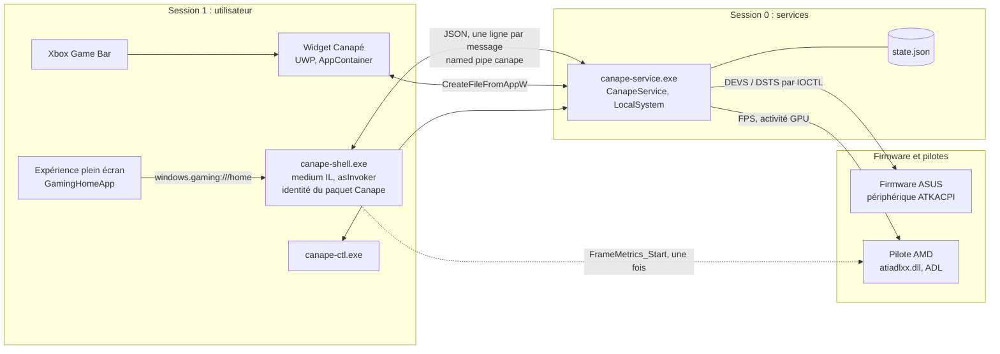
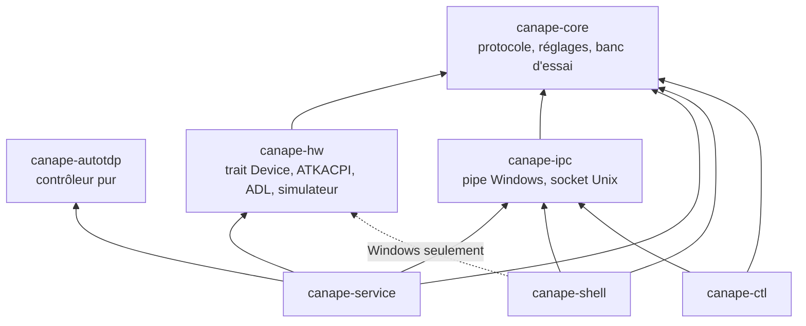
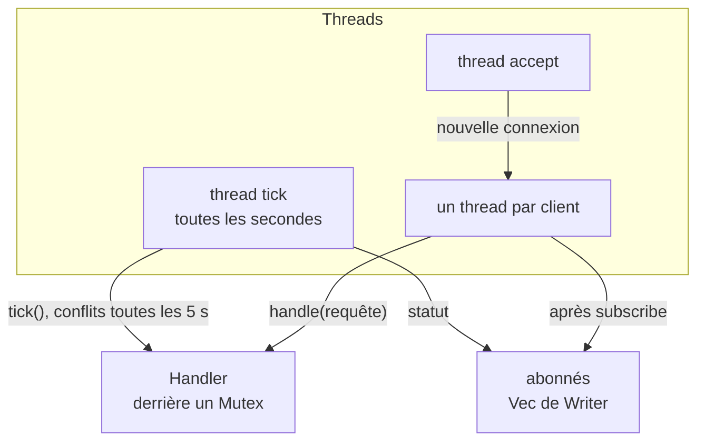
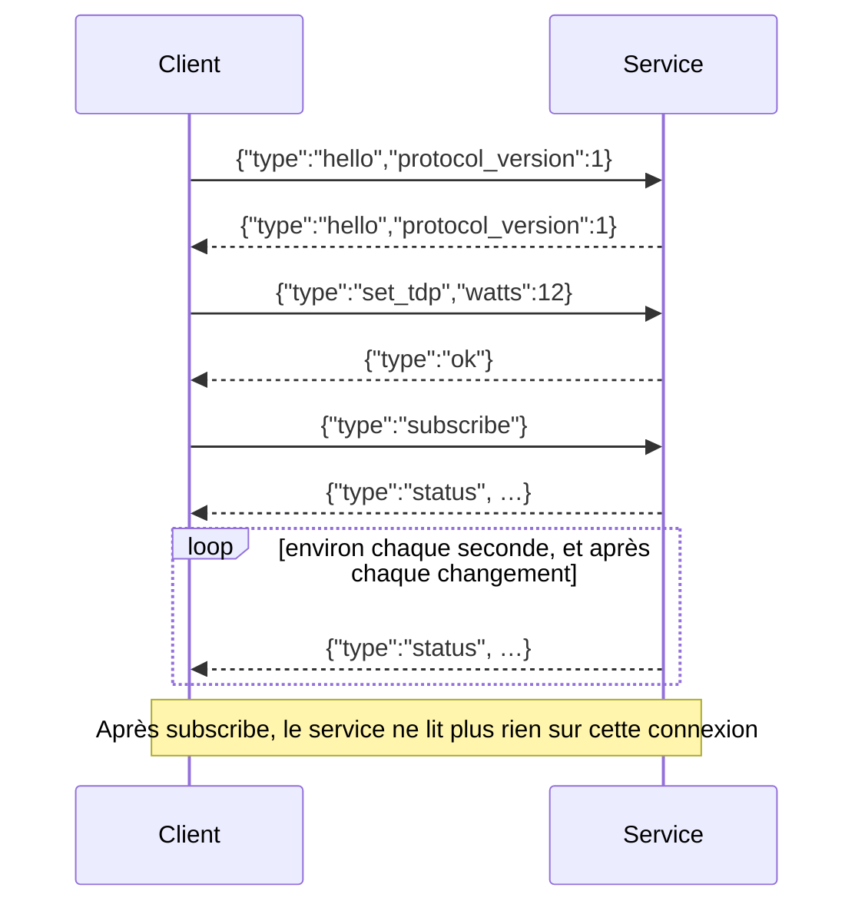
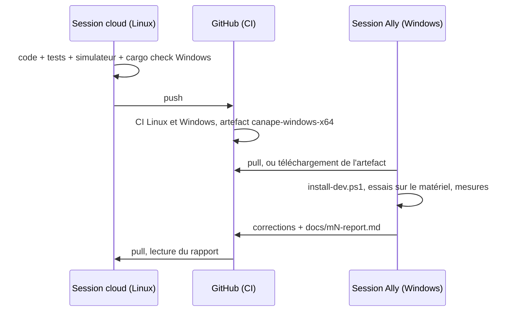

# Guide du développeur

[🇬🇧 English version](developer-guide.en.md) · [📚 Index de la documentation](README.md)

Ce guide décrit l'architecture de Canapé, le protocole entre ses composants, la façon de compiler et de tester (sous Linux sans matériel comme sur l'Ally), l'empaquetage, le widget, les traductions et les règles du projet.

## Sommaire

- [Architecture](#architecture)
  - [Processus, sessions et niveaux d'intégrité](#processus-sessions-et-niveaux-dintégrité)
  - [Crates](#crates)
  - [Le service de l'intérieur](#le-service-de-lintérieur)
- [Protocole IPC](#protocole-ipc)
  - [Transport](#transport)
  - [Requêtes](#requêtes)
  - [Réponses](#réponses)
  - [Le statut](#le-statut)
  - [Types imbriqués](#types-imbriqués)
  - [Erreurs](#erreurs)
  - [Faire évoluer le protocole](#faire-évoluer-le-protocole)
- [Compiler et tester sous Linux](#compiler-et-tester-sous-linux)
  - [Service et shell avec le simulateur](#service-et-shell-avec-le-simulateur)
  - [Variables d'environnement](#variables-denvironnement)
  - [Captures d'écran avec Xvfb](#captures-décran-avec-xvfb)
- [Compiler et tester sous Windows](#compiler-et-tester-sous-windows)
- [Intégration continue](#intégration-continue)
- [Empaquetage](#empaquetage)
- [Le widget Game Bar](#le-widget-game-bar)
- [Traductions](#traductions)
- [Notes sur le matériel](#notes-sur-le-matériel)
- [Conventions](#conventions)
- [Travailler à deux sessions : l'Ally et le cloud](#travailler-à-deux-sessions--lally-et-le-cloud)

## Architecture

Canapé est fait de trois programmes qui tournent en même temps, plus un outil en ligne de commande. **Seul le service a des droits élevés** et touche au matériel ; l'interface et le widget ne font qu'envoyer des requêtes.



### Processus, sessions et niveaux d'intégrité

| Processus | Session | Intégrité / compte | Identité | Démarré par |
|---|---|---|---|---|
| `canape-service.exe` | 0 | LocalSystem | aucune | Gestionnaire de services, au boot (démarrage automatique, redémarrage après plantage : 3 fois, 2 s d'attente) |
| `canape-shell.exe` | 1 | **medium IL** (`asInvoker`) | paquet sparse `Canape`, AUMID `Canape_<hash>!App` | Le FSE, avec `windows.gaming:///home` ; ou `shell:AppsFolder\…` |
| Widget | 1 | AppContainer (low IL) | paquet `Canape.Widget` | La Game Bar |
| `canape-ctl.exe` | 1 | celui du terminal | aucune | À la main |

Conséquences :

- Le FSE n'active l'app d'accueil qu'en **medium IL** : le shell doit rester `asInvoker` et ne rien demander de privilégié. Tout ce qui touche au matériel passe par le service.
- Le service, en **session 0**, n'a ni écran ni fenêtres : il ne peut pas savoir quel jeu est au premier plan (le shell le lui dit, `foreground_app`) et le pilote AMD refuse d'y démarrer le comptage des images (le shell le démarre, voir [Notes sur le matériel](#adl-depuis-la-session-0)).
- Le widget vit dans un AppContainer : il ouvre le pipe avec `CreateFileFromAppW`, et la DACL du pipe l'autorise explicitement.
- Le shell est **à instance unique** (mutex `Local\Canape.Shell`) : une deuxième activation ramène la fenêtre existante au premier plan et se termine. Le FSE active parfois l'accueil plusieurs fois au boot (voir [m1-report.md](m1-report.md)).

### Crates



| Crate | Type | Rôle | Fichiers clés |
|---|---|---|---|
| `canape-core` | bibliothèque | Protocole (`Request`, `Response`, `Status`), réglages (`AutoTdpSettings`, `PerformanceMode`, `Profile`), banc d'essai (`BenchPlan`, `BenchReport` et ses recommandations), journal minimal | `protocol.rs`, `settings.rs`, `bench.rs`, `log.rs` |
| `canape-autotdp` | bibliothèque | Contrôleur d'auto TDP : machine à états pure, nourrie d'un `Sample` par seconde, sans dépendance au système | `lib.rs` |
| `canape-hw` | bibliothèque | Trait `Device` ; backend Ally (Windows) au-dessus d'ATKACPI et d'ADL ; `MockDevice` pour le reste | `lib.rs`, `atk.rs`, `windows.rs`, `adl.rs`, `mock.rs` |
| `canape-ipc` | bibliothèque | Une `Connection` qui envoie et reçoit des lignes JSON ; named pipe sous Windows, socket Unix ailleurs | `lib.rs`, `windows.rs`, `unix.rs` |
| `canape-service` | binaire | Service Windows : état, auto TDP, profils, banc d'essai, détection des conflits, serveur IPC, persistance | `handler.rs`, `server.rs`, `bench_run.rs`, `conflicts.rs`, `winsvc.rs` |
| `canape-shell` | binaire | App d'accueil Slint (rendu logiciel) : 5 pages, graphes de puissance et de GPU en direct, sélecteur de couleur d'accent, manette XInput, suivi du premier plan, 13 langues | `main.rs`, `link.rs`, `ui/*.slint`, `i18n.rs`, `report.rs`, `nav.rs`, `foreground.rs`, `history.rs`, `accent.rs` |
| `canape-ctl` | binaire | Envoie une requête JSON, ou `watch` pour suivre le statut | `main.rs` |

Le shell dépend de `canape-hw` sous Windows uniquement pour `arm_frame_metrics()` (démarrer le comptage des images du pilote AMD depuis la session utilisateur) ; il n'écrit jamais dans le firmware.

### Le service de l'intérieur



- `Handler` (`handler.rs`) contient tout l'état et traite les requêtes, indépendamment du transport ; il est testé avec `MockDevice`.
- Le thread **tick** appelle `Handler::tick()` chaque seconde (mesures, banc d'essai, auto TDP), cherche les programmes en conflit tous les 5 ticks, enregistre `state.json` si des watts appris ou un banc d'essai ont changé l'état, puis pousse le statut aux abonnés.
- Chaque **client** a son thread. Une requête qui modifie l'état est journalisée (`SetTdp { watts: 12 } -> Ok`), suivie d'un enregistrement de `state.json` si la réponse est `ok`, puis d'un statut poussé à tous les abonnés.
- Arguments de `canape-service.exe` :

| Argument | Effet |
|---|---|
| *(aucun)* | Lancé par le gestionnaire de services ; lancé à la main sous Windows, se replie sur `--console`. |
| `--console` | Sert le pipe (ou le socket) au premier plan, sur tout OS ; journal sur stderr. |
| `--stdio` | Lit des requêtes JSON sur stdin et répond sur stdout, sans thread tick (ni auto TDP, ni statut poussé). Pour des essais rapides. |
| `install` / `uninstall` | Windows, administrateur : enregistre (et démarre) ou supprime le service `CanapeService`. |

## Protocole IPC

Les types sont définis dans [`crates/canape-core/src/protocol.rs`](../crates/canape-core/src/protocol.rs). Le widget C# reproduit la même chose à la main dans `widget/CanapeWidget/CanapeLink.cs`.

### Transport

| | Windows | Linux, macOS (développement) |
|---|---|---|
| Canal | Named pipe `\\.\pipe\canape` | Socket Unix : `$CANAPE_SOCKET`, sinon `$XDG_RUNTIME_DIR/canape.sock`, sinon `<tmp>/canape.sock` |
| Format | Un objet JSON par ligne (UTF-8, terminé par `\n`) | idem |
| Sécurité | DACL `D:P(A;;GA;;;SY)(A;;GA;;;BA)(A;;GRGW;;;IU)(A;;GRGW;;;AC)S:(ML;;NW;;;LW)` : contrôle total pour SYSTEM et les administrateurs, lecture / écriture pour l'utilisateur interactif et **toutes** les apps AppContainer, étiquette d'intégrité basse pour que le widget puisse écrire. Clients distants refusés, première instance exclusive (personne d'autre ne peut servir ce nom). | Droits du fichier socket |

Les messages sont des enums Serde à étiquette interne : le champ `type` donne la variante en `snake_case`, les autres champs sont à côté. Un `Option` vide s'écrit `null`.

**Déroulement d'une connexion**



- Chaque client **devrait** commencer par `hello`. Le service ne l'impose pas, mais refuse une version différente de `1`.
- Une requête reçoit exactement une réponse, dans l'ordre.
- Après `subscribe`, la connexion ne fait plus que recevoir. Raison : sous Windows, les entrées / sorties d'un pipe synchrone sont sérialisées sur le même objet fichier ; une lecture en attente bloquerait les écritures du thread tick (bug trouvé en M2, voir [m2-report.md](m2-report.md)). Les clients utilisent donc **une connexion d'abonnement et une ou plusieurs connexions de commandes** (le shell en garde une ouverte, le widget en ouvre une par commande).
- Une ligne qui n'est pas du JSON valide ferme la connexion (ligne `client error: …` dans le journal) ; seul le mode `--stdio` renvoie une `error`.
- Le client Windows réessaie pendant 2 s si toutes les instances du pipe sont occupées.

### Requêtes

| Requête | Champs | Réponse | Effet |
|---|---|---|---|
| `hello` | `protocol_version: u32` | `hello` ou `error` | Vérifie la version (actuelle : `1`). |
| `get_status` | — | `status` | Statut courant. |
| `subscribe` | — | `status`, puis un `status` environ chaque seconde | La connexion devient « push » seulement. |
| `set_performance_mode` | `mode` : `silent` \| `performance` \| `turbo` \| `manual` | `ok` / `error` | Désactive l'auto TDP. Un mode firmware remet `tdp_watts` à `null`. Refusé pendant un banc d'essai. |
| `set_tdp` | `watts: u32` | `ok` / `error` | TDP manuel (sPPT, SPL, fPPT), mode `manual`, auto TDP désactivé. Refusé hors de la plage du modèle et pendant un banc d'essai. |
| `set_auto_tdp` | `settings: AutoTdpSettings` | `ok` / `error` | Active (ou désactive avec `enabled: false`) l'auto TDP. Pendant un profil, modifie le profil. Refusé pendant un banc d'essai. |
| `set_battery_charge_limit` | `percent: u8` (40 à 100) | `ok` / `error` | Limite de charge de la batterie. |
| `foreground_app` | `exe: string \| null` | `ok` | Programme au premier plan (envoyé par le shell) ; applique ou quitte le profil correspondant. |
| `save_profile` | `profile: Profile` | `ok` / `error` | Crée ou remplace le profil de `profile.exe` (casse ignorée) ; le réapplique s'il est actif. |
| `delete_profile` | `exe: string` | `ok` | Supprime le profil ; rend la main à l'état général s'il était actif. |
| `list_profiles` | — | `profiles` | Tous les profils. |
| `start_bench` | `plan: BenchPlan` | `ok` / `error` | Lance un banc d'essai (il faut au moins 5 FPS). Le plan est borné à la plage du modèle ; pas et durées au moins à 1. |
| `cancel_bench` | — | `ok` / `error` | Arrête le banc d'essai en gardant un rapport partiel. |
| `get_bench_report` | — | `bench` | Le dernier rapport terminé ou annulé (pendant un banc d'essai, le précédent). |
| `set_accent` | `color: string` (`#rrggbb`) | `ok` / `error` | Couleur d'accent de l'interface, partagée par le shell et le widget. Validée (`#` et six chiffres hexadécimaux, sinon une erreur), stockée en minuscules, enregistrée dans `state.json` et poussée dans `status.accent`. |

Exemples :

```json
{"type":"set_performance_mode","mode":"turbo"}
{"type":"set_auto_tdp","settings":{"enabled":true,"target_fps":60,"min_watts":7,"max_watts":25,"battery_max_watts":15,"max_temp_c":85}}
{"type":"set_battery_charge_limit","percent":80}
{"type":"foreground_app","exe":"eldenring.exe"}
{"type":"foreground_app","exe":null}
{"type":"save_profile","profile":{"exe":"eldenring.exe","auto_tdp":{"enabled":true,"target_fps":60,"min_watts":7,"max_watts":19,"battery_max_watts":null,"max_temp_c":null},"learned_watts":16}}
{"type":"delete_profile","exe":"eldenring.exe"}
{"type":"start_bench","plan":{"from_watts":25,"to_watts":7,"step_watts":3,"settle_secs":5,"measure_secs":15}}
{"type":"set_accent","color":"#14b8a6"}
```

### Réponses

| Réponse | Champs | Exemple |
|---|---|---|
| `hello` | `protocol_version` | `{"type":"hello","protocol_version":1}` |
| `status` | les champs du [statut](#le-statut), à plat | `{"type":"status","tdp_watts":16,…}` |
| `ok` | — | `{"type":"ok"}` |
| `error` | `message` (anglais, non traduit) | `{"type":"error","message":"a bench is running: cancel it first"}` |
| `profiles` | `profiles: [Profile]` | `{"type":"profiles","profiles":[…]}` |
| `bench` | `report: BenchReport \| null` | `{"type":"bench","report":null}` |

### Le statut

```json
{
  "type": "status",
  "tdp_watts": 16,
  "performance_mode": "manual",
  "auto_tdp": {"enabled": true, "target_fps": 60, "min_watts": 7, "max_watts": 25, "battery_max_watts": 15, "max_temp_c": 85},
  "fps": 61.2,
  "gpu_util": 0.93,
  "power_watts": 14.6,
  "cpu_temp_c": 78.0,
  "battery_percent": 64,
  "conflicts": [],
  "foreground": "eldenring.exe",
  "active_profile": "eldenring.exe",
  "on_battery": true,
  "thermal_limited": false,
  "bench": null,
  "accent": "#ff3d5e"
}
```

| Champ | Type | Signification |
|---|---|---|
| `tdp_watts` | `u32 \| null` | Limite appliquée par Canapé. `null` en mode firmware (le firmware ne la communique pas) ou avant tout réglage. |
| `performance_mode` | `string \| null` | `silent`, `performance`, `turbo`, `manual`, ou `null` si rien n'a encore été appliqué. |
| `auto_tdp` | `AutoTdpSettings` | Réglages en vigueur : globaux, ou ceux du profil actif. Valeurs telles que réglées (non bornées au modèle). |
| `fps` | `f32 \| null` | FPS du dernier tick (pilote AMD). |
| `gpu_util` | `f32 \| null` | Activité GPU entre 0 et 1. |
| `power_watts` | `f32 \| null` | Ce que l'APU consomme réellement, en watts (`tdp_watts` n'en est que la limite). Tracé face à la limite dans les graphes du shell et du widget. Facultatif en entrée. |
| `cpu_temp_c` | `f32 \| null` | Température CPU en °C. |
| `battery_percent` | `u8 \| null` | Charge de la batterie. |
| `foreground` | `string \| null` | Programme au premier plan signalé par le shell. |
| `active_profile` | `string \| null` | `exe` du profil appliqué. |
| `on_battery` | `bool \| null` | `true` sur batterie, `false` sur secteur. |
| `thermal_limited` | `bool` | L'auto TDP retient la puissance à cause de la limite de température. |
| `bench` | `BenchProgress \| null` | Progression du banc d'essai en cours. |
| `accent` | `string \| null` | Couleur d'accent `#rrggbb`, dès qu'un client en a choisi une (`set_accent`). Le shell l'adopte quand elle change ailleurs et donne la sienne à un service qui n'en a pas ; le widget la suit. Facultatif en entrée. |

### Types imbriqués

**`AutoTdpSettings`**

| Champ | Type | Défaut | |
|---|---|---|---|
| `enabled` | `bool` | `false` | |
| `target_fps` | `u32` | `60` | 0 refusé |
| `min_watts` | `u32` | `7` | |
| `max_watts` | `u32` | `25` | |
| `battery_max_watts` | `u32 \| null` | `null` | facultatif en entrée |
| `max_temp_c` | `u32 \| null` | `null` | facultatif en entrée |

**`Profile`** : `exe` (string, comparé sans la casse), `auto_tdp` (`AutoTdpSettings`), `learned_watts` (`u32 | null`, facultatif).

**`BenchPlan`** : `from_watts` (25), `to_watts` (7), `step_watts` (3), `settle_secs` (5), `measure_secs` (15).

**`BenchProgress`** : `step` (à partir de 1), `steps`, `watts`, `seconds_left`. Exemple : `{"step":2,"steps":7,"watts":22,"seconds_left":110}`.

**`BenchReport`**

```json
{
  "exe": "eldenring.exe",
  "started_unix": 1792615847,
  "plan": {"from_watts": 25, "to_watts": 7, "step_watts": 3, "settle_secs": 5, "measure_secs": 15},
  "points": [
    {"watts": 7, "fps_avg": 31.0, "fps_low": 25.0, "gpu_avg": 0.98, "temp_max": 67.0, "samples": 15},
    {"watts": 10, "fps_avg": 44.0, "fps_low": 38.0, "gpu_avg": 0.97, "temp_max": 70.0, "samples": 15}
  ],
  "completed": true
}
```

`points` est trié par puissance croissante. Les recommandations (`sweet_spot`, `watts_for`, `most_efficient`) sont des méthodes de `BenchReport`, calculées côté client ; voir [Auto TDP et banc d'essai](auto-tdp.fr.md#les-trois-recommandations).

### Erreurs

| Message | Cause |
|---|---|
| `unsupported protocol version N, expected 1` | `hello` avec une autre version |
| `a bench is running: cancel it first` | `set_performance_mode`, `set_tdp`, `set_auto_tdp` ou `start_bench` pendant un banc d'essai |
| `invalid auto TDP settings` | Minimum au-dessus du maximum après bornage au modèle, ou objectif à 0 |
| `a profile needs an executable name` | `save_profile` avec un `exe` vide |
| `no bench is running` | `cancel_bench` sans banc d'essai |
| `no frame rate: start a game before the bench` | `start_bench` sous 5 FPS |
| `not a #RRGGBB colour: …` | `set_accent` avec autre chose que `#` et six chiffres hexadécimaux |
| `value out of range: …` | Watts hors de la plage du modèle, limite de charge hors de 40 à 100 % |
| `firmware refused: DEVS 0x… = … returned …` | Le firmware n'a pas renvoyé 1 |
| `device I/O failed: …` | `DeviceIoControl` a échoué |

### Faire évoluer le protocole

- Un nouveau champ de `Status` ou de `AutoTdpSettings` prend `#[serde(default)]` : les anciens clients l'ignorent, et un ancien `state.json` reste lisible.
- Une nouvelle requête est une nouvelle variante de `Request` ; pensez à l'ajouter à la liste des requêtes en lecture seule de `server.rs` si elle ne modifie rien (sinon elle est journalisée et déclenche un enregistrement).
- Un changement incompatible augmente `PROTOCOL_VERSION`, côté Rust **et** dans `CanapeLink.cs`.
- Le widget ne réécrit que les champs qu'il connaît : `set_auto_tdp` renvoie l'objet `auto_tdp` reçu en entier, en ne changeant que `enabled` et `target_fps`.

## Compiler et tester sous Linux

La session cloud n'a pas de matériel : tout se teste avec le simulateur (`MockDevice`).

**Dépendances** (Debian / Ubuntu, comme la CI) :

```sh
sudo apt-get install -y libxkbcommon-dev libfontconfig1-dev
```

Pour afficher le shell, il faut un serveur X (le backend Slint est winit + X11, rendu logiciel). Le shell active la feature Slint `software-renderer-path` à côté de `renderer-software` : sans elle, le rendu logiciel ne dessine pas les éléments `Path` et les graphes restent vides.

**Vérifications avant de pousser** (règle du projet) :

```sh
cargo fmt --all --check
cargo clippy --all-targets -- -D warnings
cargo test
rustup target add x86_64-pc-windows-msvc   # une fois
cargo check --target x86_64-pc-windows-msvc --all-targets
```

`cargo test` lance 64 tests à ce jour : contrôleur d'auto TDP (dont une simulation du cas d'oscillation de M4), handler du service (profils, banc d'essai, persistance), banc d'essai, ATKACPI, IPC, navigation à la manette, suivi du premier plan, langues et complétude des catalogues. Le `cargo check` Windows attrape le code `#[cfg(windows)]` que Linux ne compile pas, sans pouvoir l'exécuter.

### Service et shell avec le simulateur

```sh
# Terminal 1 : le service, avec un « jeu » simulé à 60 FPS
CANAPE_MOCK_FPS=60 cargo run -p canape-service -- --console

# Terminal 2 : suivre le statut, envoyer des commandes
cargo run -p canape-ctl -- watch
cargo run -p canape-ctl -- '{"type":"set_auto_tdp","settings":{"enabled":true,"target_fps":60,"min_watts":7,"max_watts":25}}'

# Terminal 3 : le shell dans une fenêtre
CANAPE_WINDOWED=1 cargo run -p canape-shell
```

Le simulateur : plage de 7 à 30 W, activité GPU 70 %, 55 °C, batterie 80 % sur secteur, limite de charge 40 à 100 %. Les FPS restent ceux de `CANAPE_MOCK_FPS` quelle que soit la puissance : l'auto TDP descend donc jusqu'au minimum (un objectif à 60 avec 60 FPS et 70 % de GPU déclenche la règle du GPU au repos).

Au clavier, le shell se pilote comme à la manette : Tab / Maj+Tab, Entrée ou Espace, Échap, Page préc. / Page suiv.

Sous Linux, le shell ne suit pas le premier plan. Pour simuler un jeu, envoyez-le au service :

```sh
cargo run -p canape-ctl -- '{"type":"foreground_app","exe":"eldenring.exe"}'
cargo run -p canape-ctl -- '{"type":"start_bench","plan":{"from_watts":25,"to_watts":7,"step_watts":3,"settle_secs":1,"measure_secs":2}}'
```

Hors Windows, les journaux et l'état vont dans `<tmp>/Canape/` (`service.log`, `state.json`, `shell.log`, `shell.json`, avec `<tmp>` = `$TMPDIR` ou `/tmp`). Supprimez `state.json` pour repartir d'un état vierge.

### Variables d'environnement

| Variable | Lue par | Effet |
|---|---|---|
| `CANAPE_MOCK_FPS` | service (simulateur) | FPS simulés, par exemple `60`. Sans elle, `fps` vaut `null` et l'auto TDP ne bouge pas. Sert aussi sous Windows quand le simulateur est utilisé. |
| `CANAPE_SOCKET` | service, shell, `canape-ctl` (hors Windows) | Chemin du socket Unix. |
| `CANAPE_WINDOWED` | shell | Présente (n'importe quelle valeur) : fenêtre au lieu du plein écran. |
| `CANAPE_PAGE` | shell | Page ouverte au démarrage : 0 Accueil, 1 Performance, 2 Profils, 3 Banc d'essai, 4 Réglages. |
| `LC_ALL`, `LC_MESSAGES`, `LANGUAGE`, `LANG` | shell (hors Windows) | Langue en mode Automatique, dans cet ordre de priorité. |
| `TMPDIR` | tous (hors Windows) | Dossier temporaire, donc emplacement de `Canape/`. |

### Captures d'écran avec Xvfb

Les captures de `docs/images/` sont faites ainsi (recette vérifiée) :

```sh
export TMPDIR=$(mktemp -d) CANAPE_SOCKET=/tmp/doc.sock   # state.json et shell.json vierges
Xvfb :99 -screen 0 1280x720x24 &
CANAPE_MOCK_FPS=60 ./target/debug/canape-service --console &
./target/debug/canape-ctl '{"type":"foreground_app","exe":"eldenring.exe"}'   # plus profils, accent, banc d'essai court…
DISPLAY=:99 CANAPE_WINDOWED=1 CANAPE_PAGE=1 LANG=fr_FR.UTF-8 ./target/debug/canape-shell &
for w in 15 18 22 17 12 9 13 19 …; do ./target/debug/canape-ctl "{\"type\":\"set_tdp\",\"watts\":$w}"; sleep 2.5; done
DISPLAY=:99 import -window root docs/images/fr/performance.png   # ImageMagick
```

- 1280×720 correspond à l'écran 1080p de l'Ally à 150 %.
- `LANG=<locale>` (ou `LANGUAGE=<code>`) choisit la langue (le mode Automatique la suit) ; sinon, enregistrez un choix dans `<tmp>/Canape/shell.json` (`{"language":"ja"}`).
- Préparez l'état avec `canape-ctl` (profils, premier plan, accent, banc d'essai) avant de lancer le shell. Un banc d'essai court (`settle_secs` 1, `measure_secs` 2) remplit la page de résultats en 20 s environ.
- Les graphes gardent la dernière minute **dans le shell** : laissez-le tourner au moins 60 s pendant que le TDP change (le simulateur consomme 90 % de la limite, avec un GPU fixe à 70 %), sinon les courbes sont plates ou courtes.
- Le shell n'est à instance unique que sous Windows : sous Linux, un écran Xvfb par shell permet de capturer plusieurs pages à la fois.
- Fichiers : `docs/images/<langue>/<page>.png` (`home`, `performance`, `profiles`, `bench-results`, `bench-running`, `settings`), `docs/images/accent-<couleur>.png` pour les variantes d'accent. Optimisez avec `pngquant` puis `optipng`.
- Un `shell.json` ou un `state.json` resté dans `<tmp>/Canape/` change ce qui s'affiche : utilisez un `TMPDIR` dédié pour des captures reproductibles.

## Compiler et tester sous Windows

**Prérequis** : Rust (toolchain MSVC), Visual Studio Build Tools 2022 avec les outils C++ et le Windows SDK, mode développeur.

```powershell
cargo build --release -p canape-shell -p canape-service -p canape-ctl
```

> [!WARNING]
> **Smart App Control** bloque les build scripts non signés d'une compilation neuve (`os error 4551`). Solutions : relancer, compiler en debug, utiliser les binaires de la CI, ou désactiver Smart App Control (difficile à réactiver). Voir [m1-report.md](m1-report.md) et [m2-report.md](m2-report.md).

**Installer** sur la machine : `packaging\install-dev.ps1` (voir le [guide d'utilisation](user-guide.fr.md#installer-canapé)).

**Lancer le service à la main** pour voir son journal :

```powershell
Stop-Service CanapeService       # un seul serveur peut posséder le pipe
& .\target\release\canape-service.exe --console
```

> [!IMPORTANT]
> Lancé **sans droits administrateur**, ou sur un PC qui n'est pas une Ally reconnue, le service ne peut pas ouvrir `\\.\ATKACPI` et **bascule silencieusement sur le simulateur** (`device = mock` dans le journal). Vérifiez toujours la ligne `device = ROG Ally`.

**Pièges de Windows PowerShell 5.1** :

- les guillemets d'un argument JSON passé à un `.exe` doivent être échappés (`'{\"type\":\"get_status\"}'`) ;
- `if (…) { @("--release") }` renvoie une chaîne, que le splatting passe caractère par caractère (corrigé dans `install-dev.ps1`) ;
- `Stop-Process` rend la main avant que l'exécutable soit libéré : attendre avec `Wait-Process`.

Pour tester le shell **avec l'identité du paquet** (comme le FSE), passez par `install-dev.ps1` puis `explorer.exe shell:AppsFolder\Canape_<hash>!App`.

## Intégration continue

[`.github/workflows/ci.yml`](../.github/workflows/ci.yml) tourne à chaque push, pull request ou lancement manuel :

| Job | Étapes |
|---|---|
| `windows` (windows-latest) | `cargo fmt --all --check`, `cargo clippy --all-targets -- -D warnings`, `cargo test`, `cargo build --release` des trois binaires, artefact **`canape-windows-x64`** (`canape-shell.exe`, `canape-service.exe`, `canape-ctl.exe`) |
| `linux` (ubuntu-latest) | Dépendances X11 / fontconfig, `cargo clippy --all-targets -- -D warnings`, `cargo test` |

L'artefact s'installe sur l'Ally avec `install-dev.ps1 -BinariesDir` : c'est le moyen de contourner Smart App Control. Le widget n'est pas compilé par la CI.

Profil release (`Cargo.toml`) : `opt-level = "s"`, LTO, `codegen-units = 1`, `panic = "abort"`, symboles retirés.

## Empaquetage


| Fichier | Rôle |
|---|---|
| [`packaging/identity/AppxManifest.xml`](../packaging/identity/AppxManifest.xml) | Identité `Canape`, éditeur `CN=Canape Dev`, Windows 10.0.26100 minimum. `uap10:AllowExternalContent`. Application `App` → `canape-shell.exe`, `uap10:TrustLevel="mediumIL"`, `uap10:RuntimeBehavior="win32App"`. Extension `uap3:AppExtension Name="windows.gamingApp"`. Capacités `runFullTrust`, `unvirtualizedResources` et `Microsoft.appCategory.gamingHome_8wekyb3d8bbwe`. |
| [`packaging/identity/CustomCapability.SCCD`](../packaging/identity/CustomCapability.SCCD) | Débloque la capacité `gamingHome`. `AllowAny="true"`, catalogue `FFFF` (test) : **mode développeur obligatoire**. Copié aussi à la racine de l'installation. |
| [`crates/canape-shell/canape-shell.exe.manifest`](../crates/canape-shell/canape-shell.exe.manifest) | Intégré à l'exe par `build.rs` (MSVC) : élément `msix` qui lie l'exe au paquet (`publisher`, `packageName`, `applicationId` identiques au manifeste du paquet), `asInvoker`, DPI PerMonitorV2. |
| [`packaging/install-dev.ps1`](../packaging/install-dev.ps1) | Compile, installe le service, crée le certificat, `makeappx pack`, `signtool sign`, `Add-AppxPackage -ExternalLocation`, et éventuellement `GamingHomeApp`. |

**Certificat de développement** : auto-signé, sujet `CN=Canape Dev`, usage « signature de code » (`1.3.6.1.5.5.7.3.3`), créé dans `CurrentUser\My`, exporté en `.pfx` (mot de passe `canape-dev`) et `.cer` dans `$HOME\dev\canape-cert`, le `.cer` importé dans `LocalMachine\TrustedPeople`. Il signe le paquet d'identité et le widget. L'éditeur du certificat, du manifeste du paquet et du manifeste de l'exe doivent rester identiques.

**Choix de l'accueil** : par l'utilisateur dans Paramètres → Jeux → Expérience plein écran, ou en écrivant la valeur non documentée `HKCU\Software\Microsoft\Windows\CurrentVersion\GamingConfiguration\GamingHomeApp = <PFN>!App`. Au boot, si `StartupToGamingHome = 1`, Windows active cet AUMID avec l'argument `windows.gaming:///home` (`args=[]` hors FSE).

> [!NOTE]
> Une distribution hors mode développeur demanderait un SCCD signé par Microsoft. C'est hors périmètre tant que Canapé reste un projet personnel.

## Le widget Game Bar

| Point | Choix |
|---|---|
| Technologie | **C# UWP compilé en .NET Native** : la Game Bar n'accepte que des apps UWP XAML (pas WinUI 3). Projet dérivé de l'exemple officiel `WidgetSampleCS` (MIT). |
| SDK | `Microsoft.Gaming.XboxGameBar` **7.2.240903001** (la 7.3.x casse la compilation). Le bloc `proxyStub` du manifeste correspond à cette version. |
| Cible | `TargetPlatformVersion` 10.0.26100.0 (SDK installé sur l'Ally), `TargetPlatformMinVersion` 10.0.19041.0. `mp:PhoneIdentity` requis par les cibles d'empaquetage UWP. |
| Pipe | `CreateFileFromAppW` (autorisé depuis un AppContainer depuis Windows 10 2004). Une connexion d'abonnement, puis une connexion courte par commande, reconnexion toutes les 2 s. |
| Paquet | `Canape.Widget`, extension `microsoft.gameBarUIExtension`, signé avec le certificat de développement. |
| Fichiers | `widget/CanapeWidget/` : `CanapeLink.cs` (client du pipe), `WidgetPage.xaml(.cs)` (interface), `Strings/<langue>/Resources.resw`, `Package.appxmanifest`. |

**Compiler** : workload `Microsoft.VisualStudio.Workload.UniversalBuildTools` puis `packaging\build-widget.ps1` (voir le [guide d'utilisation](user-guide.fr.md#le-widget-xbox-game-bar)). Le script lance MSBuild (Release x64, sideload, signé), puis `Add-AppxPackage` en ne passant **que les frameworks absents ou plus anciens** : réinstaller VCLibs ou .NET Native alors que la Game Bar les utilise échoue avec `0x80073D02` ([m3-report.md](m3-report.md)).

Le widget ne se compile que sur Windows avec les outils UWP : il n'est vérifié ni par la CI, ni par la session cloud.

## Traductions

### Shell (Slint + gettext)

- Toute chaîne visible passe par `@tr("…")` dans `crates/canape-shell/ui/*.slint`. Les nombres restent des nombres jusqu'à l'affichage : les formats (`"{} W"`, `"{} %"`, `"{} °C"`, le séparateur décimal) sont eux-mêmes traduits.
- Catalogues : `crates/canape-shell/lang/<code>/LC_MESSAGES/canape-shell.po`, intégrés à l'exe par `build.rs` (`with_bundled_translations("lang")`, sans contexte par défaut : une chaîne est traduite une seule fois). Seule exception : `msgctxt "decimal separator"` pour `"."`.
- L'anglais est la langue source : pas de catalogue.
- `shell.json` (`%LOCALAPPDATA%\Canape\`, `<tmp>/Canape/` hors Windows) contient `language` et `accent`. `accent` est désormais une couleur hexadécimale `#rrggbb` ; les codes des versions précédentes (`red`, `blue`, `violet`, `green`, `orange`, `cyan`) sont convertis au chargement, toute autre valeur donne `#ff3d5e`. Un choix est enregistré et envoyé par `set_accent` après 600 ms sans changement.
- `i18n.rs` choisit le catalogue : choix enregistré dans `shell.json` s'il est fourni, sinon la première langue préférée de Windows (`GetUserPreferredUILanguages`) ou de l'environnement POSIX qui est fournie, sinon l'anglais. Correspondance par code de base (`pt-BR` → `pt`, `zh-*` → `zh_CN`).

**Ajouter une langue au shell**

1. Ajoutez le code (nom du dossier) à `LANGUAGES` dans [`i18n.rs`](../crates/canape-shell/src/i18n.rs). Si le code ne correspond pas au code de base des balises de Windows, adaptez `match_locale` (comme pour `zh_CN`).
2. Copiez `lang/fr/LC_MESSAGES/canape-shell.po` vers `lang/<code>/LC_MESSAGES/canape-shell.po`, mettez à jour l'en-tête (`Language`, `Plural-Forms`) et traduisez chaque `msgstr`. **Une ligne par champ** : le test ne lit pas les chaînes sur plusieurs lignes. Gardez le même nombre de `{}`.
3. Ajoutez une tuile dans la grille `rows` de `SettingsPage` ([`pages.slint`](../crates/canape-shell/ui/pages.slint)), avec le nom de la langue dans la langue elle-même (il reste deux cases vides).
4. `cargo test -p canape-shell` : le test `every_language_translates_every_string` vérifie que chaque catalogue contient chaque `@tr` des sources, sans traduction vide, avec les mêmes `{}`, et sans entrée périmée.
5. Faites des captures de chaque page avec Xvfb et `LANGUAGE=<code>` : les textes trop longs sont coupés (`…`).

Ajouter une chaîne à l'interface demande d'ajouter son entrée dans les 12 catalogues, sinon ce même test échoue.

### Widget (.resw)

- Chaque chaîne est dans `widget/CanapeWidget/Strings/<balise>/Resources.resw` : `x:Uid` dans le XAML (clés `Nom.Propriété`), `ResourceLoader` dans le code (clés sans point), `ms-resource:` dans le manifeste. Les formats (`FormatWatts`, `FormatPercent`, `FormatCelsius`) sont des ressources.
- Langue par défaut `en-US` ; Windows choisit selon les langues préférées.

**Ajouter une langue au widget** : copiez `Strings/en-US/Resources.resw` vers `Strings/<balise BCP-47>/`, traduisez chaque `<value>` en gardant les clés et les `{0}`, ajoutez `<PRIResource Include="Strings\<balise>\Resources.resw" />` dans `CanapeWidget.csproj`, recompilez. Le détail est dans [`widget/README.md`](../widget/README.md).

Il n'y a pas de test automatique pour le widget. Pour vérifier que toutes les langues ont les mêmes clés que l'anglais :

```sh
cd widget/CanapeWidget/Strings
for f in */Resources.resw; do
  diff <(grep -o 'data name="[^"]*"' en-US/Resources.resw | sort) \
       <(grep -o 'data name="[^"]*"' "$f" | sort) > /dev/null || echo "$f differs"
done
```

## Notes sur le matériel

> [!IMPORTANT]

### ATKACPI

Le firmware ASUS s'atteint par `\\.\ATKACPI` (ouverture en lecture / écriture, partagée), IOCTL `0x0022240C`. Tampon d'entrée : `[méthode u32][longueur des arguments u32][arguments u32…]`, little-endian ; sortie sur 16 octets.

| Méthode | Valeur | Usage |
|---|---|---|
| `DSTS` | `0x53545344` | Lecture. Résultat = valeur + bit de présence `0x00010000` ; 0 si l'ID n'existe pas. |
| `DEVS` | `0x53564544` | Écriture. Le firmware renvoie 1 en cas de succès. |

| ID | Nom | Usage dans Canapé |
|---|---|---|
| `0x001200A0` | sPPT (PL2, boost lent) | TDP, écrit en premier |
| `0x001200A3` | SPL (PL1, soutenu) | TDP, écrit en second |
| `0x001200C1` | fPPT (boost rapide) | TDP, écrit en dernier, seulement si `DSTS` le dit présent |
| `0x00120057` | Limite de charge | 40 à 100 % |
| `0x00120094` | Température CPU | Lecture, valeurs de 1 à 124 °C |


### Modèles

Le modèle est lu dans `HKLM\HARDWARE\DESCRIPTION\System\BIOS\SystemProductName` :

| Contient | Modèle | Plage de TDP |
|---|---|---|
| `RC71` | ROG Ally (Z1 / Z1 Extreme) | 5 à 30 W |
| `RC72` | ROG Ally X | 5 à 30 W |
| `RC73YA` | ROG Xbox Ally (Z2 A) | 5 à 35 W |
| `RC73XA` | ROG Xbox Ally X (Z2 Extreme) | 5 à 35 W |


### ADL depuis la session 0

`atiadlxx.dll` (livrée avec le pilote AMD) est chargée à l'exécution : sans pilote, pas de télémétrie, mais pas d'erreur.

| Appel | Service (session 0) | Session utilisateur |
|---|---|---|
| `ADL2_Main_Control_Create`, liste des adaptateurs | OK, mais aucun adaptateur `present` (pas d'écran) | OK |
| `ADL2_Adapter_FrameMetrics_Start(adaptateur, 0)` | **−1** | 0 |
| `ADL2_Adapter_FrameMetrics_Get` | FPS seulement **après** un `Start` réussi depuis la session utilisateur | OK |
| `ADL2_New_QueryPMLogData_Get`, capteur 19 (activité GFX) | OK | OK |

D'où la solution : au démarrage, le shell appelle `canape_hw::arm_frame_metrics()` (un seul `FrameMetrics_Start`, ligne `adl: …` dans `shell.log`) ; le comptage est global au pilote et le service lit ensuite les FPS. L'adaptateur choisi est l'iGPU AMD intégré qui existe, en préférant un adaptateur `present`. Diagnostic détaillé : [m4-report.md](m4-report.md).

### Pas encore implémenté (M5)

| Fonction | Interface prévue |
|---|---|
| Courbes de ventilateurs | ATKACPI `0x00110024` / `0x00110025` (8 températures + 8 % de PWM) |
| Fréquence de l'écran | `ChangeDisplaySettingsEx` sur l'écran interne |
| Mode de la manette, boutons spéciaux | HID ASUS (VID `0x0B05`, rapport `0x5A`) |

## Conventions

Tirées de [`CLAUDE.md`](../CLAUDE.md) :

| Règle | Détail |
|---|---|
| Langues | Documentation et échanges en français (cette documentation existe aussi en anglais) ; code, commentaires et messages de commit en anglais. |
| Légèreté d'abord | Pas de navigateur embarqué, pas de runtime async sans besoin mesuré, dépendances minimales. Objectifs : service < 10 Mo et ≈ 0 % de CPU au repos, shell < 80 Mo. Mesuré en release (M4) : service 1,3 à 1,4 Mo privés, shell 10,9 à 11,3 Mo privés et 0,31 % d'un cœur au premier plan. |
| Privilèges | Seul `canape-service` a des droits élevés. `canape-shell` reste `asInvoker` : le FSE l'active en medium IL. |
| Avant de pousser | `cargo fmt --all --check`, `cargo clippy --all-targets -- -D warnings`, `cargo test`, `cargo check --target x86_64-pc-windows-msvc --all-targets` depuis Linux. |
| Secrets | Jamais de `.pfx` / `.cer` / `.msix` dans le dépôt (`.gitignore`). |

## Travailler à deux sessions : l'Ally et le cloud

Deux sessions travaillent sur le dépôt et se synchronisent par GitHub :

| Session | Machine | Peut | Ne peut pas |
|---|---|---|---|
| **Ally** | ROG Ally, Windows | Compiler sous Windows, installer, tester le matériel, le FSE, la Game Bar, mesurer mémoire et CPU | — |
| **Cloud** | Linux, sans matériel | Écrire le code, les tests, la documentation ; lancer le simulateur, faire des captures Xvfb ; `cargo check` pour Windows | Exécuter du code Windows, toucher au matériel |



- **Ne jamais affirmer qu'un comportement Windows fonctionne sans l'avoir testé sur l'Ally.** Ce qui n'a été vérifié que sous Linux est marqué comme tel (voir l'[état d'avancement](../README.md#état-davancement)).
- Les essais sur l'Ally donnent lieu à un **rapport d'étape** (`docs/m1-report.md` à `docs/m4-report.md`) : configuration testée et commit de départ, ce qui marche, ce qui a été corrigé, mesures de mémoire et de CPU, problèmes trouvés, ce qui reste ouvert. Les preuves sont datées et chiffrées.
