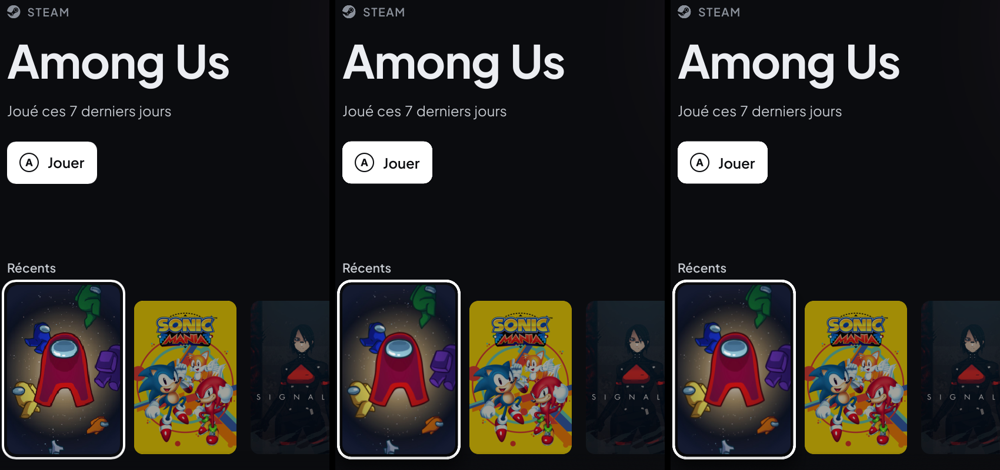

# Essai : rendu logiciel ou rendu par la carte graphique

Le shell dessine avec le rendu logiciel de Slint (voir [architecture.md](architecture.md)). Cet essai mesure sur l'Ally ce que coûteraient les rendus par la carte graphique, avant de décider quoi que ce soit. La version normale du shell n'est pas concernée. **Décision** : on garde le rendu logiciel (voir le bilan en fin de page) ; la version de test a été retirée du code après l'essai, elle reste accessible dans l'historique (c5724d5).

## Deux exécutables

> **Pas encore essayé sur l'Ally.**

Décision suivante : le rendu GPU devient une option, sans coût quand elle est éteinte. Les 82 Mo de la version de test avec le rendu logiciel montrent que lier un rendu GPU coûte de la mémoire même quand il n'est pas choisi ; on ne lie donc jamais les deux dans un même exécutable. Deux exécutables, installés ensemble et construits depuis le même crate :

| Exécutable | Rendu | Construction |
|---|---|---|
| `canape-shell.exe` | Logiciel seulement, comme avant | `cargo build --release -p canape-shell` |
| `canape-shell-gpu.exe` | FemtoVG sur OpenGL seulement, sans wgpu | `cargo build --release -p canape-shell --no-default-features --features gpu` |

`canape-shell.exe` reste celui du FSE (`AppxManifest.xml`). Le réglage `renderer` (`software` ou `gpu`) est dans `shell.json`, proposé dans Réglages → Système → Affichage (« Économe » / « Fluide ») et dans la visite de bienvenue. Au démarrage, `canape-shell.exe` le lit avant de créer sa fenêtre ; sur `gpu`, il lance `canape-shell-gpu.exe`, attend jusqu'à 5 s un événement nommé posé quand la fenêtre a dessiné sa première image, puis se ferme (`renderer::PARENT_STAYS_WAITING` le fait attendre sans fenêtre à la place). En cas d'échec, le réglage repasse sur `software` et le shell continue. Les deux exécutables écrivent `renderer: …` et l'identité du paquet dans `shell.log`. Détails dans le [guide du développeur](developer-guide.fr.md#deux-exécutables--rendu-logiciel-ou-carte-graphique).

À vérifier sur l'Ally : mémoire privée de `canape-shell.exe` avec l'option éteinte (28 Mo attendus, plus les 82 Mo des bibliothèques liées en moins), fluidité avec l'option allumée, réaction du FSE quand `canape-shell.exe` se ferme au profit de l'autre, et identité du paquet de `canape-shell-gpu.exe` dans le journal.

## Ce qu'on sait avant l'essai

- **Rendu logiciel** : 11 Mo privés au premier plan, 14 Mo avec un jeu devant (M4, M5). Sous Windows, il ne redessine que les zones qui changent.
- **OpenGL** : les 115 Mo de M2 mêlaient build debug et OpenGL ; jamais mesuré en release.
- **Direct3D** : dans Slint 1.18, seulement par wgpu (Direct3D 12), une option encore instable. Skia sous Windows passe par OpenGL ; il n'est pas dans l'essai (le plus lourd, et pas de Direct3D sans wgpu).
- **Fluidité** : le rendu logiciel n'était pas synchronisé avec l'écran. La copie à l'écran se fait par GDI, et le rythme vient d'un minuteur de 8 ms (125 Hz). Une saccade à 120 Hz pouvait donc venir de là, même quand le rendu est assez rapide. Un essai d'attente de la composition suivante de Windows après chaque image (`DwmFlush` après `WM_PAINT`, 319c5a4) a été retiré après mesure : une image de plus de 8,3 ms tombait alors à 40 FPS, et l'accueil paraissait moins fluide qu'avec la copie immédiate (voir « Après c0a1f5b »).

## Version de test

Une seule version contient les trois rendus ; `CANAPE_RENDERER` choisit au lancement :

| `CANAPE_RENDERER` | Rendu | API |
|---|---|---|
| `software` (ou absent) | Logiciel | Processeur, copie GDI |
| `femtovg` | FemtoVG | OpenGL |
| `femtovg-wgpu` | FemtoVG | wgpu, Direct3D 12 |

```powershell
cargo build --release -p canape-shell --features gpu-renderers
```

Le rendu retenu est écrit dans `shell.log` (`renderer: …`).

## Mesures, pour chaque rendu

Toujours en release, sur la page Jeux, avec la vraie bibliothèque :

1. **Mémoire au repos**, 30 s après le lancement : mémoire privée (Private Bytes), ensemble de travail privé, et mémoire GPU dédiée et partagée (Gestionnaire des tâches, onglet Détails, colonnes à ajouter).
2. **Images par seconde** avec `SLINT_DEBUG_PERFORMANCE=refresh_full_speed,console` : navigation rapide pendant 15 s, d'abord gauche/droite seulement, puis haut/bas seulement.
3. **CPU** du shell : au repos sur Jeux pendant 20 s, puis pendant la navigation.
4. **Avec un jeu devant**, 1 min après son lancement : mémoire privée et mémoire GPU du shell, et FPS du jeu comparés à une partie sans le shell.
5. **Ressenti** : fluidité des animations à 120 Hz (Pierre), et netteté du texte et des jaquettes.
6. **Rendu logiciel seulement** : refaire 2, 3 et 5 avec `CANAPE_NO_VSYNC=1`, pour voir ce qu'apporte la synchronisation avec l'écran.

## Décision

On passe à un rendu par la carte graphique seulement s'il rend l'accueil fluide là où le rendu logiciel n'y arrive pas, sans dépasser l'objectif de 80 Mo et sans coûter de FPS en jeu. Sinon, on garde le rendu logiciel, synchronisé avec l'écran.

## Résultats

Mesuré le 25 octobre 2026 sur l'Ally (RC71L, écran 1920 × 1080 à 120 Hz, sur secteur, Winhanced lancé), version normale à c5724d5 et version de test compilée depuis le même commit. Page Jeux, vraie bibliothèque (9 jeux). Navigation simulée au clavier : rafales de 4 appuis toutes les 70 ms, 15 s par sens. CPU en % d'un cœur (temps processeur du processus / durée). Mémoire GPU : compteurs « GPU Process Memory ». Jeu devant : Among Us, plafonné à 60 FPS par le jeu, mesuré 1 min après son lancement sur 20 s de télémétrie du service.

Avec `refresh_full_speed`, le shell redessine sans arrêt : les FPS « au repos » mesurent le coût d'une image sans animation, pas une situation réelle. Le CPU au repos et pendant la navigation est mesuré sans `SLINT_DEBUG_PERFORMANCE`.

### Version normale (rendu logiciel)

| | Vsync (par défaut) | `CANAPE_NO_VSYNC=1` |
|---|---|---|
| FPS repos (plein régime) | 59 | 96 |
| FPS gauche/droite | 36 (moy. 37) | 44 (moy. 46) |
| FPS haut/bas | 36 (moy. 38) | 42 (moy. 45) |
| CPU repos, 20 s | 0,7 % | 0,7 % |
| CPU gauche/droite | 81 % | 100 % |
| CPU haut/bas | 94 % | 108 % |
| Mémoire privée / ensemble privé, 30 s | 28 / 26 Mo | |
| Avec le jeu devant | 28 / 26 Mo, jeu à 60 FPS, 9,4 W | |
| Ressenti (Pierre) | un peu saccadé | pareil qu'avec vsync |

Une image coûte environ 10 ms sans animation et 22 ms pendant la navigation : le rendu logiciel n'atteint pas 120 FPS sur la page Jeux. Avec vsync, chaque image attend la composition suivante, donc les FPS tombent sur un diviseur de 120 (60 au repos, 40 en navigation) ; sans vsync on gagne quelques images mais le ressenti ne change pas. La page Jeux n'est plus à 22–25 FPS comme avant 79a1d48, mais reste loin de 120.

### Après c0a1f5b (animations allégées)

Même méthode, version normale installée par `install-dev.ps1` (la sortie redirigée en admin ne bloque plus). Cas en plus, « gauche/droite lent » : un appui toutes les 300 ms.

| | Vsync (par défaut) | `CANAPE_NO_VSYNC=1` |
|---|---|---|
| FPS repos (plein régime) | 60 | 94 |
| FPS gauche/droite rapide | 60 | 97 |
| FPS haut/bas rapide | 60 | 97 |
| FPS gauche/droite lent | 39 | 50 |
| CPU repos, 20 s | 1,1 % | 1,1 % |
| CPU gauche/droite rapide | 54 % | 62 % |
| CPU haut/bas rapide | 62 % | 105 % |
| CPU gauche/droite lent | 73 % | 99 % |
| Ressenti (Pierre) | pareil qu'avant c0a1f5b | plus fluide qu'avec vsync |

La navigation rapide ne coûte plus rien de plus qu'une image sans animation (60 ou 97 FPS, contre 36 ou 45 avant). Le cas lent est le plus lourd : avec un appui toutes les 300 ms, la sélection se pose à chaque pas et le fondu du fond, qui couvre tout l'écran, se joue à chaque fois ; en rafale de 70 ms il ne se déclenche pas. Avec vsync, les images de plus de 8,3 ms tombent à 40 FPS, ce qui peut expliquer que Pierre trouve la version sans vsync plus fluide.

### Après ed56d0f

Plus de vsync, fondu du fond seulement après une pause, image du fond recadrée. Mêmes cas, plus un cas « pause » : 2 s d'arrêt puis un seul pas, cinq fois.

| Cas | FPS (plein régime) | CPU |
|---|---|---|
| Repos | 114 (110–117) | 1,0 % |
| Gauche/droite rapide | 112 (108–115) | 52 % |
| Haut/bas rapide | 93 (85–113) | 106 % |
| Gauche/droite lent (300 ms) | 104 (95–112) | 33 % |
| Pause puis un pas | 106, au plus bas 97 | 14 % |

Les FPS sont des moyennes par seconde : le fondu ne dure que 240 ms, donc la seconde qui le contient le dilue. Une seconde à 97 FPS contre environ 110 sans fondu revient à environ 55 FPS pendant le fondu, à prendre comme un ordre de grandeur. L'image recadrée rend aussi chaque image moins chère : 114 FPS au repos contre 94 avant. Haut/bas rapide reste le cas le plus lourd.

Ressenti (Pierre) : fluide en parcours rapide comme en parcours lent, fondu compris.

### Version de test, `CANAPE_RENDERER=software`

| Mesure | Valeur |
|---|---|
| Mémoire privée / ensemble privé, 30 s | 82 / 26 Mo |
| Mémoire GPU dédiée / partagée | 0 / 0 Mo |
| FPS repos / gauche-droite / haut-bas | 50 / 23 / 23 |
| CPU repos / gauche-droite / haut-bas | 1,2 % / 79 % / 94 % |
| Avec le jeu devant | 82 / 26 Mo, jeu à 60 FPS, 8,7 W |

Les bibliothèques OpenGL et wgpu liées gonflent la mémoire privée (82 Mo contre 28) sans toucher l'ensemble de travail. Les FPS sont plus bas que la version normale à commit égal ; écart non expliqué.

### Version de test, `CANAPE_RENDERER=femtovg` (OpenGL)

| Mesure | Valeur |
|---|---|
| Mémoire privée / ensemble privé, 30 s | 336 / 166 Mo |
| Mémoire GPU dédiée / partagée | 54 / 154 Mo |
| FPS repos / gauche-droite / haut-bas | 119 / 106 / 104 |
| CPU repos / gauche-droite / haut-bas | 0,8 % / 61 % / 74 % |
| Avec le jeu devant | 293 / 123 Mo, GPU 54 / 150 Mo, jeu à 60 FPS, 8,6 W |
| Ressenti (Pierre) | fluide et net |

### Version de test, `CANAPE_RENDERER=femtovg-wgpu` (Direct3D 12)

| Mesure | Valeur |
|---|---|
| Mémoire privée / ensemble privé, 30 s | 307 / 125 Mo |
| Mémoire GPU dédiée / partagée | 104 / 301 Mo |
| FPS repos / gauche-droite / haut-bas | 120 / 85 / 82 |
| CPU repos / gauche-droite / haut-bas | 0,7 % / 66 % / 95 % |
| Avec le jeu devant | 283 / 112 Mo, GPU 104 / 301 Mo, jeu à 60 FPS, 9,2 W |
| Ressenti (Pierre) | aussi fluide qu'OpenGL |

### Jeu sans le shell

Among Us seul : 60 FPS, 8,8 à 9,3 W selon le passage. Le jeu étant plafonné à 60 FPS, aucun rendu ne lui coûte d'images ; les écarts de consommation (8,6 à 9,4 W) restent dans le bruit entre deux passages.

### Netteté



Pas de différence visible de netteté du texte ni des jaquettes entre les trois rendus (captures complètes : [logiciel](images/ally/renderer-software.png), [OpenGL](images/ally/renderer-femtovg.png), [wgpu](images/ally/renderer-femtovg-wgpu.png)).

### Autres constats

- Avec les rendus GPU, le compteur de FPS de la barre du haut affiche 1 à 2 FPS sur l'accueil : les mesures d'images du pilote comptent alors le shell lui-même, présenté en plein écran par la carte graphique.
- Aucun rendu n'a échoué au démarrage.

### Bilan au regard de la décision

Les rendus GPU rendent l'accueil fluide (Pierre : fluide et net, contre « un peu saccadé » en logiciel, avec ou sans vsync) et ne coûtent pas d'images au jeu testé, mais dépassent l'objectif de 80 Mo : 290 à 340 Mo privés, plus 54 à 104 Mo de mémoire GPU dédiée. OpenGL fait mieux que wgpu sur les FPS de navigation, le CPU et la mémoire GPU.

Pierre a choisi de garder le rendu logiciel, le moins gourmand en mémoire, et de l'alléger plutôt que de passer au GPU. Après ed56d0f, il tient 104 à 114 FPS sur l'accueil, avec un ressenti fluide (voir « Après ed56d0f »).
