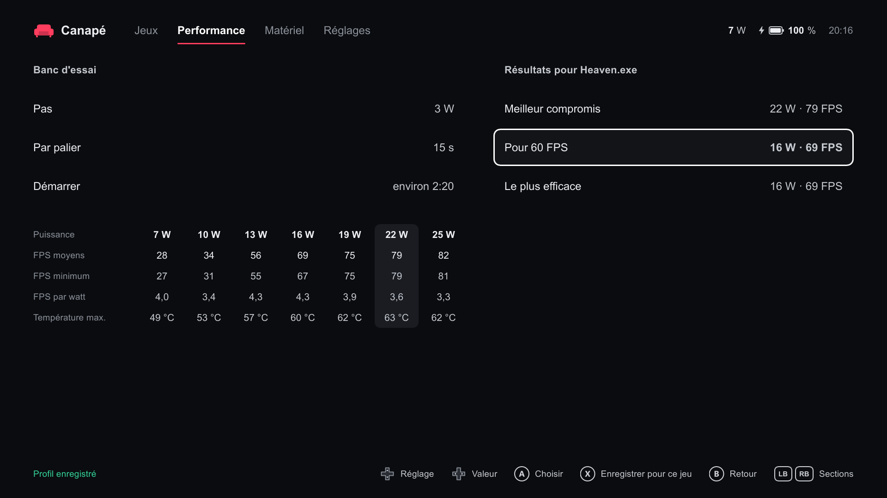
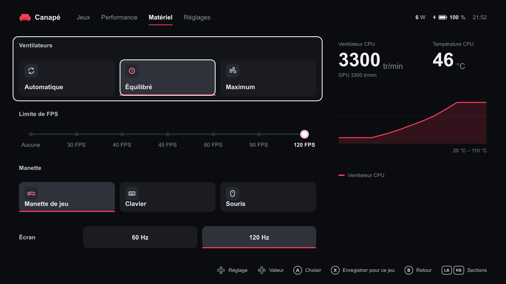
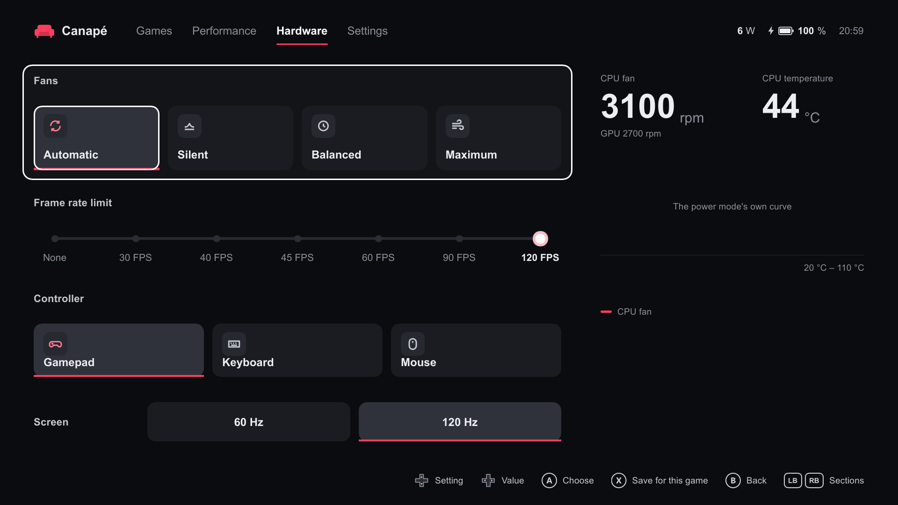
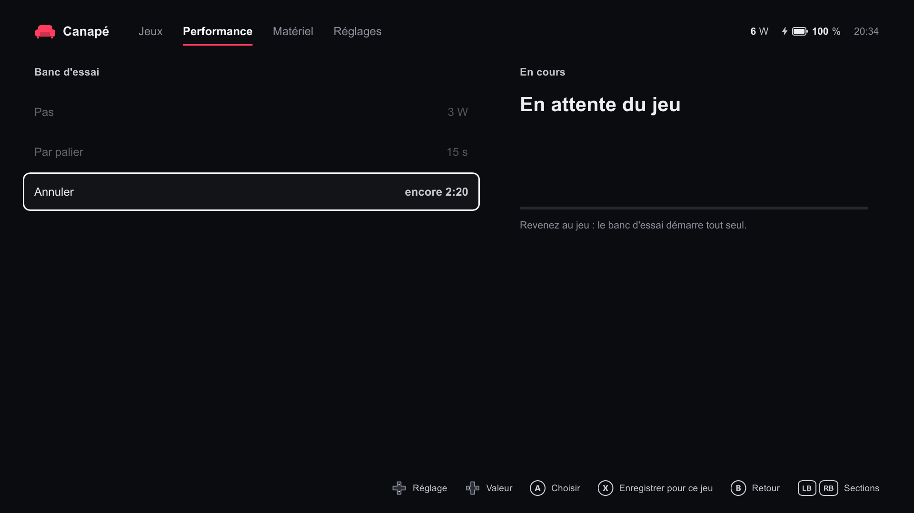
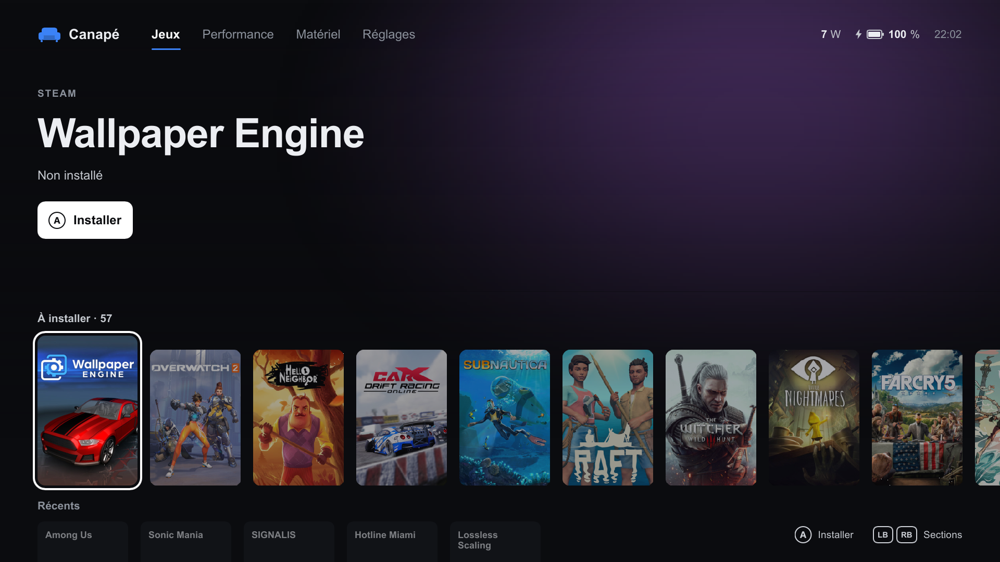

# M5 report (part 2): auto TDP, bench, limits and fans on real loads

Tested on the ROG Ally RC71L on 2026-10-22, from `c1f09cb` up to `3b5a99f`, **release** builds installed with `install-dev.ps1` (widget rebuilt with `build-widget.ps1` at `8f3861d`). Fixes found along the way were made in the cloud session and installed on the Ally between blocks; each result below names the build it was measured on. The other tuning tool was paused for the tests and left paused.

Loads: **Unigine Heaven 4.0** (Basic, from benchmark.unigine.com) and **FurMark 2.10.2** (portable zip from geeks3d.com, SHA256 checked). Neither is shipped with Canapé.

## Test load

Heaven's Extreme preset (1920×1080, 8× AA) gave 19 FPS at 25 W, and its camera flight swings between 43 and 104 FPS: unusable for a 60 FPS target. The runs below use:

- DirectX 11, full screen, **1280×720, Quality High, Tessellation Normal, no AA**, vsync off;
- the camera switched to **Free** about 20 s after start, which freezes it on the same village view every time.

That gives 78 FPS at 25 W, within ±0.5 FPS from one second to the next. FurMark runs `furmark-gl` in a 1280×720 window.

## Results

| Item | Build | Result | Detail |
|---|---|---|---|
| Auto TDP, target 60 | `c1f09cb` | OK | 25 → 16 W in 26 s, then 16 W for 150 s without a change or a probe. 64.5 FPS average (min 60.1), 15.5 W drawn, 69 °C max |
| Auto TDP, target 40 | `c1f09cb` | **Problem, fixed** | 11 ↔ 13 W cycle, about one minute per period (see below) |
| Auto TDP, target 40 | `8f3861d` | OK | 11 W for 147 s at 40.1–41.4 FPS; a dip below the target only steps back by 1 W (12 W) |
| Profile, learned watts | `c1f09cb` | **Problem, fixed** | X saved the power raised while the shell was in front (13 W instead of 11) |
| Profile, learned watts | `8f3861d` | OK | X saves 11 W, the last steady power, while the limit was 12 W at that moment |
| Profile applied at launch | `c1f09cb` | OK | From manual 20 W, Heaven's profile applies within 1 s and starts at the learned 13 W |
| Bench from the shell | `c1f09cb` | **Problem, fixed** | "no frame rate: start a game before the bench" (see below) |
| Bench from the shell | `8f3861d` | OK | "En attente du jeu"; the bench starts by itself 1 to 3 s after going back to Heaven |
| Profile after a bench | `c1f09cb` | **Problem, fixed** | The active profile did not take over again |
| Profile after a cancelled bench | `8f3861d` | OK | Auto TDP, target 40, learned 11 W: the profile is back |
| Cancelled bench keeps the complete report | `05a2924` | OK | A complete run, then a run cancelled after 18 s: the complete report is still the one shown |
| Recommendations, A and X | `c1f09cb` | OK | A on "Pour 60 FPS" sets manual 16 W; X saves the profile at 60 FPS, 7–16 W, learned 16 W |
| Frame rate limit 40 | `8f3861d` | OK | 39.9–40.0 FPS from the 3rd second, for 38 s |
| Frame rate limit "Aucune" | `8f3861d` | OK | Back to 78–79 FPS within 2 s |
| Frame rate limit 120 | `8f3861d` | OK | 78.5–79.6 FPS (Heaven's own rate) |
| Fans, Automatique | `8f3861d` | OK | Custom curves cleared, back to the firmware's 4100–4200 / 2800 rpm within 20–40 s |
| Fans, Équilibré and Maximum | `8f3861d` | OK | See the fan table |
| Fans, Silencieux | `8f3861d` | **Problem, preset removed** | Faster than Équilibré under load (see below); dropped in `3b5a99f` |
| Hardware page with 3 fan tiles | `3b5a99f` | OK | Automatique, Équilibré, Maximum; ←/→ and A apply them |
| Per-game refresh rate | `8f3861d` | **Problem, fixed** | Picking 60 Hz during a game also changed the global rate |
| Per-game refresh rate | `dc23673` | OK | 60 Hz while Heaven is in front, 120 Hz when it quits, with and without X |
| Frame rate after leaving full screen | up to `a2b407a` | **Known limit** | See below |
| Language | `8f3861d` | OK | English re-translates every page at once; back to Automatique gives French |
| Frame rate after a fresh start | `801effb` | OK | Heaven at 37–39 FPS right away |

### Bench (Heaven, steps of 3 W, 15 s per step, `c1f09cb`)

| Limit | Average FPS | Low FPS | FPS per watt | Max temperature |
|---|---|---|---|---|
| 7 W | 28 | 27 | 4.0 | 49 °C |
| 10 W | 34 | 31 | 3.4 | 53 °C |
| 13 W | 56 | 55 | 4.3 | 57 °C |
| 16 W | 69 | 67 | 4.3 | 60 °C |
| 19 W | 75 | 75 | 3.9 | 62 °C |
| 22 W | 79 | 79 | 3.6 | 63 °C |
| 25 W | 82 | 81 | 3.3 | 62 °C |

Recommendations: best compromise 22 W · 79 FPS, for 60 FPS 16 W · 69 FPS, most efficient 16 W · 69 FPS.

### Fans (FurMark, about 20 W, 2 minutes per preset, `8f3861d`)

| Preset | CPU rpm | GPU rpm | CPU temperature at the end |
|---|---|---|---|
| Silencieux | 5300–5400 | 5100–5200 | 59 °C |
| Équilibré | 4200 | 4200 | 62 °C |
| Maximum | 6300, then 5700–5800 after 90 s | same | 56 °C |
| Automatique | 4100–4200 | 2800 | 65 °C |

Maximum easing to 5800 rpm at 56 °C follows its own curve (55 % at 50 °C, 65 % at 60 °C). The status has no GPU temperature, so only the CPU's is reported. No run came near 90 °C.

### Memory (Heaven in full screen, widget opened in Game Bar, `8f3861d`)

| Process | Private working set | Private bytes | Working set |
|---|---|---|---|
| canape-service | 1.7 MB | 2.3 MB | 11.4 MB |
| canape-shell | 13.8 MB | 15.7 MB | 36.1 MB |
| CanapeWidget | 25.3 MB | 37.8 MB | 86.8 MB |

### Language

Language → English → A: every page and the button hints re-translate at once, including the status line ("Service connected · No Steam API key"). The saved language was Français before the test; it was left on Automatique, which gives French on this Ally.

## Problems

### Auto TDP cycling 11 ↔ 13 W at target 40 (fixed in `1354e55`)

At 11 W Heaven sits right on 40 FPS (39.2–41). A dip to 36.6 FPS made auto TDP raise by 2 W to 13 W, hold that for about a minute, then probe down to 11 W again. A probe that just misses the target now steps back by 1 W. Measured on `8f3861d`: 11 W for 147 s out of 180, with two one-second dips that each brought only 12 W.

### Learned watts taken while the shell was in front (fixed in `1354e55`)

While the shell is in front, the game behind it has no frame rate and auto TDP raises the power (11 → 13 W). X then saved 13 W. A profile now learns the last power that held for 30 s. Measured: 11 W saved while the limit was at 12 W.

### Bench impossible to start from the shell with a full-screen game (fixed in `8f3861d`)

The shell is in front, the full-screen game behind it is minimised and has no frame rate, so the service refused the bench with an English error left on screen. The service now waits up to 2 minutes for the game to have frames for 3 s ("En attente du jeu", Cancel works meanwhile), and error lines fade after 10 s.

### Profile not given back after a bench (fixed in `8f3861d`)

After a run, the global state before the bench (manual 20 W, auto off) came back but the active profile (auto, target 40) did not, so the shell offered "Pour 60 FPS" from the global target. The profile now takes over again. Related, fixed in `d8e868b`: a cancelled run replaced the last complete report, and with only 19–25 W measured it still recommended 19 W "for 40 FPS".

### Silencieux fan preset faster than Équilibré (preset removed in `3b5a99f`)

Under FurMark at about 60 °C, the Silent preset gave about 5300 rpm while Balanced held 4200. Custom curves written with `canape-ctl` (both fans, read back identical) at about 20 W:

| Curve | Steady rpm near 60 °C |
|---|---|
| Silent preset `(30,0) (45,0) (55,10) (62,15) …` | ~5300, short dips to ~3300 right after writing |
| B: Silent without zeros, low points at 5 % | ~5300 |
| E: zeros below 50 °C, 15 % from 55 °C | ~5300 |
| F: Silent with its first point at 40 °C | ~5300 |
| G: strictly increasing from 1 % | ~5300 |
| H: low points at 10 % | ~5300 |
| C: `(40,10) (50,12) (58,15) (65,20) …` | 3600 for 90 s (58–64 °C) |
| I: C with its first point at 0 % | 3600 for 80 s, then ~5300 once the CPU reached 65 °C |
| Balanced preset | 4200 |

No single trait of the curve (zeros, first temperature, a flat start, duties below 10 %) explains the override: it looks like firmware behaviour. The firmware's own Silent curves (`get_fan_curves` defaults in Silent mode: CPU `(40,4) (45,8) (55,26) … (85,26)`, GPU 1 % everywhere) cannot be written as custom curves: our validation refuses them (26 % at 90 °C under the 30 % floor, 1 % at 80 °C under the 25 % floor). Meanwhile the firmware's Silent power mode with no custom curve kept 3200 / 2800 rpm at 61–70 °C under the same load. The preset was dropped; for quiet, use fans on Automatique with the Silencieux power mode.

### Per-game refresh rate changed the global rate (fixed in `dc23673`)

Picking 60 Hz on the Hardware page during a game (to save it with X) also set the global rate: after quitting Heaven the screen stayed at 60 Hz. A rate picked during a game now lasts only for that game. Measured on `dc23673`: 60 Hz with Heaven in front, 120 Hz after quitting it, both with X (profile `refresh_hz` 60) and without.

### Frame rate lost after leaving full screen (known limit)

Heaven in exclusive full screen, minimised while the full-screen shell stays in front for 40 s, then restored: `fps` stays null (watched up to 2 minutes), while Heaven renders at 97 % GPU in front. A short minimise (3 s) without the shell in front does not trigger it: the rate came back within 2 s. Without a rate, auto TDP and the bench do nothing.

Tried and not enough:

| Build | Attempt | Result |
|---|---|---|
| `dc23673` | Shell restarts frame metrics on a fresh handle after 6 s without a rate | Restarts logged every 30 s, rate stays null |
| `05a2924` | A short-lived copy of the shell starts them again | Logged, rate stays null |
| `a2b407a` | The main shell never owns them; only short-lived copies start them | Rate fine after a fresh start, still null after the repro |

Killing the shell, starting it again and bringing Heaven back to the front did restore the rate once, but the attempts above show the cause was not the process that owns the frame metrics. `801effb` goes back to starting them once at startup. Workaround for the user: quit and restart the game.

### Other notes

- `canape-ctl` writes power limits and fan curves only through the service: no other tool touched the hardware.
- Heaven's launcher is a Qt browser; the runs called `Heaven.exe` directly with the launcher's arguments.

## Steam install

On `3b5a99f`, with a Steam Web API key added to `shell.json` (not in the repository):

- The shell fetched the owned games on start (`owned.json`, 62 games) and downloaded 58 covers. Games → Down shows **"À installer · 58"**, every tile with its cover.
- The shelf is sorted by last played, then title, like Récents. Among Us (1.07 GB on disk, 693 MB to download) was the smallest known game in it.
- A on Among Us: `library: installing steam:945360`. The **Steam desktop client** came to the front over the shell with its own "Installer" dialog (desktop shortcuts ticked, drive C:), confirmed with the default folder. The download finished in 28 s: `library: steam:945360 installed`, `8 games found`.
- Back in the shell, the shelf reads "À installer · 57" and Among Us is first in Récents.
- Launch: Récents → Among Us → A gives `library: launching steam:945360 (Uri { uri: "steam://rungameid/945360" })`. The game started, became the foreground game (`Among Us.exe`) with a frame rate of 60 FPS, and showed its own terms screen (not accepted here).
- The progress on the cover and in the header ("Installation… 0 %", a bar on the cover) was seen only on a second, accidental install (below). Among Us's own download was over before the shell was back in front.
- **Problem: the focus jumps to the to-install shelf.** After a library refresh (`8 games found`), the focus went back to the first tile of "À installer" (Wallpaper Engine, A = Installer). A press meant for Among Us in Récents therefore started a Wallpaper Engine install. It was cancelled in Steam's dialog before any download.
- **Problem: a cancelled install keeps showing.** After that cancel, the shell still showed "Installation… 0 %" for Wallpaper Engine.
- Both fixed in `5b9a20c`, checked on the Ally: one A on a game to install only turns the button into "Confirmer" with "Appuyez de nouveau sur A pour installer" (no log line, no Steam dialog); moving to another tile and back gives "Installer" again. Among Us launched again from Récents with a single A (`steam://rungameid/945360`, 60 FPS in front). The hint at the bottom right still reads "Installer" while the button reads "Confirmer".

- To consider: on a handheld, the Steam desktop window and its mouse-sized dialog are awkward with the gamepad. Steam's Big Picture would suit the shell better.

## State left on the Ally

Canapé `3b5a99f` installed (service, shell, ctl; widget from `8f3861d`, unchanged since). Silent mode, auto TDP off (target 60, 7–25 W), fans on Automatique (no custom curve), frame rate limit 120, screen at 120 Hz, language Automatique, accent `#ff3d5e`. Profiles: `WindowsTerminal.exe` (left as found) and `Heaven.exe` (auto TDP, target 40, learned 11 W) from these tests. Heaven and FurMark stay installed (FurMark in `C:\Users\White\dev\furmark2`). The other tool still paused.
