# Canapé user guide

[🇫🇷 Version française](user-guide.fr.md) · [📚 Documentation index](README.md)

This guide explains how to install Canapé on a ROG Ally, make it the home app of the full-screen experience (FSE), use it with the gamepad, add the Xbox Game Bar widget, and then troubleshoot and uninstall it.

> [!IMPORTANT]
> Canapé is a personal project under development. **Validated on the Ally**: installation, FSE boot, the service, modes, manual TDP, auto TDP (version `99cad07`) and the first version of the widget. **Written and tested without hardware, but not tried on the Ally yet**: the shell in 13 languages (four sections, arrow navigation), the game library and installing Steam and Epic games, the Hardware page (fans, frame rate limit, controller mode), per-game profiles, the bench, the latest auto TDP optimizations and the new version of the widget. The sections concerned say so.

## Contents

- [Requirements](#requirements)
- [Installing Canapé](#installing-canapé)
  - [1. Turn on Developer Mode](#1-turn-on-developer-mode)
  - [2. Run `install-dev.ps1`](#2-run-install-devps1)
  - [Script options](#script-options)
  - [Using the CI binaries](#using-the-ci-binaries)
  - [Checking the installation](#checking-the-installation)
- [Making Canapé the FSE home app](#making-canapé-the-fse-home-app)
  - [Going back to Winhanced or the Xbox app](#going-back-to-winhanced-or-the-xbox-app)
- [Using Canapé with the gamepad](#using-canapé-with-the-gamepad)
  - [Controls](#controls)
  - [Shared elements](#shared-elements)
  - [Games](#games)
    - [Adding other games](#adding-other-games)
    - [Installing owned games](#installing-owned-games)
  - [Performance](#performance)
  - [Hardware](#hardware)
    - [Gyro aiming](#gyro-aiming)
  - [Settings](#settings)
  - [Game profiles](#game-profiles)
  - [Bench](#bench)
- [The Xbox Game Bar widget](#the-xbox-game-bar-widget)
- [Languages](#languages)
- [Troubleshooting](#troubleshooting)
- [Uninstalling](#uninstalling)

## Requirements

| Item | Details |
|---|---|
| Handheld | **ROG Ally RC71L** (the only model tested). The ROG Ally X (RC72LA), ROG Xbox Ally (RC73YA) and ROG Xbox Ally X (RC73XA) are recognized by the code but have never been tried. |
| Windows | Windows 11 **24H2 or later** (the identity package requires version 10.0.26100). |
| Tools | **Visual Studio Build Tools 2022** with the C++ tools and the **Windows SDK** (provides `makeappx` and `signtool`, used even with prebuilt binaries). **Rust** (MSVC toolchain) if you build on the Ally. **Git** to get the repository. |
| Rights | An **elevated** Terminal for the installation (Windows service and certificate). |
| Optional | [GitHub CLI](https://cli.github.com/) (`gh`) to download the CI binaries; the **UWP** workload of the Build Tools for the widget. |

> [!WARNING]

## Installing Canapé

### 1. Turn on Developer Mode

Settings → System → Advanced → **For developers** → Developer Mode: on.

The install script stops with `Developer Mode is off` otherwise (it reads `HKLM\SOFTWARE\Microsoft\Windows\CurrentVersion\AppModelUnlock\AllowDevelopmentWithoutDevLicense`).

### 2. Run `install-dev.ps1`

In an **elevated Terminal**, at the root of the cloned repository:

```powershell
powershell -ExecutionPolicy Bypass -File packaging\install-dev.ps1
```

The script runs six steps:

| Step | What happens |
|---|---|
| 1/6 | Builds `canape-shell`, `canape-service` and `canape-ctl` (release by default), or takes prebuilt binaries (`-BinariesDir`). |
| 2/6 | Stops and uninstalls the service if it exists, closes the shell, copies the three `.exe` files and `CustomCapability.SCCD` to `C:\Program Files\Canape`. |
| 3/6 | Installs and starts the **`CanapeService`** Windows service (automatic start, LocalSystem account, automatic restart after a crash). |
| 4/6 | On the first run, creates a `CN=Canape Dev` development certificate in `$HOME\dev\canape-cert` and adds it to `LocalMachine\TrustedPeople`. |
| 5/6 | Packs and signs the `Canape.Identity.msix` identity package. |
| 6/6 | Registers the package with `Add-AppxPackage -ExternalLocation`: `canape-shell.exe` gets the `Canape_…!App` identity that the FSE can launch. |

At the end, the script prints the test command, the `canape-ctl watch` command and where the logs are.

> [!CAUTION]
> Never commit the contents of `$HOME\dev\canape-cert` (`.pfx`, `.cer`): it is the key that signs your packages.

Running the script again later updates Canapé: it replaces the binaries and registers the service and the package again. Your settings (`state.json`) are kept.

### Script options

| Option | Default | Purpose |
|---|---|---|
| `-InstallDir <folder>` | `C:\Program Files\Canape` | Where the binaries are installed. |
| `-CertDir <folder>` | `$HOME\dev\canape-cert` | Where the development certificate is created and reused (the widget uses it too). |
| `-BuildProfile release\|debug` | `release` | Cargo profile. `debug` is a fallback when Smart App Control blocks a release build (see [Troubleshooting](#troubleshooting)). |
| `-BinariesDir <folder>` | *(empty)* | Takes `canape-shell.exe`, `canape-service.exe` and `canape-ctl.exe` from this folder instead of building. Handy with the CI binaries. |
| `-SetAsHomeApp` | off | Also writes `GamingHomeApp` in the registry to pick Canapé as the FSE home app (see below). |

### Using the CI binaries

GitHub Actions builds the release binaries on Windows at every push and publishes them as the `canape-windows-x64` artifact. No Rust needed on the Ally, and no building under Smart App Control:

```powershell
gh run download --repo pierregouedar/canape --name canape-windows-x64 --dir $HOME\dev\canape-bin
powershell -ExecutionPolicy Bypass -File packaging\install-dev.ps1 -BinariesDir $HOME\dev\canape-bin
```

You still need the Windows SDK (packing and signing the identity package) and the cloned repository (the script reads `packaging\identity`).

### Checking the installation

1. **The service**: `Get-Service CanapeService` should show `Running`.
2. **Telemetry**: `& "C:\Program Files\Canape\canape-ctl.exe" watch` prints one JSON status per second (Ctrl+C to quit).
3. **The shell outside the FSE**: run the command the script printed, for example:
   ```powershell
   explorer.exe shell:AppsFolder\Canape_84zrj1c9kn010!App
   ```
   The part after `Canape_` depends on your certificate; the script prints the right value (`Registered …`).

## Making Canapé the FSE home app

1. Open **Settings → Gaming → Full screen experience**.
2. Pick **Canapé** as the home app.
3. Turn on starting in the full-screen experience if you want the handheld to boot straight into Canapé.
4. Reboot: Windows launches `canape-shell.exe` with the `windows.gaming:///home` argument.

If Canapé is not in the list, run the script again with `-SetAsHomeApp`. It writes the undocumented value `HKCU\Software\Microsoft\Windows\CurrentVersion\GamingConfiguration\GamingHomeApp = <PFN>!App` that the FSE reads to know which app to launch.

> [!NOTE]
> Booting into the FSE was validated on the Ally in M1 and M2 (a single activation at boot, service already up). It has not been retested since, as nothing changed on the startup side.

### Going back to Winhanced or the Xbox app

Just pick the other app in **Settings → Gaming → Full screen experience**. Canapé stays installed and can be picked again at any time.

To do it from the command line, put back the previous `GamingHomeApp` value. For example, for Winhanced:

```powershell
Set-ItemProperty "HKCU:\Software\Microsoft\Windows\CurrentVersion\GamingConfiguration" -Name GamingHomeApp -Value "Winhanced_2wdva71107yvr!App"
```


## Using Canapé with the gamepad

> [!NOTE]
> The interface described here (four sections, arrow navigation everywhere) has not been tried on the Ally yet: only an earlier version and gamepad navigation were validated there. The game library in particular was only tested on Linux, with a fake library: finding the games, their covers and launching them on Windows are still to be checked. The same goes for the Hardware page, whose writes to the fans, the graphics driver and the controller have never reached a real Ally (see [Hardware](#hardware)). Screenshots are rendered on Linux with the hardware simulator and made-up values.

### Controls

| Button | Action |
|---|---|
| **LB / RB** | Previous / next section: Games → Performance → Hardware → Settings, wrapping around |
| **D-pad** or **left stick** | Up and down change row; left and right move along the row or change its value. Held, the move repeats after 0.4 s. In Games, left and right move along the shelf, up and down swap the shelves. |
| **A** | Choose; in Games, launch the game (or install it) |
| **X** | Save for the game in the foreground (Performance, Hardware, Bench); delete a profile (Game profiles) |
| **B** | Leave a sub-page (Game profiles, Add a game, Bench, Gyro aiming, Back buttons and lighting) back on the line it was opened from, otherwise back to Games |

The gamepad is only read while Canapé is in the foreground: a game launched from Canapé keeps the whole gamepad. When Canapé comes back to the front, a button still held for the game does nothing until it is released; the first time (when the Ally starts, for example), the gamepad is ignored for 2 s (the window only shows about 1.5 s later), so that a press while signing in does not launch a game. The same rules apply to keyboard keys, including the Enter and Escape that tools such as Steam Input send for A and B. The focused row or tile has a white outline; the accent colour marks what is chosen (a bar under a tile, the value of a line). On a keyboard (development), the same actions are the arrow keys, Enter, F2 (X), Esc and Page Up / Page Down.

### Shared elements

- **Top**: the logo, the four sections (the current one is underlined in the accent colour) and, on the right, the power draw in watts, the frame rate, the battery (with a bolt when plugged in) and the time. "Offline" replaces the readings when the service does not answer.
- **Bottom right**: the buttons that do something on the page, with Windows' gamepad glyphs.
- **Bottom left**: the outcome of the last command ("Profile saved", "Service unreachable", "Service error: …") and the warning when another program also drives the hardware. Error messages from the service stay in English.
- An unknown value shows as "—" (for example the frame rate when no game is running).

### Games

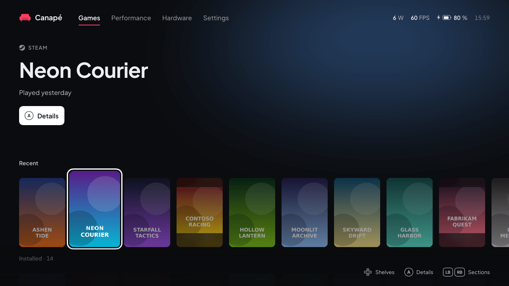

<sub>A made-up library (`tools/fake-library.py`): titles and covers are generated.</sub>

The first section, the one Canapé opens on: the selected game large, then shelves of covers, one under the other.

| Area | Contents |
|---|---|
| **Selected game** | Its store's logo and name (STEAM, EPIC, GOG, XBOX, OTHER GAMES), its title, when it was last played ("Played today", "Played yesterday", "Played in the last 7 days"…) and the **Details** button: A opens the game page. Behind it, a glow takes the colour of its cover. |
| **Recent** | The last 10 games played, the most recent first. Absent until a game has been played. The selected cover is larger, opaque and outlined in white; the others are dimmed. A game without art shows its title on a tinted card. |
| **Installed · N** | Every installed game, in alphabetical order. |
| **Steam · N**, **Epic · N**, **GOG · N**, **Xbox · N**, **Other games · N** | Each store's games, with its logo, installed and to install mixed in alphabetical order, then the games added by hand (see [Adding other games](#adding-other-games)). Only stores that have games (a lone store with nothing to install gets no shelf: it would repeat Installed). |
| **To install · N** | Always last: the Steam, Epic and GOG games you own but have not installed (see [Installing owned games](#installing-owned-games)). Empty, it explains how to set up Steam, with two buttons to sign in to Epic or GOG (left and right pick, A confirms). |

**Moving around**: left and right move along the shelf; it only scrolls when the selection reaches an edge, keeping one game visible beside it. The backdrop takes the selected game's colour once you stop on it. Up and down go to the previous or next shelf: it slides to the top, the next one peeks in at the bottom, dimmed. Each shelf remembers its selected game when you leave it. On To install, the header describes the game to install and the button becomes **Install**. **A** opens the selected game's page.

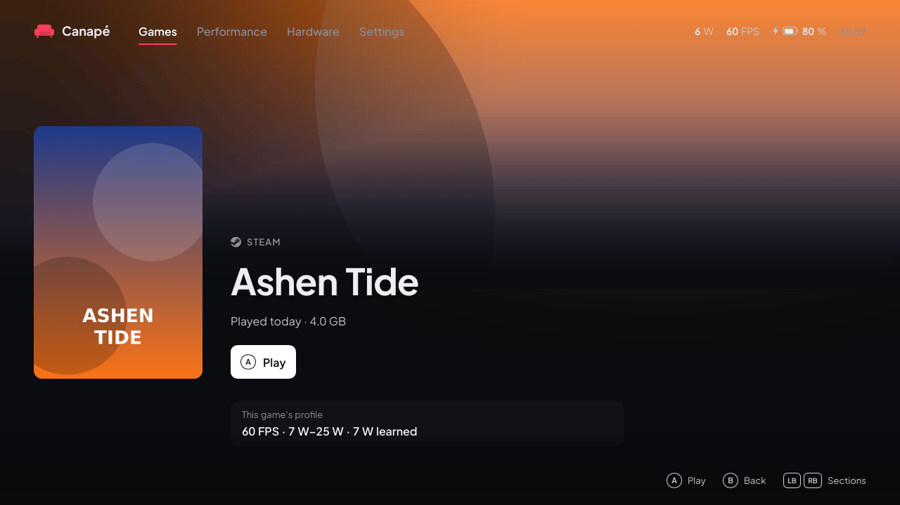

**Game page**: the cover large, the store, the title, when it was last played, the time played (Steam, with the API key), and the space it takes on disk (Steam, Epic, GOG; for an Epic or GOG game to install, the space it will take and the free space of the games folder, see [Installing owned games](#installing-owned-games)); behind, the game's wide art that Steam keeps on disk, when there is some. **A** launches the game ("Launching…", the cover comes forward a little) or, if it is not installed, installs it, with the progress under the button. **B** goes back to the shelf, on the same game. Once launched, the game moves first on Recent. Under the button, **This game's profile** sums up its profile (target, power range, learned power, frame rate limit): Canapé learns which program the game is the first time it is launched from Canapé (the first full-screen program to come to the front within 2 minutes, Steam, launchers and their windows aside), and shows it once a profile exists for it.

Below the page, a second part: from the button, **down** scrolls the page to it (the **More** hint shows when it has something to show), **up** scrolls back, **B** always goes back to the shelf. It shows the **time to beat** and the **achievements** (both described below) when known.

> [!NOTE]
> Not tried on the Ally yet: the page scrolling was only seen on Linux, with the fake library.

**Where the games come from**

| Store | What Canapé reads | Launch | Covers |
|---|---|---|---|
| **Steam** | The library folders (`steamapps\libraryfolders.vdf`) and each game's manifest (`appmanifest_*.acf`). Tools (Steamworks redistributables, Proton, SteamVR) are left out. | Through Steam, started hidden in the tray if it was not running (`steam.exe -silent steam://rungameid/…`): no Steam window. Most Steam games need the client. | Steam's own cache: the art you picked in Steam, else the 600×900 portrait, else the hero or header image (shown whole, on a blurred backdrop) |
| **Epic Games** | The launcher's manifests (`%ProgramData%\Epic\EpicGamesLauncher\Data\Manifests`). DLC, engines and unfinished installs are left out. Plus the games installed from Canapé with Legendary (see [below](#installing-owned-games)). | Through Legendary, without the launcher. Once signed in to Epic in Canapé, games installed by the Epic launcher are handed to Legendary at the next scan (`legendary import`, no new download); until then, or if that fails, through the launcher | Downloaded (see below), else a title card |
| **GOG** | The registry (`HKLM\SOFTWARE\WOW6432Node\GOG.com\Games`), where GOG Galaxy and the offline installers register each game. DLC are left out. Plus the games installed from Canapé with gogdl (see [below](#installing-owned-games)). | The game's executable directly, without Galaxy | Downloaded (see below), else a title card |
| **Xbox app** | The `XboxGames` folders of every drive (`Content\MicrosoftGame.config`). | Through Windows (`shell:AppsFolder\…`) | The game's square logo |
| **Other games** | `%LOCALAPPDATA%\Canape\games.json` (see [Adding other games](#adding-other-games)). | The program directly, with its arguments | The one given in `games.json`, else downloaded by title (SteamGridDB), else a title card |

- The last played time comes from Steam for Steam games, and from Canapé for every game launched from it.
- A game installed from two stores shows once: the copy played last, else the Steam one, then GOG, Epic, Xbox and last `games.json`.
- The list shows at once from the last scan; a new scan runs in the background at every start, and again when you come back to the library after a minute away. A game installed meanwhile appears then.
- Xbox app games installed outside an `XboxGames` folder are not found.
- Canapé launches games itself, without rights: like every app of the session.

**Downloaded covers**

A game with no art on the device can get one from the internet after each scan (**Settings → Download missing covers**, on by default):

- **Steam games**: the 600×900 portrait from Steam's public store servers, no account needed. Useful for a game whose art Steam has not cached yet, or for which it only has the wide header image: the portrait replaces it.
- **Every store** (Epic, GOG, Xbox included), with a free **SteamGridDB** API key: create an account on [steamgriddb.com](https://www.steamgriddb.com), copy the key from *Preferences → API*, and put it in `%LOCALAPPDATA%\Canape\shell.json` as `"steamgriddb_key": "…"`. Steam games are looked up by their Steam id, the others by title; only static portrait images are taken (no animated, NSFW or humour grids). The key is only ever sent to SteamGridDB's API.

Covers are saved in `%LOCALAPPDATA%\Canape\covers` and reused; a game with no art anywhere is asked for again after a week. At most 60 downloads per scan. Turning the setting off keeps the covers already downloaded but fetches no more.

> [!NOTE]
> Not tried on the Ally yet: the download goes through WinHTTP (built into Windows) and was only tested on Linux against recorded answers.

**Time to beat (IGDB)**

Below the game page (**down** from the button), a full-width **Time to beat** band can show three average times, each in its block under a coloured strip: **Main story** (going straight through), **Main + extras** and **Completionist** (finishing everything), for example "~12 h", "~18 h", "~35 h" ("—" for an unknown one; no band when none is known), from [IGDB](https://www.igdb.com)'s "time to beat" data (Twitch's game database). This needs a free Twitch application of your own; without it nothing is asked and the page shows no time. There is no setting: the two values in `shell.json` are the switch.

1. Sign in at [dev.twitch.tv/console](https://dev.twitch.tv/console) with a Twitch account (Twitch requires two-factor authentication to register an application).
2. **Applications → Register Your Application**: any name (for example "Canape ROG Ally"), **OAuth Redirect URLs** `http://localhost`, category **Application Integration**, client type **Confidential**. Create it.
3. Open the application (**Manage**): copy the **Client ID**, then click **New Secret** and copy the secret.
4. Add them to `%LOCALAPPDATA%\Canape\shell.json`, next to the other keys:

   ```json
   "igdb_client_id": "…",
   "igdb_client_secret": "…"
   ```

5. Restart Canapé (or wait ten minutes) and open a game's page: the time shows a second or two later if IGDB knows it.

- Steam games are found by their Steam id, others by their exact title (the game itself rather than a DLC, a bundle or an edition). "Main story" is IGDB players' usual time, else the fastest one.
- The id and the secret only go to Twitch (`id.twitch.tv`), which gives a token valid about two months; only the id and that token go to IGDB (`api.igdb.com`). Neither the secret nor the token is written to the logs.
- Each game is asked for once, when its page opens, then kept 30 days in `%LOCALAPPDATA%\Canape\igdb.json` (7 days for a game IGDB does not know). At most 6 lookups a minute; after an error (network, refused key), none for 10 minutes, and one line in `shell.log`.
- IGDB has fewer games and fewer submissions than some other sites: many games have no time.

> [!NOTE]
> Not tried on the Ally yet. The IGDB field names (`external_games`, `game_type`, `game_time_to_beats`…) come from the known documentation and were not checked against the real API: if no time shows, `shell.log` says why.

**Achievements (Steam)**

Below the time to beat (or alone below the game page), a Steam game shows its **Achievements**: how many are unlocked ("23 / 51 · 45 %") with a bar, then one tile per achievement, icon and name: the unlocked ones first (the latest first), then the locked ones, with their grey icon (the most common first). The D-pad moves along the tiles, which scroll by rows at the edge; the line under them gives the focused one's description, the day it was unlocked and the share of players who have it. Up from the first row goes back to the top of the page.

- Steam games only (installed or to install), with the Steam Web API key already used for the owned games (`steam_api_key` in `shell.json`, see [Installing owned games](#installing-owned-games)) and the Steam account last signed in on the device. Without the key nothing is asked and the part does not show.
- Steam only answers for a public profile: in Steam, **Profile → Edit profile → Privacy settings**, **Game details** must be **Public**. With private game details, or for a game without achievements, nothing shows (one line in `shell.log`).
- Names and descriptions come in the interface language when the game is translated. A hidden achievement keeps its description secret until it is unlocked.
- The list is kept in `%LOCALAPPDATA%\Canape\achievements.json` and shows at once; it is asked for again when the page opens if it is more than an hour old (or in another language). Icons are downloaded once into `%LOCALAPPDATA%\Canape\achievement-icons`, only those on screen, three at a time. After a network error, nothing is asked for 10 minutes.
- The key only goes to Steam (`api.steampowered.com`) and never appears in the logs.
- GOG, Epic, Xbox and other games: no achievements. GOG has an achievements service, but it needs each game's own identifiers (from the game's build files) and an exchange of your GOG sign-in that could disturb the one gogdl keeps: left out for now.

> [!NOTE]
> Not tried on the Ally yet: neither the Steam requests (written from Valve's published Web API documentation and tested on answers written from it, not recorded ones), nor the icon downloads, nor the grid on the device. Only the page (on Linux, with the fake library) and the reading of the answers were tested.

#### Adding other games

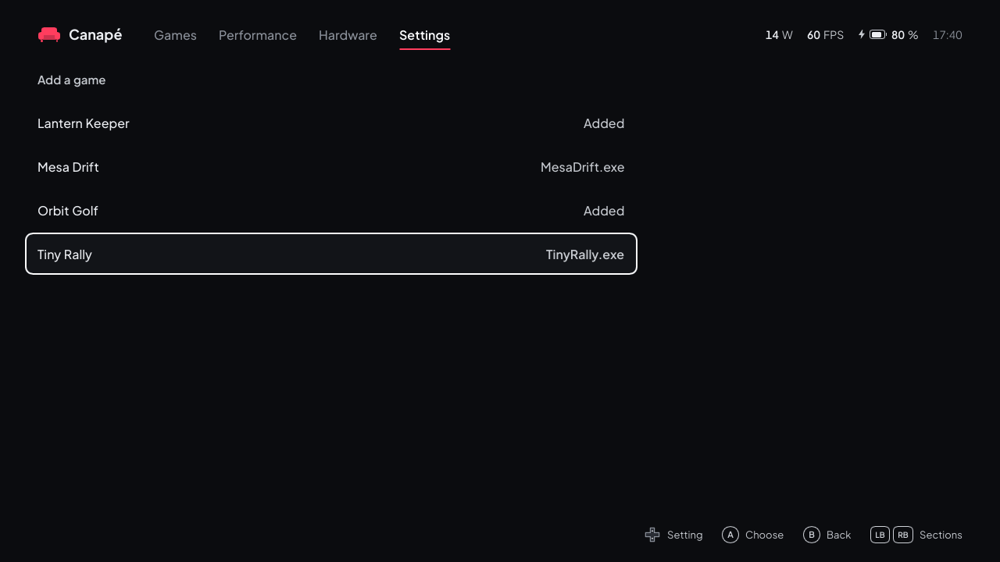

<sub>Made-up shortcuts (`tools/fake-library.py`).</sub>

> [!NOTE]
> **Not tried on the Ally yet**: neither reading the Start menu and desktop shortcuts nor launching these games. Only the UI (on Linux, with the fake library), reading `games.json` and reading `.lnk` files (on shortcuts generated from the published format) were tested.

A game no store knows (a standalone `.exe`, an itch.io game, an emulator…) can be added in two ways. These games get their own **Other games** shelf, with a gamepad icon, and launch directly, without a store.

**From Canapé, with the gamepad**: **Settings → Add a game** lists, by name, the games already added ("Added") and the shortcuts of the Start menu (yours and everyone's) and of both desktops that could be games, with the program's name. **A** adds the game, or takes it out if it was added; the library updates at once. Left out: shortcuts to anything but an `.exe` (documents, web pages), Windows' own programs, uninstallers, installers, update tools, manuals and support pages, the stores' clients, and games a store already lists (same title or same program). What is left may include apps that are not games: nothing is added unless you pick it.

**By hand**, in `%LOCALAPPDATA%\Canape\games.json` (the file the sub-page writes):

```json
{ "games": [
  { "title": "Celeste", "exe": "D:\\Games\\Celeste\\Celeste.exe" },
  { "title": "Metroid Fusion", "exe": "D:\\Emu\\mGBA\\mGBA.exe",
    "args": "\"D:\\Roms\\Metroid Fusion.gba\"", "dir": "D:\\Emu\\mGBA",
    "cover": "covers\\fusion.png" },
  { "title": "An itch.io game", "exe": "itch://caves/123/launch" }
] }
```

| Field | Role |
|---|---|
| `title` | The name shown (required). |
| `exe` | What is started (required): an executable, a `.lnk` shortcut, a script, or an address (`itch://…`, `steam://…`), opened like a double click. |
| `args` | Arguments, optional (for example the ROM for an emulator). |
| `dir` | The working folder; by default, the executable's. |
| `cover` | A JPEG or PNG cover, portrait if possible; a relative path starts from the folder of `games.json`. Without one, a cover is looked up on SteamGridDB by title if the key is set (see [Downloaded covers](#games)), otherwise a title card shows. |

- In JSON, each `\` of a path is written `\\` (or use `/`, which Windows accepts too).
- An emulator can be listed several times with different `args`: each game is separate. The Recent history follows the program and its arguments: changing the title keeps it.
- An unreadable file (a stray comma…) shows none of these games; the error is in `shell.log` and in yellow on the sub-page, and Canapé never rewrites a file it could not read.
- Changes made by hand show up when you come back to the library after a minute, or at the next start.

#### Installing owned games

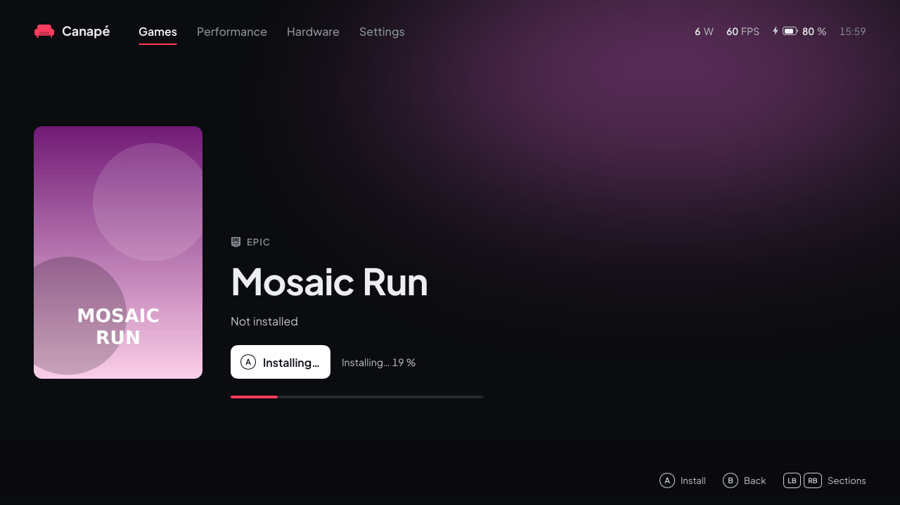

<sub>Made-up owned games (`tools/fake-library.py`); the install of Mosaic Run is simulated.</sub>

> [!NOTE]
> **Nothing in this part has been tried on the Ally yet**: not the Steam owned list through the Web API, not installing through Steam, not the Legendary or gogdl download, not the Epic and GOG sign-ins, not installing and launching Epic and GOG games. Only the UI (on Linux, with the fake library and a simulated install) and the reading of Steam's, Epic's, GOG's and GitHub's answers were tested (against recorded answers for Steam, Epic and GitHub; for GOG, against answers written from gogdl's source code, as GOG's servers cannot be reached from the cloud session).

The **To install** shelf lists the games you own on Steam, Epic or GOG but have not installed on the console (the last shelf: down until you reach it). **A** opens the game's page, then **A** on the page ("Install") installs it without opening Steam's interface, the Epic launcher or GOG Galaxy: a single press on the shelf never starts a download. A game already installed, from any store (same id or same title), does not show in this list. GOG and Xbox app games are never in it: Canapé gets no list of the games owned there (the Xbox app offers none to other programs), so they only show once installed with GOG Galaxy or the Xbox app, and then launch like the others.

**Steam: set up once**

1. Create a free Steam Web API key on [steamcommunity.com/dev/apikey](https://steamcommunity.com/dev/apikey).
2. Put it in `%LOCALAPPDATA%\Canape\shell.json` as `"steam_api_key": "…"`.

Canapé asks for the list of the account last signed in to Steam on this device (`config\loginusers.vdf` in Steam's folder): Steam must have been opened there at least once with your account. The key is only ever sent to Steam's API (`api.steampowered.com`). Tools (redistributables, Proton, SteamVR) are left out; free games you have already launched are in the list.

**Epic: sign in once**

1. Pick **Epic Games account** in [Settings](#settings).
2. The first time, Canapé downloads **Legendary**, an open-source Epic client (GPL-3 licence) that stays a separate program, from its official releases on GitHub, into `%LOCALAPPDATA%\Canape\tools`. The file is checked against the SHA-256 digest GitHub publishes: without a digest, or if it does not match, nothing is saved and the error shows at the top of the library.
3. Canapé opens Epic's sign-in page in the browser. Sign in (touch and the touch keyboard are needed): the page then shows a small JSON text with an `authorizationCode`. Copy the page (select all, copy) or just the code's value: Canapé watches the clipboard for 10 minutes, finds the code and signs Legendary in without a window. A again while waiting reads the clipboard at once, or opens the page again.
4. An error (download, sign-in) shows in yellow under the Settings lines and in the Games page header. Once signed in, Canapé asks for the list of games again. The button then reads "Epic: <account> (sign in again)".

Epic games that install through another store (Ubisoft, EA) are left out: Legendary cannot install them.

**GOG: sign in once**

1. Pick **GOG account** in [Settings](#settings), or **Sign in to GOG** on the empty To install shelf.
2. The first time, Canapé downloads **gogdl** (heroic-gogdl, an open-source GOG downloader, GPL-3 licence, that stays a separate program) from its official releases on GitHub, into `%LOCALAPPDATA%\Canape\tools`. The version is pinned (1.3.1) and the file checked against its SHA-256 digest: if it does not match, nothing is saved and the error shows.
3. GOG's sign-in page opens in the browser. Sign in: GOG lands on an almost empty page whose address holds a code (`embed.gog.com/on_login_success?origin=client&code=…`).
4. **Copy the address of that page** (address bar, then Copy) and come back to Canapé (Armoury button): Canapé watches the clipboard for 10 minutes and signs in as soon as it finds that address there; **A** on the line checks at once, or opens the page again if there is nothing. The line reads "Waiting for the GOG address…" meanwhile, then the account.

The browser is not made for the gamepad: the touch screen and the touch keyboard may be needed. Only GOG games available on Windows are listed (no films). GOG's tokens stay in `%LOCALAPPDATA%\Canape\gog\auth.json`.

**When the list is refreshed**: when Canapé starts (to count the games of the shelf), when you bring the To install shelf to the front if the last request is more than 10 minutes old, and right after an Epic or GOG sign-in. Without a Steam key or an Epic or GOG account, no store is asked. A store that cannot be listed (wrong Steam key, Epic session expired) shows its error in the header for 10 seconds and keeps the last list. The last list is kept in `owned.json` and shows at once. Covers are fetched like the [downloaded covers](#games), under the same **Download missing covers** setting; for Epic games, Canapé first tries the portrait art Epic provides, for GOG games the GOG store's image.

**What A does**

| Store | Install | Progress | At the end |
|---|---|---|---|
| **Steam** | Your own Steam client downloads the game, with no Steam window: Canapé adds the game to Steam's download queue (in the Steam library folder with the most free space), then starts Steam quietly in the notification area, or restarts it if it was already running (a few seconds; never while a game is running). If that is not possible (a game is running, Steam already knows the game, Steam does not start the download within 90 s), Canapé falls back to Steam's small install window (folder, shortcuts): confirm it; this fallback was tried on the Ally (Terraria in 75 s). **The windowless install has not been tried on the Ally yet**, and it relies on how Steam behaves, not on anything Valve documents: a Steam update could break it, and then the install window comes back. Steam's download settings still apply (for example a download that waits for the hours set in Steam). | Read every 2 s from the game's manifest. | The game moves to Installed, which comes back to the front with the game selected: A launches it, through Steam like the others. |
| **Epic** | Legendary installs the game silently, without a window or questions, into the games folder. | Read from Legendary's output. | The game moves to Installed and launches through Legendary: the Epic launcher is never opened. |
| **GOG** | gogdl downloads the game's Windows version, in Canapé's language when the game has it (English otherwise), without DLC, without a window or questions, into the games folder. | Read from gogdl's output. | The game moves to Installed and launches directly through its executable: GOG Galaxy is never needed. |

- While installing, the cover shows a progress bar, and the header "Installing… N %" when the game is selected; "Waiting for the store…" until the download starts (Steam's window to confirm, for example). You can keep moving around and install other games.
- **Where and whether it fits**: Steam shows the folder and the free space in its own window. Epic and GOG games go into the **games folder** (**Settings → Games folder**, see [Settings](#settings)), one sub-folder per game. On the page of an Epic or GOG game to install, the facts line shows the space the game will take, as its store says (a few seconds after the page opens, the store is asked), and the free space of the games folder: "Not installed · 21.7 GB · 48.2 GB free in D:\Games". When the game does not fit, a yellow line says so next to the button and **A** does nothing: free some space, or pick another folder in Settings. Canapé checks again just before downloading, in case the space ran out meanwhile ("not enough space in …").
- Steam: if the install window is not confirmed, Canapé gives up after 10 minutes ("Steam did not start the download"); an install cancelled in Steam midway gives "cancelled in Steam".
- On failure, the header shows "<title>: <message>" in yellow, the message in English (`Steam is not installed`, `Legendary is not available`, `legendary: …` with Legendary's last line, `gogdl: …`). It stays until the next install and is also in `shell.log`.
- Games installed by Legendary are found in its configuration (`%USERPROFILE%\.config\legendary\installed.json`) as long as `legendary.exe` is in `%LOCALAPPDATA%\Canape\tools`. Those installed by gogdl are recorded by Canapé in `%LOCALAPPDATA%\Canape\gog\installed.json`; a game whose folder was deleted leaves the list.
- GOG: a game's redistributables (Visual C++, DirectX…) are downloaded with it but not installed; Windows 11 already has most of them. If a game asks for one when it starts, install it by hand (from Microsoft's site).

### Performance

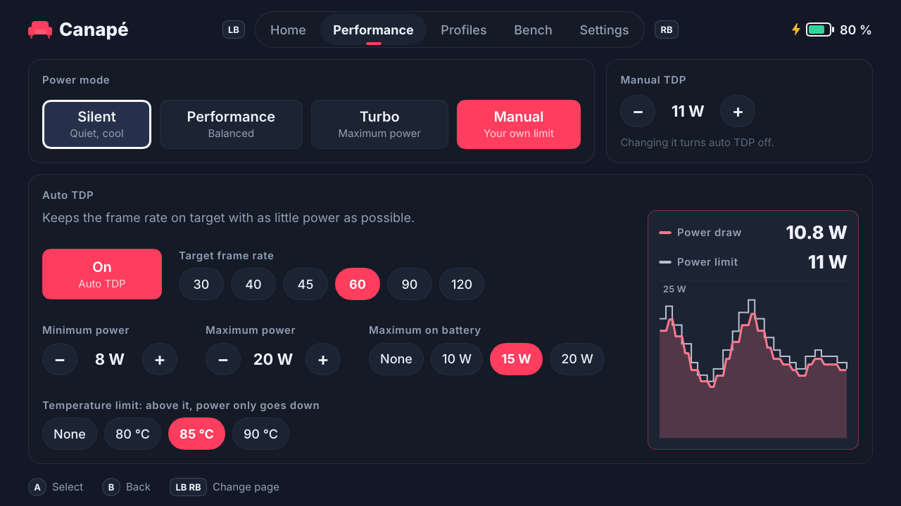

<sub>The same page in Russian: [ru/performance.png](images/ru/performance.png).</sub>

**Moving around**: the page is made of rows. Up and down move from row to row (rows that do not apply to the current mode are skipped), left and right move along a row of tiles or change the row's value at once, **A** picks a tile, **X** saves the settings for the game in the foreground (creates or updates its profile). The focused row has a white outline.

| Row | Content |
|---|---|
| **Mode** | Silent, Performance and Turbo are the ASUS firmware modes: the firmware sets its own limits, which Canapé cannot read. **Auto TDP** turns auto TDP on. The current mode has a lighter tile and an accent bar. Picking a firmware mode turns auto TDP off. Right of the title: "<game> · game profile" when a profile applies, "General settings" otherwise. |
| **Target** (auto TDP) | A ruler of stops: 30, 40, 45, 60, 90, 120 FPS. Left and right move to the next stop. |
| **Power range** (auto TDP) | ‹ minimum › — bar — ‹ maximum ›. The bar is on the model's scale (5 to 30 W on the ROG Ally and Ally X, 5 to 35 W on the ROG Xbox Ally models; 5 to 35 W if the service does not say). Up and down pick the minimum or the maximum (the active knob grows), left and right move it by 1 W; the minimum cannot pass the maximum. An accent mark shows what the APU draws now, with the value and the profile's learned watts. |
| **Power limit** (manual TDP) | The same bar with one knob: left and right change the limit by 1 W. Only shows while a manual limit is in place (from **Set as TDP** on the bench, or ±1 W in the widget): there is no Manual tile any more; a minimum equal to the maximum under auto TDP does the same. |
| **Other settings** | Tiles: **On battery** (none, 10, 15, 20 W, a ceiling applied only on battery), **Temperature** (none, 80, 85, 90 °C: above it, power only goes down), **Screen** (moves to the next rate the screen offers), **Bench** (opens the [bench](#bench), with its duration, or the time left during a run). A goes to the next value. |

On the right: the power draw (with the limit, or "Thermal limit reached"), the frame rate (with the target) and the graph of the last minute: the draw in the accent colour, the limit dashed in grey. The scale adapts in 5 W steps; a gap in the line means the service was unreachable.

How it works in detail: [Auto TDP and bench](auto-tdp.en.md).

> [!TIP]
> While a game profile is active, these settings change **the profile**, not the global settings.

### Hardware

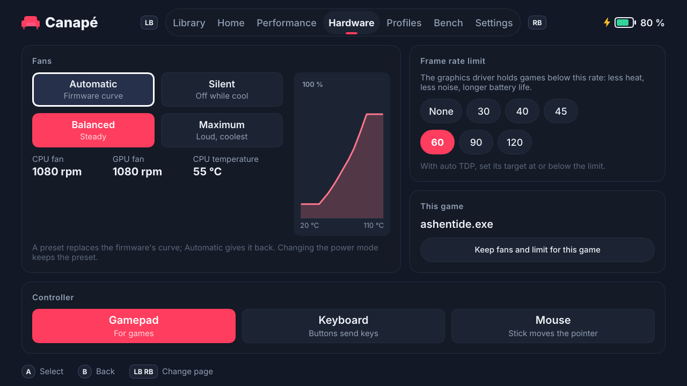

> [!NOTE]

Six rows, used like the Performance page: up and down change row, left and right move along the tiles (A picks) or change the frame rate limit at once, the last row opens [Gyro aiming](#gyro-aiming) on the left and [Back buttons and lighting](#back-buttons-and-lighting) on the right, **X** saves the fans, the frame rate limit, the screen refresh rate and gyro aiming for the game in the foreground (see [This game](#this-game)). On the right: the CPU fan speed (and the GPU fan's below it), in rpm, the CPU temperature (with the temperature limit when set) and the CPU fan's curve. "—" when the firmware gives no reading.

**Fans**

| Tile | Curve (CPU and GPU fans alike) |
|---|---|
| Automatic | The firmware's own curve for the current power mode. Canapé removes its curves. |
| Balanced | From 10 % at 40 °C to 75 % from 92 °C, close to ASUS's balanced behaviour. |
| Maximum | 35 % from 30 °C, full speed from 80 °C: loud, but the coolest. |

- There is no quiet preset: on the Ally, the firmware runs the fans at about 5300 rpm under load with a low curve (measured in M5, part 2), louder than with Balanced. For quiet, use **Automatic** with the **Silent** power mode: the firmware stays at about 3200 / 2800 rpm there.
- The CPU fan's curve runs from 20 to 110 °C across and from 0 to 100 % up. With Automatic, it gives way to "The power mode's own curve".
- A preset **survives power mode changes**: the firmware puts its own curves back at every mode change, and the service writes the preset again right after.
- **Automatic** writes the current power mode again: that is how the firmware takes its curves back. In Manual, the service then puts your TDP back.
- **Safety**: every curve is checked before it reaches the firmware. The fan may never slow down as the temperature rises, and it must run at least at 25 % from 80 °C, 30 % from 90 °C and 40 % from 100 °C, just under ASUS's own Silent mode. A curve that would leave the fans stopped when hot is refused. The APU also throttles itself at its temperature limit, but a quiet curve makes the console hot to hold.
- **Custom**: when the curves in use match no preset (set with `canape-ctl`, or a different preset on each fan), no tile is selected and the row's title reads "Custom curves set by another client."

**Frame rate limit**

A ruler: None, 30, 40, 45, 60, 90 or 120. The AMD graphics driver holds every game at or below that rate, on AC and on battery: less heat, less noise, longer battery life. **None** removes the limit.

> [!TIP]
> With auto TDP, set its target **at or below** the limit. Auto TDP regulates power to reach its target: with a limit of 40 and a target of 60, the target can never be reached and auto TDP would raise power to its maximum for nothing. A limit equal to the target is ideal: the game sits at its cap and auto TDP takes back the watts it does not need (see [Auto TDP and bench](auto-tdp.en.md#the-frame-cap-and-the-idle-gpu-rule)).

#### This game

The title of the Fans row shows the program in the foreground. **X** saves the current fan curves, frame rate limit and screen refresh rate in that game's profile (nothing happens without a game in the foreground):

- The other settings of the profile (auto TDP, learned watts) are kept. Without a profile, one is created with the current auto TDP settings.
- **Automatic** is saved too: that game will then run on the firmware's curves even if a preset is in use the rest of the time.
- **None** is saved as "follow the global limit": a profile cannot force "no limit" while a global limit is set.
- When the game comes to the foreground, its curves and limit apply; when it leaves, the global ones come back.
- While the game is in front, picking a preset or a limit changes **its profile** if the profile has its own fans (or its own limit); otherwise the change is global and stays after the game. A profile made from the Game profiles page or the bench has neither: it follows the global fans and limit.

**Controller**

| Tile | Mode of the built-in controller |
|---|---|
| Gamepad | Xbox gamepad (XInput), for games. |
| Keyboard | The sticks and buttons send keys, for games that only know the keyboard. |
| Mouse | Desktop mode: the right stick moves the pointer. |

The mode is global (not per game), remembered and re-applied when the service starts. Canapé does not read it back from the controller: no tile is selected until Canapé has set it once. Only the ROG Ally and Ally X controllers are known; on the ROG Xbox Ally models the request returns an error.

> [!WARNING]
> Canapé reads the gamepad through XInput. In Keyboard or Mouse mode the controller should no longer show up as an Xbox gamepad, so Canapé may stop answering it: come back to **Gamepad** with the touch screen, or with `canape-ctl` (see [Troubleshooting](#canape-ctl-talking-to-the-service)).

**Charge limit**

Three tiles: 60, 80 and 100 %. The battery stops charging at that level, even plugged in: a console that lives on its charger keeps a healthier battery at 60 or 80 %. **100 %** removes the limit. The limit is global (not per game), remembered and re-applied when the service starts. Canapé cannot read it back from the firmware: no tile is selected until Canapé has set it once (a limit set elsewhere, or another value set with `canape-ctl`, selects none).

> [!NOTE]
> Not tried on the Ally yet: the firmware write (`set_battery_charge_limit`) has only been tested with the simulator.

**Screen**

One tile per refresh rate the built-in screen offers at its current resolution (60 and 120 Hz on the ROG Ally); A applies the focused one. A lower rate saves battery in games capped at 30, 40 or 60 FPS. The choice is applied at once. Without a game in the foreground it becomes the general rate, remembered like a change made in Windows settings. With a game in the foreground it only lasts for that session: **X** keeps it in the game's profile, and the screen goes back to the general rate when the game closes.

- A game profile can hold its own rate (**X** on this page): it applies when the game comes to the foreground; when the game leaves, the screen goes back to the rate picked here, or to the one the profile replaced.
- Canapé only switches when the profile changes: a rate picked in Windows settings meanwhile is left alone.
- Only the built-in screen is touched, never a TV or monitor plugged in. Without a built-in screen (or off Windows) the Screen row does not show.

> [!NOTE]
> Not tried on the Ally yet (`ChangeDisplaySettingsEx` on the internal display, from the shell).

#### Gyro aiming

Opened from the **Gyro aiming** row of the Hardware page; **B** goes back. While a game is in front, turning the Ally moves the **mouse**, as with a mouse in your other hand: handy for fine aiming in shooters. It never acts on Canapé itself.

> [!WARNING]
> **Not tried on the Ally yet**: written and tested on Linux with a simulated sensor only. The left / right and up / down directions in particular still have to be checked on the device; use **Invert up and down** if the vertical axis feels wrong.

| Line | Values |
|---|---|
| Active | **Off**; **While a back paddle is held** (aim while holding either paddle, let go to stop); **A back paddle turns it on and off**; **Always** (while a game is in front). |
| Sensitivity | 1 to 50 (mouse movement per degree turned, 10 by default); the game's own mouse sensitivity multiplies it. |
| Left and right | **Turn the console** (around its vertical axis, as when looking around) or **Tilt like a wheel** (comfortable when lying down). |
| Invert up and down | Tilting the top of the screen away moves the view up; **On** moves it down. |

- **Games**: the movement is a mouse movement. It works in games that take the mouse alongside the gamepad, or the mouse alone. Games that only read the gamepad ignore it, and some swap their button prompts between keyboard and gamepad each time the mouse moves. A game run as administrator ignores it too.
- **Per game**: **X** keeps these settings in the profile of the game in the foreground, with the fans and the frame rate limit. A profile without its own gyro settings follows the global ones. While a game with its own settings is in front, a change goes into its profile.
- The paddles go to gyro aiming even when **Use the Ally's buttons** is off. In **While held** mode, holding a paddle in a game that also uses it does both.
- **Cost**: nothing while the gyro is off or the paddles are released; while aiming, the shell reads the sensor every 10 ms.

#### Back buttons and lighting

On the page's last row, on the right, **Back buttons and lighting ›** opens a page that chooses what M1 and M2, the two buttons on the back, send (on the left), and the light of the rings around the sticks (on the right). The lines are M1, right and M2, left: the right and left back buttons. **A** on one of them opens a grid of every choice, each with its icon (gamepad buttons, keys, mouse, media), the name of the focused one below; the arrows move, **A** applies the choice, **B** closes the grid without changing anything. On the brightness line, left and right go through the levels; a level not applied yet shows in italics after a dot, and **A** applies it (leaving the line drops it). B goes back to the Hardware page.

| Choice | The button sends |
|---|---|
| Default | Its own key, as from the factory |
| Disabled | Nothing |
| A, B, X, Y, LB, RB, LT, RT, stick clicks, D-pad, View, Menu, Xbox | That gamepad button |
| Esc, Enter, Space, Tab, Backspace, arrows, Page up / down, Shift, Ctrl, Windows, F11, F12 | That key |
| Left, right, middle click, scroll up / down | That mouse action |
| Volume up / down, mute the microphone, touch keyboard | That action |

- The controller itself does the translation: it works in every game and program, whatever reads the gamepad.
- The choice is global (not per game), remembered, and written again when the service starts and after every change of controller mode. Canapé writes the controller's whole button table each time, with the factory bindings for every other button: a remap made elsewhere (Armoury Crate, another tool) for the other buttons is undone, and so is turbo.
- It needs the gamepad or mouse mode: in keyboard (WASD) mode the choice is refused, and the saved buttons come back with another mode. Choosing a button while Canapé has not set the mode puts the controller in gamepad mode.
- With the left button under the screen held, M1 and M2 keep their own keys.
- **Restore the default buttons** gives M1 and M2 their own keys back.
- Steam Input, or a game that already knows M1 and M2 by their own keys, sees the new button instead.

> [!NOTE]
> Not tried on the Ally yet: the packets were checked against four open-source projects that drive the Ally's controller (see the developer guide), but never sent to a real one. Only the ROG Ally and Ally X controllers are known. If a button behaves oddly, **Restore the default buttons**.

**Stick lighting**

- **Brightness**: Default, Off, Low, Medium, High, applied with A. **Default** leaves the rings to the controller: Canapé stops changing them. The controller keeps the last effect written, even after a restart: Canapé cannot bring back its factory lighting, pick the effect you want instead.
- **Effect**: Steady, Breathing, Colour cycle, Rainbow, Strobe, applied with A; the controller runs it itself, even when Canapé is closed. **Speed** (Slow, Medium, Fast) for every effect but Steady. Colour cycle and Rainbow go through every colour: the swatches are greyed out.
- **Colour**: the first swatch, a ring, follows the accent colour picked in Settings (and changes with it); the others are fixed colours, white first. A applies the focused one; picked while the rings are off or on Default, it lights them on High.
- One colour for both rings. The choice is global, remembered and written again when the service starts.

> [!NOTE]
> Not tried on the Ally yet (checked against open-source projects, like the back buttons). If the rings look wrong, choose the **Steady** effect and a colour.

### Settings

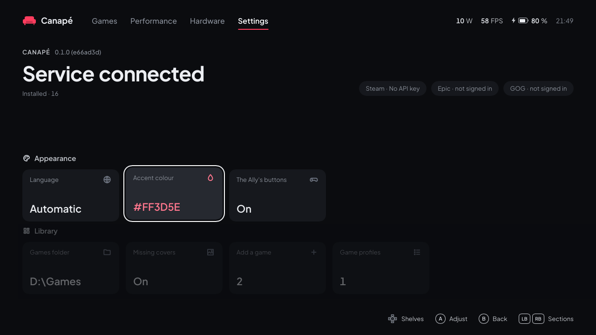

Setting lines: up and down move from one to the next (the left column, then the right one), left and right change the value (it turns to the accent colour between ‹ ›), A acts on the line.

| Line | Effect |
|---|---|
| **Language** | "Automatic" (the Windows language) or one of the 13 languages. Left and right go through the list, **A** applies the language shown; the choice is remembered. See [Languages](#languages). |
| **Use the Ally's buttons** | The **Armoury** button (right, under the screen) brings Canapé to the front from a game, or goes back to Games when Canapé is already in front; the **Command Center** button (left) opens the Xbox Game Bar, where the Canapé widget lives. Turn it off if Armoury Crate or another tool should handle them (otherwise both react). Not tried on the Ally yet. |
| **Download missing covers** | See [Games](#games). |
| **Epic Games account** | The signed-in account, or "Sign in": **A** opens the Epic sign-in, downloading Legendary first if needed (see [Installing owned games](#installing-owned-games)). Not tried on the Ally yet. |
| **GOG account** | The signed-in account, or "Sign in": **A** opens GOG's sign-in page in the browser, downloading gogdl first if needed, then waits for the copied address (see [Installing owned games](#installing-owned-games)). Not tried on the Ally yet. |
| **Games folder** | Where Epic and GOG games are installed, and its free space. By default, the folder that already holds most of the games installed by Canapé or the Epic launcher, else `Games` on the drive with the most free space. Left and right (or A) go through the folders that already hold games and `Games` on each internal drive; the choice is saved in `shell.json` (`games_folder`). Not tried on the Ally yet. |
| **Game profiles** | The number of profiles; **A** opens the [Game profiles](#game-profiles) sub-page. |
| **Add a game** | The number of games in `games.json`; **A** opens the list of games to add (see [Adding other games](#adding-other-games)). Not tried on the Ally yet. |
| **Accent colour** | Eight ready-made swatches (left and right, A picks) and three lines **Hue**, **Saturation** and **Brightness** that left and right move. The whole interface follows live; the colour is saved in `shell.json` and sent to the service once you stop adjusting, and **the Game Bar widget follows the accent colour**. |

Bottom right: Canapé's version, the state of the connection to the service and whether a Steam API key is in `shell.json` (its validity is not checked).

| Teal accent | Orange accent |
|---|---|
| 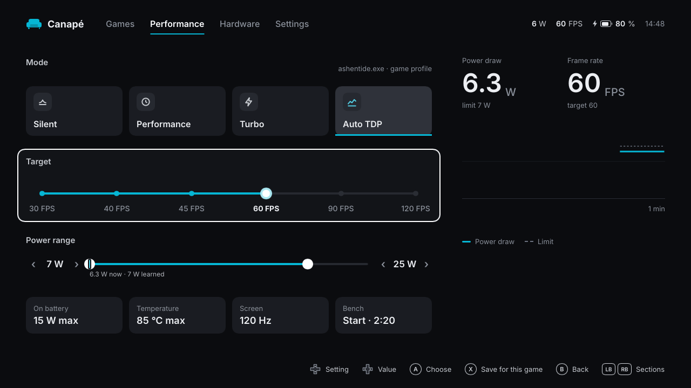 | 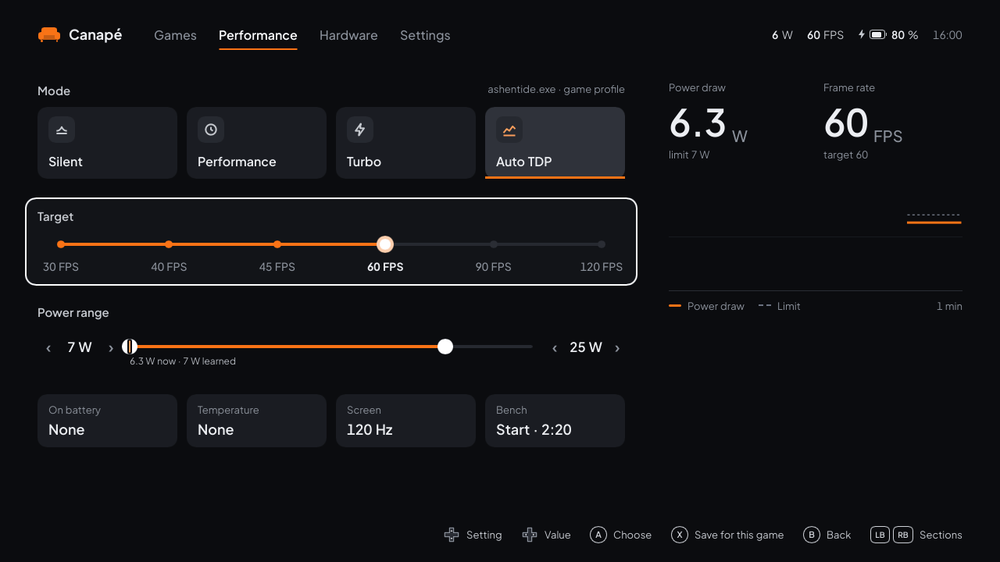 |

<sub>The same settings in German: [de/settings.png](images/de/settings.png).</sub>

### Game profiles

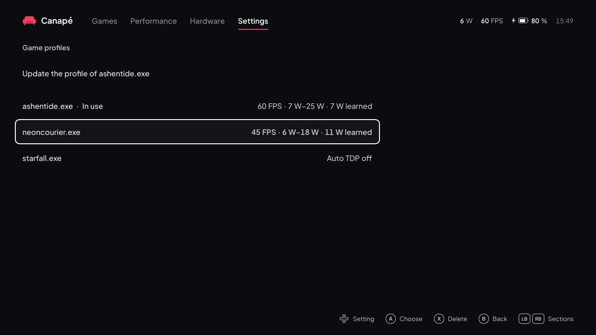

Opened from **Settings → Game profiles**; **B** goes back. A profile ties an executable (for example `eldenring.exe`) to auto TDP settings and, if you saved them from the [Hardware](#hardware) page, to fan curves, a frame rate limit and a screen refresh rate. When that program comes to the foreground the service applies the profile; when it leaves, the global settings come back.

- **First line**: "Save a profile for <game>" (or "Update the profile of <game>"); **A** saves the current auto TDP settings (target, power, maximum on battery, temperature limit). Greyed out while no game is in the foreground.
  - With auto TDP on, the current power is saved too as **learned watts**: the game's next session starts right there.
  - Fan curves and a frame rate limit already in the profile are kept.
- **The profiles**, sorted by name, with the target, the power range and the learned watts; "In use" after the name of the profile that applies. **X** asks for a confirmation ("Press X again to delete"), a second **X** deletes; moving to another line cancels.

The Performance and Hardware pages do the same with **X**.

> [!NOTE]
> **How Canapé detects the game**: every 2 seconds the shell checks which program is in the foreground and tells the service (which, in session 0, cannot see windows). Explorer, Game Bar, the Start menu, Task Manager and Canapé itself are ignored: going back to Canapé does not "leave" the game while it is still running. Another program counts as a game when it **fills the screen** (full screen or borderless window) or **already has a profile**: a browser or Discord in an ordinary window does not replace the game running behind it. To create a profile for a windowed game, switch it to full screen while you save the profile. The shell must be running for profiles to work.

Profiles and learned watts are covered in [Auto TDP and bench](auto-tdp.en.md#per-game-profiles).

### Bench

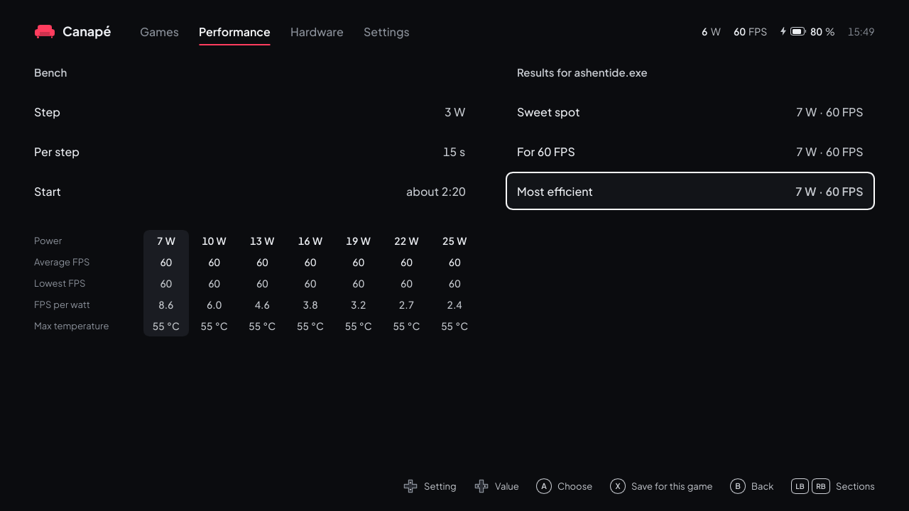

Opened from the **Bench** tile of the Performance page; **B** goes back. The bench runs the foreground game at several power limits, from 25 W down to 7 W, measures each one and suggests the right value.

1. Start the game and leave a **demanding, steady scene** running (not a menu).
2. Come back to Canapé (Xbox button or Alt+Tab), **Performance → Bench**.
3. Set the **step** (2, 3 or 5 W) and the time **per step** (10, 15 or 30 s) with left and right. The total time shows on the **Start** line (about 2:20 with 3 W and 15 s).
4. **A** on **Start**, then go back to the game. Until the game is back in front, the bench shows "Waiting for the game"; it starts once the game has been running again for 3 s, and gives up after 2 minutes. The limit then changes on its own; each step waits 5 s before measuring.

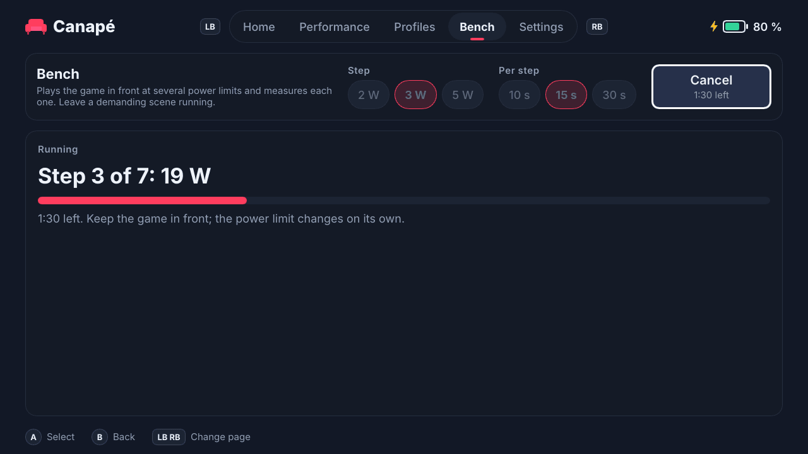

While the bench runs, the mode, TDP and auto TDP are locked ("a bench is running: cancel it first"); the line becomes **Cancel**, which stops the bench and keeps the steps already measured (without replacing the previous complete results for the same game). On the right: the current step, its power, a progress bar and the time left. At the end, or when cancelled, the service restores the previous state.

**Results**: under the settings, for each step, the power, the average FPS, the lowest FPS (the worst second), FPS per watt and the maximum temperature; the sweet spot's column is highlighted. On the right, three recommendations, each with its power and frame rate:

| Line | Meaning |
|---|---|
| **Sweet spot** | The lowest power within 5 % of the best result: above it, more watts bring almost nothing. |
| **For N FPS** | The lowest power that holds the current auto TDP target, on average. "—" if the target was not reached, or if a cancelled run did not go low enough to tell. |
| **Most efficient** | The most frames per watt: the most battery-friendly setting. |

On a recommendation, **A** sets the TDP (manual limit at that value, auto TDP off) and **X** saves it in the game's profile (creates or replaces the profile: auto TDP on, target and ceiling taken from the measure). The exact computation is in [Auto TDP and bench](auto-tdp.en.md#the-bench).

> [!NOTE]
> The bench has not been tried on the Ally yet.

## The Xbox Game Bar widget

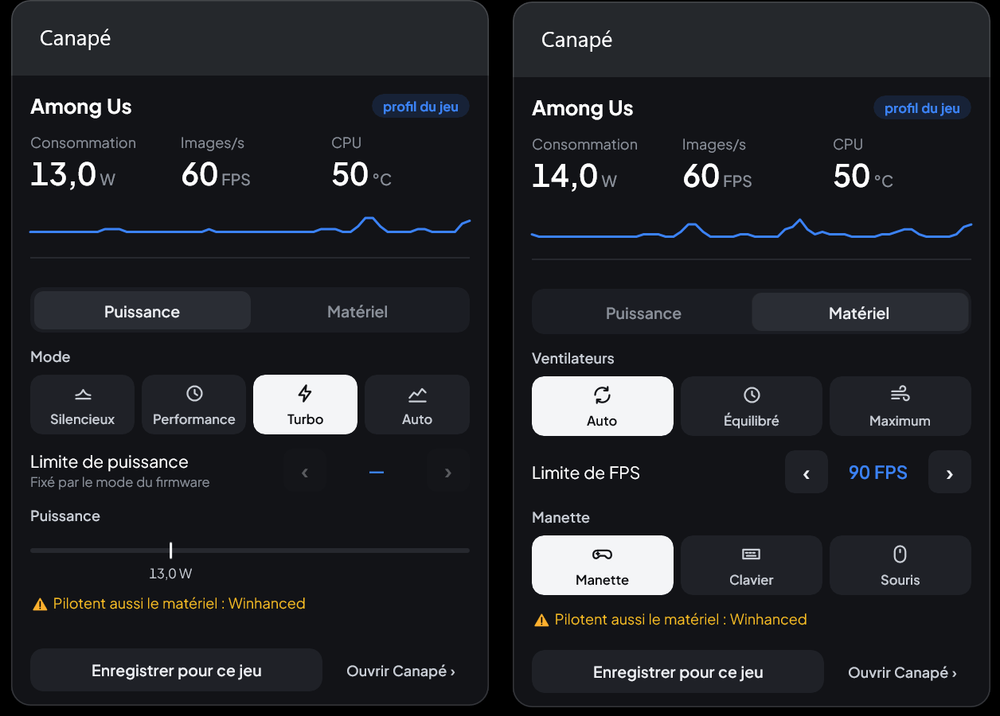

<sub>On the Ally, in game (Among Us); French interface.</sub>

The widget gives you the quick settings without leaving the game. All the logic stays in the service: the widget is just a remote control.

**Install** (once, then at every widget update):

1. Add the UWP workload to the Build Tools (elevated Terminal, several GB):
   ```powershell
   $vs = & "${env:ProgramFiles(x86)}\Microsoft Visual Studio\Installer\vswhere.exe" -latest -products * -property installationPath
   & "${env:ProgramFiles(x86)}\Microsoft Visual Studio\Installer\setup.exe" modify --installPath $vs `
       --add Microsoft.VisualStudio.Workload.UniversalBuildTools --includeRecommended --quiet --norestart
   ```
2. Build, sign and install (no elevation needed; the `install-dev.ps1` certificate must exist):
   ```powershell
   powershell -ExecutionPolicy Bypass -File packaging\build-widget.ps1
   ```

**Open**: Game Bar (Win+G or the Xbox button) → **Widgets** menu → **Canapé**. You can pin it to keep it over the game.

**Contents**: at the top, what always shows; below, two tabs, **Power** and **Hardware**. When the widget opens and at each tab change, the lines slide in from the left one after the other, like the title on the shell's Games page.

| Area | Detail |
|---|---|
| Header | The foreground game (without `.exe`) and the "game profile" chip when its profile applies; otherwise the connection state ("Connecting…", "Service not connected"). |
| Figures | Power draw (one decimal), frames per second and CPU temperature ("Throttled" in amber when the temperature limit holds power down). |
| Graph | The last minute: power draw in the accent colour, the limit dashed grey. |
| Bench | Step, wattage and time left during a bench (started from the shell). |
| **Power** tab | Mode (Silent, Performance, Turbo, Auto; the chosen tile is white, a firmware mode turns auto TDP off). The ‹ value ›: under auto TDP the **target** (30 to 120 FPS), otherwise the **power limit** ±1 W, greyed out in a firmware mode and bounded by the model's range. The power range on the model's scale, with the current draw (read-only). |
| **Hardware** tab | Fans: Auto (the firmware's curve), Balanced, Maximum; "Custom curves" when other curves are in place. The frame rate limit ‹ › (None, 30 to 120). The controller: Gamepad, Keyboard, Mouse. The battery charge limit ‹ › (60, 80, 100 %; "—" until Canapé has set it, not tried on the Ally yet). |
| Footer, always in view | **Save for this game**: the tab in front into the foreground game's profile (Power: the current auto TDP; Hardware: fans and frame rate limit; the rest of the profile is kept). **Open Canapé**, which brings the shell to the front. |

The widget has no bench button, no profile list, no power range or screen refresh setting: those stay in the shell. Its panel follows Game Bar's transparency setting, and the widget follows the accent colour picked in the shell. Default size 400 × 600, resizable.

> [!NOTE]
> The **first version** of the widget was validated on the Ally (M3) through Win+G on the desktop. The two-tab version was validated on the Ally on 25 October 2026 in Game Bar: tabs, fans, frame rate limit, controller, Save for this game, and **Open Canapé**, which brings the shell in front of the game. The latter goes through the identity package's `canape://` protocol: after an update, install the package again (`install-dev.ps1`) for it to exist.

## Languages

Canapé is translated into 13 languages:

| Language | Shell | Widget |
|---|---|---|
| English | `en` (source language) | `en-US` (default fallback) |
| Français | `fr` | `fr-FR` |
| Español | `es` | `es-ES` |
| Deutsch | `de` | `de-DE` |
| Italiano | `it` | `it-IT` |
| Português | `pt` | `pt-BR` |
| Nederlands | `nl` | `nl-NL` |
| Polski | `pl` | `pl-PL` |
| Русский | `ru` | `ru-RU` |
| Türkçe | `tr` | `tr-TR` |
| 日本語 | `ja` | `ja-JP` |
| 한국어 | `ko` | `ko-KR` |
| 简体中文 | `zh_CN` | `zh-Hans` |

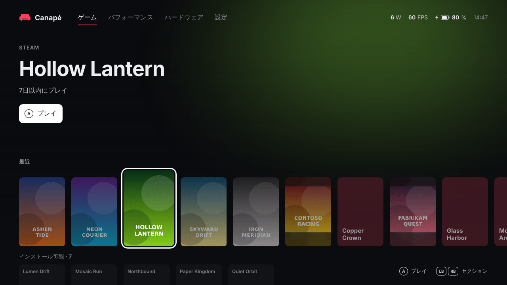

- **Shell, Automatic mode** (default): the first language in Windows' preferred languages list that is bundled, otherwise English. Any Chinese variant shows Simplified Chinese.
- **Shell, manual choice**: **Settings → Language** page. The choice is saved in `%LOCALAPPDATA%\Canape\shell.json` and applied at once.
- **Widget**: it always follows Windows' preferred languages (Settings → Time & language → Language); restart Game Bar after a change.
- Error messages returned by the service stay in English, after a translated prefix.


These programs write the same power limits to the firmware, and some also the fan curves, the driver's frame rate limit or the controller mode: if two of them run, the last one to write wins, and Canapé's auto TDP or fan preset can be overridden without notice.

Every 5 seconds, the service looks for these processes and shows a yellow warning in the shell (and in the widget):

| Program | Process detected |
|---|---|
| Armoury Crate | `ArmouryCrate.Service.exe` |

What to do:

- **Armoury Crate**: stop its services (`services.msc`) or turn it off.
  ```powershell
  ```

Other ASUS services (ASUS Optimization, System Analysis, ROG Live Service) and RTSS are not reported: as far as we know, they do not write the power limits.

## Troubleshooting

### Files and logs

| File | Contents |
|---|---|
| `%ProgramData%\Canape\service.log` | Service log: detected model, ADL state at startup, every command that changes the state and its response (`SetTdp { watts: 12 } -> Ok`), conflicting programs, errors. |
| `%ProgramData%\Canape\state.json` | Last applied state, re-applied when the service starts: mode, TDP, auto TDP, fan curves, frame rate limit, charge limit, controller mode, back buttons, stick lighting, profiles, last bench. |
| `%LOCALAPPDATA%\Canape\shell.log` | Shell log: launches (with their arguments), chosen language, ADL state, service errors. |
| `%LOCALAPPDATA%\Canape\shell.json` | Shell preferences: `language`, `accent`, `online_covers`, `steamgriddb_key`, `steam_api_key`, `igdb_client_id`, `igdb_client_secret`, `refresh_hz`, `ally_buttons`. |
| `%LOCALAPPDATA%\Canape\games.json` | The games added by hand or from **Settings → Add a game** (see [Adding other games](#adding-other-games)). |
| `%LOCALAPPDATA%\Canape\covers\` | Downloaded covers (`<store>_<id>.jpg` / `.png`, `.miss` markers). |
| `%LOCALAPPDATA%\Canape\library.json` | The games of the last scan, shown at once on the next start. Can be deleted: the next scan writes it again. |
| `%LOCALAPPDATA%\Canape\recent.json` | When each game was last launched from Canapé (for the "Recent" order). |
| `%LOCALAPPDATA%\Canape\igdb.json` | Times to beat asked of IGDB, per game, with their date. `igdb-token.json` next to it: the current Twitch token. Both can be deleted. |
| `%LOCALAPPDATA%\Canape\achievements.json` | Steam achievements per game, with their date and language; `achievement-icons\` next to it: their downloaded icons. Both can be deleted. |
| `%LOCALAPPDATA%\Canape\owned.json` | The owned games from the last request to Steam and Epic, shown at once in To install mode. Can be deleted: the next request writes it again. |
| `%LOCALAPPDATA%\Canape\tools\` | `legendary.exe`, downloaded at the first Epic sign-in. Without it, Canapé no longer lists owned Epic games nor the ones Legendary installed; the next Epic sign-in downloads it again. |
| `%USERPROFILE%\.config\legendary\` | Legendary's configuration, written by Legendary itself: Epic sign-in, games it installed (`installed.json`). |

Every line starts with the time in Unix seconds.

### `canape-ctl`: talking to the service

`canape-ctl` sends one JSON request to the service and prints the response; `watch` prints the status every second.

```powershell
$ctl = "C:\Program Files\Canape\canape-ctl.exe"
& $ctl watch
```

> [!WARNING]
> **Windows PowerShell 5.1** (the one on the Ally) drops the double quotes of an argument passed to an `.exe`. Escape them with `\"`:
> ```powershell
> & $ctl '{\"type\":\"set_tdp\",\"watts\":12}'
> ```

Examples (written in readable form here; escape the quotes in PowerShell 5.1):

| Request | Effect |
|---|---|
| `{"type":"get_status"}` | Full status, once |
| `{"type":"set_performance_mode","mode":"turbo"}` | Mode `silent`, `performance`, `turbo` or `manual` |
| `{"type":"set_tdp","watts":12}` | Manual TDP (turns auto TDP off) |
| `{"type":"set_auto_tdp","settings":{"enabled":true,"target_fps":60,"min_watts":7,"max_watts":25}}` | Auto TDP |
| `{"type":"set_battery_charge_limit","percent":80}` | Battery charge limit (40 to 100 %) |
| `{"type":"reset_fan_curves"}` | Fans back to the firmware's curves (Automatic) |
| `{"type":"set_fps_limit","fps":null}` | Removes the frame rate limit (or `"fps":40` for a limit, 30 to 120) |
| `{"type":"set_controller_mode","mode":"gamepad"}` | Controller back to gamepad mode (`wasd`, `mouse`) |
| `{"type":"set_gyro","settings":{"activation":"off"}}` | Gyro aiming off (`hold`, `toggle`, `always`; other fields: `sensitivity`, `horizontal` `yaw` or `roll`, `invert_y`) |
| `{"type":"reset_back_buttons"}` | M1 and M2 back to their own keys |
| `{"type":"set_lighting","lighting":null}` | Stick rings left to the controller (back at the next restart) |
| `{"type":"list_profiles"}` | Saved profiles |
| `{"type":"get_bench_report"}` | Last bench |
| `{"type":"cancel_bench"}` | Cancels the running bench |

The exit code is 0 when the service answered without an error, 1 otherwise. The full list of requests is in the [developer guide](developer-guide.en.md#ipc-protocol).

### Common problems

| Symptom | Likely cause and fix |
|---|---|
| "Service not connected" at the bottom of the shell, "Offline" at the top | The service is not running: `Get-Service CanapeService`, then `Start-Service CanapeService` (elevated). Check `service.log`. |
| The widget shows "Service not connected" and "The Canapé service isn't running." | Same cause: the `\\.\pipe\canape` pipe does not exist. |
| FPS stay at "—" in game | The AMD driver only counts frames once armed from the user session: the shell does it at startup (line `adl: frame metrics started` in `shell.log`). Launch Canapé at least once after boot. Known limit: a fullscreen game minimized, then left hidden behind Canapé for about forty seconds, loses its frame rate until it is started again. |
| The TDP shows "Auto" and −/+ are disabled | A firmware mode (Silent, Performance, Turbo) is active: the firmware does not report its limits. Pick **Manual**. |
| Auto TDP does not move | It only acts while a game runs: at least 5 FPS **and** at least 15 % GPU activity. On the desktop or in a still menu, it keeps the current value. |
| The power changes on its own | Another tool drives the hardware (yellow warning), or a game profile just kicked in ("<game> · game profile" at the top of the Performance page). |
| The fans or the frame rate limit change on their own | A game profile with its own fans or limit just kicked in or ended, or another tool rewrote them (yellow warning). |
| "Service error: GPU driver refused: ADL2_FPS_Settings_Set… (session 0)" on the frame rate limit | The AMD driver refuses the limit from the service. This case has not been tried yet: note the message (it is also in `service.log`) and report it. |
| The gamepad no longer moves around Canapé after picking Keyboard or Mouse | Expected: the controller no longer acts as an Xbox gamepad. Tap **Gamepad** on the touch screen, or send `{"type":"set_controller_mode","mode":"gamepad"}` with `canape-ctl`. |
| The To install list stays empty, or a store is missing from it | Steam: no key or a rejected one, or no account in `loginusers.vdf`; Epic: not signed in. These errors do not show in the library: look for `library: Steam owned games` or `library: Epic` in `shell.log`. Restart Canapé (or sign in to Epic again) to ask for the list right away. |
| Canapé is not offered in Settings → Gaming | Run `install-dev.ps1 -SetAsHomeApp` again. Check that the package is installed: `Get-AppxPackage -Name Canape`. |
| `Developer Mode is off` | Turn on Developer Mode (see [above](#1-turn-on-developer-mode)). |
| `makeappx.exe not found` | Install the Windows SDK with the Build Tools. |
| `cargo build` fails with `os error 4551` | **Smart App Control** is blocking an unsigned build script. Retry (it sometimes passes), use `-BuildProfile debug`, or install the [CI binaries](#using-the-ci-binaries). Turning Smart App Control off (Windows Security → App & browser control) solves it but is hard to turn back on. |
| `canape-ctl` answers `invalid message` | Quotes dropped by PowerShell 5.1: escape them (see above). |

To start over with the settings: stop the service, delete `%ProgramData%\Canape\state.json`, start the service again. Profiles and the last bench are lost then.

## Uninstalling

1. **Pick another home app** in Settings → Gaming → Full screen experience (see [Going back to Winhanced or the Xbox app](#going-back-to-winhanced-or-the-xbox-app)).
2. In an **elevated Terminal**, from the repository root:
   ```powershell
   powershell -ExecutionPolicy Bypass -File packaging\uninstall-dev.ps1
   ```

| Step | What the script does |
|---|---|
| 1/6 | While the service still runs, puts the hardware back to neutral: fans on the firmware's curves (**Automatic**), no frame rate limit, controller in **Gamepad** mode, and the charge limit back to 100 % if Canapé had set one. Once the service is gone, nothing would undo them. If the service is not running, it says so and goes on. |
| 2/6 | Closes the shell, stops and removes the `CanapeService` service. |
| 3/6 | Removes the shell's identity package (`Canape`) and the widget's (`Canape.Widget`). |
| 4/6 | Clears the FSE home app value (`GamingHomeApp`) if it still names Canapé. |
| 5/6 | Deletes `C:\Program Files\Canape`. |
| 6/6 | Keeps your data unless asked otherwise (see the options). |

| Option | Effect |
|---|---|
| `-RemoveData` | Also deletes `%ProgramData%\Canape` (settings, profiles, last bench, service log) and `%LOCALAPPDATA%\Canape` (shell settings, library cache, Legendary download, shell log). |
| `-RemoveCertificate` | Also removes the `CN=Canape Dev` development certificate and `$HOME\dev\canape-cert`. Keep it if you will reinstall: `build-widget.ps1` needs it. |
| `-InstallDir`, `-CertDir` | The same as for `install-dev.ps1`, if you changed them. |

> [!NOTE]
> The script has **not been tried on the Ally yet**. If a step fails, the commands it runs are in `packaging\uninstall-dev.ps1` and can be typed by hand.

Games installed from Canapé stay on disk, and Legendary's configuration (Epic sign-in included) stays in `%USERPROFILE%\.config\legendary`.

