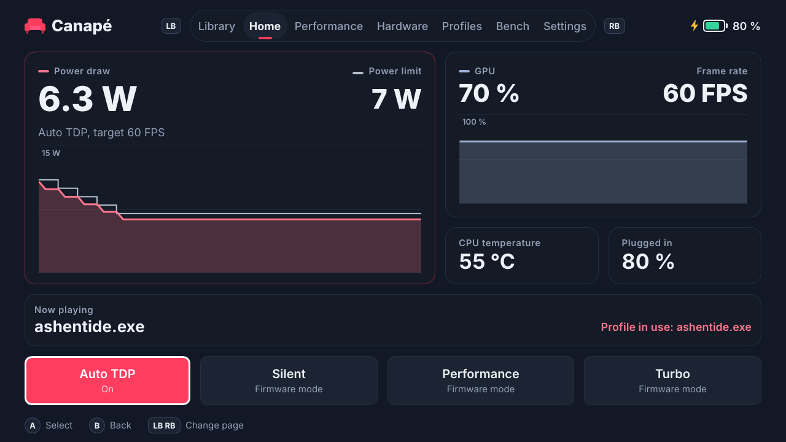
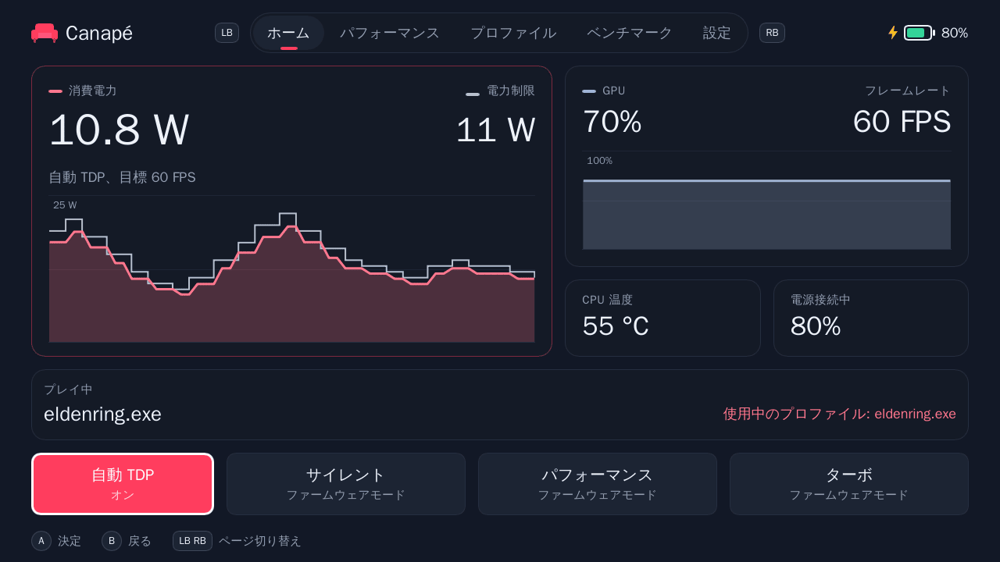

# Canapé user guide

[🇫🇷 Version française](user-guide.fr.md) · [📚 Documentation index](README.md)

This guide explains how to install Canapé on a ROG Ally, make it the home app of the full-screen experience (FSE), use it with the gamepad, add the Xbox Game Bar widget, and then troubleshoot and uninstall it.

> [!IMPORTANT]
> Canapé is a personal project under development. **Validated on the Ally**: installation, FSE boot, the service, modes, manual TDP, auto TDP (version `99cad07`) and the first version of the widget. **Written and tested without hardware, but not tried on the Ally yet**: the five-page shell in 13 languages, per-game profiles, the bench, the latest auto TDP optimizations and the new version of the widget. The sections concerned say so.

## Contents

- [Requirements](#requirements)
- [Installing Canapé](#installing-canapé)
  - [1. Turn on Developer Mode](#1-turn-on-developer-mode)
  - [2. Run `install-dev.ps1`](#2-run-install-devps1)
  - [Script options](#script-options)
  - [Using the CI binaries](#using-the-ci-binaries)
  - [Checking the installation](#checking-the-installation)
- [Making Canapé the FSE home app](#making-canapé-the-fse-home-app)
  - [Going back to Winhanced or the Xbox app](#going-back-to-winhanced-or-the-xbox-app)
- [Using Canapé with the gamepad](#using-canapé-with-the-gamepad)
  - [Controls](#controls)
  - [Shared elements](#shared-elements)
  - [Home](#home)
  - [Performance](#performance)
  - [Profiles](#profiles)
  - [Bench](#bench)
  - [Settings](#settings)
- [The Xbox Game Bar widget](#the-xbox-game-bar-widget)
- [Languages](#languages)
- [Troubleshooting](#troubleshooting)
- [Uninstalling](#uninstalling)

## Requirements

| Item | Details |
|---|---|
| Handheld | **ROG Ally RC71L** (the only model tested). The ROG Ally X (RC72LA), ROG Xbox Ally (RC73YA) and ROG Xbox Ally X (RC73XA) are recognized by the code but have never been tried. |
| Windows | Windows 11 **24H2 or later** (the identity package requires version 10.0.26100). |
| Tools | **Visual Studio Build Tools 2022** with the C++ tools and the **Windows SDK** (provides `makeappx` and `signtool`, used even with prebuilt binaries). **Rust** (MSVC toolchain) if you build on the Ally. **Git** to get the repository. |
| Rights | An **elevated** Terminal for the installation (Windows service and certificate). |
| Optional | [GitHub CLI](https://cli.github.com/) (`gh`) to download the CI binaries; the **UWP** workload of the Build Tools for the widget. |

> [!WARNING]

## Installing Canapé

### 1. Turn on Developer Mode

Settings → System → Advanced → **For developers** → Developer Mode: on.

The install script stops with `Developer Mode is off` otherwise (it reads `HKLM\SOFTWARE\Microsoft\Windows\CurrentVersion\AppModelUnlock\AllowDevelopmentWithoutDevLicense`).

### 2. Run `install-dev.ps1`

In an **elevated Terminal**, at the root of the cloned repository:

```powershell
powershell -ExecutionPolicy Bypass -File packaging\install-dev.ps1
```

The script runs six steps:

| Step | What happens |
|---|---|
| 1/6 | Builds `canape-shell`, `canape-service` and `canape-ctl` (release by default), or takes prebuilt binaries (`-BinariesDir`). |
| 2/6 | Stops and uninstalls the service if it exists, closes the shell, copies the three `.exe` files and `CustomCapability.SCCD` to `C:\Program Files\Canape`. |
| 3/6 | Installs and starts the **`CanapeService`** Windows service (automatic start, LocalSystem account, automatic restart after a crash). |
| 4/6 | On the first run, creates a `CN=Canape Dev` development certificate in `$HOME\dev\canape-cert` and adds it to `LocalMachine\TrustedPeople`. |
| 5/6 | Packs and signs the `Canape.Identity.msix` identity package. |
| 6/6 | Registers the package with `Add-AppxPackage -ExternalLocation`: `canape-shell.exe` gets the `Canape_…!App` identity that the FSE can launch. |

At the end, the script prints the test command, the `canape-ctl watch` command and where the logs are.

> [!CAUTION]
> Never commit the contents of `$HOME\dev\canape-cert` (`.pfx`, `.cer`): it is the key that signs your packages.

Running the script again later updates Canapé: it replaces the binaries and registers the service and the package again. Your settings (`state.json`) are kept.

### Script options

| Option | Default | Purpose |
|---|---|---|
| `-InstallDir <folder>` | `C:\Program Files\Canape` | Where the binaries are installed. |
| `-CertDir <folder>` | `$HOME\dev\canape-cert` | Where the development certificate is created and reused (the widget uses it too). |
| `-BuildProfile release\|debug` | `release` | Cargo profile. `debug` is a fallback when Smart App Control blocks a release build (see [Troubleshooting](#troubleshooting)). |
| `-BinariesDir <folder>` | *(empty)* | Takes `canape-shell.exe`, `canape-service.exe` and `canape-ctl.exe` from this folder instead of building. Handy with the CI binaries. |
| `-SetAsHomeApp` | off | Also writes `GamingHomeApp` in the registry to pick Canapé as the FSE home app (see below). |

### Using the CI binaries

GitHub Actions builds the release binaries on Windows at every push and publishes them as the `canape-windows-x64` artifact. No Rust needed on the Ally, and no building under Smart App Control:

```powershell
gh run download --repo pierregouedar/canape --name canape-windows-x64 --dir $HOME\dev\canape-bin
powershell -ExecutionPolicy Bypass -File packaging\install-dev.ps1 -BinariesDir $HOME\dev\canape-bin
```

You still need the Windows SDK (packing and signing the identity package) and the cloned repository (the script reads `packaging\identity`).

### Checking the installation

1. **The service**: `Get-Service CanapeService` should show `Running`.
2. **Telemetry**: `& "C:\Program Files\Canape\canape-ctl.exe" watch` prints one JSON status per second (Ctrl+C to quit).
3. **The shell outside the FSE**: run the command the script printed, for example:
   ```powershell
   explorer.exe shell:AppsFolder\Canape_84zrj1c9kn010!App
   ```
   The part after `Canape_` depends on your certificate; the script prints the right value (`Registered …`).

## Making Canapé the FSE home app

1. Open **Settings → Gaming → Full screen experience**.
2. Pick **Canapé** as the home app.
3. Turn on starting in the full-screen experience if you want the handheld to boot straight into Canapé.
4. Reboot: Windows launches `canape-shell.exe` with the `windows.gaming:///home` argument.

If Canapé is not in the list, run the script again with `-SetAsHomeApp`. It writes the undocumented value `HKCU\Software\Microsoft\Windows\CurrentVersion\GamingConfiguration\GamingHomeApp = <PFN>!App` that the FSE reads to know which app to launch.

> [!NOTE]
> Booting into the FSE was validated on the Ally in M1 and M2 (a single activation at boot, service already up). It has not been retested since, as nothing changed on the startup side.

### Going back to Winhanced or the Xbox app

Just pick the other app in **Settings → Gaming → Full screen experience**. Canapé stays installed and can be picked again at any time.

To do it from the command line, put back the previous `GamingHomeApp` value. For example, for Winhanced:

```powershell
Set-ItemProperty "HKCU:\Software\Microsoft\Windows\CurrentVersion\GamingConfiguration" -Name GamingHomeApp -Value "Winhanced_2wdva71107yvr!App"
```


## Using Canapé with the gamepad

> [!NOTE]
> The five-page shell described here has not been tried on the Ally yet: only its previous (single-page) version and gamepad navigation were validated. Screenshots are rendered on Linux with the hardware simulator and made-up values; a few texts may differ slightly from the current version.

### Controls

| Button | Action |
|---|---|
| **LB / RB** | Previous / next page (Home → Performance → Profiles → Bench → Settings, wrapping around) |
| **D-pad** or **left stick** | Move to the next control (down, right) or the previous one (up, left). Held, the move repeats after 0.4 s. |
| **A** | Select the focused control |
| **B** | Back to Home |

The gamepad is only read while Canapé is in the foreground: a game launched from Canapé keeps the whole gamepad. The focused control has a white outline. On a keyboard (development), the same actions are Tab / Shift+Tab, Enter, Esc and Page Up / Page Down.

### Shared elements

- **Top**: the tabs (the current one is underlined in the accent colour), the battery (with a bolt when plugged in) and the word "Offline" when the service does not answer.
- **Bottom**: gamepad hints and, on the right, the outcome of the last command ("Profile saved", "Service unreachable", "Service error: …"). Error messages from the service stay in English.
- An unknown value shows as "—" (for example the frame rate when no game is running).

### Home



| Area | Contents |
|---|---|
| **Power draw and power limit** | On the left, what the APU actually draws; on the right, the limit applied ("Auto" when a firmware mode picks its own limits, or "—"). Below: "Auto TDP, target 60 FPS", "Set by the firmware: Turbo mode" or "Manual TDP". |
| **Power graph** | The last minute, one point per second: the power draw (filled curve, in the accent colour) under the limit (light stepped line). The scale adapts in 5 W steps. A gap in the curve marks a lost connection to the service. |
| **States** | "Thermal limit reached" (yellow) when the temperature limit is holding power down, "Bench running". |
| **GPU and frame rate** | GPU activity with its graph of the last minute (0 to 100 %), and the game's frame rate. |
| **Tiles** | CPU temperature (yellow from 80 °C, red from 90 °C), battery ("On battery" or "Plugged in"). |
| **Now playing** | The foreground program Canapé detected, and the profile in use, if any. |
| **Shortcuts** | Auto TDP (on / off), Silent, Performance, Turbo. |
| **Yellow warning** | Shows at the top when another program also drives the hardware. |

### Performance


<sub>The same page in Russian: [ru/performance.png](images/ru/performance.png).</sub>

**Power mode**

| Tile | Effect |
|---|---|
| Silent | ASUS silent firmware mode. The firmware sets its own limits, which Canapé cannot read: the TDP shows as "Auto". |
| Performance | Balanced firmware mode. |
| Turbo | Turbo firmware mode. |
| Manual | Manual limit: keeps the current power if known, otherwise starts from **15 W**. |

Picking a firmware mode turns auto TDP off.

**Manual TDP**: − / + change the limit by 1 W. The buttons are disabled in a firmware mode ("Choose Manual to set the power yourself."). Changing the TDP by hand turns auto TDP off.

**Auto TDP**

| Control | Effect |
|---|---|
| On / Off | Turns auto TDP on or off. |
| Target frame rate | 30, 40, 45, 60, 90 or 120. Picking a target **also turns** auto TDP on. |
| Minimum / maximum power | − / + in 1 W steps. The minimum cannot pass the maximum. The UI accepts 5 to 35 W; the service limits itself to the model's range (5 to 30 W on the ROG Ally). |
| Maximum on battery | None, 10, 15 or 20 W: a ceiling applied only on battery. |
| Temperature limit | None, 80, 85 or 90 °C: above it, power only goes down. |

On the right, the same graph as on Home shows the power draw against the limit live: you can watch auto TDP bring the power down or up.

How it works in detail: [Auto TDP and bench](auto-tdp.en.md).

> [!TIP]
> While a game profile is active, these settings change **the profile**, not the global settings.

### Profiles


A profile ties an executable (for example `eldenring.exe`) to auto TDP settings. When that program comes to the foreground, the service applies the profile; when it leaves, the global settings come back.

- **Current game** (left): the foreground program, the settings that will be saved (target, power, maximum on battery, temperature limit) and the **Save as profile** (or **Update the profile**) button. The button is disabled until a game is detected.
  - If auto TDP is on, the current power is also saved as **learned watts**: the next session of that game starts right there.
- **Profiles** (right): the list sorted by name, with the target, the power range and the learned watts. The profile in use is highlighted ("In use"). **Delete** asks for confirmation: a first press of A shows "Confirm", a second one deletes. Moving away cancels.

> [!NOTE]
> **How Canapé detects the game**: every 2 seconds the shell checks which program is in the foreground and tells the service (which, in session 0, cannot see windows). Explorer, Game Bar, the Start menu, Task Manager and Canapé itself are ignored: going back to Canapé does not "leave" the game while it is still running. Another program counts as a game when it **fills the screen** (full screen or borderless window) or **already has a profile**: a browser or Discord in an ordinary window does not replace the game running behind it. To create a profile for a windowed game, switch it to full screen while you save the profile. The shell must be running for profiles to work.

Profiles and learned watts are covered in [Auto TDP and bench](auto-tdp.en.md#per-game-profiles).

### Bench


The bench plays the foreground game at several power limits, from 25 W down to 7 W, measures each one and suggests the right value.

1. Start the game and leave a **demanding, steady scene** running (not a menu).
2. Go back to Canapé (Xbox button or Alt+Tab), **Bench** page.
3. Pick the **step** (2, 3 or 5 W) and the measuring time **per step** (10, 15 or 30 s). The total time shows under **Start** (about 2:20 with 3 W and 15 s).
4. **Start**, then go back to the game. The limit changes on its own; each step waits 5 s before measuring.


During a bench, the mode, the TDP and auto TDP are locked ("a bench is running: cancel it first"); **Cancel** stops the bench and keeps the steps already measured. At the end, or on cancel, the service restores the previous state.

**Results**: for each step, the power, the average FPS (with a relative bar), the lowest FPS (the worst second), FPS per watt and the maximum temperature. The sweet spot is highlighted. Three recommendations follow:

| Card | Meaning |
|---|---|
| **Sweet spot** | The lowest power within 5 % of the best result: past it, more watts buy almost nothing. |
| **For N FPS** | The lowest power that holds the current auto TDP target, on average. "Target not reached in this run" otherwise. |
| **Most efficient** | The most frames per watt: the most battery-friendly setting. |

Each card offers **Set as TDP** (manual limit at that value, auto TDP off) and **Save for the game** (creates or replaces the game's profile: auto TDP on, target and ceiling taken from the measurement). The exact computation is in [Auto TDP and bench](auto-tdp.en.md#the-bench).

> [!NOTE]
> The bench has not been tried on the Ally yet.

### Settings


- **Language**: "Automatic" (the Windows language) or one of the 13 languages. The change is immediate and remembered. See [Languages](#languages).
- **Accent colour**: three sliders, **Hue**, **Saturation** and **Brightness**, a preview with the `#RRGGBB` code and 8 **presets**. With the gamepad, A on a slider grabs it, the D-pad or the stick moves it, A again lets go. The whole UI follows live; the colour is saved in `shell.json` and sent to the service once you stop adjusting, and **the widget follows the accent colour**.
- **Canapé**: version, service connection state, gamepad controls reminder.

| Teal accent | Amber accent |
|---|---|
|  |  |

<sub>The same settings in German: [de/settings.png](images/de/settings.png).</sub>

## The Xbox Game Bar widget

The widget gives you the quick settings without leaving the game. All the logic stays in the service: the widget is just a remote control.

**Install** (once, then at every widget update):

1. Add the UWP workload to the Build Tools (elevated Terminal, several GB):
   ```powershell
   $vs = & "${env:ProgramFiles(x86)}\Microsoft Visual Studio\Installer\vswhere.exe" -latest -products * -property installationPath
   & "${env:ProgramFiles(x86)}\Microsoft Visual Studio\Installer\setup.exe" modify --installPath $vs `
       --add Microsoft.VisualStudio.Workload.UniversalBuildTools --includeRecommended --quiet --norestart
   ```
2. Build, sign and install (no elevation needed; the `install-dev.ps1` certificate must exist):
   ```powershell
   powershell -ExecutionPolicy Bypass -File packaging\build-widget.ps1
   ```

**Open**: Game Bar (Win+G or the Xbox button) → **Widgets** menu → **Canapé**. You can pin it to keep it over the game.

**Contents**

| Area | Details |
|---|---|
| Header | Connection state as text ("Connecting…", "Service not connected"), foreground game (without `.exe`), "Profile" in the accent colour when a profile is applied. |
| Tiles | TDP, FPS, temperature (caption "Throttled" in yellow when the temperature limit is holding power down), battery (caption "Plugged in" in green on the charger). |
| Bench | Step, power and time left while a bench runs (started from the shell). |
| Modes | Silent, Performance, Turbo. |
| ±1 W | Only active when the TDP is known; disabled in a firmware mode ("Set by the firmware mode"). |
| Auto TDP | On / off and target 30, 40 or 60 FPS. The other settings (minimum, maximum, battery, temperature) are kept as they are. |

The widget has no Manual mode, no bench button and no profile management: those stay in the shell. Its panel follows Game Bar's transparency setting, and the widget follows the accent colour picked in the shell.

> [!NOTE]
> The **first version** of the widget was validated on the Ally (M3) through Win+G on the desktop. The **current version** (13 languages, new look, ±1 W disabled in firmware modes) has not been built yet. Opening it from the Xbox button in the FSE, with Canapé as the home app, has not been tested yet.

## Languages

Canapé is translated into 13 languages:

| Language | Shell | Widget |
|---|---|---|
| English | `en` (source language) | `en-US` (default fallback) |
| Français | `fr` | `fr-FR` |
| Español | `es` | `es-ES` |
| Deutsch | `de` | `de-DE` |
| Italiano | `it` | `it-IT` |
| Português | `pt` | `pt-BR` |
| Nederlands | `nl` | `nl-NL` |
| Polski | `pl` | `pl-PL` |
| Русский | `ru` | `ru-RU` |
| Türkçe | `tr` | `tr-TR` |
| 日本語 | `ja` | `ja-JP` |
| 한국어 | `ko` | `ko-KR` |
| 简体中文 | `zh_CN` | `zh-Hans` |



- **Shell, Automatic mode** (default): the first language in Windows' preferred languages list that is bundled, otherwise English. Any Chinese variant shows Simplified Chinese.
- **Shell, manual choice**: **Settings → Language** page. The choice is saved in `%LOCALAPPDATA%\Canape\shell.json` and applied at once.
- **Widget**: it always follows Windows' preferred languages (Settings → Time & language → Language); restart Game Bar after a change.
- Error messages returned by the service stay in English, after a translated prefix.


These programs write the same power limits to the firmware: if two of them run, the last one to write wins, and Canapé's auto TDP can be overridden without notice.

Every 5 seconds, the service looks for these processes and shows a yellow warning in the shell (and in the widget):

| Program | Process detected |
|---|---|
| Armoury Crate | `ArmouryCrate.Service.exe` |

What to do:

- **Armoury Crate**: stop its services (`services.msc`) or turn it off.
  ```powershell
  ```

Other ASUS services (ASUS Optimization, System Analysis, ROG Live Service) and RTSS are not reported: as far as we know, they do not write the power limits.

## Troubleshooting

### Files and logs

| File | Contents |
|---|---|
| `%ProgramData%\Canape\service.log` | Service log: detected model, ADL state at startup, every command that changes the state and its response (`SetTdp { watts: 12 } -> Ok`), conflicting programs, errors. |
| `%ProgramData%\Canape\state.json` | Last applied state, re-applied when the service starts: mode, TDP, auto TDP, charge limit, profiles, last bench. |
| `%LOCALAPPDATA%\Canape\shell.log` | Shell log: launches (with their arguments), chosen language, ADL state, service errors. |
| `%LOCALAPPDATA%\Canape\shell.json` | Shell preferences (language). |

Every line starts with the time in Unix seconds.

### `canape-ctl`: talking to the service

`canape-ctl` sends one JSON request to the service and prints the response; `watch` prints the status every second.

```powershell
$ctl = "C:\Program Files\Canape\canape-ctl.exe"
& $ctl watch
```

> [!WARNING]
> **Windows PowerShell 5.1** (the one on the Ally) drops the double quotes of an argument passed to an `.exe`. Escape them with `\"`:
> ```powershell
> & $ctl '{\"type\":\"set_tdp\",\"watts\":12}'
> ```

Examples (written in readable form here; escape the quotes in PowerShell 5.1):

| Request | Effect |
|---|---|
| `{"type":"get_status"}` | Full status, once |
| `{"type":"set_performance_mode","mode":"turbo"}` | Mode `silent`, `performance`, `turbo` or `manual` |
| `{"type":"set_tdp","watts":12}` | Manual TDP (turns auto TDP off) |
| `{"type":"set_auto_tdp","settings":{"enabled":true,"target_fps":60,"min_watts":7,"max_watts":25}}` | Auto TDP |
| `{"type":"set_battery_charge_limit","percent":80}` | Battery charge limit (40 to 100 %) |
| `{"type":"list_profiles"}` | Saved profiles |
| `{"type":"get_bench_report"}` | Last bench |
| `{"type":"cancel_bench"}` | Cancels the running bench |

The exit code is 0 when the service answered without an error, 1 otherwise. The full list of requests is in the [developer guide](developer-guide.en.md#ipc-protocol).

### Common problems

| Symptom | Likely cause and fix |
|---|---|
| "Service not connected" at the bottom of the shell, "Offline" at the top | The service is not running: `Get-Service CanapeService`, then `Start-Service CanapeService` (elevated). Check `service.log`. |
| The widget shows "Service not connected" and "The Canapé service isn't running." | Same cause: the `\\.\pipe\canape` pipe does not exist. |
| FPS stay at "—" in game | The AMD driver only counts frames once armed from the user session: the shell does it at startup (line `adl: frame metrics started` in `shell.log`). Launch Canapé at least once after boot. |
| The TDP shows "Auto" and −/+ are disabled | A firmware mode (Silent, Performance, Turbo) is active: the firmware does not report its limits. Pick **Manual**. |
| Auto TDP does not move | It only acts while a game runs: at least 5 FPS **and** at least 15 % GPU activity. On the desktop or in a still menu, it keeps the current value. |
| The power changes on its own | Another tool drives the hardware (yellow warning), or a game profile just kicked in ("Profile in use" on Home). |
| Canapé is not offered in Settings → Gaming | Run `install-dev.ps1 -SetAsHomeApp` again. Check that the package is installed: `Get-AppxPackage -Name Canape`. |
| `Developer Mode is off` | Turn on Developer Mode (see [above](#1-turn-on-developer-mode)). |
| `makeappx.exe not found` | Install the Windows SDK with the Build Tools. |
| `cargo build` fails with `os error 4551` | **Smart App Control** is blocking an unsigned build script. Retry (it sometimes passes), use `-BuildProfile debug`, or install the [CI binaries](#using-the-ci-binaries). Turning Smart App Control off (Windows Security → App & browser control) solves it but is hard to turn back on. |
| `canape-ctl` answers `invalid message` | Quotes dropped by PowerShell 5.1: escape them (see above). |

To start over with the settings: stop the service, delete `%ProgramData%\Canape\state.json`, start the service again. Profiles and the last bench are lost then.

## Uninstalling

There is no uninstall script yet. In an elevated Terminal:

1. **Pick another home app** in Settings → Gaming → Full screen experience (see [Going back to Winhanced or the Xbox app](#going-back-to-winhanced-or-the-xbox-app)).
2. **Remove the service**:
   ```powershell
   & "C:\Program Files\Canape\canape-service.exe" uninstall
   ```
3. **Remove the packages** (shell identity and widget):
   ```powershell
   Get-AppxPackage -Name Canape | Remove-AppxPackage
   Get-AppxPackage -Name Canape.Widget | Remove-AppxPackage
   ```
4. **Delete the files**:
   ```powershell
   Get-Process canape-shell -ErrorAction SilentlyContinue | Stop-Process -Force
   Remove-Item -Recurse "C:\Program Files\Canape", "$env:ProgramData\Canape", "$env:LOCALAPPDATA\Canape"
   ```
5. **Remove the development certificate** (if nothing else uses it):
   ```powershell
   Get-ChildItem Cert:\LocalMachine\TrustedPeople, Cert:\CurrentUser\My |
       Where-Object Subject -eq "CN=Canape Dev" | Remove-Item
   Remove-Item -Recurse "$HOME\dev\canape-cert"
   ```

