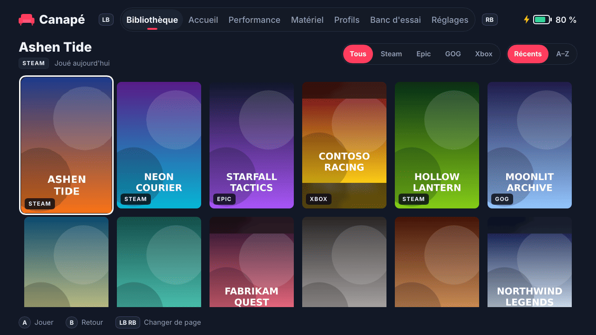
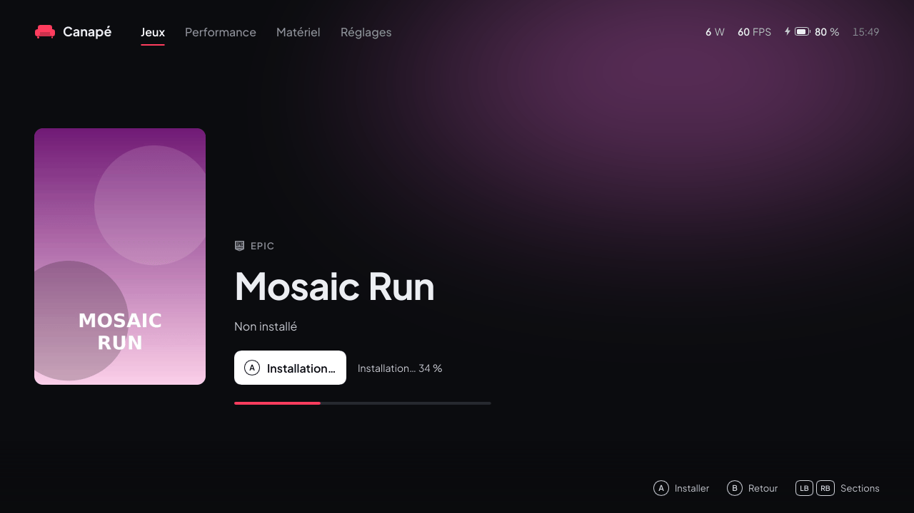
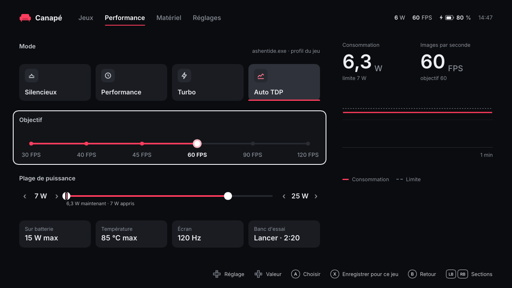
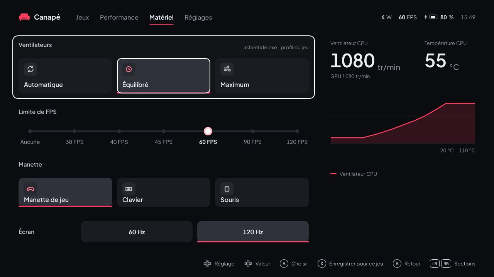
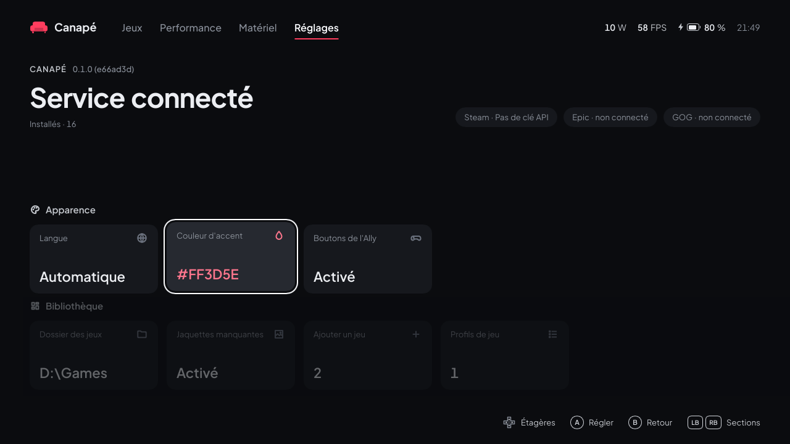
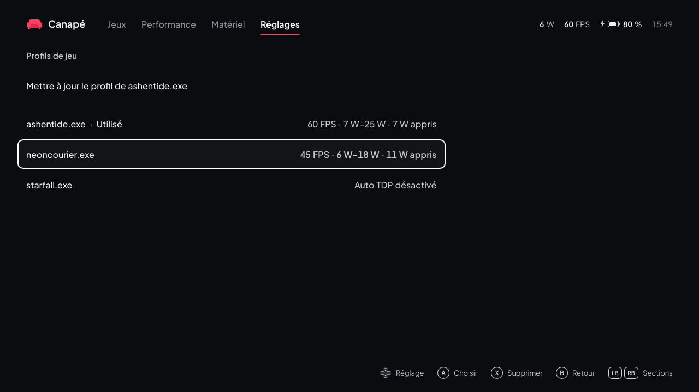
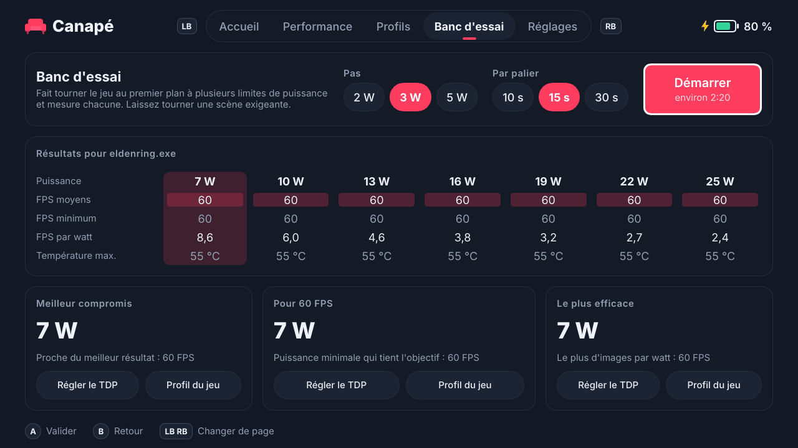
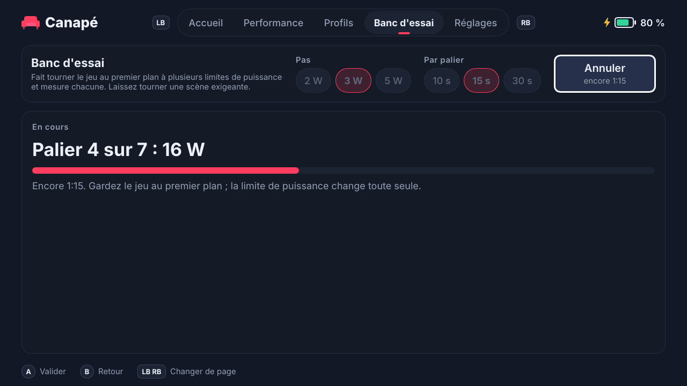

# Guide d'utilisation de Canapé

[🇬🇧 English version](user-guide.en.md) · [📚 Index de la documentation](README.md)

Ce guide explique comment installer Canapé sur une ROG Ally, en faire l'accueil de l'expérience plein écran (FSE), l'utiliser à la manette, ajouter le widget Xbox Game Bar, puis dépanner et désinstaller.

> [!IMPORTANT]
> Canapé est un projet personnel en cours de développement. Ce qui a été **validé sur l'Ally** : l'installation, le démarrage en FSE, le service, les modes, le TDP manuel, l'auto TDP (version `99cad07`) et la première version du widget. Ce qui est **écrit et testé sans matériel, mais pas encore essayé sur l'Ally** : le shell en 13 langues (quatre sections, navigation aux flèches), la bibliothèque de jeux et l'installation des jeux Steam et Epic, la page Matériel (ventilateurs, limite de FPS, mode de la manette), les profils par jeu, le banc d'essai, les dernières optimisations de l'auto TDP et la nouvelle version du widget. Les sections concernées le signalent.

## Sommaire

- [Prérequis](#prérequis)
- [Installer Canapé](#installer-canapé)
  - [1. Activer le mode développeur](#1-activer-le-mode-développeur)
  - [2. Lancer `install-dev.ps1`](#2-lancer-install-devps1)
  - [Options du script](#options-du-script)
  - [Utiliser les binaires de la CI](#utiliser-les-binaires-de-la-ci)
  - [Vérifier l'installation](#vérifier-linstallation)
- [Faire de Canapé l'accueil du FSE](#faire-de-canapé-laccueil-du-fse)
  - [Revenir à Winhanced ou à l'app Xbox](#revenir-à-winhanced-ou-à-lapp-xbox)
- [Utiliser Canapé à la manette](#utiliser-canapé-à-la-manette)
  - [Commandes](#commandes)
  - [Éléments communs](#éléments-communs)
  - [Jeux](#jeux)
    - [Installer des jeux possédés](#installer-des-jeux-possédés)
  - [Performance](#performance)
  - [Matériel](#matériel)
  - [Réglages](#réglages)
  - [Profils de jeu](#profils-de-jeu)
  - [Banc d'essai](#banc-dessai)
- [Le widget Xbox Game Bar](#le-widget-xbox-game-bar)
- [Langues](#langues)
- [Dépannage](#dépannage)
- [Désinstaller](#désinstaller)

## Prérequis

| Élément | Détail |
|---|---|
| Console | **ROG Ally RC71L** (seul modèle testé). Les ROG Ally X (RC72LA), ROG Xbox Ally (RC73YA) et ROG Xbox Ally X (RC73XA) sont reconnus par le code mais n'ont jamais été essayés. |
| Windows | Windows 11 **24H2 ou plus récent** (le paquet d'identité exige la version 10.0.26100). |
| Outils | **Visual Studio Build Tools 2022** avec les outils C++ et le **Windows SDK** (fournit `makeappx` et `signtool`, utilisés même avec des binaires précompilés). **Rust** (toolchain MSVC) si vous compilez sur l'Ally. **Git** pour récupérer le dépôt. |
| Droits | Un Terminal **administrateur** pour l'installation (service Windows et certificat). |
| Optionnel | [GitHub CLI](https://cli.github.com/) (`gh`) pour télécharger les binaires de la CI ; le workload **UWP** des Build Tools pour le widget. |

> [!WARNING]

## Installer Canapé

### 1. Activer le mode développeur

Paramètres → Système → Avancé → **Pour les développeurs** → Mode développeur : activé.

Le script d'installation s'arrête avec `Developer Mode is off` si ce n'est pas fait (il lit `HKLM\SOFTWARE\Microsoft\Windows\CurrentVersion\AppModelUnlock\AllowDevelopmentWithoutDevLicense`).

### 2. Lancer `install-dev.ps1`

Dans un **Terminal administrateur**, à la racine du dépôt cloné :

```powershell
powershell -ExecutionPolicy Bypass -File packaging\install-dev.ps1
```

Le script fait six étapes :

| Étape | Ce qui se passe |
|---|---|
| 1/6 | Compile `canape-shell`, `canape-service` et `canape-ctl` (release par défaut), ou prend des binaires déjà compilés (`-BinariesDir`). |
| 2/6 | Arrête et désinstalle le service s'il existe, ferme le shell, copie les trois `.exe` et `CustomCapability.SCCD` dans `C:\Program Files\Canape`. |
| 3/6 | Installe et démarre le service Windows **`CanapeService`** (démarrage automatique, compte LocalSystem, redémarrage automatique en cas de plantage). |
| 4/6 | Crée au premier passage un certificat de développement `CN=Canape Dev` dans `$HOME\dev\canape-cert` et l'ajoute à `LocalMachine\TrustedPeople`. |
| 5/6 | Empaquette et signe le paquet d'identité `Canape.Identity.msix`. |
| 6/6 | Enregistre le paquet avec `Add-AppxPackage -ExternalLocation` : `canape-shell.exe` obtient l'identité `Canape_…!App` que le FSE sait lancer. |

À la fin, le script affiche la commande de test, la commande `canape-ctl watch` et l'emplacement des journaux.

> [!CAUTION]
> Ne commitez jamais le contenu de `$HOME\dev\canape-cert` (`.pfx`, `.cer`) : c'est la clé qui signe vos paquets.

Relancer le script plus tard met Canapé à jour : il remplace les binaires et réenregistre le service et le paquet. Vos réglages (`state.json`) sont conservés.

### Options du script

| Option | Par défaut | Rôle |
|---|---|---|
| `-InstallDir <dossier>` | `C:\Program Files\Canape` | Dossier d'installation des binaires. |
| `-CertDir <dossier>` | `$HOME\dev\canape-cert` | Où créer et réutiliser le certificat de développement (le widget s'en sert aussi). |
| `-BuildProfile release\|debug` | `release` | Profil Cargo. `debug` sert de secours quand Smart App Control bloque une compilation release (voir [Dépannage](#dépannage)). |
| `-BinariesDir <dossier>` | *(vide)* | Prend `canape-shell.exe`, `canape-service.exe` et `canape-ctl.exe` dans ce dossier au lieu de compiler. Pratique avec les binaires de la CI. |
| `-SetAsHomeApp` | désactivé | Écrit aussi `GamingHomeApp` dans le registre pour choisir Canapé comme accueil du FSE (voir plus bas). |

### Utiliser les binaires de la CI

GitHub Actions compile les binaires release sous Windows à chaque push et les publie dans l'artefact `canape-windows-x64`. Pas besoin de Rust sur l'Ally, ni de compiler sous Smart App Control :

```powershell
gh run download --repo pierregouedar/canape --name canape-windows-x64 --dir $HOME\dev\canape-bin
powershell -ExecutionPolicy Bypass -File packaging\install-dev.ps1 -BinariesDir $HOME\dev\canape-bin
```

Le Windows SDK reste nécessaire (empaquetage et signature du paquet d'identité), ainsi que le dépôt cloné (le script lit `packaging\identity`).

### Vérifier l'installation

1. **Le service** : `Get-Service CanapeService` doit afficher `Running`.
2. **La télémétrie** : `& "C:\Program Files\Canape\canape-ctl.exe" watch` affiche un statut JSON par seconde (Ctrl+C pour sortir).
3. **Le shell hors FSE** : lancez la commande affichée par le script, par exemple :
   ```powershell
   explorer.exe shell:AppsFolder\Canape_84zrj1c9kn010!App
   ```
   La partie après `Canape_` dépend de votre certificat ; le script affiche la bonne valeur (`Registered …`).

## Faire de Canapé l'accueil du FSE

1. Ouvrez **Paramètres → Jeux → Expérience plein écran**.
2. Choisissez **Canapé** comme application d'accueil.
3. Activez le démarrage dans l'expérience plein écran si vous voulez que la console démarre directement sur Canapé.
4. Redémarrez : Windows lance `canape-shell.exe` avec l'argument `windows.gaming:///home`.

Si Canapé n'apparaît pas dans la liste, relancez le script avec `-SetAsHomeApp`. Il écrit la valeur non documentée `HKCU\Software\Microsoft\Windows\CurrentVersion\GamingConfiguration\GamingHomeApp = <PFN>!App` que le FSE lit pour savoir quelle app lancer.

> [!NOTE]
> Le démarrage en FSE a été validé sur l'Ally en M1 et M2 (une seule activation au boot, service déjà prêt). Il n'a pas été retesté depuis, car rien n'a changé côté démarrage.

### Revenir à Winhanced ou à l'app Xbox

Choisissez simplement l'autre application dans **Paramètres → Jeux → Expérience plein écran**. Canapé reste installé et peut être resélectionné à tout moment.

Pour le faire en ligne de commande, remettez l'ancienne valeur de `GamingHomeApp`. Par exemple pour Winhanced :

```powershell
Set-ItemProperty "HKCU:\Software\Microsoft\Windows\CurrentVersion\GamingConfiguration" -Name GamingHomeApp -Value "Winhanced_2wdva71107yvr!App"
```


## Utiliser Canapé à la manette

> [!NOTE]
> L'interface décrite ici (quatre sections, navigation aux flèches partout) n'a pas encore été essayée sur l'Ally : seules une version précédente et la navigation à la manette y ont été validées. La bibliothèque de jeux, en particulier, n'a été testée que sous Linux, avec une fausse bibliothèque : la recherche des jeux, leurs jaquettes et leur lancement sous Windows restent à vérifier. Même chose pour la page Matériel, dont les écritures vers les ventilateurs, le pilote graphique et la manette n'ont jamais atteint une vraie Ally (voir [Matériel](#matériel)). Les captures sont rendues sous Linux avec le simulateur matériel et des valeurs fictives.

### Commandes

| Bouton | Action |
|---|---|
| **LB / RB** | Section précédente / suivante : Jeux → Performance → Matériel → Réglages, en boucle |
| **Croix** ou **stick gauche** | Haut et bas changent de rangée ; gauche et droite se déplacent dans la rangée ou changent sa valeur. Maintenu, le déplacement se répète après 0,4 s. Dans Jeux, gauche et droite parcourent l'étagère, haut et bas passent d'une étagère à l'autre. |
| **A** | Choisir ; dans Jeux, lancer le jeu (ou l'installer) |
| **X** | Enregistrer pour le jeu au premier plan (Performance, Matériel, Banc d'essai) ; supprimer un profil (Profils de jeu) |
| **B** | Quitter une sous-page (Profils de jeu, Banc d'essai), sinon revenir à Jeux |

La manette n'est lue que lorsque Canapé est au premier plan : un jeu lancé depuis Canapé garde toute la manette. La rangée ou la tuile sélectionnée est entourée de blanc ; la couleur d'accent marque ce qui est choisi (trait sous une tuile, valeur d'une ligne). Au clavier (développement), les mêmes actions passent par les flèches, Entrée, F2 (X), Échap et Page préc. / Page suiv.

### Éléments communs

- **En haut** : le logo, les quatre sections (la section courante est soulignée de la couleur d'accent) et, à droite, la consommation en watts, les FPS, la batterie (avec un éclair sur secteur) et l'heure. « Hors ligne » remplace les mesures quand le service ne répond pas.
- **En bas à droite** : les boutons utiles sur la page, avec les glyphes de manette de Windows.
- **En bas à gauche** : le résultat de la dernière commande (« Profil enregistré », « Service injoignable », « Erreur du service : … ») et l'avertissement quand un autre programme pilote aussi le matériel. Les messages d'erreur du service restent en anglais.
- Une valeur inconnue s'affiche « — » (par exemple les FPS quand aucun jeu ne tourne).

### Jeux



<sub>Une bibliothèque inventée (`tools/fake-library.py`) : titres et jaquettes sont générés.</sub>

La première section, celle sur laquelle Canapé s'ouvre : le jeu sélectionné en grand, puis une étagère de jaquettes.

| Zone | Contenu |
|---|---|
| **Jeu sélectionné** | Sa boutique (STEAM, EPIC, GOG, XBOX), son titre, quand il a été joué pour la dernière fois (« Joué aujourd'hui », « Joué hier », « Joué ces 7 derniers jours »…) et le bouton **Jouer** (« Lancement… » après A). Derrière, une lueur reprend la couleur de sa jaquette. |
| **Récents** | Les jeux installés, les derniers joués en premier (puis par nom). La jaquette sélectionnée est plus grande, opaque et entourée de blanc ; les autres sont atténuées. Un jeu sans image affiche son titre sur une carte teintée. |
| **À installer · N** | En bas, l'étagère suivante dépasse : les jeux Steam et Epic que vous possédez sans les avoir installés (voir [Installer des jeux possédés](#installer-des-jeux-possédés)). |

**Se déplacer** : gauche et droite parcourent l'étagère, qui défile pour garder deux jeux visibles avant la sélection. Haut ou bas fait passer l'autre étagère devant (« À installer » n'apparaît que si elle contient des jeux : voir [Installer des jeux possédés](#installer-des-jeux-possédés) pour configurer Steam ou Epic) : le bandeau décrit alors le jeu à installer et le bouton devient **Installer**. **A** lance le jeu sélectionné ; Canapé affiche « Lancement… » quelques secondes, puis place le jeu en tête de l'étagère.

**D'où viennent les jeux**

| Boutique | Ce que lit Canapé | Lancement | Jaquettes |
|---|---|---|---|
| **Steam** | Les dossiers de bibliothèque (`steamapps\libraryfolders.vdf`) et le manifeste de chaque jeu (`appmanifest_*.acf`). Les outils (redistribuables Steamworks, Proton, SteamVR) sont écartés. | Par Steam (`steam://rungameid/…`) | Le cache de Steam : l'image choisie dans Steam, sinon le portrait 600×900, sinon l'image « hero » ou l'en-tête (affichés en entier, sur un fond flouté) |
| **Epic Games** | Les manifestes du lanceur (`%ProgramData%\Epic\EpicGamesLauncher\Data\Manifests`). DLC, moteurs et installations inachevées sont écartés. S'y ajoutent les jeux installés depuis Canapé avec Legendary (voir [plus bas](#installer-des-jeux-possédés)). | Par le lanceur Epic ; par Legendary, sans le lanceur, pour les jeux installés avec lui | Téléchargée (voir plus bas), sinon une carte titre |
| **GOG** | Le registre (`HKLM\SOFTWARE\WOW6432Node\GOG.com\Games`), où GOG Galaxy et les installateurs hors ligne inscrivent chaque jeu. Les DLC sont écartés. | L'exécutable du jeu directement, sans Galaxy | Téléchargée (voir plus bas), sinon une carte titre |
| **App Xbox** | Les dossiers `XboxGames` de chaque lecteur (`Content\MicrosoftGame.config`). | Par Windows (`shell:AppsFolder\…`) | Le logo carré du jeu |

- La date de dernière partie vient de Steam pour les jeux Steam, et de Canapé pour tout jeu lancé depuis Canapé.
- Un jeu installé depuis deux boutiques n'apparaît qu'une fois : la copie jouée en dernier, sinon celle de Steam, puis GOG, Epic et Xbox.
- La liste s'affiche tout de suite depuis la dernière recherche ; une nouvelle recherche tourne en arrière-plan à chaque démarrage, et de nouveau quand on revient à la bibliothèque après plus d'une minute ailleurs. Un jeu installé entre-temps apparaît alors.
- Les jeux de l'app Xbox installés hors d'un dossier `XboxGames` ne sont pas trouvés.
- Canapé lance les jeux lui-même, sans droits particuliers : comme n'importe quelle app de la session.

**Jaquettes téléchargées**

Un jeu sans image sur l'appareil peut en récupérer une sur Internet après chaque scan (**Réglages → Télécharger les jaquettes manquantes**, activé par défaut) :

- **Jeux Steam** : le portrait 600×900 des serveurs publics de la boutique Steam, sans compte. Utile pour un jeu dont Steam n'a pas encore mis l'image en cache, ou dont il n'a que l'image large (en-tête) : le portrait la remplace.
- **Toutes les boutiques** (Epic, GOG et Xbox compris), avec une clé d'API **SteamGridDB** gratuite : créez un compte sur [steamgriddb.com](https://www.steamgriddb.com), copiez la clé depuis *Preferences → API*, et ajoutez-la dans `%LOCALAPPDATA%\Canape\shell.json` sous la forme `"steamgriddb_key": "…"`. Les jeux Steam sont cherchés par leur identifiant Steam, les autres par leur titre ; seules les images fixes au format portrait sont retenues (pas d'animations, ni d'images NSFW ou humoristiques). La clé n'est envoyée qu'à l'API de SteamGridDB.

Les jaquettes sont enregistrées dans `%LOCALAPPDATA%\Canape\covers` et réutilisées ; un jeu sans image nulle part est redemandé au bout d'une semaine. 60 téléchargements au plus par scan. Désactiver le réglage garde les jaquettes déjà téléchargées mais n'en récupère plus.

> [!NOTE]
> Pas encore essayé sur l'Ally : le téléchargement passe par WinHTTP (intégré à Windows) et n'a été testé que sous Linux, sur des réponses enregistrées.

#### Installer des jeux possédés



<sub>Des jeux possédés inventés (`tools/fake-library.py`) ; l'installation de Mosaic Run est simulée.</sub>

> [!NOTE]
> **Rien de cette partie n'a encore été essayé sur l'Ally** : ni la liste des jeux Steam par l'API Web, ni l'installation par Steam, ni le téléchargement de Legendary, ni la connexion Epic, ni l'installation et le lancement des jeux Epic par Legendary. Seuls l'interface (sous Linux, avec la fausse bibliothèque et une installation simulée) et la lecture des réponses de Steam, d'Epic et de GitHub (sur des réponses enregistrées) ont été testées.

L'étagère **À installer** liste les jeux que vous possédez sur Steam ou sur Epic sans les avoir installés sur la console (haut ou bas depuis Récents la fait passer devant). **A** sur un jeu l'installe sans ouvrir l'interface de Steam ni le lanceur Epic ; le bouton et l'aide en bas de l'écran deviennent « Installer ». Un jeu déjà installé, depuis n'importe quelle boutique (même identifiant ou même titre), n'apparaît pas dans cette liste.

**Steam : préparer une fois**

1. Créez une clé d'API Web Steam gratuite sur [steamcommunity.com/dev/apikey](https://steamcommunity.com/dev/apikey).
2. Ajoutez-la dans `%LOCALAPPDATA%\Canape\shell.json` sous la forme `"steam_api_key": "…"`.

Canapé demande la liste du compte connecté en dernier à Steam sur cet appareil (`config\loginusers.vdf` dans le dossier de Steam) : Steam doit donc y avoir été ouvert au moins une fois avec votre compte. La clé n'est envoyée qu'à l'API de Steam (`api.steampowered.com`). Les outils (redistribuables, Proton, SteamVR) sont écartés ; les jeux gratuits déjà lancés font partie de la liste.

**Epic : se connecter une fois**

1. Choisissez **Compte Epic Games** dans les [Réglages](#réglages).
2. La première fois, Canapé télécharge **Legendary**, un client Epic libre (licence GPL-3) qui reste un programme séparé, depuis ses publications officielles sur GitHub, dans `%LOCALAPPDATA%\Canape\tools`. Le fichier est vérifié avec l'empreinte SHA-256 que GitHub publie : sans empreinte, ou si elle ne correspond pas, rien n'est enregistré et l'erreur s'affiche en haut de la bibliothèque.
3. Legendary ouvre sa propre fenêtre de connexion Epic, avec une console à côté (sans WebView2, Legendary y demande un code à la place). Ces fenêtres ne se pilotent pas à la manette : l'écran tactile et le clavier tactile peuvent être nécessaires.
4. Une erreur (téléchargement, connexion) s'affiche en jaune sous les lignes de Réglages et dans le bandeau de la page Jeux. La fenêtre fermée, Canapé redemande la liste des jeux. Le bouton affiche ensuite « Epic : <compte> (se reconnecter) ».

Les jeux Epic qui s'installent par une autre boutique (Ubisoft, EA) sont écartés : Legendary ne sait pas les installer.

**Quand la liste est mise à jour** : au démarrage de Canapé (pour compter les jeux de l'étagère), en passant à l'étagère À installer si la dernière demande date de plus de 10 minutes, et juste après une connexion Epic. Sans clé Steam ni compte Epic, aucune boutique n'est sollicitée. Une boutique impossible à lister (clé Steam erronée, session Epic expirée) affiche son erreur dans l'en-tête pendant 10 secondes et la dernière liste est gardée. La dernière liste est gardée dans `owned.json` et s'affiche tout de suite. Les jaquettes sont récupérées comme les [jaquettes téléchargées](#jeux), avec le même réglage **Télécharger les jaquettes manquantes** ; pour les jeux Epic, Canapé essaie d'abord l'image portrait fournie par Epic.

**Ce que fait A**

| Boutique | Installation | Progression | À la fin |
|---|---|---|---|
| **Steam** | Canapé confie l'installation à Steam, qui démarre discrètement dans la zone de notification s'il ne tournait pas. Steam n'ouvre que sa petite fenêtre d'installation (dossier, raccourcis) : confirmez-la (pas encore vérifié à la manette). Steam télécharge ensuite en arrière-plan. | Lue toutes les 2 s dans le manifeste du jeu. | Le jeu passe dans Récents, qui revient devant avec le jeu sélectionné : A le lance, par Steam comme les autres. |
| **Epic** | Legendary installe le jeu en silence, sans fenêtre ni question, dans son dossier par défaut. | Lue dans ce qu'affiche Legendary. | Le jeu passe dans Récents et se lance par Legendary : le lanceur Epic n'est jamais ouvert. |

- Pendant l'installation, la jaquette affiche une barre de progression et le bandeau « Installation… N % » quand le jeu est sélectionné. On peut continuer à naviguer et installer d'autres jeux.
- Canapé ne choisit pas le dossier et ne vérifie pas l'espace libre : Steam le propose dans sa fenêtre, Legendary prend son dossier par défaut.
- Steam : si la fenêtre d'installation n'est pas confirmée, Canapé abandonne au bout de 10 minutes (« Steam did not start the download ») ; une installation annulée dans Steam en cours de route donne « cancelled in Steam ».
- En cas d'échec, le bandeau affiche « <titre> : <message> » en jaune, le message restant en anglais (`Steam is not installed`, `Legendary is not available`, `legendary: …` avec la dernière ligne de Legendary). Il reste affiché jusqu'à la prochaine installation et figure aussi dans `shell.log`.
- Les jeux installés par Legendary sont retrouvés dans sa configuration (`%USERPROFILE%\.config\legendary\installed.json`) tant que `legendary.exe` est présent dans `%LOCALAPPDATA%\Canape\tools`.

### Performance



<sub>La même page en russe : [ru/performance.png](images/ru/performance.png).</sub>

**Se déplacer** : la page est faite de rangées. Haut et bas passent d'une rangée à l'autre (celles qui ne s'appliquent pas au mode en cours sont sautées), gauche et droite se déplacent dans une rangée de tuiles ou changent tout de suite la valeur de la rangée, **A** choisit une tuile, **X** enregistre les réglages pour le jeu au premier plan (crée ou met à jour son profil). La rangée qui a le focus est entourée de blanc.

| Rangée | Contenu |
|---|---|
| **Mode** | Silencieux, Performance et Turbo sont les modes firmware ASUS : le firmware fixe ses limites, que Canapé ne peut pas lire. **Auto TDP** allume l'auto TDP. Le mode en cours a une tuile plus claire et un trait d'accent. Choisir un mode firmware désactive l'auto TDP. À droite du titre : « <jeu> · profil du jeu » quand un profil s'applique, « Réglages généraux » sinon. |
| **Objectif** (auto TDP) | Une réglette de crans : 30, 40, 45, 60, 90, 120 FPS. Gauche et droite passent au cran voisin. |
| **Plage de puissance** (auto TDP) | ‹ minimum › — barre — ‹ maximum ›. La barre est à l'échelle du modèle (5 à 30 W sur les ROG Ally et Ally X, 5 à 35 W sur les ROG Xbox Ally ; 5 à 35 W si le service ne le dit pas). Haut et bas choisissent le minimum ou le maximum (la poignée active grossit), gauche et droite le déplacent de 1 W ; le minimum ne peut pas dépasser le maximum. Un trait d'accent montre ce que l'APU consomme en ce moment, avec la valeur et les watts appris du profil. |
| **Limite de puissance** (TDP manuel) | La même barre avec une seule poignée : gauche et droite changent la limite de 1 W. N'apparaît que lorsqu'une limite manuelle est en place (par **Régler le TDP** au banc d'essai, ou ±1 W dans le widget) : il n'y a plus de tuile Manuel ; un minimum égal au maximum en auto TDP donne le même résultat. |
| **Autres réglages** | Des tuiles : **Sur batterie** (aucun, 10, 15, 20 W, plafond appliqué seulement sur batterie), **Température** (aucune, 80, 85, 90 °C : au-delà, la puissance ne fait que baisser), **Écran** (passe à la fréquence suivante proposée par l'écran), **Banc d'essai** (ouvre le [banc d'essai](#banc-dessai), avec sa durée, ou le temps restant pendant un essai). A passe à la valeur suivante. |

À droite : la consommation (avec la limite, ou « Limite thermique atteinte »), les images par seconde (avec l'objectif) et le graphe de la dernière minute : la consommation en couleur d'accent, la limite en pointillés gris. L'échelle s'adapte par pas de 5 W ; un trou dans la courbe signale une coupure avec le service.

Le fonctionnement détaillé est dans [Auto TDP et banc d'essai](auto-tdp.fr.md).

> [!TIP]
> Quand un profil de jeu est actif, ces réglages modifient **le profil**, pas les réglages généraux.

### Matériel



> [!NOTE]

Quatre rangées, parcourues comme la page Performance : haut et bas changent de rangée, gauche et droite se déplacent dans les tuiles (A choisit) ou changent la limite de FPS tout de suite, **X** enregistre les ventilateurs, la limite de FPS et la fréquence de l'écran pour le jeu au premier plan (voir [Ce jeu](#ce-jeu)). À droite : la vitesse du ventilateur CPU (et celle du GPU en dessous), en tr/min, la température CPU (avec la limite de température si elle est réglée) et la courbe du ventilateur CPU. « — » quand le firmware ne donne pas de mesure.

**Ventilateurs**

| Tuile | Courbe (la même pour les ventilateurs CPU et GPU) |
|---|---|
| Automatique | La courbe propre au firmware pour le mode d'alimentation en cours. Canapé retire ses courbes. |
| Équilibré | De 10 % à 40 °C jusqu'à 75 % dès 92 °C, proche du comportement équilibré d'ASUS. |
| Maximum | 35 % dès 30 °C, pleine vitesse dès 80 °C : bruyant, mais le plus frais. |

- Il n'y a pas de préréglage silencieux : sur l'Ally, le firmware fait tourner les ventilateurs vers 5300 tr/min avec une courbe basse sous charge (mesuré en M5, partie 2), plus fort qu'avec Équilibré. Pour du silence, utilisez **Automatique** avec le mode d'alimentation **Silencieux** : le firmware y reste vers 3200 / 2800 tr/min.
- La courbe du ventilateur CPU va de 20 à 110 °C en largeur et de 0 à 100 % en hauteur. En Automatique, elle laisse place à « La courbe propre au mode d'alimentation ».
- Un préréglage **résiste aux changements de mode** : le firmware remet ses propres courbes à chaque changement de mode, et le service réécrit le préréglage juste après.
- **Automatique** réécrit le mode d'alimentation en cours : c'est ainsi que le firmware reprend ses courbes. En Manuel, le service remet ensuite votre TDP.
- **Sécurité** : chaque courbe est vérifiée avant d'atteindre le firmware. Le ventilateur ne doit jamais ralentir quand la température monte, et il doit tourner à au moins 25 % dès 80 °C, 30 % dès 90 °C et 40 % dès 100 °C, juste sous le mode Silencieux d'ASUS. Une courbe qui laisserait les ventilateurs arrêtés à chaud est refusée. L'APU se bride de lui-même à sa limite de température, mais une courbe trop discrète rend la console chaude en main.
- **Personnalisé** : quand les courbes en place ne correspondent à aucun préréglage (réglées avec `canape-ctl`, ou un préréglage différent par ventilateur), aucune tuile n'est sélectionnée et le titre de la rangée indique « Courbes personnalisées définies par un autre client. »

**Limite de FPS**

Une réglette : Aucune, 30, 40, 45, 60, 90 ou 120. Le pilote graphique AMD maintient tous les jeux à ce débit ou en dessous, sur secteur comme sur batterie : moins de chaleur, moins de bruit, plus d'autonomie. **Aucune** retire la limite.

> [!TIP]
> Avec l'auto TDP, réglez son objectif **au niveau de la limite ou en dessous**. L'auto TDP règle la puissance pour atteindre son objectif : avec une limite à 40 et un objectif à 60, l'objectif n'est jamais atteint et l'auto TDP monterait la puissance au maximum pour rien. Une limite égale à l'objectif est idéale : le jeu reste à son plafond et l'auto TDP rend les watts inutiles (voir [Auto TDP et banc d'essai](auto-tdp.fr.md#le-plafond-de-fps-et-la-règle-du-gpu-au-repos)).

#### Ce jeu

Le titre de la rangée Ventilateurs indique le programme au premier plan. **X** enregistre les courbes, la limite de FPS et la fréquence de l'écran en cours dans le profil de ce jeu (rien ne se passe sans jeu au premier plan) :

- Les autres réglages du profil (auto TDP, watts appris) sont conservés. S'il n'y a pas de profil, il est créé avec les réglages d'auto TDP en cours.
- **Automatique** s'enregistre aussi : ce jeu tournera alors sur les courbes du firmware, même si un préréglage est utilisé le reste du temps.
- **Aucune** s'enregistre comme « suivre la limite générale » : un profil ne peut pas imposer « pas de limite » quand une limite générale est réglée.
- Quand le jeu passe au premier plan, ses courbes et sa limite s'appliquent ; quand il le quitte, celles des réglages généraux reviennent.
- Pendant le jeu, choisir un préréglage ou une limite modifie **son profil** si ce profil a ses propres ventilateurs (ou sa propre limite) ; sinon, le changement est général et reste après le jeu. Un profil créé depuis la page Profils ou le banc d'essai n'a ni l'un ni l'autre : il suit les ventilateurs et la limite généraux.

**Manette**

| Tuile | Mode de la manette intégrée |
|---|---|
| Manette de jeu | Manette Xbox (XInput), pour les jeux. |
| Clavier | Les sticks et les boutons envoient des touches, pour les jeux qui ne connaissent que le clavier. |
| Souris | Mode bureau : le stick droit déplace le pointeur. |

Le mode est général (pas par jeu), mémorisé et réappliqué au démarrage du service. Canapé ne le relit pas dans la manette : aucune tuile n'est sélectionnée tant que Canapé ne l'a pas réglé une fois. Seules les manettes des ROG Ally et Ally X sont connues ; sur les ROG Xbox Ally, la requête renvoie une erreur.

> [!WARNING]
> Canapé lit la manette en XInput. En mode Clavier ou Souris, la manette ne devrait plus se présenter comme une manette Xbox, et Canapé risque de ne plus lui répondre : revenez à **Manette de jeu** avec l'écran tactile, ou avec `canape-ctl` (voir [Dépannage](#canape-ctl--parler-au-service)).

**Écran**

Une tuile par fréquence que l'écran intégré propose à sa résolution actuelle (60 et 120 Hz sur la ROG Ally) ; A applique celle qui a le focus. Une fréquence plus basse économise la batterie dans les jeux limités à 30, 40 ou 60 FPS. Le choix s'applique tout de suite. Sans jeu au premier plan, il devient la fréquence générale, mémorisée comme un réglage fait dans les paramètres de Windows. Avec un jeu au premier plan, il ne vaut que pour cette partie : **X** le garde dans le profil du jeu, et l'écran revient à la fréquence générale quand le jeu se ferme.

- Un profil de jeu peut avoir sa propre fréquence (**X** sur cette page) : elle s'applique quand le jeu passe au premier plan ; quand il le quitte, l'écran revient à la fréquence choisie ici, ou à celle que le profil avait remplacée.
- Canapé ne change la fréquence qu'au changement de profil : une fréquence choisie entre-temps dans les paramètres de Windows est respectée.
- Seul l'écran intégré est concerné, jamais une télé ou un moniteur branché. Sans écran intégré (ou hors Windows), la rangée Écran n'apparaît pas.

> [!NOTE]
> Pas encore essayé sur l'Ally (`ChangeDisplaySettingsEx` sur l'écran interne, depuis le shell).

### Réglages



Des lignes de réglage : haut et bas passent de l'une à l'autre (la colonne de gauche, puis celle de droite), gauche et droite changent la valeur (elle passe en couleur d'accent entre ‹ ›), A agit sur la ligne.

| Ligne | Effet |
|---|---|
| **Langue** | « Automatique » (langue de Windows) ou l'une des 13 langues. Gauche et droite parcourent la liste, **A** applique la langue affichée ; le choix est mémorisé. Voir [Langues](#langues). |
| **Utiliser les boutons de l'Ally** | Le bouton **Armoury** (à droite, sous l'écran) ramène Canapé au premier plan depuis un jeu, ou revient à Jeux si Canapé est déjà devant ; le bouton **Command Center** (à gauche) ouvre la Xbox Game Bar, où se trouve le widget Canapé. Désactivez-le si Armoury Crate ou un autre outil doit les gérer (sinon les deux réagissent). Pas encore essayé sur l'Ally. |
| **Télécharger les jaquettes manquantes** | Voir [Jeux](#jeux). |
| **Compte Epic Games** | Le compte connecté, ou « Se connecter » : **A** ouvre la connexion Epic, en téléchargeant Legendary d'abord si besoin (voir [Installer des jeux possédés](#installer-des-jeux-possédés)). Pas encore essayé sur l'Ally. |
| **Profils de jeu** | Le nombre de profils ; **A** ouvre la sous-page [Profils de jeu](#profils-de-jeu). |
| **Couleur d'accent** | Huit pastilles prêtes (gauche et droite, A choisit) et trois lignes **Teinte**, **Saturation** et **Luminosité** que gauche et droite déplacent. Toute l'interface suit en direct ; la couleur est enregistrée dans `shell.json` et envoyée au service une fois le réglage terminé, et **le widget de la Game Bar suit la couleur d'accent**. |

En bas à droite : la version de Canapé, l'état de la connexion au service et la présence d'une clé d'API Steam dans `shell.json` (sans vérifier qu'elle est valide).

| Accent sarcelle | Accent orange |
|---|---|
|  |  |

<sub>Captures en anglais. Les mêmes réglages en allemand : [de/settings.png](images/de/settings.png).</sub>

### Profils de jeu



Ouverte depuis **Réglages → Profils de jeu** ; **B** y revient. Un profil associe un exécutable (par exemple `eldenring.exe`) à des réglages d'auto TDP et, si vous les avez enregistrés depuis la page [Matériel](#matériel), à des courbes de ventilateurs, une limite de FPS et une fréquence d'écran. Quand ce programme passe au premier plan, le service applique le profil ; quand il le quitte, les réglages généraux reviennent.

- **Première ligne** : « Enregistrer un profil pour <jeu> » (ou « Mettre à jour le profil de <jeu> ») ; **A** enregistre les réglages d'auto TDP en cours (objectif, puissance, maximum sur batterie, limite de température). Grisée tant qu'aucun jeu n'est au premier plan.
  - Si l'auto TDP est actif, la puissance actuelle est aussi enregistrée comme **watts appris** : la prochaine session du jeu démarre directement à cette valeur.
  - Les courbes de ventilateurs et la limite de FPS déjà présentes dans le profil sont conservées.
- **Les profils**, triés par nom, avec l'objectif, la plage de puissance et les watts appris ; « Utilisé » après le nom du profil appliqué. **X** demande une confirmation (« Appuyez de nouveau sur X pour supprimer »), un second **X** supprime ; changer de ligne annule.

La même chose se fait depuis les pages Performance et Matériel avec **X**.

> [!NOTE]
> **Comment Canapé détecte le jeu** : le shell regarde toutes les 2 secondes quel programme a le premier plan et le signale au service (qui, en session 0, ne voit pas les fenêtres). L'Explorateur, la Game Bar, le menu Démarrer, le gestionnaire des tâches et Canapé lui-même sont ignorés : revenir dans Canapé ne « quitte » pas le jeu tant qu'il tourne. Un autre programme compte comme un jeu s'il **occupe tout l'écran** (plein écran ou fenêtre sans bordure) ou s'il **a déjà un profil** : un navigateur ou Discord dans une fenêtre normale ne remplace pas le jeu qui tourne derrière. Pour créer le profil d'un jeu fenêtré, passez-le en plein écran le temps de l'enregistrer. Il faut que le shell tourne pour que les profils fonctionnent.

Les profils et les watts appris sont détaillés dans [Auto TDP et banc d'essai](auto-tdp.fr.md#profils-par-jeu).

### Banc d'essai



Ouvert depuis la tuile **Banc d'essai** de la page Performance ; **B** y revient. Le banc d'essai fait tourner le jeu au premier plan à plusieurs limites de puissance, de 25 W à 7 W, mesure chacune et propose la bonne valeur.

1. Lancez le jeu et laissez tourner une **scène exigeante et stable** (pas un menu).
2. Revenez dans Canapé (bouton Xbox ou Alt+Tab), **Performance → Banc d'essai**.
3. Réglez le **pas** (2, 3 ou 5 W) et la durée **par palier** (10, 15 ou 30 s) avec gauche et droite. La durée totale s'affiche sur la ligne **Démarrer** (environ 2:20 avec 3 W et 15 s).
4. **A** sur **Démarrer**, puis revenez au jeu. Tant que le jeu n'est pas revenu au premier plan, le banc d'essai affiche « En attente du jeu » ; il démarre dès que le jeu tourne de nouveau depuis 3 s, et abandonne au bout de 2 min. La limite change ensuite toute seule ; chaque palier attend 5 s avant de mesurer.



Pendant le banc d'essai, le mode, le TDP et l'auto TDP sont verrouillés (« a bench is running: cancel it first ») ; la ligne devient **Annuler**, qui arrête le banc d'essai en gardant les paliers déjà mesurés (sans remplacer les résultats complets précédents du même jeu). À droite : le palier en cours, sa puissance, une barre de progression et le temps restant. À la fin, ou à l'annulation, le service remet l'état d'avant.

**Résultats** : sous les réglages, pour chaque palier, la puissance, les FPS moyens, les FPS minimum (la pire seconde), les FPS par watt et la température maximale ; la colonne du meilleur compromis est surlignée. À droite, trois recommandations, chacune avec sa puissance et ses FPS :

| Ligne | Signification |
|---|---|
| **Meilleur compromis** | La plus petite puissance à moins de 5 % du meilleur résultat : au-delà, plus de watts n'apportent presque rien. |
| **Pour N FPS** | La plus petite puissance qui tient l'objectif actuel de l'auto TDP, en moyenne. « — » si l'objectif n'a pas été atteint, ou si un essai interrompu n'est pas descendu assez bas pour le savoir. |
| **Le plus efficace** | Le plus d'images par watt : le réglage le plus économe en batterie. |

Sur une recommandation, **A** règle le TDP (limite manuelle à cette valeur, auto TDP désactivé) et **X** l'enregistre dans le profil du jeu (crée ou remplace le profil : auto TDP activé, objectif et plafond tirés de la mesure). Le calcul exact est dans [Auto TDP et banc d'essai](auto-tdp.fr.md#le-banc-dessai).

> [!NOTE]
> Le banc d'essai n'a pas encore été essayé sur l'Ally.

## Le widget Xbox Game Bar

Le widget donne les réglages rapides sans quitter le jeu. Toute la logique reste dans le service : le widget n'est qu'une télécommande.

**Installer** (une fois, puis à chaque mise à jour du widget) :

1. Ajouter le workload UWP aux Build Tools (Terminal administrateur, plusieurs Go) :
   ```powershell
   $vs = & "${env:ProgramFiles(x86)}\Microsoft Visual Studio\Installer\vswhere.exe" -latest -products * -property installationPath
   & "${env:ProgramFiles(x86)}\Microsoft Visual Studio\Installer\setup.exe" modify --installPath $vs `
       --add Microsoft.VisualStudio.Workload.UniversalBuildTools --includeRecommended --quiet --norestart
   ```
2. Compiler, signer et installer (sans droits administrateur ; le certificat d'`install-dev.ps1` doit exister) :
   ```powershell
   powershell -ExecutionPolicy Bypass -File packaging\build-widget.ps1
   ```

**Ouvrir** : Game Bar (Win+G ou bouton Xbox) → menu **Widgets** → **Canapé**. Vous pouvez l'épingler pour le garder au-dessus du jeu.

**Contenu**

| Zone | Détail |
|---|---|
| En-tête | Le jeu au premier plan (sans `.exe`) et « profil du jeu » quand son profil s'applique ; sinon l'état de la connexion (« Connexion… », « Service non connecté »). |
| Chiffres | La consommation (une décimale) et les images par seconde. |
| Graphe | La dernière minute : la consommation en couleur d'accent, la limite en pointillés gris. |
| Banc d'essai | Palier, puissance et temps restant pendant un banc d'essai (lancé depuis le shell). |
| Mode | Quatre tuiles : Silencieux, Performance, Turbo, Auto. La tuile choisie est blanche. Un mode firmware coupe l'auto TDP. |
| ‹ valeur › | En auto TDP, l'**objectif** (30, 40, 45, 60, 90, 120 FPS) ; sinon la **limite de puissance** ±1 W, grisée en mode firmware (« Fixé par le mode du firmware ») et bornée par la plage du modèle. |
| Puissance | La plage de l'auto TDP (ou la limite manuelle) sur l'échelle du modèle, avec un trait sur la consommation du moment. Lecture seule : la plage se règle dans le shell. |
| Pied | Température CPU (« Bridé » en ambre quand la limite de température retient la puissance), activité GPU, batterie. |

Le widget n'a ni bouton de banc d'essai, ni gestion des profils, ni réglage de la plage de puissance, des ventilateurs, de la limite de FPS ou de la manette : ces actions restent dans le shell. Son panneau suit le réglage de transparence de la Game Bar, et le widget suit la couleur d'accent choisie dans le shell. Taille par défaut 400 × 600, redimensionnable.

> [!NOTE]
> La **première version** du widget a été validée sur l'Ally (M3) via Win+G sur le bureau. La **version actuelle** (nouvelle mise en page avec tuiles de mode, objectif et barre de puissance, 13 langues) n'a pas encore été compilée. L'ouverture depuis le bouton Xbox dans le FSE, avec Canapé comme accueil, n'a pas encore été testée.

## Langues

Canapé est traduit en 13 langues :

| Langue | Shell | Widget |
|---|---|---|
| English | `en` (langue source) | `en-US` (repli par défaut) |
| Français | `fr` | `fr-FR` |
| Español | `es` | `es-ES` |
| Deutsch | `de` | `de-DE` |
| Italiano | `it` | `it-IT` |
| Português | `pt` | `pt-BR` |
| Nederlands | `nl` | `nl-NL` |
| Polski | `pl` | `pl-PL` |
| Русский | `ru` | `ru-RU` |
| Türkçe | `tr` | `tr-TR` |
| 日本語 | `ja` | `ja-JP` |
| 한국어 | `ko` | `ko-KR` |
| 简体中文 | `zh_CN` | `zh-Hans` |


- **Shell, mode Automatique** (par défaut) : la première langue de la liste des langues préférées de Windows qui est fournie, sinon l'anglais. Toute variante du chinois affiche le chinois simplifié.
- **Shell, choix manuel** : page **Réglages → Langue**. Le choix est enregistré dans `%LOCALAPPDATA%\Canape\shell.json` et appliqué tout de suite.
- **Widget** : il suit toujours la liste des langues préférées de Windows (Paramètres → Heure et langue → Langue) ; relancez la Game Bar après un changement.
- Les messages d'erreur renvoyés par le service restent en anglais, précédés d'un texte traduit.


Ces programmes écrivent les mêmes limites de puissance dans le firmware, et certains aussi les courbes de ventilateurs, la limite de FPS du pilote ou le mode de la manette : si deux d'entre eux tournent, le dernier qui écrit gagne, et l'auto TDP ou le préréglage de ventilateurs de Canapé peuvent être annulés sans prévenir.

Toutes les 5 secondes, le service cherche ces processus et affiche un avertissement jaune dans le shell (et dans le widget) :

| Programme | Processus détecté |
|---|---|
| Armoury Crate | `ArmouryCrate.Service.exe` |

Que faire :

- **Armoury Crate** : arrêtez ses services (`services.msc`) ou désactivez-le.
  ```powershell
  ```

Les autres services ASUS (ASUS Optimization, System Analysis, ROG Live Service) et RTSS ne sont pas signalés : à notre connaissance, ils n'écrivent pas les limites de puissance.

## Dépannage

### Fichiers et journaux

| Fichier | Contenu |
|---|---|
| `%ProgramData%\Canape\service.log` | Journal du service : modèle détecté, état d'ADL au démarrage, chaque commande qui modifie l'état et sa réponse (`SetTdp { watts: 12 } -> Ok`), programmes en conflit, erreurs. |
| `%ProgramData%\Canape\state.json` | Dernier état appliqué, réappliqué au démarrage du service : mode, TDP, auto TDP, courbes de ventilateurs, limite de FPS, limite de charge, mode de la manette, profils, dernier banc d'essai. |
| `%LOCALAPPDATA%\Canape\shell.log` | Journal du shell : démarrages (avec leurs arguments), langue choisie, état d'ADL, erreurs du service. |
| `%LOCALAPPDATA%\Canape\shell.json` | Préférences du shell : `language`, `accent`, `online_covers`, `steamgriddb_key`, `steam_api_key`, `refresh_hz`, `ally_buttons`. |
| `%LOCALAPPDATA%\Canape\covers\` | Jaquettes téléchargées (`<boutique>_<id>.jpg` / `.png`, marqueurs `.miss`). |
| `%LOCALAPPDATA%\Canape\library.json` | Les jeux de la dernière recherche, affichés tout de suite au démarrage suivant. Peut être supprimé : la recherche suivante le réécrit. |
| `%LOCALAPPDATA%\Canape\recent.json` | Quand chaque jeu a été lancé depuis Canapé pour la dernière fois (pour l'ordre « Récents »). |
| `%LOCALAPPDATA%\Canape\owned.json` | Les jeux possédés de la dernière demande à Steam et à Epic, affichés tout de suite en mode À installer. Peut être supprimé : la demande suivante le réécrit. |
| `%LOCALAPPDATA%\Canape\tools\` | `legendary.exe`, téléchargé à la première connexion Epic. Sans lui, Canapé ne liste plus les jeux Epic possédés ni ceux installés par Legendary ; la prochaine connexion Epic le télécharge de nouveau. |
| `%USERPROFILE%\.config\legendary\` | Configuration de Legendary, écrite par Legendary lui-même : connexion Epic, jeux qu'il a installés (`installed.json`). |

Chaque ligne commence par l'heure en secondes Unix.

### `canape-ctl` : parler au service

`canape-ctl` envoie une requête JSON au service et affiche la réponse ; `watch` affiche le statut chaque seconde.

```powershell
$ctl = "C:\Program Files\Canape\canape-ctl.exe"
& $ctl watch
```

> [!WARNING]
> **Windows PowerShell 5.1** (celui de l'Ally) perd les guillemets doubles d'un argument passé à un `.exe`. Il faut les échapper avec `\"` :
> ```powershell
> & $ctl '{\"type\":\"set_tdp\",\"watts\":12}'
> ```

Exemples (écrits ici sous forme lisible ; échappez les guillemets dans PowerShell 5.1) :

| Requête | Effet |
|---|---|
| `{"type":"get_status"}` | Statut complet une fois |
| `{"type":"set_performance_mode","mode":"turbo"}` | Mode `silent`, `performance`, `turbo` ou `manual` |
| `{"type":"set_tdp","watts":12}` | TDP manuel (désactive l'auto TDP) |
| `{"type":"set_auto_tdp","settings":{"enabled":true,"target_fps":60,"min_watts":7,"max_watts":25}}` | Auto TDP |
| `{"type":"set_battery_charge_limit","percent":80}` | Limite de charge de la batterie (40 à 100 %) |
| `{"type":"reset_fan_curves"}` | Ventilateurs rendus aux courbes du firmware (Automatique) |
| `{"type":"set_fps_limit","fps":null}` | Retire la limite de FPS (ou `"fps":40` pour une limite, de 30 à 120) |
| `{"type":"set_controller_mode","mode":"gamepad"}` | Manette remise en mode manette de jeu (`wasd`, `mouse`) |
| `{"type":"list_profiles"}` | Profils enregistrés |
| `{"type":"get_bench_report"}` | Dernier banc d'essai |
| `{"type":"cancel_bench"}` | Annule le banc d'essai en cours |

Le code de sortie vaut 0 si le service a répondu sans erreur, 1 sinon. La liste complète des requêtes est dans le [guide du développeur](developer-guide.fr.md#protocole-ipc).

### Problèmes courants

| Symptôme | Cause probable et solution |
|---|---|
| « Service non connecté » en bas du shell, « Hors ligne » en haut | Le service ne tourne pas : `Get-Service CanapeService`, puis `Start-Service CanapeService` (administrateur). Regardez `service.log`. |
| Le widget affiche « Service non connecté » et « Le service Canapé n'est pas lancé. » | Même cause : le pipe `\\.\pipe\canape` n'existe pas. |
| Les FPS restent à « — » en jeu | Le pilote AMD ne compte les images qu'une fois activé depuis la session utilisateur : c'est le shell qui le fait à son démarrage (ligne `adl: frame metrics started` dans `shell.log`). Lancez Canapé au moins une fois après le démarrage. Limite connue : un jeu en plein écran réduit puis resté caché derrière Canapé une quarantaine de secondes perd ses FPS jusqu'à ce qu'on le relance. |
| Le TDP affiche « Auto » et −/+ sont grisés | Un mode firmware (Silencieux, Performance, Turbo) est actif : le firmware ne communique pas ses limites. Choisissez **Manuel**. |
| L'auto TDP ne bouge pas | Il n'agit que si un jeu tourne : au moins 5 FPS **et** au moins 15 % d'activité GPU. Sur le bureau ou dans un menu immobile, il garde la valeur actuelle. |
| La puissance change toute seule | Un autre outil pilote le matériel (avertissement jaune), ou un profil de jeu vient de s'appliquer (« <jeu> · profil du jeu » en haut de la page Performance). |
| Les ventilateurs ou la limite de FPS changent tout seuls | Un profil de jeu avec ses propres ventilateurs ou sa propre limite vient de s'appliquer ou de se terminer, ou un autre outil les a réécrits (avertissement jaune). |
| « Erreur du service : GPU driver refused: ADL2_FPS_Settings_Set… (session 0) » sur la limite de FPS | Le pilote AMD refuse la limite depuis le service. Ce cas n'a pas encore été essayé : notez le message (il figure aussi dans `service.log`) et signalez-le. |
| La manette ne fait plus bouger dans Canapé après avoir choisi Clavier ou Souris | Normal : la manette ne se comporte plus comme une manette Xbox. Touchez **Manette de jeu** sur l'écran, ou envoyez `{"type":"set_controller_mode","mode":"gamepad"}` avec `canape-ctl`. |
| La liste À installer reste vide, ou il y manque une boutique | Steam : clé absente ou refusée, ou aucun compte dans `loginusers.vdf` ; Epic : pas de connexion. Ces erreurs ne s'affichent pas dans la bibliothèque : cherchez `library: Steam owned games` ou `library: Epic` dans `shell.log`. Relancez Canapé (ou reconnectez-vous à Epic) pour redemander la liste tout de suite. |
| Canapé n'est pas proposé dans Paramètres → Jeux | Relancez `install-dev.ps1 -SetAsHomeApp`. Vérifiez que le paquet est installé : `Get-AppxPackage -Name Canape`. |
| `Developer Mode is off` | Activez le mode développeur (voir [plus haut](#1-activer-le-mode-développeur)). |
| `makeappx.exe not found` | Installez le Windows SDK avec les Build Tools. |
| `cargo build` échoue avec `os error 4551` | **Smart App Control** bloque un build script non signé. Relancez (ça passe parfois), utilisez `-BuildProfile debug`, ou installez les [binaires de la CI](#utiliser-les-binaires-de-la-ci). Désactiver Smart App Control (Sécurité Windows → Contrôle des applications et du navigateur) règle le problème mais ne se réactive pas facilement. |
| `canape-ctl` répond `invalid message` | Guillemets perdus par PowerShell 5.1 : échappez-les (voir ci-dessus). |

Pour repartir de zéro côté réglages : arrêtez le service, supprimez `%ProgramData%\Canape\state.json`, relancez le service. Les profils et le dernier banc d'essai sont alors perdus.

## Désinstaller

Il n'y a pas encore de script de désinstallation. D'abord, sur la page **Matériel**, remettez les ventilateurs en **Automatique**, la limite de FPS sur **Aucune** et la manette en **Manette de jeu** : une fois le service parti, plus rien ne les annulera. Ensuite, dans un Terminal administrateur :

1. **Choisir un autre accueil** dans Paramètres → Jeux → Expérience plein écran (voir [Revenir à Winhanced ou à l'app Xbox](#revenir-à-winhanced-ou-à-lapp-xbox)).
2. **Retirer le service** :
   ```powershell
   & "C:\Program Files\Canape\canape-service.exe" uninstall
   ```
3. **Retirer les paquets** (identité du shell et widget) :
   ```powershell
   Get-AppxPackage -Name Canape | Remove-AppxPackage
   Get-AppxPackage -Name Canape.Widget | Remove-AppxPackage
   ```
4. **Supprimer les fichiers** :
   ```powershell
   Get-Process canape-shell -ErrorAction SilentlyContinue | Stop-Process -Force
   Remove-Item -Recurse "C:\Program Files\Canape", "$env:ProgramData\Canape", "$env:LOCALAPPDATA\Canape"
   ```
5. **Retirer le certificat de développement** (si plus rien ne s'en sert) :
   ```powershell
   Get-ChildItem Cert:\LocalMachine\TrustedPeople, Cert:\CurrentUser\My |
       Where-Object Subject -eq "CN=Canape Dev" | Remove-Item
   Remove-Item -Recurse "$HOME\dev\canape-cert"
   ```

Les jeux installés depuis Canapé restent sur le disque, et la configuration de Legendary (connexion Epic comprise) reste dans `%USERPROFILE%\.config\legendary`.

