# Guide d'utilisation de Canapé

[🇬🇧 English version](user-guide.en.md) · [📚 Index de la documentation](README.md)

Ce guide explique comment installer Canapé sur une ROG Ally, en faire l'accueil de l'expérience plein écran (FSE), l'utiliser à la manette, ajouter le widget Xbox Game Bar, puis dépanner et désinstaller.

> [!IMPORTANT]
> Canapé est un projet personnel en cours de développement. Ce qui a été **validé sur l'Ally** : l'installation, le démarrage en FSE, le service, les modes, le TDP manuel, l'auto TDP (version `1268753`) et la première version du widget. Ce qui est **écrit et testé sans matériel, mais pas encore essayé sur l'Ally** : le shell en 13 langues (quatre sections, navigation aux flèches), la bibliothèque de jeux et l'installation des jeux Steam et Epic, la page Matériel (ventilateurs, limite de FPS, mode de la manette), les profils par jeu, le banc d'essai, les dernières optimisations de l'auto TDP et la nouvelle version du widget. Les sections concernées le signalent.

## Sommaire

- [Prérequis](#prérequis)
- [Installer Canapé](#installer-canapé)
  - [1. Activer le mode développeur](#1-activer-le-mode-développeur)
  - [2. Lancer `install-dev.ps1`](#2-lancer-install-devps1)
  - [Options du script](#options-du-script)
  - [Utiliser les binaires de la CI](#utiliser-les-binaires-de-la-ci)
  - [Vérifier l'installation](#vérifier-linstallation)
- [Faire de Canapé l'accueil du FSE](#faire-de-canapé-laccueil-du-fse)
  - [Revenir à Winhanced ou à l'app Xbox](#revenir-à-winhanced-ou-à-lapp-xbox)
- [Premier lancement](#premier-lancement)
- [Utiliser Canapé à la manette](#utiliser-canapé-à-la-manette)
  - [Commandes](#commandes)
  - [Éléments communs](#éléments-communs)
  - [Jeux](#jeux)
    - [Options d'un jeu](#options-dun-jeu)
    - [Ajouter d'autres jeux](#ajouter-dautres-jeux)
    - [Installer des jeux possédés](#installer-des-jeux-possédés)
  - [Performance](#performance)
  - [Matériel](#matériel)
    - [Visée au gyroscope](#visée-au-gyroscope)
  - [Réglages](#réglages)
  - [Profils de jeu](#profils-de-jeu)
  - [Banc d'essai](#banc-dessai)
  - [Optimisations Windows](#optimisations-windows)
- [Le widget Xbox Game Bar](#le-widget-xbox-game-bar)
- [Langues](#langues)
- [Dépannage](#dépannage)
- [Désinstaller](#désinstaller)

## Prérequis

| Élément | Détail |
|---|---|
| Console | **ROG Ally RC71L** (seul modèle testé). Les ROG Ally X (RC72LA), ROG Xbox Ally (RC73YA) et ROG Xbox Ally X (RC73XA) sont reconnus par le code mais n'ont jamais été essayés. |
| Windows | Windows 11 **24H2 ou plus récent** (le paquet d'identité exige la version 10.0.26100). |
| Outils | **Visual Studio Build Tools 2022** avec les outils C++ et le **Windows SDK** (fournit `makeappx` et `signtool`, utilisés même avec des binaires précompilés). **Rust** (toolchain MSVC) si vous compilez sur l'Ally. **Git** pour récupérer le dépôt. |
| Droits | Un Terminal **administrateur** pour l'installation (service Windows et certificat). |
| Optionnel | [GitHub CLI](https://cli.github.com/) (`gh`) pour télécharger les binaires de la CI ; le workload **UWP** des Build Tools pour le widget. |

> [!WARNING]

## Installer Canapé

### 1. Activer le mode développeur

Paramètres → Système → Avancé → **Pour les développeurs** → Mode développeur : activé.

Le script d'installation s'arrête avec `Developer Mode is off` si ce n'est pas fait (il lit `HKLM\SOFTWARE\Microsoft\Windows\CurrentVersion\AppModelUnlock\AllowDevelopmentWithoutDevLicense`).

### 2. Lancer `install-dev.ps1`

Dans un **Terminal administrateur**, à la racine du dépôt cloné :

```powershell
powershell -ExecutionPolicy Bypass -File packaging\install-dev.ps1
```

Le script fait six étapes :

| Étape | Ce qui se passe |
|---|---|
| 1/6 | Compile `canape-shell`, `canape-service` et `canape-ctl` (release par défaut), ou prend des binaires déjà compilés (`-BinariesDir`). |
| 2/6 | Arrête et désinstalle le service s'il existe, ferme le shell, copie les trois `.exe` et `CustomCapability.SCCD` dans `C:\Program Files\Canape`. |
| 3/6 | Installe et démarre le service Windows **`CanapeService`** (démarrage automatique, compte LocalSystem, redémarrage automatique en cas de plantage). |
| 4/6 | Crée au premier passage un certificat de développement `CN=Canape Dev` dans `$HOME\dev\canape-cert` et l'ajoute à `LocalMachine\TrustedPeople`. |
| 5/6 | Empaquette et signe le paquet d'identité `Canape.Identity.msix`. |
| 6/6 | Enregistre le paquet avec `Add-AppxPackage -ExternalLocation` : `canape-shell.exe` obtient l'identité `Canape_…!App` que le FSE sait lancer. |

À la fin, le script affiche la commande de test, la commande `canape-ctl watch` et l'emplacement des journaux.

> [!CAUTION]
> Ne commitez jamais le contenu de `$HOME\dev\canape-cert` (`.pfx`, `.cer`) : c'est la clé qui signe vos paquets.

Relancer le script plus tard met Canapé à jour : il remplace les binaires et réenregistre le service et le paquet. Vos réglages (`state.json`) sont conservés.

### Options du script

| Option | Par défaut | Rôle |
|---|---|---|
| `-InstallDir <dossier>` | `C:\Program Files\Canape` | Dossier d'installation des binaires. |
| `-CertDir <dossier>` | `$HOME\dev\canape-cert` | Où créer et réutiliser le certificat de développement (le widget s'en sert aussi). |
| `-BuildProfile release\|debug` | `release` | Profil Cargo. `debug` sert de secours quand Smart App Control bloque une compilation release (voir [Dépannage](#dépannage)). |
| `-BinariesDir <dossier>` | *(vide)* | Prend `canape-shell.exe`, `canape-service.exe` et `canape-ctl.exe` dans ce dossier au lieu de compiler. Pratique avec les binaires de la CI. |
| `-SetAsHomeApp` | désactivé | Écrit aussi `GamingHomeApp` dans le registre pour choisir Canapé comme accueil du FSE (voir plus bas). |

### Utiliser les binaires de la CI

GitHub Actions compile les binaires release sous Windows à chaque push et les publie dans l'artefact `canape-windows-x64`. Pas besoin de Rust sur l'Ally, ni de compiler sous Smart App Control :

```powershell
gh run download --repo pierregouedar/canape --name canape-windows-x64 --dir $HOME\dev\canape-bin
powershell -ExecutionPolicy Bypass -File packaging\install-dev.ps1 -BinariesDir $HOME\dev\canape-bin
```

Le Windows SDK reste nécessaire (empaquetage et signature du paquet d'identité), ainsi que le dépôt cloné (le script lit `packaging\identity`).

### Vérifier l'installation

1. **Le service** : `Get-Service CanapeService` doit afficher `Running`.
2. **La télémétrie** : `& "C:\Program Files\Canape\canape-ctl.exe" watch` affiche un statut JSON par seconde (Ctrl+C pour sortir).
3. **Le shell hors FSE** : lancez la commande affichée par le script, par exemple :
   ```powershell
   explorer.exe shell:AppsFolder\Canape_84zrj1c9kn010!App
   ```
   La partie après `Canape_` dépend de votre certificat ; le script affiche la bonne valeur (`Registered …`).

## Faire de Canapé l'accueil du FSE

1. Ouvrez **Paramètres → Jeux → Expérience plein écran**.
2. Choisissez **Canapé** comme application d'accueil.
3. Activez le démarrage dans l'expérience plein écran si vous voulez que la console démarre directement sur Canapé.
4. Redémarrez : Windows lance `canape-shell.exe` avec l'argument `windows.gaming:///home`.

Si Canapé n'apparaît pas dans la liste, relancez le script avec `-SetAsHomeApp`. Il écrit la valeur non documentée `HKCU\Software\Microsoft\Windows\CurrentVersion\GamingConfiguration\GamingHomeApp = <PFN>!App` que le FSE lit pour savoir quelle app lancer.

> [!NOTE]
> Le démarrage en FSE a été validé sur l'Ally en M1 et M2 (une seule activation au boot, service déjà prêt). Il n'a pas été retesté depuis, car rien n'a changé côté démarrage.

### Revenir à Winhanced ou à l'app Xbox

Choisissez simplement l'autre application dans **Paramètres → Jeux → Expérience plein écran**. Canapé reste installé et peut être resélectionné à tout moment.

Pour le faire en ligne de commande, remettez l'ancienne valeur de `GamingHomeApp`. Par exemple pour Winhanced :

```powershell
Set-ItemProperty "HKCU:\Software\Microsoft\Windows\CurrentVersion\GamingConfiguration" -Name GamingHomeApp -Value "Winhanced_2wdva71107yvr!App"
```


## Premier lancement

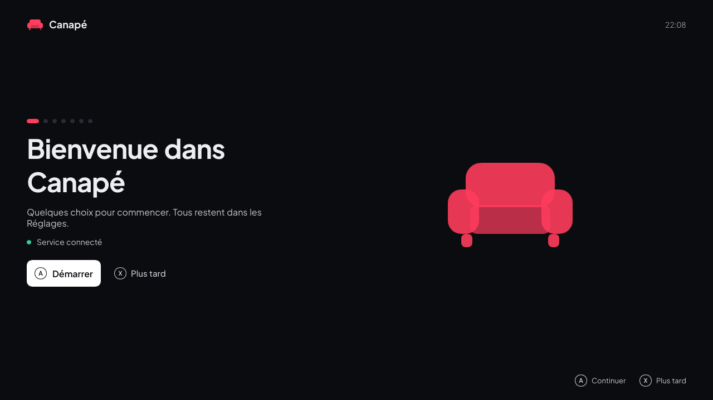

> [!NOTE]
> **Pas encore essayé sur l'Ally.** La visite n'a tourné que sous Linux, avec le simulateur matériel et la fausse bibliothèque ; les captures viennent de là. Sur l'Ally, restent à vérifier le clavier tactile, le presse-papiers et les connexions dans le navigateur par-dessus le FSE.

Au tout premier lancement, une courte visite remplace les sections. Chaque étape change les mêmes réglages que la page [Réglages](#réglages), appliqués tout de suite (sauf l'affichage, appliqué à la fin de la visite) ; **A** continue, **X** passe l'étape (« Plus tard » sur la première ferme toute la visite), **B** revient à l'étape précédente, la croix se déplace à droite. Les points en haut à gauche disent où vous en êtes. L'étape atteinte est enregistrée : après un redémarrage, Canapé y revient. Une fois terminée (ou remise à plus tard), la visite ne revient plus ; **Réglages → Système → Visite de bienvenue** la relance depuis le début.

| Étape | Ce qu'elle fait |
|---|---|
| **Bienvenue** | Dit si le service répond. S'il ne répond pas au bout de 3 s : les réglages de puissance, de ventilateurs et de manette sont indisponibles ; installez-le avec `packaging\install-dev.ps1` (voir [Installer Canapé](#installer-canapé)) ou démarrez `CanapeService` dans Services. On peut continuer sans lui. |
| **Langue** | Automatique ou l'une des 13 langues, sur deux colonnes ; l'interface change au fil de la croix. |
| **Couleur d'accent** | Les huit pastilles de la page Réglages ; gauche et droite les appliquent tout de suite. |
| **Boutiques de jeux** | Steam : si le client a été trouvé et combien de jeux Steam sont installés, puis la **clé Steam Web API** (pour lister les jeux possédés non installés). Epic et GOG : **A** lance la même connexion que dans Réglages (navigateur, puis presse-papiers) et la ligne affiche le compte une fois connecté. **Durée de jeu (IGDB)** : le **Client ID** et le **Client secret** de l'application Twitch, facultatifs. |
| **Dossier des jeux** | Où s'installent les jeux Epic et GOG et son espace libre ; gauche et droite le changent (comme dans Réglages). |
| **Les boutons de l'Ally** | Ce que font les boutons Armoury et Command Center avec Canapé, et **Utiliser les boutons de l'Ally** activé ou non. |
| **Affichage** | **Économe** (rendu logiciel, le défaut) ou **Fluide** (carte graphique) ; gauche et droite choisissent. Fluide demande environ 300 Mo de mémoire en plus, aussi pendant les jeux. Le choix est appliqué à la fin de la visite : Canapé redémarre alors si c'est Fluide. Voir [Affichage](#affichage--économe-ou-fluide). Pas encore essayé sur l'Ally. |
| **C'est prêt** | Les gestes principaux : LB / RB les sections, A choisir ou jouer, B retour, X enregistrer pour ce jeu (Performance, Matériel), Y les options d'un jeu sur sa page. **A** mène aux jeux. |

| Boutiques de jeux | Saisie d'une clé |
|---|---|
| 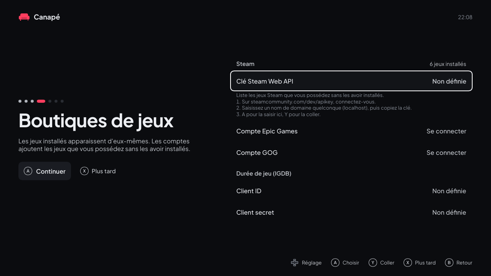 | 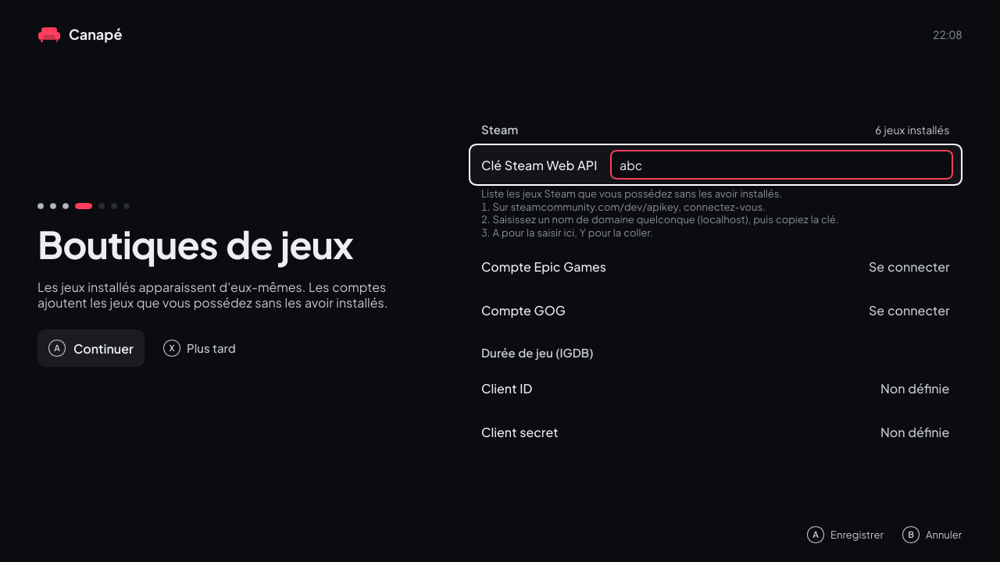 |

**Clés** : **A** sur une ligne de clé ouvre un champ de texte et fait apparaître le clavier tactile de Windows (Canapé le demande explicitement, Windows ne le faisant pas pour cette fenêtre) ; **A** (Entrée) enregistre, **B** annule. **Y** colle plutôt la clé depuis le presse-papiers : copiez-la dans le navigateur, revenez dans Canapé, Y. Une clé Steam fait 32 lettres et chiffres (la ligne « Key: … » de la page peut être copiée entière) ; une valeur Twitch est un seul mot de lettres et de chiffres. Le reste est refusé (« Ce n'est pas une clé : rien n'a été enregistré. »). Un champ vide retire la clé. Les clés enregistrées n'affichent que leurs quatre derniers caractères et ne sont jamais écrites dans le journal. Tout va dans `shell.json` (`steam_api_key`, `igdb_client_id`, `igdb_client_secret`), comme à la main.

- **Steam** : sur [steamcommunity.com/dev/apikey](https://steamcommunity.com/dev/apikey), connectez-vous, saisissez un nom de domaine quelconque (`localhost`), copiez la clé. La liste des jeux possédés est redemandée dès l'enregistrement.
- **IGDB** : sur [dev.twitch.tv/console](https://dev.twitch.tv/console) (double authentification activée), enregistrez une application (nom quelconque, redirection `http://localhost`, catégorie Application Integration, Confidential), copiez son Client ID, puis **New Secret** (détails dans [Jeux](#jeux), « Durée de jeu »).

| Sans le service | Autre outil | Dernière étape |
|---|---|---|
| 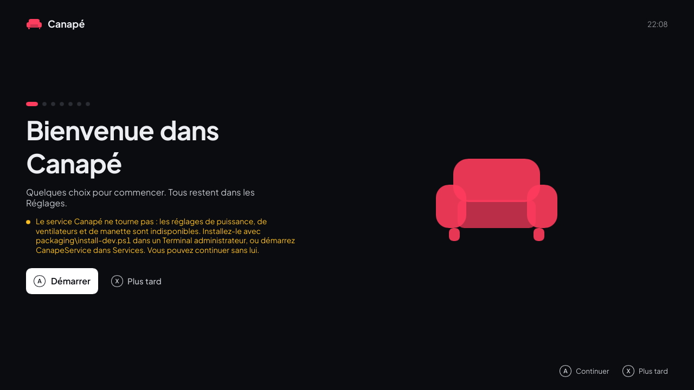 | 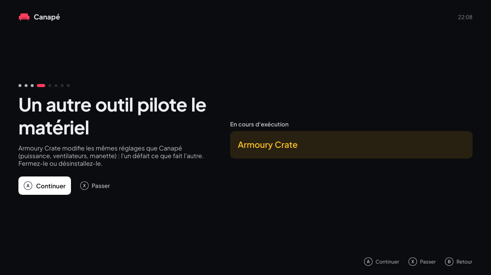 | 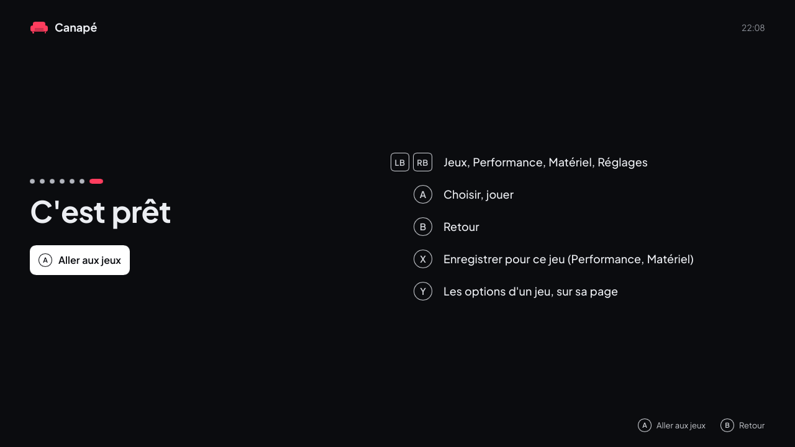 |

<sub>Autres étapes : [langue](images/fr/onboarding-language.png), [couleur d'accent](images/fr/onboarding-accent.png), [dossier des jeux](images/fr/onboarding-folder.png), [boutons de l'Ally](images/fr/onboarding-buttons.png). La capture « autre outil » est simulée : hors Windows, le service n'en signale jamais.</sub>

Une étape **Optimisations de Windows** vient entre les boutons de l'Ally et l'affichage. Elle dit ce que fait la [sélection recommandée](#optimisations-windows) (Copilot, publicités, astuces et enregistrement des jeux en arrière-plan désactivés, dossiers de jeux exclus des analyses de Defender) et **A** (« Appliquer la sélection recommandée ») l'applique, comme la page des optimisations Windows. L'étape reste et montre le résultat : « Tout est appliqué », ou le nombre de réglages non appliqués ; le **A** suivant continue, et « Plus tard » passe l'étape. Sans le service, elle le dit et rien n'est appliqué. *Pas encore essayé sur l'Ally.*

Une installation qui avait déjà un `shell.json` d'une version précédente voit aussi la visite, une fois.

## Utiliser Canapé à la manette

> [!NOTE]
> L'interface décrite ici (quatre sections, navigation aux flèches partout) n'a pas encore été essayée sur l'Ally : seules une version précédente et la navigation à la manette y ont été validées. La bibliothèque de jeux, en particulier, n'a été testée que sous Linux, avec une fausse bibliothèque : la recherche des jeux, leurs jaquettes et leur lancement sous Windows restent à vérifier. Même chose pour la page Matériel, dont les écritures vers les ventilateurs, le pilote graphique et la manette n'ont jamais atteint une vraie Ally (voir [Matériel](#matériel)). Les captures sont rendues sous Linux avec le simulateur matériel et des valeurs fictives.

### Commandes

| Bouton | Action |
|---|---|
| **LB / RB** | Section précédente / suivante : Jeux → Performance → Matériel → Réglages, en boucle |
| **Croix** ou **stick gauche** | Dans Jeux, gauche et droite parcourent l'étagère, haut et bas passent d'une étagère à l'autre. Dans Performance, Matériel et Réglages, de même : haut et bas changent d'étagère, gauche et droite de carte ; dans un tiroir, ils changent la valeur ou parcourent les choix. Dans une sous-page, haut et bas changent de ligne. Maintenu, le déplacement se répète après 0,4 s. |
| **A** | Sur une carte, ouvrir son tiroir (ou sa page) ; dans un tiroir, appliquer le choix qui a le focus ; dans Jeux, lancer le jeu (ou l'installer) |
| **X** | Enregistrer pour le jeu au premier plan (Performance, Matériel, Banc d'essai) ; rétablir les boutons d'origine (tiroir Boutons arrière) ; supprimer un profil (Profils de jeu) |
| **Y** | Passer de M1 à M2 (tiroir Boutons arrière), du minimum au maximum (tiroir Plage de puissance) ; sur la fiche d'un jeu, ses options (renommer, catégories, retirer, désinstaller ; voir [Options d'un jeu](#options-dun-jeu)) |
| **B** | Fermer un tiroir ; quitter une sous-page (Profils de jeu, Ajouter un jeu, Jeux masqués, Optimisations Windows, Banc d'essai) en retrouvant la carte d'où on l'a ouverte ; sinon revenir à Jeux |

La manette n'est lue que lorsque Canapé est au premier plan : un jeu lancé depuis Canapé garde toute la manette. Quand Canapé revient au premier plan, un bouton encore enfoncé pour le jeu n'agit pas tant qu'il n'a pas été relâché ; la première fois (au démarrage de l'Ally par exemple), la manette est ignorée pendant 2 s (la fenêtre n'apparaît qu'environ 1,5 s après), pour qu'un appui pendant l'ouverture de session ne lance pas un jeu. Les mêmes règles valent pour les touches du clavier, y compris l'Entrée et l'Échap que des outils comme Steam Input envoient pour A et B. La carte, la ligne ou la tuile sélectionnée est entourée de blanc (une carte sélectionnée se soulève aussi un peu, sa valeur en couleur d'accent) ; la couleur d'accent marque ce qui est choisi (trait sous une tuile, valeur d'une ligne). Au clavier (développement), les mêmes actions passent par les flèches, Entrée, F2 (X), Échap et Page préc. / Page suiv.

### Éléments communs

- **En haut** : le logo, les quatre sections (la section courante est soulignée de la couleur d'accent) et, à droite, la consommation en watts, les FPS, la batterie (avec un éclair sur secteur) et l'heure. « Hors ligne » remplace les mesures quand le service ne répond pas.
- **En bas à droite** : les boutons utiles sur la page, avec les glyphes de manette de Windows.
- **En bas à gauche** : le résultat de la dernière commande (« Profil enregistré », « Service injoignable », « Erreur du service : … ») et l'avertissement quand un autre programme pilote aussi le matériel. Les messages d'erreur du service restent en anglais.
- Une valeur inconnue s'affiche « — » (par exemple les FPS quand aucun jeu ne tourne).

### Jeux


<sub>Une bibliothèque inventée (`tools/fake-library.py`) : titres et jaquettes sont générés.</sub>

La première section, celle sur laquelle Canapé s'ouvre : le jeu sélectionné en grand, puis des étagères de jaquettes, l'une sous l'autre.

| Zone | Contenu |
|---|---|
| **Jeu sélectionné** | Le logo et le nom de sa boutique (STEAM, EPIC, GOG, XBOX, AUTRES JEUX), son titre, quand il a été joué pour la dernière fois (« Joué aujourd'hui », « Joué hier », « Joué ces 7 derniers jours »…) et le bouton **Détails** : A ouvre la fiche du jeu. Derrière, une lueur reprend la couleur de sa jaquette. |
| **Récents** | Les 10 derniers jeux joués, le plus récent en premier. Absente tant qu'aucun jeu n'a été joué. La jaquette sélectionnée est plus grande, opaque et entourée de blanc ; les autres sont atténuées. Un jeu sans image affiche son titre sur une carte teintée. |
| **Installés · N** | Tous les jeux installés, par ordre alphabétique. |
| **Vos catégories · N** | Une étagère par catégorie que vous avez créée (voir [Options d'un jeu](#options-dun-jeu)), par nom : ses jeux, installés ou à installer, par ordre alphabétique. Une catégorie sans jeu n'a pas d'étagère. |
| **Steam · N**, **Epic · N**, **GOG · N**, **Xbox · N**, **Autres jeux · N** | Les jeux de chaque boutique, avec son logo, installés et à installer mélangés par ordre alphabétique, puis les jeux ajoutés à la main (voir [Ajouter d'autres jeux](#ajouter-dautres-jeux)). Seulement les boutiques qui ont des jeux (une boutique seule sans rien à installer n'a pas d'étagère : elle répéterait Installés). |
| **À installer · N** | Toujours en dernier : les jeux Steam, Epic et GOG que vous possédez sans les avoir installés (voir [Installer des jeux possédés](#installer-des-jeux-possédés)). Vide, elle explique comment configurer Steam, avec deux boutons pour se connecter à Epic ou à GOG (gauche et droite choisissent, A valide). |

**Se déplacer** : gauche et droite parcourent l'étagère ; elle ne défile qu'en arrivant au bord, en gardant un jeu visible à côté de la sélection. La couleur du fond suit le jeu sélectionné dès qu'on s'arrête dessus. Haut et bas passent à l'étagère précédente ou suivante : elle glisse en haut, la suivante dépasse en bas, atténuée. Chaque étagère retient le jeu sélectionné quand on la quitte. Sur À installer, le bandeau décrit le jeu à installer et le bouton devient **Installer**. **A** ouvre la fiche du jeu sélectionné.

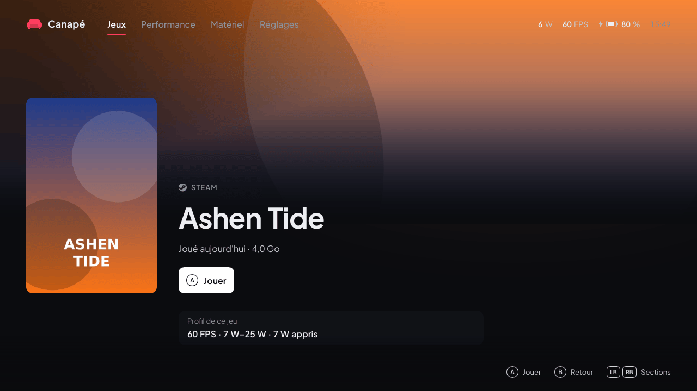

**Fiche du jeu** : la jaquette en grand, la boutique, le titre, quand il a été joué, le temps de jeu (Steam, avec la clé API), et la place qu'il prend sur le disque (Steam, Epic, GOG ; pour un jeu Epic ou GOG à installer, la place qu'il prendra et la place libre du dossier des jeux, voir [Installer des jeux possédés](#installer-des-jeux-possédés)) ; derrière, la grande image du jeu que Steam garde sur le disque, s'il y en a une ; pour un jeu Epic (une fois connecté à Epic dans Canapé), l'image d'Epic lui-même, prise au lien des métadonnées de Legendary (`%USERPROFILE%\.config\legendary\metadata\<app>.json`), téléchargée une fois dans `%LOCALAPPDATA%\Canape\covers` (`epic_<app>.wide.jpg`) quand les jaquettes en ligne sont activées, et recadrée sur la même bande (pas encore essayé sur l'Ally). Les jeux Epic installés par Legendary sans jaquette reçoivent de la même façon la jaquette portrait d'Epic. **A** lance le jeu (« Lancement… », la jaquette avance un peu) ou, s'il n'est pas installé, l'installe, avec la progression sous le bouton. **B** revient à l'étagère, sur le même jeu. Une fois lancé, le jeu passe en tête de Récents. Sous le bouton, **Profil de ce jeu** résume son profil (objectif, plage de puissance, puissance apprise, limite de FPS) : Canapé apprend quel programme est le jeu la première fois qu'il est lancé depuis Canapé (le premier programme plein écran qui passe devant dans les 2 minutes, hors Steam, lanceurs et leurs fenêtres), et l'affiche dès qu'un profil existe pour lui.

Sous la fiche, une seconde partie : depuis le bouton, **bas** fait défiler la page jusqu'à elle (l'indication **Plus** apparaît quand elle a quelque chose à montrer), **haut** remonte, **B** revient toujours à l'étagère. Elle montre la **durée de jeu** et les **succès** (décrits plus bas) quand ils sont connus.

> [!NOTE]
> Pas encore essayé sur l'Ally : le défilement de la fiche n'a été vu que sous Linux, avec la bibliothèque de test.

**Y** sur la fiche ouvre les options du jeu : voir [Options d'un jeu](#options-dun-jeu).

**D'où viennent les jeux**

| Boutique | Ce que lit Canapé | Lancement | Jaquettes |
|---|---|---|---|
| **Steam** | Les dossiers de bibliothèque (`steamapps\libraryfolders.vdf`) et le manifeste de chaque jeu (`appmanifest_*.acf`). Les outils (redistribuables Steamworks, Proton, SteamVR) sont écartés. | Par Steam, démarré caché dans la zone de notification s'il ne tournait pas (`steam.exe -silent steam://rungameid/…`) : aucune fenêtre Steam. La plupart des jeux Steam ont besoin du client. | Le cache de Steam : l'image choisie dans Steam, sinon le portrait 600×900, sinon l'image « hero » ou l'en-tête (affichés en entier, sur un fond flouté) |
| **Epic Games** | Les manifestes du lanceur (`%ProgramData%\Epic\EpicGamesLauncher\Data\Manifests`). DLC, moteurs et installations inachevées sont écartés. S'y ajoutent les jeux installés depuis Canapé avec Legendary (voir [plus bas](#installer-des-jeux-possédés)). | Par Legendary, sans le lanceur. Une fois connecté à Epic dans Canapé, les jeux installés par le lanceur Epic sont confiés à Legendary au scan suivant (`legendary import`, sans retéléchargement) ; d'ici là, ou si la reprise échoue, par le lanceur | Téléchargée (voir plus bas), sinon une carte titre |
| **GOG** | Le registre (`HKLM\SOFTWARE\WOW6432Node\GOG.com\Games`), où GOG Galaxy et les installateurs hors ligne inscrivent chaque jeu. Les DLC sont écartés. S'y ajoutent les jeux installés depuis Canapé avec gogdl (voir [plus bas](#installer-des-jeux-possédés)). | L'exécutable du jeu directement, sans Galaxy | Téléchargée (voir plus bas), sinon une carte titre |
| **App Xbox** | Les dossiers `XboxGames` de chaque lecteur (`Content\MicrosoftGame.config`). | Par Windows (`shell:AppsFolder\…`) | Le logo carré du jeu |
| **Autres jeux** | `%LOCALAPPDATA%\Canape\games.json` (voir [Ajouter d'autres jeux](#ajouter-dautres-jeux)). | Le programme directement, avec ses arguments | Celle indiquée dans `games.json`, sinon téléchargée par le titre (SteamGridDB), sinon une carte titre |

- La date de dernière partie vient de Steam pour les jeux Steam, et de Canapé pour tout jeu lancé depuis Canapé.
- Un jeu installé depuis deux boutiques n'apparaît qu'une fois : la copie jouée en dernier, sinon celle de Steam, puis GOG, Epic, Xbox et enfin `games.json`.
- La liste s'affiche tout de suite depuis la dernière recherche ; une nouvelle recherche tourne en arrière-plan à chaque démarrage, et de nouveau quand on revient à la bibliothèque après plus d'une minute ailleurs. Un jeu installé entre-temps apparaît alors.
- Les jeux de l'app Xbox installés hors d'un dossier `XboxGames` ne sont pas trouvés.
- Canapé lance les jeux lui-même, sans droits particuliers : comme n'importe quelle app de la session.

**Jaquettes téléchargées**

Un jeu sans image sur l'appareil peut en récupérer une sur Internet après chaque scan (**Réglages → Jaquettes manquantes**, activé par défaut) :

- **Jeux Steam** : le portrait 600×900 des serveurs publics de la boutique Steam, sans compte. Utile pour un jeu dont Steam n'a pas encore mis l'image en cache, ou dont il n'a que l'image large (en-tête) : le portrait la remplace.
- **Toutes les boutiques** (Epic, GOG et Xbox compris), avec une clé d'API **SteamGridDB** gratuite : créez un compte sur [steamgriddb.com](https://www.steamgriddb.com), copiez la clé depuis *Preferences → API*, et ajoutez-la dans `%LOCALAPPDATA%\Canape\shell.json` sous la forme `"steamgriddb_key": "…"`. Les jeux Steam sont cherchés par leur identifiant Steam, les autres par leur titre ; seules les images fixes au format portrait sont retenues (pas d'animations, ni d'images NSFW ou humoristiques). La clé n'est envoyée qu'à l'API de SteamGridDB.

Les jaquettes sont enregistrées dans `%LOCALAPPDATA%\Canape\covers` et réutilisées ; un jeu sans image nulle part est redemandé au bout d'une semaine. 60 téléchargements au plus par scan. Désactiver le réglage garde les jaquettes déjà téléchargées mais n'en récupère plus.

> [!NOTE]
> Pas encore essayé sur l'Ally : le téléchargement passe par WinHTTP (intégré à Windows) et n'a été testé que sous Linux, sur des réponses enregistrées.

**Durée de jeu (IGDB)**

Sous la fiche (**bas** depuis le bouton), un bandeau **Durée de jeu** pleine largeur peut montrer trois durées moyennes, chacune dans son bloc sous un bandeau de couleur : **Histoire** (en allant droit au but), **Histoire + extras** et **Complétionniste** (tout finir), par exemple « ~12 h », « ~18 h », « ~35 h » (« — » pour une durée inconnue ; pas de bandeau quand aucune ne l'est), d'après les données « time to beat » d'[IGDB](https://www.igdb.com) (la base de jeux de Twitch). Il faut pour cela une application Twitch à vous, gratuite ; sans elle, rien n'est demandé et la fiche n'affiche pas de durée. Il n'y a pas de réglage : la présence des deux valeurs dans `shell.json` suffit.

1. Connectez-vous sur [dev.twitch.tv/console](https://dev.twitch.tv/console) avec un compte Twitch (Twitch exige la double authentification pour créer une application).
2. **Applications → Register Your Application** : un nom au choix (par exemple « Canape ROG Ally »), **OAuth Redirect URLs** `http://localhost`, catégorie **Application Integration**, type de client **Confidential**. Enregistrez.
3. Ouvrez l'application (**Manage**) : copiez le **Client ID**, puis **New Secret** et copiez le secret.
4. Ajoutez-les dans `%LOCALAPPDATA%\Canape\shell.json`, à côté des autres clés :

   ```json
   "igdb_client_id": "…",
   "igdb_client_secret": "…"
   ```

5. Relancez Canapé (ou attendez dix minutes) et ouvrez la fiche d'un jeu : la durée apparaît une ou deux secondes plus tard si IGDB la connaît.

- Les jeux sont retrouvés par l'identifiant de leur boutique quand IGDB le connaît (Steam, GOG, et Epic par les identifiants que garde Legendary), sinon par leur titre : le même titre d'abord, sinon le même avec ou sans sous-titre ou édition (« Fall Guys » trouve « Fall Guys: Ultimate Knockout », « Death Stranding Director's Cut » trouve « Death Stranding »), le jeu lui-même plutôt qu'un DLC ou un pack. `shell.log` dit quand un jeu est introuvable ou sans durée sur IGDB (pas encore essayé sur l'Ally). « Histoire » est la durée habituelle des joueurs d'IGDB, sinon la plus rapide.
- L'identifiant et le secret ne vont qu'à Twitch (`id.twitch.tv`), qui donne un jeton d'environ deux mois ; seuls l'identifiant et ce jeton vont à IGDB (`api.igdb.com`). Ni le secret ni le jeton n'apparaissent dans les journaux.
- Chaque jeu est demandé une fois, quand sa fiche s'ouvre, puis gardé 30 jours dans `%LOCALAPPDATA%\Canape\igdb.json` (7 jours pour un jeu qu'IGDB ne connaît pas). Au plus 6 demandes par minute ; après une erreur (réseau, clé refusée), plus rien pendant 10 minutes, et une ligne dans `shell.log`.
- IGDB compte moins de jeux et moins de contributions que d'autres sites : beaucoup de jeux n'ont pas de durée.

> [!NOTE]
> Pas encore essayé sur l'Ally. Les noms des champs IGDB (`external_games`, `game_type`, `game_time_to_beats`…) viennent de la documentation connue et n'ont pas été vérifiés sur l'API réelle : si aucune durée n'apparaît, `shell.log` dit pourquoi.

**Succès (Steam)**

Sous la durée de jeu (ou seule sous la fiche), un jeu Steam montre ses **Succès** : combien sont débloqués (« 23 / 51 · 45 % ») avec une barre, puis une tuile par succès, icône et nom : d'abord les débloqués (les plus récents en premier), puis les verrouillés, icône grisée (les plus courants en premier). La croix directionnelle se déplace entre les tuiles, qui défilent par rangées au bord ; la ligne en dessous donne la description de celle qui a le focus, le jour où elle a été débloquée et la part des joueurs qui l'ont. Haut depuis la première rangée remonte en haut de la fiche.

- Jeux Steam seulement (installés ou à installer), avec la clé d'API Web Steam déjà utilisée pour les jeux possédés (`steam_api_key` dans `shell.json`, voir [Installer des jeux possédés](#installer-des-jeux-possédés)) et le dernier compte Steam connecté sur l'appareil. Sans la clé, rien n'est demandé et la partie n'apparaît pas.
- Steam ne répond que pour un profil public : dans Steam, **Profil → Modifier le profil → Paramètres de confidentialité**, **Détails des jeux** doit être **Public**. Avec des détails des jeux privés, ou pour un jeu sans succès, rien ne s'affiche (une ligne dans `shell.log`).
- Noms et descriptions arrivent dans la langue de l'interface quand le jeu est traduit. Un succès caché garde sa description secrète tant qu'il n'est pas débloqué.
- La liste est gardée dans `%LOCALAPPDATA%\Canape\achievements.json` et s'affiche tout de suite ; elle est redemandée à l'ouverture de la fiche si elle a plus d'une heure (ou est dans une autre langue). Les icônes sont téléchargées une fois dans `%LOCALAPPDATA%\Canape\achievement-icons`, seulement celles à l'écran, trois à la fois. Après une erreur réseau, plus rien n'est demandé pendant 10 minutes.
- La clé ne va qu'à Steam (`api.steampowered.com`) et n'apparaît jamais dans les journaux.
- Jeux GOG, Epic, Xbox et autres : pas de succès. GOG a un service de succès, mais il demande les identifiants propres à chaque jeu (dans les fichiers de sa version) et un échange de votre connexion GOG qui pourrait déranger celle que garde gogdl : laissé de côté pour l'instant.

> [!NOTE]
> Pas encore essayé sur l'Ally : ni les requêtes Steam (écrites d'après la documentation publiée de l'API Web de Valve et testées sur des réponses écrites d'après elle, pas enregistrées), ni le téléchargement des icônes, ni la grille sur l'appareil. Seules la fiche (sous Linux, avec la bibliothèque de test) et la lecture des réponses ont été testées.

#### Options d'un jeu

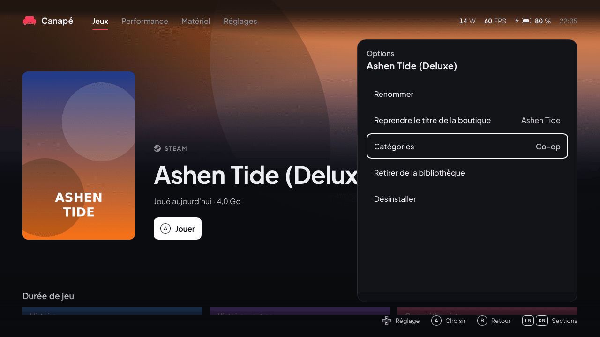

Sur la fiche d'un jeu, **Y** ouvre un panneau à droite avec ce qu'on peut faire du jeu. **Haut / bas** se déplacent, **A** choisit, **B** revient d'un pas (et ferme le panneau depuis son premier niveau), **Y** le ferme. Seules les lignes qui s'appliquent apparaissent :

| Ligne | Effet |
|---|---|
| **Renommer** | Un champ de texte avec le titre actuel (sélectionné : la saisie le remplace). **A** (ou Entrée) garde le nouveau titre, **B** (ou Échap) annule. Le nouveau titre s'affiche partout dans Canapé (étagères, fiche, tri par nom) ; les fichiers des boutiques ne sont pas touchés. Un titre vide, ou celui de la boutique, annule le renommage. Sur l'Ally, le clavier tactile s'ouvre avec le champ (il se pilote aussi à la manette) et se referme après. |
| **Reprendre le titre de la boutique** | Seulement pour un jeu renommé : revient au titre de la boutique (affiché à droite). |
| **Catégories** | Les catégories du jeu (à droite). **A** ouvre la liste : **Nouvelle catégorie** demande un nom (même champ de texte) et y range le jeu ; **A** sur une catégorie y range le jeu ou l'en retire (✓). Chaque catégorie est une étagère de la bibliothèque, après **Installés**, par nom. Une catégorie que son dernier jeu quitte disparaît. |
| **Retirer de la bibliothèque** | Un jeu de boutique est masqué : il quitte toutes les étagères mais reste installé. Les jeux masqués reviennent par **Réglages → Ajouter un jeu → Jeux masqués** (A réaffiche le jeu). Un jeu ajouté à la main (Autres jeux) est plutôt retiré de `games.json`, après confirmation (A à nouveau sur **Retirer de la bibliothèque**, ou **Annuler**). |
| **Désinstaller** | Jeux installés seulement, après une étape de confirmation qui dit ce qui va se passer (**Désinstaller** / **Annuler**). Voir plus bas. |

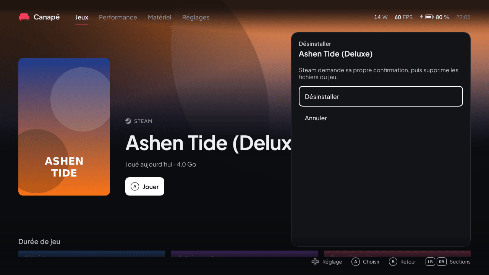

**Comment chaque boutique désinstalle** : Canapé ne supprime jamais lui-même un jeu d'une boutique, sauf les jeux GOG qu'il a installés lui-même.

| Boutique | Ce qui se passe |
|---|---|
| **Steam** | La désinstallation de Steam (`steam://uninstall/<appid>`) : **Steam demande sa propre confirmation** dans sa fenêtre. Canapé attend (15 min au plus) que le manifeste du jeu disparaisse, puis relance un scan. |
| **Epic** (installé depuis Canapé, ou par le lanceur Epic une fois confié à Legendary) | `legendary uninstall` sans fenêtre : Legendary supprime les fichiers du jeu (et lance le désinstalleur du jeu s'il en a un). Un jeu du lanceur Epic pas encore confié est d'abord importé (`legendary import`, sans téléchargement), puis désinstallé de la même façon. Sans connexion Epic dans Canapé, la ligne indique **Connectez-vous d'abord à Epic** et ne fait rien. |
| **GOG** installé depuis Canapé (gogdl) | Le dossier du jeu est supprimé (seulement s'il contient le `goggame-<id>.info` du jeu), et la liste de Canapé mise à jour. |
| **GOG** installé par GOG Galaxy ou l'installeur GOG | Le désinstalleur du jeu (`unins000.exe` dans son dossier) s'ouvre ; Windows peut demander l'autorisation d'un administrateur. Suivez-le. |
| **Application Xbox** | Les paramètres de Windows s'ouvrent sur la page du jeu (`ms-settings:appsfeatures-app`) : désinstallez-le là ; **Windows demande** confirmation. |
| **Autres jeux** | Pas de désinstallation : seulement **Retirer de la bibliothèque**. |

Pendant ce temps, le bouton indique **Désinstallation…** et la ligne à côté où confirmer (fenêtre de Steam, désinstalleur du jeu, paramètres de Windows). Une fois fini, la fiche se ferme et la bibliothèque est relue : un jeu que vous possédez (Steam, Epic, GOG) passe dans **À installer**, les autres disparaissent. Un échec affiche « Impossible de désinstaller … » en jaune ; le détail est dans `shell.log`.

Titres, catégories et jeux masqués sont gardés dans `%LOCALAPPDATA%\Canape\overrides.json`.

> [!WARNING]
> Pas encore essayé sur l'Ally. Seuls le panneau, le renommage, les catégories, le masquage et le retrait ont été essayés, sous Linux avec la bibliothèque de test (la désinstallation y est simulée). Non testés : le clavier tactile (Canapé le demande à Windows ; on ignore s'il s'affiche par-dessus l'expérience plein écran), toutes les désinstallations sous Windows (boîte de dialogue de Steam, Legendary, désinstalleur GOG et sa demande d'autorisation, page Paramètres d'un jeu Xbox) et le retour de Canapé au premier plan ensuite.

#### Ajouter d'autres jeux

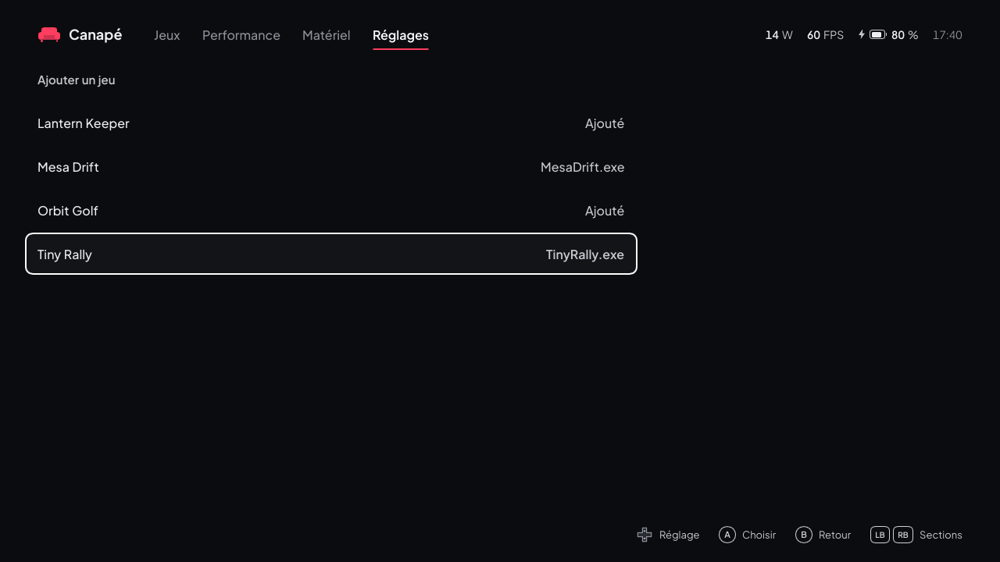

<sub>Raccourcis inventés (`tools/fake-library.py`).</sub>

> [!NOTE]
> **Pas encore essayé sur l'Ally** : ni la lecture des raccourcis du menu Démarrer et du bureau, ni le lancement de ces jeux. Seuls l'interface (sous Linux, avec la bibliothèque inventée), la lecture de `games.json` et celle des fichiers `.lnk` (sur des raccourcis générés selon le format publié) ont été testées.

Un jeu qu'aucune boutique ne connaît (un `.exe` autonome, un jeu itch.io, un émulateur…) s'ajoute de deux façons. Ces jeux ont leur étagère **Autres jeux**, avec une icône de manette, et se lancent directement, sans boutique.

**Depuis Canapé, à la manette** : **Réglages → Ajouter un jeu** liste, par nom, les jeux déjà ajoutés (« Ajouté ») et les raccourcis du menu Démarrer (le vôtre et celui de tous les utilisateurs) et des deux bureaux qui pourraient être des jeux, avec le nom du programme. **A** ajoute le jeu, ou le retire s'il était ajouté ; la bibliothèque se met à jour aussitôt. Sont écartés : les raccourcis vers autre chose qu'un `.exe` (documents, pages web), les programmes de Windows, les désinstalleurs, installeurs, outils de mise à jour, manuels et pages de support, les clients des boutiques et les jeux qu'une boutique liste déjà (même titre ou même programme). Ce qui reste peut contenir des applications qui ne sont pas des jeux : rien n'est ajouté sans votre choix.

**À la main**, dans `%LOCALAPPDATA%\Canape\games.json` (le fichier que la sous-page écrit) :

```json
{ "games": [
  { "title": "Celeste", "exe": "D:\\Jeux\\Celeste\\Celeste.exe" },
  { "title": "Metroid Fusion", "exe": "D:\\Emu\\mGBA\\mGBA.exe",
    "args": "\"D:\\Roms\\Metroid Fusion.gba\"", "dir": "D:\\Emu\\mGBA",
    "cover": "covers\\fusion.png" },
  { "title": "Un jeu itch.io", "exe": "itch://caves/123/launch" }
] }
```

| Champ | Rôle |
|---|---|
| `title` | Le nom affiché (obligatoire). |
| `exe` | Ce qui est lancé (obligatoire) : un exécutable, un raccourci `.lnk`, un script, ou une adresse (`itch://…`, `steam://…`), ouvert comme un double-clic. |
| `args` | Les arguments, facultatifs (par exemple la ROM pour un émulateur). |
| `dir` | Le dossier de travail ; par défaut, celui de l'exécutable. |
| `cover` | Une jaquette JPEG ou PNG, de préférence en portrait ; un chemin relatif part du dossier de `games.json`. Sans elle, une jaquette est cherchée sur SteamGridDB par le titre si la clé est réglée (voir [Jaquettes téléchargées](#jeux)), sinon une carte titre s'affiche. |

- Dans le JSON, chaque `\` d'un chemin s'écrit `\\` (ou utilisez `/`, que Windows accepte aussi).
- Un émulateur peut figurer plusieurs fois avec des `args` différents : chaque jeu est distinct. L'historique « Récents » suit le programme et ses arguments : changer le titre ne le perd pas.
- Un fichier illisible (virgule en trop…) ne fait apparaître aucun de ces jeux ; l'erreur est dans `shell.log` et en jaune sur la sous-page, et Canapé ne réécrit jamais un fichier qu'il n'a pas pu lire.
- Les modifications à la main apparaissent au retour sur la bibliothèque après une minute, ou au démarrage suivant.

#### Installer des jeux possédés


<sub>Des jeux possédés inventés (`tools/fake-library.py`) ; l'installation de Mosaic Run est simulée.</sub>

> [!NOTE]
> **Rien de cette partie n'a encore été essayé sur l'Ally** : ni la liste des jeux Steam par l'API Web, ni l'installation par Steam, ni le téléchargement de Legendary ou de gogdl, ni les connexions Epic et GOG, ni l'installation et le lancement des jeux Epic et GOG. Seuls l'interface (sous Linux, avec la fausse bibliothèque et une installation simulée) et la lecture des réponses de Steam, d'Epic, de GOG et de GitHub ont été testées (sur des réponses enregistrées pour Steam, Epic et GitHub ; pour GOG, sur des réponses écrites d'après le code source de gogdl, les serveurs de GOG n'étant pas joignables depuis la session cloud).

L'étagère **À installer** liste les jeux que vous possédez sur Steam, Epic ou GOG sans les avoir installés sur la console (la dernière étagère : bas jusqu'à elle). **A** ouvre la fiche du jeu, puis **A** dans la fiche (« Installer ») l'installe sans ouvrir l'interface de Steam, le lanceur Epic ni GOG Galaxy : un appui isolé sur l'étagère ne lance jamais de téléchargement. Un jeu déjà installé, depuis n'importe quelle boutique (même identifiant ou même titre), n'apparaît pas dans cette liste. Les jeux GOG et de l'app Xbox n'y sont jamais : Canapé n'obtient pas la liste des jeux possédés là-bas (l'app Xbox n'en donne aucune aux autres programmes), ils n'apparaissent donc qu'une fois installés avec GOG Galaxy ou l'app Xbox, et se lancent ensuite comme les autres.

**Steam : préparer une fois**

1. Créez une clé d'API Web Steam gratuite sur [steamcommunity.com/dev/apikey](https://steamcommunity.com/dev/apikey).
2. Ajoutez-la dans `%LOCALAPPDATA%\Canape\shell.json` sous la forme `"steam_api_key": "…"`.

Canapé demande la liste du compte connecté en dernier à Steam sur cet appareil (`config\loginusers.vdf` dans le dossier de Steam) : Steam doit donc y avoir été ouvert au moins une fois avec votre compte. La clé n'est envoyée qu'à l'API de Steam (`api.steampowered.com`). Les outils (redistribuables, Proton, SteamVR) sont écartés ; les jeux gratuits déjà lancés font partie de la liste.

**Epic : se connecter une fois**

1. Choisissez **Compte Epic Games** dans les [Réglages](#réglages).
2. La première fois, Canapé télécharge **Legendary**, un client Epic libre (licence GPL-3) qui reste un programme séparé, depuis ses publications officielles sur GitHub, dans `%LOCALAPPDATA%\Canape\tools`. Le fichier est vérifié avec l'empreinte SHA-256 que GitHub publie : sans empreinte, ou si elle ne correspond pas, rien n'est enregistré et l'erreur s'affiche en haut de la bibliothèque.
3. Canapé ouvre la page de connexion d'Epic dans le navigateur. Connectez-vous (l'écran tactile et le clavier tactile sont nécessaires) : la page affiche ensuite un petit texte JSON avec un `authorizationCode`. Copiez cette page (tout sélectionner, copier) ou seulement la valeur du code : Canapé surveille le presse-papiers pendant 10 minutes, y trouve le code et connecte Legendary sans fenêtre. A de nouveau pendant l'attente relit le presse-papiers tout de suite, ou rouvre la page.
4. Une erreur (téléchargement, connexion) s'affiche en jaune sous les lignes de Réglages et dans le bandeau de la page Jeux. Une fois connecté, Canapé redemande la liste des jeux. Le bouton affiche ensuite « Epic : <compte> (se reconnecter) ».

Les jeux Epic qui s'installent par une autre boutique (Ubisoft, EA) sont écartés : Legendary ne sait pas les installer. De même les extensions qu'Epic liste comme des produits (la mise à niveau vers un director's cut, par exemple).

**Doublons** : une boutique qui liste deux fois un même jeu (deux entrées Epic au même titre) ne le montre qu'une fois, l'exemplaire qui a une jaquette. Un jeu possédé sur deux boutiques (Death Stranding sur Steam et sur Epic) reste sur l'étagère de chaque boutique, mais n'apparaît qu'une fois dans **À installer** : l'exemplaire Steam, sinon GOG, Epic, Xbox. Un autre jeu dont le titre commence pareil (Death Stranding Director's Cut) est gardé. Pas encore essayé sur l'Ally.

**GOG : se connecter une fois**

1. Choisissez **Compte GOG** dans les [Réglages](#réglages), ou **Se connecter à GOG** sur l'étagère À installer vide.
2. La première fois, Canapé télécharge **gogdl** (heroic-gogdl, un outil de téléchargement GOG libre, licence GPL-3, qui reste un programme séparé) depuis ses publications officielles sur GitHub, dans `%LOCALAPPDATA%\Canape\tools`. La version est fixée (1.3.1) et le fichier vérifié avec son empreinte SHA-256 : s'il ne correspond pas, rien n'est enregistré et l'erreur s'affiche.
3. La page de connexion de GOG s'ouvre dans le navigateur. Connectez-vous : GOG arrive sur une page presque vide dont l'adresse contient un code (`embed.gog.com/on_login_success?origin=client&code=…`).
4. **Copiez l'adresse de cette page** (barre d'adresse, puis Copier) et revenez à Canapé (bouton Armoury) : Canapé surveille le presse-papiers pendant 10 minutes et se connecte dès qu'il y trouve cette adresse ; **A** sur la ligne le vérifie tout de suite, ou rouvre la page s'il n'y a rien. La ligne affiche « En attente de l'adresse GOG… » en attendant, puis le compte.

Le navigateur ne se pilote pas à la manette : l'écran tactile et le clavier tactile peuvent être nécessaires. Seuls les jeux GOG disponibles sous Windows sont listés (pas les films). Les jetons de GOG restent dans `%LOCALAPPDATA%\Canape\gog\auth.json`.

**Quand la liste est mise à jour** : au démarrage de Canapé (pour compter les jeux de l'étagère), en passant à l'étagère À installer si la dernière demande date de plus de 10 minutes, et juste après une connexion Epic ou GOG. Sans clé Steam ni compte Epic ou GOG, aucune boutique n'est sollicitée. Une boutique impossible à lister (clé Steam erronée, session Epic expirée) affiche son erreur dans l'en-tête pendant 10 secondes et la dernière liste est gardée. La dernière liste est gardée dans `owned.json` et s'affiche tout de suite. Les jaquettes sont récupérées comme les [jaquettes téléchargées](#jeux), avec le même réglage **Télécharger les jaquettes manquantes** ; pour les jeux Epic, Canapé essaie d'abord l'image portrait fournie par Epic, pour les jeux GOG l'image de la boutique GOG.

**Ce que fait A**

| Boutique | Installation | Progression | À la fin |
|---|---|---|---|
| **Steam** | Votre propre client Steam télécharge le jeu, sans aucune fenêtre Steam : Canapé ajoute le jeu à la file de téléchargement de Steam (dans la bibliothèque Steam qui a le plus de place libre), puis démarre Steam discrètement dans la zone de notification, ou le redémarre s'il tournait déjà (quelques secondes ; jamais pendant qu'un jeu tourne). Si ce n'est pas possible (un jeu tourne, Steam connaît déjà le jeu, Steam ne lance pas le téléchargement en 90 s), Canapé revient à la petite fenêtre d'installation de Steam (dossier, raccourcis) : confirmez-la ; ce repli a été essayé sur l'Ally (Terraria en 75 s). **L'installation sans fenêtre n'a pas encore été essayée sur l'Ally**, et elle repose sur le comportement de Steam, pas sur une interface documentée par Valve : une mise à jour de Steam peut la casser, et la fenêtre d'installation revient alors. Les réglages de téléchargement de Steam s'appliquent toujours (par exemple un téléchargement qui attend les horaires réglés dans Steam). | Lue toutes les 2 s dans le manifeste du jeu. | Le jeu passe dans Installés, qui revient devant avec le jeu sélectionné : A le lance, par Steam comme les autres. |
| **Epic** | Legendary installe le jeu en silence, sans fenêtre ni question, dans le dossier des jeux. | Lue dans ce qu'affiche Legendary. | Le jeu passe dans Installés et se lance par Legendary : le lanceur Epic n'est jamais ouvert. |
| **GOG** | gogdl télécharge la version Windows du jeu, dans la langue de Canapé si le jeu l'a (sinon en anglais), sans DLC, sans fenêtre ni question, dans le dossier des jeux. | Lue dans ce qu'affiche gogdl. | Le jeu passe dans Installés et se lance directement par son exécutable : GOG Galaxy n'est jamais nécessaire. |

- Pendant l'installation, la jaquette affiche une barre de progression et le bandeau « Installation… N % » quand le jeu est sélectionné ; « En attente de la boutique… » tant que le téléchargement n'a pas commencé (fenêtre de Steam à valider, par exemple). On peut continuer à naviguer et installer d'autres jeux.
- **Où, et est-ce que ça rentre** : Steam montre le dossier et la place libre dans sa propre fenêtre. Les jeux Epic et GOG vont dans le **dossier des jeux** (**Réglages → Dossier des jeux**, voir [Réglages](#réglages)), un sous-dossier par jeu. Sur la fiche d'un jeu Epic ou GOG à installer, la ligne d'infos donne la place que le jeu prendra, d'après sa boutique (demandée à l'ouverture de la fiche : quelques secondes), et la place libre du dossier des jeux : « Non installé · 21,7 Go · 48,2 Go libres dans D:\Games ». Si le jeu ne rentre pas, une ligne jaune le dit à côté du bouton et **A** ne fait rien : libérez de la place, ou choisissez un autre dossier dans les Réglages. Canapé vérifie encore juste avant de télécharger, au cas où la place aurait manqué entre-temps (« not enough space in … »).
- Steam : si la fenêtre d'installation n'est pas confirmée, Canapé abandonne au bout de 10 minutes (« Steam did not start the download ») ; une installation annulée dans Steam en cours de route donne « cancelled in Steam ».
- En cas d'échec, le bandeau affiche un court message en jaune, dans la langue de l'interface : « Impossible d'installer <titre> », « Impossible de lancer <titre> », « Impossible de télécharger Legendary » (ou gogdl), « Epic : la connexion a échoué », « Epic : impossible de lister les jeux possédés »… Le détail technique suit entre parenthèses, en anglais, s'il est court (`no checked Legendary release found`, `legendary: …` avec la dernière ligne de Legendary) ; plus long, ou s'il ressemble à une clé ou à un code, il ne figure que dans `shell.log`, qui garde toujours le détail complet. Le message s'efface au bout de 10 secondes ou à la prochaine installation. *Pas encore essayé sur l'Ally.*
- Les jeux installés par Legendary sont retrouvés dans sa configuration (`%USERPROFILE%\.config\legendary\installed.json`) tant que `legendary.exe` est présent dans `%LOCALAPPDATA%\Canape\tools`. Ceux installés par gogdl sont notés par Canapé dans `%LOCALAPPDATA%\Canape\gog\installed.json` ; un jeu dont le dossier a été supprimé disparaît de la liste.
- GOG : les redistribuables d'un jeu (Visual C++, DirectX…) sont téléchargés avec lui mais pas installés ; Windows 11 en a déjà la plupart. Si un jeu en réclame un au lancement, installez-le à la main (site de Microsoft).
- **Easy Anti-Cheat** (jeux Epic et GOG qui l'embarquent, comme Fall Guys) : Legendary et gogdl téléchargent son installateur avec le jeu (`EasyAntiCheat\EasyAntiCheat_EOS_Setup.exe` et `EasyAntiCheat\Settings.json`, qui donne le produit du jeu) sans l'exécuter, et sans lui le jeu ne démarre pas. Juste après une telle installation, et avant de lancer un tel jeu tant que le service `EasyAntiCheat_EOS` n'existe pas, Canapé exécute `EasyAntiCheat_EOS_Setup.exe install <produit>` avec les droits d'administrateur : Windows affiche sa demande habituelle (une par installation), et rien n'est installé sans votre accord. Canapé attend la fin de l'installateur (5 minutes au plus) et note le résultat dans `shell.log`. En cas de refus, le bandeau indique « Easy Anti-Cheat n'a pas été installé (refusé) : <titre> risque de ne pas démarrer », le jeu est lancé quand même, et Canapé ne redemande pas pour ce jeu avant son prochain démarrage. Une fois le service présent (installé par n'importe quel jeu ou lanceur), plus rien n'est demandé. L'installateur est toujours lancé par le shell, avec votre accord, jamais par le service de Canapé : un programme qui tourne en SYSTEM ne doit pas exécuter un fichier que n'importe quel utilisateur peut déposer dans un dossier de jeu. *Pas encore essayé sur l'Ally.*

### Performance


<sub>La même page en russe : [ru/performance.png](images/ru/performance.png).</sub>

**En haut**, en direct : le jeu au premier plan (suivi de « profil du jeu » quand son profil s'applique, et du mode), la consommation avec sa limite et les watts appris pour le jeu (ou « Limite thermique atteinte »), les images par seconde avec l'objectif de l'auto TDP, la température CPU et, à droite, le graphe de la dernière minute : la consommation en couleur d'accent, la limite en pointillés gris. L'échelle s'adapte par pas de 5 W ; un trou dans la courbe signale une coupure avec le service.

**Se déplacer** : en dessous, les réglages sont des cartes rangées sur des étagères, comme les jeux : l'étagère de devant est en haut, la suivante dépasse en dessous, assombrie. Haut et bas changent d'étagère, gauche et droite de carte ; la carte sélectionnée se soulève et montre sa valeur en couleur d'accent. **A** ouvre le **tiroir** de la carte, qui monte du bas de l'écran et contient le réglage lui-même ; **B** le ferme. Dans un tiroir, gauche et droite déplacent tout de suite une réglette, ou parcourent des tuiles que **A** applique. **X** enregistre les réglages pour le jeu au premier plan (crée ou met à jour son profil), tiroir ouvert ou non. Une carte grisée ne s'applique pas au mode en cours.

| Carte | Tiroir |
|---|---|
| **Puissance → Mode** | Quatre tuiles. Silencieux, Performance et Turbo sont les modes firmware ASUS : le firmware fixe ses limites, que Canapé ne peut pas lire. **Auto TDP** allume l'auto TDP. Le mode en cours a une tuile plus claire et un trait d'accent. Choisir un mode firmware désactive l'auto TDP. À côté du titre du tiroir : « <jeu> · profil du jeu » quand un profil s'applique, « Réglages généraux » sinon. |
| **Puissance → Objectif** (auto TDP) | Une réglette de crans : 30, 40, 45, 60, 90, 120 FPS, avec les images par seconde du moment à côté du titre. Gauche et droite passent au cran voisin. |
| **Puissance → Plage de puissance** (auto TDP) | ‹ minimum › — barre — ‹ maximum ›. La barre est à l'échelle du modèle (5 à 30 W sur les ROG Ally et Ally X, 5 à 35 W sur les ROG Xbox Ally ; 5 à 35 W si le service ne le dit pas). Haut, bas ou **Y** choisissent le minimum ou le maximum (la poignée active grossit), gauche et droite le déplacent de 1 W ; le minimum ne peut pas dépasser le maximum. Un trait d'accent montre ce que l'APU consomme en ce moment ; la valeur et les watts appris du profil sont à côté du titre. |
| **Puissance → Limite de puissance** (TDP manuel) | La même barre avec une seule poignée : gauche et droite changent la limite de 1 W. La carte ne porte ce nom que lorsqu'une limite manuelle est en place (par **Régler le TDP** au banc d'essai, ou ±1 W dans le widget) : il n'y a pas de tuile Manuel ; un minimum égal au maximum en auto TDP donne le même résultat. Avec un mode firmware, la carte est grisée. |
| **Puissance → Sur batterie** | Une réglette : aucun, 10, 15, 20 W, plafond appliqué seulement sur batterie. |
| **Puissance → Température** | Une réglette : aucune, 80, 85, 90 °C : au-delà, la puissance ne fait que baisser. |
| **Mesures et écran → Banc d'essai** | Ouvre la page du [banc d'essai](#banc-dessai). La carte montre sa durée, ou le temps restant pendant un essai. |
| **Mesures et écran → Écran** | Les fréquences que propose l'écran, en tuiles : **A** applique celle qui a le focus (voir Écran, dans la page [Matériel](#matériel)). |
| **Mesures et écran → Profils de jeu** | Le nombre de profils ; ouvre la page [Profils de jeu](#profils-de-jeu). |
| **Processeur → Boost du processeur** | Une réglette : Par défaut, Désactivé, Activé, Agressif. *Par défaut* laisse le réglage à Windows (et remet ce qu'il était si Canapé l'avait changé). |
| **Processeur → Préférence énergétique** | Une réglette : Par défaut, 0, 25, 50, 75, 100 %. Bas : vitesse, haut : économie d'énergie. |
| **Processeur → Fréquence maximale** | Une réglette : Par défaut, 2,0, 2,8, 3,6, 4,4 GHz. Plafonne la fréquence du processeur ; utile pour économiser la batterie dans les jeux légers. |
| **Processeur → Cœurs actifs** | Une réglette : Par défaut, 25, 50, 75, 100 % : la part des cœurs que Windows garde éveillés. |

> [!WARNING]
> **Étagère Processeur : pas encore essayée sur l'Ally.** Testée avec le simulateur seulement. Canapé modifie les paramètres du processeur du **mode d'alimentation actif de Windows**, sur secteur comme sur batterie ; il garde les valeurs que le mode avait et les remet quand vous choisissez *Par défaut* et à la désinstallation (`uninstall-dev.ps1` les rétablit). **X** les enregistre dans le profil du jeu avec les réglages de puissance ; avec un profil en cours, un changement va dans le profil. Le curseur de mode d'alimentation de Windows peut en écraser certains : si une valeur semble sans effet, signalez-le.

Le fonctionnement détaillé est dans [Auto TDP et banc d'essai](auto-tdp.fr.md).

> [!TIP]
> Quand un profil de jeu est actif, ces réglages modifient **le profil**, pas les réglages généraux.

**Animations allégées** (pas encore essayé sur l'Ally) : en mode Silencieux, ou avec une limite de puissance de 12 W ou moins, quand [Pleine puissance dans Canapé](#réglages) n'est pas en vigueur, Canapé saute les animations les plus coûteuses (fondu du fond de la bibliothèque, glissement des étagères et des tiroirs). Les autres animations restent.

### Matériel


> [!NOTE]

**En haut**, en direct : le jeu au premier plan, la vitesse du ventilateur CPU (et celle du GPU en dessous), en tr/min, la température CPU (avec la limite de température si elle est réglée) et la courbe du ventilateur CPU, un trait en pointillés marquant la température du moment. « — » quand le firmware ne donne pas de mesure.

En dessous, quatre étagères de cartes, parcourues comme la page [Performance](#performance) : **A** ouvre le tiroir d'une carte, **B** le ferme, **X** enregistre les ventilateurs, le mode de l'écran (résolution et fréquence), la limite de FPS, les réglages d'image et la visée au gyroscope pour le jeu au premier plan (voir [Ce jeu](#ce-jeu)).

| Étagère | Cartes |
|---|---|
| **Refroidissement** | Ventilateurs |
| **Manette** | Mode, Boutons arrière, Éclairage des sticks, Visée au gyroscope |
| **Image** | Résolution, Fréquence, Limite de FPS, Mise à l'échelle, Génération d'images |
| **Batterie** | Limite de charge |

**Ventilateurs**

| Tuile | Courbe (la même pour les ventilateurs CPU et GPU) |
|---|---|
| Automatique | La courbe propre au firmware pour le mode d'alimentation en cours. Canapé retire ses courbes. |
| Équilibré | De 10 % à 40 °C jusqu'à 75 % dès 92 °C, proche du comportement équilibré d'ASUS. |
| Maximum | 35 % dès 30 °C, pleine vitesse dès 80 °C : bruyant, mais le plus frais. |

- Il n'y a pas de préréglage silencieux : sur l'Ally, le firmware fait tourner les ventilateurs vers 5300 tr/min avec une courbe basse sous charge (mesuré en M5, partie 2), plus fort qu'avec Équilibré. Pour du silence, utilisez **Automatique** avec le mode d'alimentation **Silencieux** : le firmware y reste vers 3200 / 2800 tr/min.
- La courbe du ventilateur CPU va de 20 à 110 °C en largeur et de 0 à 100 % en hauteur. En Automatique, elle laisse place à « La courbe propre au mode d'alimentation ».
- Un préréglage **résiste aux changements de mode** : le firmware remet ses propres courbes à chaque changement de mode, et le service réécrit le préréglage juste après.
- **Automatique** réécrit le mode d'alimentation en cours : c'est ainsi que le firmware reprend ses courbes. En Manuel, le service remet ensuite votre TDP.
- **Sécurité** : chaque courbe est vérifiée avant d'atteindre le firmware. Le ventilateur ne doit jamais ralentir quand la température monte, et il doit tourner à au moins 25 % dès 80 °C, 30 % dès 90 °C et 40 % dès 100 °C, juste sous le mode Silencieux d'ASUS. Une courbe qui laisserait les ventilateurs arrêtés à chaud est refusée. L'APU se bride de lui-même à sa limite de température, mais une courbe trop discrète rend la console chaude en main.
- **Personnalisé** : quand les courbes en place ne correspondent à aucun préréglage (réglées avec `canape-ctl`, ou un préréglage différent par ventilateur), la carte Ventilateurs indique « Personnalisées », aucune tuile n'est sélectionnée et le titre du tiroir est suivi de « Courbes personnalisées définies par un autre client. »

**Limite de FPS**

Une réglette : Aucune, 30, 40, 45, 60, 90 ou 120. Le pilote graphique AMD maintient tous les jeux à ce débit ou en dessous, sur secteur comme sur batterie : moins de chaleur, moins de bruit, plus d'autonomie. **Aucune** retire la limite.

> [!TIP]
> Avec l'auto TDP, réglez son objectif **au niveau de la limite ou en dessous**. L'auto TDP règle la puissance pour atteindre son objectif : avec une limite à 40 et un objectif à 60, l'objectif n'est jamais atteint et l'auto TDP monterait la puissance au maximum pour rien. Une limite égale à l'objectif est idéale : le jeu reste à son plafond et l'auto TDP rend les watts inutiles (voir [Auto TDP et banc d'essai](auto-tdp.fr.md#le-plafond-de-fps-et-la-règle-du-gpu-au-repos)).

#### Ce jeu

Le haut de la page nomme le jeu au premier plan. **X**, tiroir ouvert ou non, enregistre les courbes, la résolution et la fréquence de l'écran, la limite de FPS et les réglages d'image en cours dans le profil de ce jeu (rien ne se passe sans jeu au premier plan) :

- Les autres réglages du profil (auto TDP, watts appris) sont conservés. S'il n'y a pas de profil, il est créé avec les réglages d'auto TDP en cours.
- **Automatique** s'enregistre aussi : ce jeu tournera alors sur les courbes du firmware, même si un préréglage est utilisé le reste du temps.
- **Aucune** s'enregistre comme « suivre la limite générale » : un profil ne peut pas imposer « pas de limite » quand une limite générale est réglée.
- Quand le jeu passe au premier plan, ses courbes et sa limite s'appliquent ; quand il le quitte, celles des réglages généraux reviennent.
- Pendant le jeu, choisir un préréglage ou une limite modifie **son profil** si ce profil a ses propres ventilateurs (ou sa propre limite) ; sinon, le changement est général et reste après le jeu. Un profil créé depuis la page Profils ou le banc d'essai n'a ni l'un ni l'autre : il suit les ventilateurs et la limite généraux.

**Manette**

| Tuile | Mode de la manette intégrée |
|---|---|
| Manette de jeu | Manette Xbox (XInput), pour les jeux. |
| Clavier | Les sticks et les boutons envoient des touches, pour les jeux qui ne connaissent que le clavier. |
| Souris | Mode bureau : le stick droit déplace le pointeur. |

Le mode est général (pas par jeu), mémorisé et réappliqué au démarrage du service. Canapé ne le relit pas dans la manette : aucune tuile n'est sélectionnée tant que Canapé ne l'a pas réglé une fois. Seules les manettes des ROG Ally et Ally X sont connues ; sur les ROG Xbox Ally, la requête renvoie une erreur.

> [!WARNING]
> Canapé lit la manette en XInput. En mode Clavier ou Souris, la manette ne devrait plus se présenter comme une manette Xbox, et Canapé risque de ne plus lui répondre : revenez à **Manette de jeu** avec l'écran tactile, ou avec `canape-ctl` (voir [Dépannage](#canape-ctl--parler-au-service)).

**Limite de charge**

Trois tuiles : 60, 80 et 100 %. La batterie s'arrête de charger à ce niveau, même branchée : une console qui vit sur son chargeur garde une batterie en meilleure santé à 60 ou 80 %. **100 %** retire la limite. La limite est générale (pas par jeu), mémorisée et réappliquée au démarrage du service. Canapé ne peut pas la relire dans le firmware : aucune tuile n'est sélectionnée tant que Canapé ne l'a pas réglée une fois (une limite réglée ailleurs, ou une autre valeur réglée avec `canape-ctl`, n'en sélectionne aucune).

> [!NOTE]
> Pas encore essayé sur l'Ally : l'écriture dans le firmware (`set_battery_charge_limit`) n'a été testée qu'avec le simulateur.

**Image**

Une étagère qui regroupe ce qui touche à l'image d'un jeu : la résolution, la fréquence de l'écran, la limite de FPS (décrite plus haut), la mise à l'échelle et la génération d'images. Tout s'enregistre avec **X** dans le profil du jeu.

*Résolution.* Une tuile par résolution que l'écran intégré propose avec le **même format** que la dalle (16:9 sur la ROG Ally : 1920×1080, 1600×900, 1280×720…) ; A applique celle qui a le focus. Elle ne se change que **pendant qu'un jeu tourne** (la carte est grisée sinon) : le choix ne vaut que pour cette partie, **X** le garde dans le profil du jeu, et l'écran revient à la résolution d'avant quand le jeu se ferme. Comme pour la fréquence, Canapé ne change la résolution qu'au changement de profil, et remet la fréquence en place si Windows l'a modifiée avec la résolution.

> [!NOTE]
> Changer la résolution pendant que Canapé est à l'écran redessine Canapé à la nouvelle taille.

*Fréquence.* Une tuile par fréquence que l'écran intégré propose à sa résolution actuelle (60 et 120 Hz sur la ROG Ally) ; A applique celle qui a le focus. Une fréquence plus basse économise la batterie dans les jeux limités à 30, 40 ou 60 FPS. Le choix s'applique tout de suite. Sans jeu au premier plan, il devient la fréquence générale, mémorisée comme un réglage fait dans les paramètres de Windows. Avec un jeu au premier plan, il ne vaut que pour cette partie : **X** le garde dans le profil du jeu, et l'écran revient à la fréquence générale quand le jeu se ferme.

- Un profil de jeu peut avoir sa propre fréquence (**X** sur cette page) : elle s'applique quand le jeu passe au premier plan ; quand il le quitte, l'écran revient à la fréquence choisie ici, ou à celle que le profil avait remplacée.
- Canapé ne change la fréquence qu'au changement de profil : une fréquence choisie entre-temps dans les paramètres de Windows est respectée.
- Seul l'écran intégré est concerné, jamais une télé ou un moniteur branché. Sans écran intégré (ou hors Windows), les cartes Résolution et Fréquence sont grisées.

*Mise à l'échelle.* Trois choix : Aucune, AMD (RSR) ou Lossless Scaling, avec une netteté de 0 à 100 %. *Génération d'images.* Aucune, AMD (AFMF) ou Lossless Scaling ; avec Lossless Scaling, un multiplicateur ×2, ×3 ou ×4, ou « Adaptatif » avec une cadence cible. Le choix de **Lossless Scaling** n'apparaît que si l'application est installée (Steam, app 993090).

> [!WARNING]
> **Pas encore appliqué.** La mise à l'échelle et la génération d'images sont seulement **enregistrées** dans le profil du jeu : rien ne les active encore, les tiroirs l'indiquent par « Pas encore appliqué » et le service écrit dans son journal `image: upscaling … not applied yet` quand le profil s'applique.

> [!NOTE]
> Pas encore essayé sur l'Ally : `ChangeDisplaySettingsEx` sur l'écran interne (fréquence et résolution, depuis le shell), le filtrage des résolutions d'après `EnumDisplaySettings`, et la détection de Lossless Scaling.

#### Visée au gyroscope

La carte **Visée au gyroscope** (étagère Manette) ouvre un tiroir de quatre lignes : haut et bas changent de ligne, gauche et droite sa valeur (**A** inverse aussi les deux dernières) ; **B** le ferme. La carte indique le mode d'activation. Pendant qu'un jeu est au premier plan, tourner l'Ally déplace la **souris**, comme une souris dans l'autre main : pratique pour viser finement dans les jeux de tir. Elle n'agit jamais sur Canapé lui-même.

> [!WARNING]
> **Pas encore essayé sur l'Ally** : écrit et testé sous Linux avec un capteur simulé seulement. Les sens gauche / droite et haut / bas, en particulier, restent à vérifier sur l'appareil ; **Inverser haut et bas** corrige l'axe vertical s'il semble à l'envers.

| Ligne | Valeurs |
|---|---|
| Actif | **Désactivé** ; **Tant qu'une palette arrière est tenue** (on vise en tenant l'une ou l'autre palette, on relâche pour arrêter) ; **Une palette arrière l'active et le coupe** ; **Toujours** (pendant qu'un jeu est devant). |
| Sensibilité | 1 à 50 (mouvement de souris par degré tourné, 10 par défaut) ; la sensibilité de la souris dans le jeu s'y ajoute. |
| Gauche et droite | **Tourner la console** (autour de son axe vertical, comme pour regarder autour de soi) ou **Incliner comme un volant** (confortable allongé). |
| Inverser haut et bas | Pencher le haut de l'écran vers l'arrière fait monter la vue ; **Activé** la fait descendre. |

- **Jeux** : le mouvement est un mouvement de souris. Il marche dans les jeux qui acceptent la souris en même temps que la manette, ou la souris seule. Les jeux qui ne lisent que la manette l'ignorent, et certains changent leurs icônes clavier / manette à chaque mouvement de souris. Un jeu lancé en administrateur l'ignore aussi.
- **Par jeu** : **X** garde ces réglages dans le profil du jeu au premier plan, avec les ventilateurs et la limite de FPS. Un profil sans réglages de gyroscope suit les réglages généraux. Pendant qu'un jeu qui a ses propres réglages est devant, un changement va dans son profil.
- Les palettes servent à la visée même quand **Boutons de l'Ally** est désactivé. En mode **Tant qu'une palette est tenue**, tenir une palette dans un jeu qui l'utilise aussi fait les deux.
- **Coût** : rien tant que le gyroscope est coupé ou les palettes relâchées ; pendant la visée, le shell lit le capteur toutes les 10 ms.

#### Boutons arrière et éclairage

La carte **Boutons arrière** (étagère Manette) choisit ce qu'envoient M1 et M2, les deux boutons du dos ; la carte montre les deux quand l'un n'est pas sur sa propre touche. Son tiroir présente tous les choix en grille d'icônes (boutons de manette, touches, souris, média) sur trois rangées : la touche du bouton lui-même et rien, puis la souris et le média ; la manette ; le clavier. Le titre du tiroir est le bouton réglé (M1, droite ou M2, gauche : les boutons arrière droit et gauche), suivi du nom du choix qui a le focus. Les flèches se déplacent, **A** applique le choix (une seule écriture), **Y** passe de M1 à M2, **X** rétablit les boutons d'origine, **B** ferme le tiroir.

| Choix | Le bouton envoie |
|---|---|
| Par défaut | Sa propre touche, comme en sortie d'usine |
| Désactivé | Rien |
| A, B, X, Y, LB, RB, LT, RT, clics des sticks, croix, View, Menu, Xbox | Ce bouton de manette |
| Échap, Entrée, Espace, Tab, Retour arrière, flèches, Page précédente / suivante, Maj, Ctrl, Windows, F11, F12 | Cette touche |
| Clic gauche, droit, du milieu, molette vers le haut / le bas | Cette action de souris |
| Volume + / −, couper le micro, clavier tactile | Cette action |

- C'est la manette elle-même qui traduit : cela marche dans tous les jeux et programmes, quel que soit ce qui lit la manette.
- Le choix est général (pas par jeu), mémorisé, et réécrit au démarrage du service et après chaque changement de mode de la manette. Canapé écrit chaque fois toute la table des boutons de la manette, avec les associations d'usine pour tous les autres boutons : une réassociation faite ailleurs (Armoury Crate, un autre outil) pour les autres boutons est défaite, le turbo aussi.
- Il faut le mode manette ou souris : en mode clavier (WASD) le choix est refusé, et les boutons enregistrés reviennent avec un autre mode. Choisir un bouton alors que Canapé n'a pas réglé le mode met la manette en mode manette.
- Avec le bouton gauche sous l'écran maintenu, M1 et M2 gardent leurs propres touches.
- **X** dans le tiroir (**Rétablir les boutons d'origine**) rend à M1 et M2 leurs propres touches.
- Steam Input, ou un jeu qui connaissait déjà M1 et M2 par leurs propres touches, voit le nouveau bouton à la place.

> [!NOTE]
> Pas encore essayé sur l'Ally : les paquets ont été vérifiés auprès de quatre projets open source qui pilotent la manette de l'Ally (voir le guide du développeur), mais jamais envoyés à une vraie. Seules les manettes des ROG Ally et Ally X sont connues. Si un bouton se comporte bizarrement, **Rétablir les boutons d'origine**.

**Éclairage des sticks**

La carte **Éclairage des sticks** indique l'effet (ou Par défaut, Désactivé). Son tiroir a la luminosité, l'effet et la vitesse à gauche : haut et bas changent de ligne, gauche et droite la valeur affichée ; une valeur pas encore appliquée s'affiche en italique après un point, et **A** l'applique (quitter la ligne l'abandonne). Les couleurs sont à droite, la dernière ligne : gauche et droite se déplacent, **A** applique.

- **Luminosité** : Par défaut, Désactivé, Faible, Moyenne, Forte, appliquée avec A. **Par défaut** laisse les anneaux à la manette : Canapé cesse de les changer. La manette garde le dernier effet écrit, même après un redémarrage : Canapé ne peut pas ramener son éclairage d'usine, choisissez plutôt l'effet voulu.
- **Effet** : Fixe, Respiration, Cycle de couleurs, Arc-en-ciel, Stroboscope, appliqué avec A ; la manette le joue elle-même, même Canapé fermé. **Vitesse** (Lente, Moyenne, Rapide) pour tous les effets sauf Fixe. Cycle de couleurs et Arc-en-ciel passent par toutes les couleurs : les pastilles sont grisées.
- **Couleur** : la première pastille, un anneau, suit la couleur d'accent choisie dans les Réglages (et change avec elle) ; les autres sont des couleurs fixes, le blanc d'abord. A applique celle qui a le focus ; choisie alors que les anneaux sont éteints ou sur Par défaut, elle les allume en Forte.
- Une seule couleur pour les deux anneaux. Le choix est général, mémorisé et réécrit au démarrage du service.

> [!NOTE]
> Pas encore essayé sur l'Ally (vérifié auprès de projets open source, comme les boutons arrière). Si les anneaux ont l'air faux, choisissez l'effet **Fixe** et une couleur.

### Réglages


**En haut** : la version de Canapé, l'état de la connexion au service, le nombre de jeux installés (ou la dernière connexion ou installation qui a échoué, en jaune) et, à droite, les comptes : la présence d'une clé d'API Steam dans `shell.json` (sans vérifier qu'elle est valide), et les comptes Epic et GOG connectés.

En dessous, trois étagères de cartes, parcourues comme la page [Performance](#performance) : **A** ouvre le tiroir d'une carte (ou sa page), **B** le ferme.

| Carte | Tiroir |
|---|---|
| **Apparence → Langue** | « Automatique » (langue de Windows) et les 13 langues, en tuiles sur deux rangées : les flèches se déplacent, **A** applique la langue qui a le focus ; le choix est mémorisé. Voir [Langues](#langues). |
| **Apparence → Couleur d'accent** | La carte montre le code de la couleur. Huit pastilles prêtes (gauche et droite, **A** choisit) et trois lignes **Teinte**, **Saturation** et **Luminosité** que gauche et droite déplacent, haut et bas passant de l'une à l'autre. Toute l'interface suit en direct ; la couleur est enregistrée dans `shell.json` et envoyée au service une fois le réglage terminé, et **le widget de la Game Bar suit la couleur d'accent**. |
| **Apparence → Boutons de l'Ally** | Activé ou Désactivé (**A** applique). Le bouton **Armoury** (à droite, sous l'écran) ramène Canapé au premier plan depuis un jeu, ou revient à Jeux si Canapé est déjà devant ; le bouton **Command Center** (à gauche) ouvre la Xbox Game Bar, où se trouve le widget Canapé. Désactivez-le si Armoury Crate ou un autre outil doit les gérer (sinon les deux réagissent). Pas encore essayé sur l'Ally. |
| **Bibliothèque → Dossier des jeux** | Où s'installent les jeux Epic et GOG ; sa place libre à côté du titre du tiroir. Par défaut, le dossier qui contient déjà le plus de jeux installés par Canapé ou par le lanceur Epic, sinon `Games` sur le lecteur qui a le plus de place libre. Gauche et droite parcourent les dossiers qui contiennent déjà des jeux et `Games` sur chaque lecteur interne ; le choix est enregistré dans `shell.json` (`games_folder`). Pas encore essayé sur l'Ally. |
| **Bibliothèque → Jaquettes manquantes** | Activé ou Désactivé : télécharger les jaquettes des jeux qui n'en ont pas, voir [Jeux](#jeux). |
| **Bibliothèque → Ajouter un jeu** | Le nombre de jeux de `games.json` ; ouvre la liste des jeux à ajouter (voir [Ajouter d'autres jeux](#ajouter-dautres-jeux)). S'il y a des jeux masqués, sa première ligne **Jeux masqués · N** ouvre leur liste : **A** réaffiche le jeu (voir [Options d'un jeu](#options-dun-jeu)). Pas encore essayé sur l'Ally. |
| **Bibliothèque → Profils de jeu** | Le nombre de profils ; ouvre la page [Profils de jeu](#profils-de-jeu). |
| **Comptes → Steam** | La présence d'une clé d'API Web Steam, et comment l'ajouter : `steam_api_key` dans `shell.json` liste les jeux possédés (voir [Installer des jeux possédés](#installer-des-jeux-possédés)). |
| **Comptes → Epic Games** | Le compte connecté, ou « Se connecter » : **A** dans le tiroir ouvre la connexion Epic, en téléchargeant Legendary d'abord si besoin (voir [Installer des jeux possédés](#installer-des-jeux-possédés)) ; pendant l'attente, le tiroir dit quoi copier. Pas encore essayé sur l'Ally. |
| **Comptes → GOG** | Le compte connecté, ou « Se connecter » : **A** dans le tiroir ouvre la page de connexion GOG dans le navigateur, en téléchargeant gogdl d'abord si besoin, puis attend l'adresse copiée (voir [Installer des jeux possédés](#installer-des-jeux-possédés)). Pas encore essayé sur l'Ally. |
| **Comptes → Durée de jeu** | « IGDB » quand `igdb_client_id` et `igdb_client_secret` sont dans `shell.json`, Désactivé sinon ; le tiroir explique comment les régler. |
| **Système → Optimisations Windows** | **A** ouvre la sous-page [Optimisations Windows](#optimisations-windows) (Copilot, publicités, applications préinstallées, Defender…). Pas encore essayé sur l'Ally. |
| **Système → Visite de bienvenue** | **A** relance la [visite du premier lancement](#premier-lancement) depuis le début. Pas encore essayé sur l'Ally. |
| **Système → Pleine puissance dans Canapé** | Activé (par défaut) ou Désactivé. Canapé s'affiche avec le processeur : en mode Silencieux ou avec une limite basse, l'interface saccade. Activé, tant que Canapé est la fenêtre au premier plan et qu'aucun jeu ne tourne, le service écrit les limites de puissance du mode Performance ; dès qu'un jeu passe devant ou que Canapé perd le premier plan (après 1,5 s, pour ne pas osciller), il remet exactement votre état (mode, TDP manuel, profil de jeu, auto TDP). Les courbes de ventilateurs personnalisées sont gardées. Rien n'est écrit si votre niveau est déjà celui du mode Performance ou au-dessus (TDP manuel de 15 W et plus, Performance, Turbo), pendant un banc d'essai ni quand le mode est inconnu. Si Canapé cesse de se signaler (fermé, bloqué), l'état est remis après 4 s. Les lignes `ui power: on (…)` et `ui power: off (…)` de `service.log` marquent chaque passage. Pas encore essayé sur l'Ally. |
| **Système → Affichage** | **Économe** ou **Fluide** (**A** applique) ; le tiroir rappelle le coût en mémoire et que Canapé redémarre. Voir [Affichage](#affichage--économe-ou-fluide). Pas encore essayé sur l'Ally. |

| Accent sarcelle | Accent orange |
|---|---|
|  |  |

<sub>Captures en anglais. Les mêmes réglages en allemand : [de/settings.png](images/de/settings.png).</sub>

#### Affichage : Économe ou Fluide

> [!NOTE]
> **Pas encore essayé sur l'Ally.** Les mesures citées viennent de l'essai décrit dans [gpu-renderer-test.md](gpu-renderer-test.md).

Canapé s'installe avec deux exécutables : `canape-shell.exe`, qui dessine avec le processeur (**Économe**, le défaut : environ 28 Mo de mémoire, accueil à 104 à 114 images par seconde), et `canape-shell-gpu.exe`, qui dessine avec la carte graphique (**Fluide** : accueil plus fluide, mais environ 300 Mo de mémoire en plus, aussi pendant les jeux). C'est toujours `canape-shell.exe` que l'expérience plein écran lance. Avec **Fluide**, il démarre `canape-shell-gpu.exe`, attend jusqu'à 5 secondes qu'il ait affiché sa fenêtre, puis se ferme. Si l'autre exécutable manque, se ferme ou n'affiche rien à temps, Canapé reste en **Économe** et remet le réglage sur Économe. Changer le réglage dans **Réglages → Système → Affichage** enregistre le choix, redémarre Canapé sur la page Réglages et ferme l'ancien exécutable. Le réglage est `renderer` dans `shell.json` (`"software"` ou `"gpu"`, absent : `"software"`). `shell.log` note au démarrage `renderer: …` et si le processus a une identité de paquet.

### Profils de jeu


Ouverte depuis la carte **Profils de jeu**, dans la page Performance ou Réglages ; **B** y revient. Un profil associe un exécutable (par exemple `eldenring.exe`) à des réglages d'auto TDP et, si vous les avez enregistrés depuis la page [Matériel](#matériel), à des courbes de ventilateurs, une limite de FPS, une résolution et une fréquence d'écran, une mise à l'échelle et une génération d'images et, si vous les avez enregistrés avec **X** sur la page Performance, à des [réglages du processeur](#performance) (affichés « Réglages du processeur » dans la liste). Quand ce programme passe au premier plan, le service applique le profil ; quand il le quitte, les réglages généraux reviennent.

- **Première ligne** : « Enregistrer un profil pour <jeu> » (ou « Mettre à jour le profil de <jeu> ») ; **A** enregistre les réglages d'auto TDP en cours (objectif, puissance, maximum sur batterie, limite de température). Grisée tant qu'aucun jeu n'est au premier plan.
  - Si l'auto TDP est actif, la puissance actuelle est aussi enregistrée comme **watts appris** : la prochaine session du jeu démarre directement à cette valeur.
  - Les courbes de ventilateurs et la limite de FPS déjà présentes dans le profil sont conservées.
- **Les profils**, triés par nom, avec l'objectif, la plage de puissance et les watts appris ; « Utilisé » après le nom du profil appliqué. **X** demande une confirmation (« Appuyez de nouveau sur X pour supprimer »), un second **X** supprime ; changer de ligne annule.

La même chose se fait depuis les pages Performance et Matériel avec **X**.

> [!NOTE]
> **Comment Canapé détecte le jeu** : le shell regarde toutes les 2 secondes quel programme a le premier plan et le signale au service (qui, en session 0, ne voit pas les fenêtres). L'Explorateur, la Game Bar, le menu Démarrer, le gestionnaire des tâches et Canapé lui-même sont ignorés : revenir dans Canapé ne « quitte » pas le jeu tant qu'il tourne. Un autre programme compte comme un jeu s'il **occupe tout l'écran** (plein écran ou fenêtre sans bordure) ou s'il **a déjà un profil** : un navigateur ou Discord dans une fenêtre normale ne remplace pas le jeu qui tourne derrière. Pour créer le profil d'un jeu fenêtré, passez-le en plein écran le temps de l'enregistrer. Il faut que le shell tourne pour que les profils fonctionnent.

Les profils et les watts appris sont détaillés dans [Auto TDP et banc d'essai](auto-tdp.fr.md#profils-par-jeu).

### Banc d'essai


Ouvert depuis la carte **Banc d'essai** de la page Performance ; **B** y revient. Le banc d'essai fait tourner le jeu au premier plan à plusieurs limites de puissance, de 25 W à 7 W, mesure chacune et propose la bonne valeur.

1. Lancez le jeu et laissez tourner une **scène exigeante et stable** (pas un menu).
2. Revenez dans Canapé (bouton Xbox ou Alt+Tab), **Performance → Banc d'essai**.
3. Réglez le **pas** (2, 3 ou 5 W) et la durée **par palier** (10, 15 ou 30 s) avec gauche et droite. La durée totale s'affiche sur la ligne **Démarrer** (environ 2:20 avec 3 W et 15 s).
4. **A** sur **Démarrer**, puis revenez au jeu. Tant que le jeu n'est pas revenu au premier plan, le banc d'essai affiche « En attente du jeu » ; il démarre dès que le jeu tourne de nouveau depuis 3 s, et abandonne au bout de 2 min. La limite change ensuite toute seule ; chaque palier attend 5 s avant de mesurer.


Pendant le banc d'essai, le mode, le TDP et l'auto TDP sont verrouillés (« a bench is running: cancel it first ») ; la ligne devient **Annuler**, qui arrête le banc d'essai en gardant les paliers déjà mesurés (sans remplacer les résultats complets précédents du même jeu). À droite : le palier en cours, sa puissance, une barre de progression et le temps restant. À la fin, ou à l'annulation, le service remet l'état d'avant.

**Résultats** : sous les réglages, pour chaque palier, la puissance, les FPS moyens, les FPS minimum (la pire seconde), les FPS par watt et la température maximale ; la colonne du meilleur compromis est surlignée. À droite, trois recommandations, chacune avec sa puissance et ses FPS :

| Ligne | Signification |
|---|---|
| **Meilleur compromis** | La plus petite puissance à moins de 5 % du meilleur résultat : au-delà, plus de watts n'apportent presque rien. |
| **Pour N FPS** | La plus petite puissance qui tient l'objectif actuel de l'auto TDP, en moyenne. « — » si l'objectif n'a pas été atteint, ou si un essai interrompu n'est pas descendu assez bas pour le savoir. |
| **Le plus efficace** | Le plus d'images par watt : le réglage le plus économe en batterie. |

Sur une recommandation, **A** règle le TDP (limite manuelle à cette valeur, auto TDP désactivé) et **X** l'enregistre dans le profil du jeu (crée ou remplace le profil : auto TDP activé, objectif et plafond tirés de la mesure). Le calcul exact est dans [Auto TDP et banc d'essai](auto-tdp.fr.md#le-banc-dessai).

> [!NOTE]
> Le banc d'essai n'a pas encore été essayé sur l'Ally.

### Optimisations Windows

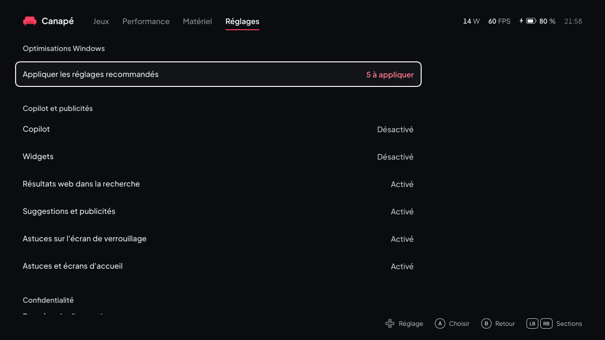

Ouverte depuis **Réglages → Optimisations Windows** ; **B** y revient. Une liste de réglages de Windows 11 utiles sur une console portable, groupés par thème. Haut et bas changent de ligne, **A** active ou rétablit le réglage. La valeur à droite est l'état de la fonction de Windows (« Copilot : Désactivé », « Mode Jeu : Activé ») ; l'écran se met à jour après chaque changement.

> [!WARNING]
> **Pas encore essayé sur l'Ally.** Tout a été testé avec le simulateur seulement. Les réglages touchent Windows lui-même : essayez-les d'abord un par un.

- **Appliquer les réglages recommandés** : applique d'un coup ceux marqués « oui » dans la colonne *Recommandé* ci-dessous (jamais la protection en temps réel, l'intégrité de la mémoire ni les applis en arrière-plan). Un second **A** confirme, car l'ensemble comprend les exclusions Defender.
- Les lignes qui baissent la protection de l'appareil, et le retrait d'une application, demandent **un second A** : la valeur devient « Appuyez encore sur A » et la conséquence s'affiche en jaune ; changer de ligne annule.
- **Tout est réversible** : Canapé note ce que chaque valeur valait avant de la changer (dans `%ProgramData%\Canape\state.json`) et la remet telle quelle quand vous rétablissez le réglage. Un réglage déjà en place avant Canapé s'affiche comme appliqué ; le rétablir remet la valeur par défaut de Windows.
- Les réglages par utilisateur s'appliquent au compte connecté à l'écran.

| Thème | Ligne | Effet | Recommandé | Redémarrage |
|---|---|---|---|---|
| Copilot et publicités | **Copilot** | Stratégie « Désactiver Windows Copilot » (ordinateur et utilisateur) et bouton de la barre des tâches masqué. Sur Windows 11 24H2, l'application Copilot se retire en plus dans *Applications préinstallées*. | oui | non |
| | **Widgets** | Stratégie « Autoriser les widgets » désactivée (tableau des widgets et son bouton). | oui | non |
| | **Résultats web dans la recherche** | Plus de résultats Bing ni de « points forts de la recherche » dans la recherche du menu Démarrer. | oui | non |
| | **Suggestions et publicités** | Plus d'applications suggérées dans Démarrer et Paramètres, plus d'installation silencieuse d'applications mises en avant, plus de recommandations ni de notifications de compte dans Démarrer, plus de publicités du fournisseur de synchronisation dans l'Explorateur, identifiant de publicité désactivé. | oui | non |
| | **Astuces sur l'écran de verrouillage** | Plus d'anecdotes ni d'astuces sur l'image de l'écran de verrouillage. | oui | non |
| | **Astuces et écrans d'accueil** | Plus de notifications d'astuces, d'« expérience de bienvenue » après les mises à jour, ni d'écran « Terminer la configuration de l'appareil ». | oui | non |
| Confidentialité | **Données de diagnostic** | Niveau le plus bas permis par l'édition (les éditions Famille et Professionnel restent au niveau « obligatoire »), pas d'expériences personnalisées, pas de demandes de commentaires. | oui | non |
| | **Applis du Store en arrière-plan** | Les applications du Store ne tournent plus en arrière-plan, sauf Xbox, la Game Bar, Gaming Services, le Store, Sécurité Windows et le widget Canapé. Peut retarder les notifications d'autres applications du Store. | non | non |
| Jeux | **Mode Jeu** | Le mode Jeu de Windows activé. | oui | non |
| | **Planification GPU à accélération matérielle** | Activée (« Redémarrez Windows pour appliquer » tant que ce n'est pas fait). | oui | **oui** |
| | **Optimisations pour les jeux fenêtrés** | Activées pour les jeux DirectX 10 et 11 en fenêtre ou sans bordure ; les autres réglages graphiques de Windows sont gardés. | oui | non |
| | **Enregistrement des jeux en arrière-plan** | Enregistrement en arrière-plan de Game DVR désactivé (`GameDVR_Enabled` et `AppCaptureEnabled`, pour votre compte). La Game Bar reste disponible, donc le widget Canapé continue de fonctionner : la stratégie `AllowGameDVR` n'est pas utilisée, car elle retire aussi la Game Bar. Pas encore essayé sur l'Ally. | oui | non |
| | **Services ASUS** | Arrête et désactive les services d'arrière-plan d'Armoury Crate et d'ASUS qui sont installés (`ArmouryCrateService`, `AsusAppService`, `ASUSOptimization`, `ASUSSoftwareManager`, `ASUSSwitch`, `ASUSSystemAnalysis`, `ASUSSystemDiagnosis`, `asus_framework`, `LightingService`, `AsusCertService`), après avoir noté comment chacun démarrait ; le rétablir les remet comme avant et relance ceux qui tournaient. **Armoury Crate ne fonctionne plus.** Le pilote ATK que Canapé utilise n'est pas touché. La ligne indique le nombre de services trouvés, et « Indisponible » s'il n'y en a aucun. **La liste est à confirmer sur l'Ally** ; pas encore essayé. | non | non |
| Sécurité | **Exclure les dossiers de jeux des analyses Defender** | Ajoute aux exclusions de Microsoft Defender les dossiers de jeux trouvés : `steamapps\common` de chaque bibliothèque Steam, les dossiers qui contiennent des jeux Epic ou GOG, et `Games` à la racine des lecteurs (le dossier de Canapé par défaut). Jamais une racine de lecteur, Windows, Program Files ni un dossier de profil. La ligne affiche le nombre de dossiers. Le rétablir retire seulement les exclusions ajoutées par Canapé. | oui | non |
| | **Protection en temps réel de Defender** | La désactive. **L'appareil n'est plus protégé contre les virus.** Windows refuse tant que la *protection contre les falsifications* est active : la ligne affiche alors « Indisponible » et dit de la couper d'abord dans **Sécurité Windows → Protection contre les virus et menaces → Gérer les paramètres**. Windows peut la réactiver de lui-même. | non | non |
| | **Intégrité de la mémoire** | Désactive l'intégrité de la mémoire (HVCI) et la sécurité basée sur la virtualisation : un peu plus de performances en jeu, **moins de protection contre les pilotes malveillants**. « Indisponible » si le firmware ou une stratégie la verrouille. | non | **oui** |

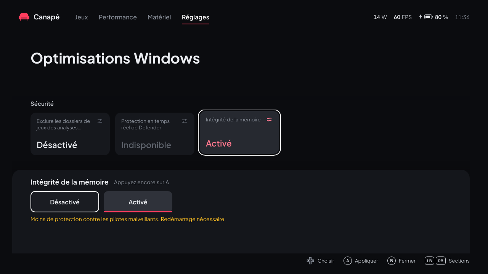

**Applications préinstallées** : les applications de Windows sans intérêt sur une console (Copilot, Clipchamp, Actualités, Météo, Bing Search, Obtenir de l'aide, Astuces, Hub de commentaires, Microsoft Solitaire Collection, Microsoft To Do, Teams, Outlook, Courrier et calendrier, Contacts, Cartes, Power Automate, Pense-bêtes, Microsoft 365, Mobile connecté, Family, Assistance rapide, Dev Home, Films et TV, LinkedIn, Spotify, Disney+, Enregistreur audio, Calculatrice, Photos). Seules celles qui sont installées s'affichent. **A** puis **A** retire l'application **pour votre compte seulement** ; « Réinstaller » ouvre sa page dans le Microsoft Store. La Xbox, la Game Bar (où vit le widget Canapé) et ce dont elles dépendent, Gaming Services, le Store, Edge, WebView2 et Sécurité Windows ne sont jamais proposés. Canapé ne les retire pas pour les futurs comptes.

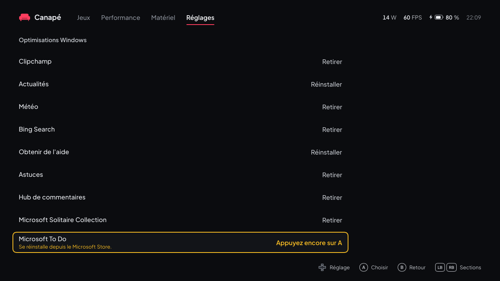

## Le widget Xbox Game Bar


<sub>Sur l'Ally, en jeu (Among Us).</sub>

Le widget donne les réglages rapides sans quitter le jeu. Toute la logique reste dans le service : le widget n'est qu'une télécommande.

**Installer** (une fois, puis à chaque mise à jour du widget) :

1. Ajouter le workload UWP aux Build Tools (Terminal administrateur, plusieurs Go) :
   ```powershell
   $vs = & "${env:ProgramFiles(x86)}\Microsoft Visual Studio\Installer\vswhere.exe" -latest -products * -property installationPath
   & "${env:ProgramFiles(x86)}\Microsoft Visual Studio\Installer\setup.exe" modify --installPath $vs `
       --add Microsoft.VisualStudio.Workload.UniversalBuildTools --includeRecommended --quiet --norestart
   ```
2. Compiler, signer et installer (sans droits administrateur ; le certificat d'`install-dev.ps1` doit exister) :
   ```powershell
   powershell -ExecutionPolicy Bypass -File packaging\build-widget.ps1
   ```

**Ouvrir** : Game Bar (Win+G ou bouton Xbox) → menu **Widgets** → **Canapé**. Vous pouvez l'épingler pour le garder au-dessus du jeu.

**Contenu** : en haut, ce qui reste visible ; en dessous, deux onglets, **Puissance** et **Matériel**. À l'ouverture et à chaque changement d'onglet, les lignes entrent une à une de gauche à droite, comme le titre sur la page Jeux du shell.

| Zone | Détail |
|---|---|
| En-tête | Le jeu au premier plan (sans `.exe`) et la pastille « profil du jeu » quand son profil s'applique ; sinon l'état de la connexion (« Connexion… », « Service non connecté »). |
| Chiffres | La consommation (une décimale), les images par seconde et la température CPU (« Bridé » en ambre quand la limite de température retient la puissance). |
| Graphe | La dernière minute : la consommation en couleur d'accent, la limite en pointillés gris. |
| Banc d'essai | Palier, puissance et temps restant pendant un banc d'essai (lancé depuis le shell). |
| Onglet **Puissance** | Mode (Silencieux, Performance, Turbo, Auto ; la tuile choisie est blanche, un mode firmware coupe l'auto TDP). La valeur ‹ › : en auto TDP l'**objectif** (30 à 120 FPS), sinon la **limite de puissance** ±1 W, grisée en mode firmware et bornée par la plage du modèle. La plage de puissance sur l'échelle du modèle, avec la consommation du moment (lecture seule). |
| Onglet **Matériel** | Ventilateurs : Auto (la courbe du firmware), Équilibré, Maximum ; « Courbes personnalisées » quand d'autres courbes sont en place. La limite de FPS ‹ › (Aucune, 30 à 120). La manette : Manette, Clavier, Souris. La limite de charge de la batterie ‹ › (60, 80, 100 % ; « — » tant que Canapé ne l'a pas réglée, pas encore essayé sur l'Ally). |
| Pied, toujours visible | **Enregistrer pour ce jeu** : l'onglet affiché dans le profil du jeu au premier plan (Puissance : l'auto TDP actuel ; Matériel : ventilateurs et limite de FPS ; le reste du profil est gardé). **Ouvrir Canapé**, qui ramène le shell devant. |

Le widget n'a ni bouton de banc d'essai, ni liste des profils, ni réglage de la plage de puissance ou de la fréquence de l'écran : ces actions restent dans le shell. Son panneau suit le réglage de transparence de la Game Bar, et le widget suit la couleur d'accent choisie dans le shell. Taille par défaut 400 × 600, redimensionnable.

> [!NOTE]
> La **première version** du widget a été validée sur l'Ally (M3) via Win+G sur le bureau. La version à deux onglets a été validée sur l'Ally le 25 octobre 2026 dans la Game Bar : onglets, ventilateurs, limite de FPS, manette, « Enregistrer pour ce jeu », et **Ouvrir Canapé**, qui ramène le shell devant le jeu. Ce dernier passe par le protocole `canape://` du paquet d'identité : après une mise à jour, réinstaller le paquet (`install-dev.ps1`) pour qu'il existe.

## Langues

Canapé est traduit en 13 langues :

| Langue | Shell | Widget |
|---|---|---|
| English | `en` (langue source) | `en-US` (repli par défaut) |
| Français | `fr` | `fr-FR` |
| Español | `es` | `es-ES` |
| Deutsch | `de` | `de-DE` |
| Italiano | `it` | `it-IT` |
| Português | `pt` | `pt-BR` |
| Nederlands | `nl` | `nl-NL` |
| Polski | `pl` | `pl-PL` |
| Русский | `ru` | `ru-RU` |
| Türkçe | `tr` | `tr-TR` |
| 日本語 | `ja` | `ja-JP` |
| 한국어 | `ko` | `ko-KR` |
| 简体中文 | `zh_CN` | `zh-Hans` |


- **Shell, mode Automatique** (par défaut) : la première langue de la liste des langues préférées de Windows qui est fournie, sinon l'anglais. Toute variante du chinois affiche le chinois simplifié.
- **Shell, choix manuel** : page **Réglages → Langue**. Le choix est enregistré dans `%LOCALAPPDATA%\Canape\shell.json` et appliqué tout de suite.
- **Widget** : il suit toujours la liste des langues préférées de Windows (Paramètres → Heure et langue → Langue) ; relancez la Game Bar après un changement.
- Les messages d'erreur renvoyés par le service restent en anglais, précédés d'un texte traduit.


Ces programmes écrivent les mêmes limites de puissance dans le firmware, et certains aussi les courbes de ventilateurs, la limite de FPS du pilote ou le mode de la manette : si deux d'entre eux tournent, le dernier qui écrit gagne, et l'auto TDP ou le préréglage de ventilateurs de Canapé peuvent être annulés sans prévenir.

Toutes les 5 secondes, le service cherche ces processus et affiche un avertissement jaune dans le shell (et dans le widget) :

| Programme | Processus détecté |
|---|---|
| Armoury Crate | `ArmouryCrate.Service.exe` |

Que faire :

- **Armoury Crate** : arrêtez ses services (`services.msc`) ou désactivez-le.
  ```powershell
  ```

Les autres services ASUS (ASUS Optimization, System Analysis, ROG Live Service) et RTSS ne sont pas signalés : à notre connaissance, ils n'écrivent pas les limites de puissance.

## Dépannage

### Fichiers et journaux

| Fichier | Contenu |
|---|---|
| `%ProgramData%\Canape\service.log` | Journal du service : modèle détecté, état d'ADL au démarrage, chaque commande qui modifie l'état et sa réponse (`SetTdp { watts: 12 } -> Ok`), programmes en conflit, erreurs. |
| `%ProgramData%\Canape\state.json` | Dernier état appliqué, réappliqué au démarrage du service : mode, TDP, auto TDP, courbes de ventilateurs, limite de FPS, limite de charge, mode de la manette, boutons arrière, éclairage des sticks, profils, dernier banc d'essai. |
| `%LOCALAPPDATA%\Canape\shell.log` | Journal du shell : démarrages (avec leurs arguments), langue choisie, état d'ADL, erreurs du service. |
| `%LOCALAPPDATA%\Canape\shell.json` | Préférences du shell : `language`, `accent`, `online_covers`, `steamgriddb_key`, `steam_api_key`, `igdb_client_id`, `igdb_client_secret`, `refresh_hz`, `ally_buttons`, `games_folder`, et pour la [visite du premier lancement](#premier-lancement) `onboarded` (terminée ou remise à plus tard) et `onboarding_step` (l'étape où revenir). |
| `%LOCALAPPDATA%\Canape\games.json` | Les jeux ajoutés à la main ou depuis **Réglages → Ajouter un jeu** (voir [Ajouter d'autres jeux](#ajouter-dautres-jeux)). |
| `%LOCALAPPDATA%\Canape\covers\` | Jaquettes téléchargées (`<boutique>_<id>.jpg` / `.png`, marqueurs `.miss`). |
| `%LOCALAPPDATA%\Canape\library.json` | Les jeux de la dernière recherche, affichés tout de suite au démarrage suivant. Peut être supprimé : la recherche suivante le réécrit. |
| `%LOCALAPPDATA%\Canape\recent.json` | Quand chaque jeu a été lancé depuis Canapé pour la dernière fois (pour l'ordre « Récents »). |
| `%LOCALAPPDATA%\Canape\overrides.json` | Vos modifications des jeux, par identifiant : titres, catégories, jeux masqués (voir [Options d'un jeu](#options-dun-jeu)). Le supprimer les annule toutes. |
| `%LOCALAPPDATA%\Canape\igdb.json` | Durées de jeu demandées à IGDB, par jeu, avec leur date. `igdb-token.json` à côté : le jeton Twitch en cours. Les deux peuvent être supprimés. |
| `%LOCALAPPDATA%\Canape\achievements.json` | Succès Steam par jeu, avec leur date et leur langue ; `achievement-icons\` à côté : leurs icônes téléchargées. Les deux peuvent être supprimés. |
| `%LOCALAPPDATA%\Canape\owned.json` | Les jeux possédés de la dernière demande à Steam et à Epic, affichés tout de suite en mode À installer. Peut être supprimé : la demande suivante le réécrit. |
| `%LOCALAPPDATA%\Canape\tools\` | `legendary.exe`, téléchargé à la première connexion Epic. Sans lui, Canapé ne liste plus les jeux Epic possédés ni ceux installés par Legendary ; la prochaine connexion Epic le télécharge de nouveau. |
| `%USERPROFILE%\.config\legendary\` | Configuration de Legendary, écrite par Legendary lui-même : connexion Epic, jeux qu'il a installés (`installed.json`). |

Chaque ligne commence par l'heure en secondes Unix.

### `canape-ctl` : parler au service

`canape-ctl` envoie une requête JSON au service et affiche la réponse ; `watch` affiche le statut chaque seconde.

```powershell
$ctl = "C:\Program Files\Canape\canape-ctl.exe"
& $ctl watch
```

> [!WARNING]
> **Windows PowerShell 5.1** (celui de l'Ally) perd les guillemets doubles d'un argument passé à un `.exe`. Il faut les échapper avec `\"` :
> ```powershell
> & $ctl '{\"type\":\"set_tdp\",\"watts\":12}'
> ```

Exemples (écrits ici sous forme lisible ; échappez les guillemets dans PowerShell 5.1) :

| Requête | Effet |
|---|---|
| `{"type":"get_status"}` | Statut complet une fois |
| `{"type":"set_performance_mode","mode":"turbo"}` | Mode `silent`, `performance`, `turbo` ou `manual` |
| `{"type":"set_tdp","watts":12}` | TDP manuel (désactive l'auto TDP) |
| `{"type":"set_auto_tdp","settings":{"enabled":true,"target_fps":60,"min_watts":7,"max_watts":25}}` | Auto TDP |
| `{"type":"set_battery_charge_limit","percent":80}` | Limite de charge de la batterie (40 à 100 %) |
| `{"type":"reset_fan_curves"}` | Ventilateurs rendus aux courbes du firmware (Automatique) |
| `{"type":"set_fps_limit","fps":null}` | Retire la limite de FPS (ou `"fps":40` pour une limite, de 30 à 120) |
| `{"type":"set_controller_mode","mode":"gamepad"}` | Manette remise en mode manette de jeu (`wasd`, `mouse`) |
| `{"type":"set_gyro","settings":{"activation":"off"}}` | Visée au gyroscope coupée (`hold`, `toggle`, `always` ; autres champs : `sensitivity`, `horizontal` `yaw` ou `roll`, `invert_y`) |
| `{"type":"reset_back_buttons"}` | M1 et M2 rendus à leurs propres touches |
| `{"type":"set_lighting","lighting":null}` | Anneaux des sticks laissés à la manette (de retour au prochain redémarrage) |
| `{"type":"list_profiles"}` | Profils enregistrés |
| `{"type":"get_bench_report"}` | Dernier banc d'essai |
| `{"type":"cancel_bench"}` | Annule le banc d'essai en cours |

Le code de sortie vaut 0 si le service a répondu sans erreur, 1 sinon. La liste complète des requêtes est dans le [guide du développeur](developer-guide.fr.md#protocole-ipc).

### Problèmes courants

| Symptôme | Cause probable et solution |
|---|---|
| « Service non connecté » en bas du shell, « Hors ligne » en haut | Le service ne tourne pas : `Get-Service CanapeService`, puis `Start-Service CanapeService` (administrateur). Regardez `service.log`. |
| Le widget affiche « Service non connecté » et « Le service Canapé n'est pas lancé. » | Même cause : le pipe `\\.\pipe\canape` n'existe pas. |
| Les FPS restent à « — » en jeu | Le pilote AMD ne compte les images qu'une fois activé depuis la session utilisateur : c'est le shell qui le fait à son démarrage (ligne `adl: frame metrics started` dans `shell.log`). Lancez Canapé au moins une fois après le démarrage. Limite connue : un jeu en plein écran réduit puis resté caché derrière Canapé une quarantaine de secondes perd ses FPS jusqu'à ce qu'on le relance. |
| Le TDP affiche « Auto » et −/+ sont grisés | Un mode firmware (Silencieux, Performance, Turbo) est actif : le firmware ne communique pas ses limites. Choisissez **Manuel**. |
| L'auto TDP ne bouge pas | Il n'agit que si un jeu tourne : au moins 5 FPS **et** au moins 15 % d'activité GPU. Sur le bureau ou dans un menu immobile, il garde la valeur actuelle. |
| La puissance change toute seule | Un autre outil pilote le matériel (avertissement jaune), ou un profil de jeu vient de s'appliquer (« <jeu> · profil du jeu » en haut de la page Performance). |
| Les ventilateurs ou la limite de FPS changent tout seuls | Un profil de jeu avec ses propres ventilateurs ou sa propre limite vient de s'appliquer ou de se terminer, ou un autre outil les a réécrits (avertissement jaune). |
| « Erreur du service : GPU driver refused: ADL2_FPS_Settings_Set… (session 0) » sur la limite de FPS | Le pilote AMD refuse la limite depuis le service. Ce cas n'a pas encore été essayé : notez le message (il figure aussi dans `service.log`) et signalez-le. |
| La manette ne fait plus bouger dans Canapé après avoir choisi Clavier ou Souris | Normal : la manette ne se comporte plus comme une manette Xbox. Touchez **Manette de jeu** sur l'écran, ou envoyez `{"type":"set_controller_mode","mode":"gamepad"}` avec `canape-ctl`. |
| La liste À installer reste vide, ou il y manque une boutique | Steam : clé absente ou refusée, ou aucun compte dans `loginusers.vdf` ; Epic : pas de connexion. Ces erreurs ne s'affichent pas dans la bibliothèque : cherchez `library: Steam owned games` ou `library: Epic` dans `shell.log`. Relancez Canapé (ou reconnectez-vous à Epic) pour redemander la liste tout de suite. |
| Canapé n'est pas proposé dans Paramètres → Jeux | Relancez `install-dev.ps1 -SetAsHomeApp`. Vérifiez que le paquet est installé : `Get-AppxPackage -Name Canape`. |
| `Developer Mode is off` | Activez le mode développeur (voir [plus haut](#1-activer-le-mode-développeur)). |
| `makeappx.exe not found` | Installez le Windows SDK avec les Build Tools. |
| `cargo build` échoue avec `os error 4551` | **Smart App Control** bloque un build script non signé. Relancez (ça passe parfois), utilisez `-BuildProfile debug`, ou installez les [binaires de la CI](#utiliser-les-binaires-de-la-ci). Désactiver Smart App Control (Sécurité Windows → Contrôle des applications et du navigateur) règle le problème mais ne se réactive pas facilement. |
| `canape-ctl` répond `invalid message` | Guillemets perdus par PowerShell 5.1 : échappez-les (voir ci-dessus). |

Pour repartir de zéro côté réglages : arrêtez le service, supprimez `%ProgramData%\Canape\state.json`, relancez le service. Les profils et le dernier banc d'essai sont alors perdus.

## Désinstaller

1. **Choisir un autre accueil** dans Paramètres → Jeux → Expérience plein écran (voir [Revenir à Winhanced ou à l'app Xbox](#revenir-à-winhanced-ou-à-lapp-xbox)).
2. Dans un **Terminal administrateur**, à la racine du dépôt :
   ```powershell
   powershell -ExecutionPolicy Bypass -File packaging\uninstall-dev.ps1
   ```

| Étape | Ce que fait le script |
|---|---|
| 1/6 | Tant que le service tourne, remet le matériel au neutre : ventilateurs sur les courbes du firmware (**Automatique**), pas de limite de FPS, manette en mode **Manette de jeu**, et limite de charge à 100 % si Canapé en avait réglé une. Rétablit aussi les [optimisations Windows](#optimisations-windows) appliquées par Canapé (chaque valeur remise comme avant, services ASUS compris) et les réglages du processeur du mode d'alimentation et liste les applications retirées, à réinstaller depuis le Microsoft Store si besoin. Une fois le service parti, plus rien ne les annulerait. Si le service ne tourne pas, il le signale et continue. |
| 2/6 | Ferme le shell, arrête et supprime le service `CanapeService`. |
| 3/6 | Retire le paquet d'identité du shell (`Canape`) et celui du widget (`Canape.Widget`). |
| 4/6 | Efface la valeur d'accueil du FSE (`GamingHomeApp`) si elle désigne encore Canapé. |
| 5/6 | Supprime `C:\Program Files\Canape`. |
| 6/6 | Garde vos données sauf demande contraire (voir les options). |

| Option | Effet |
|---|---|
| `-RemoveData` | Supprime aussi `%ProgramData%\Canape` (réglages, profils, dernier banc d'essai, journal du service) et `%LOCALAPPDATA%\Canape` (réglages du shell, cache de la bibliothèque, Legendary téléchargé, journal du shell). |
| `-RemoveCertificate` | Retire aussi le certificat de développement `CN=Canape Dev` et `$HOME\dev\canape-cert`. Gardez-le si vous réinstallez : `build-widget.ps1` en a besoin. |
| `-InstallDir`, `-CertDir` | Les mêmes que pour `install-dev.ps1`, si vous les avez changés. |

> [!NOTE]
> Le script n'a **pas encore été essayé sur l'Ally**. Si une étape échoue, les commandes qu'il lance sont dans `packaging\uninstall-dev.ps1` et peuvent se taper à la main.

Les jeux installés depuis Canapé restent sur le disque, et la configuration de Legendary (connexion Epic comprise) reste dans `%USERPROFILE%\.config\legendary`.

