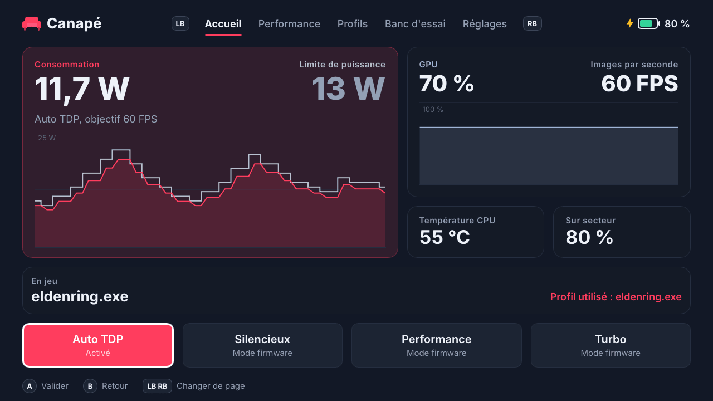

# Guide d'utilisation de Canapé

[🇬🇧 English version](user-guide.en.md) · [📚 Index de la documentation](README.md)

Ce guide explique comment installer Canapé sur une ROG Ally, en faire l'accueil de l'expérience plein écran (FSE), l'utiliser à la manette, ajouter le widget Xbox Game Bar, puis dépanner et désinstaller.

> [!IMPORTANT]
> Canapé est un projet personnel en cours de développement. Ce qui a été **validé sur l'Ally** : l'installation, le démarrage en FSE, le service, les modes, le TDP manuel, l'auto TDP (version `99cad07`) et la première version du widget. Ce qui est **écrit et testé sans matériel, mais pas encore essayé sur l'Ally** : le shell à cinq pages en 13 langues, les profils par jeu, le banc d'essai, les dernières optimisations de l'auto TDP et la nouvelle version du widget. Les sections concernées le signalent.

## Sommaire

- [Prérequis](#prérequis)
- [Installer Canapé](#installer-canapé)
  - [1. Activer le mode développeur](#1-activer-le-mode-développeur)
  - [2. Lancer `install-dev.ps1`](#2-lancer-install-devps1)
  - [Options du script](#options-du-script)
  - [Utiliser les binaires de la CI](#utiliser-les-binaires-de-la-ci)
  - [Vérifier l'installation](#vérifier-linstallation)
- [Faire de Canapé l'accueil du FSE](#faire-de-canapé-laccueil-du-fse)
  - [Revenir à Winhanced ou à l'app Xbox](#revenir-à-winhanced-ou-à-lapp-xbox)
- [Utiliser Canapé à la manette](#utiliser-canapé-à-la-manette)
  - [Commandes](#commandes)
  - [Éléments communs](#éléments-communs)
  - [Accueil](#accueil)
  - [Performance](#performance)
  - [Profils](#profils)
  - [Banc d'essai](#banc-dessai)
  - [Réglages](#réglages)
- [Le widget Xbox Game Bar](#le-widget-xbox-game-bar)
- [Langues](#langues)
- [Dépannage](#dépannage)
- [Désinstaller](#désinstaller)

## Prérequis

| Élément | Détail |
|---|---|
| Console | **ROG Ally RC71L** (seul modèle testé). Les ROG Ally X (RC72LA), ROG Xbox Ally (RC73YA) et ROG Xbox Ally X (RC73XA) sont reconnus par le code mais n'ont jamais été essayés. |
| Windows | Windows 11 **24H2 ou plus récent** (le paquet d'identité exige la version 10.0.26100). |
| Outils | **Visual Studio Build Tools 2022** avec les outils C++ et le **Windows SDK** (fournit `makeappx` et `signtool`, utilisés même avec des binaires précompilés). **Rust** (toolchain MSVC) si vous compilez sur l'Ally. **Git** pour récupérer le dépôt. |
| Droits | Un Terminal **administrateur** pour l'installation (service Windows et certificat). |
| Optionnel | [GitHub CLI](https://cli.github.com/) (`gh`) pour télécharger les binaires de la CI ; le workload **UWP** des Build Tools pour le widget. |

> [!WARNING]

## Installer Canapé

### 1. Activer le mode développeur

Paramètres → Système → Avancé → **Pour les développeurs** → Mode développeur : activé.

Le script d'installation s'arrête avec `Developer Mode is off` si ce n'est pas fait (il lit `HKLM\SOFTWARE\Microsoft\Windows\CurrentVersion\AppModelUnlock\AllowDevelopmentWithoutDevLicense`).

### 2. Lancer `install-dev.ps1`

Dans un **Terminal administrateur**, à la racine du dépôt cloné :

```powershell
powershell -ExecutionPolicy Bypass -File packaging\install-dev.ps1
```

Le script fait six étapes :

| Étape | Ce qui se passe |
|---|---|
| 1/6 | Compile `canape-shell`, `canape-service` et `canape-ctl` (release par défaut), ou prend des binaires déjà compilés (`-BinariesDir`). |
| 2/6 | Arrête et désinstalle le service s'il existe, ferme le shell, copie les trois `.exe` et `CustomCapability.SCCD` dans `C:\Program Files\Canape`. |
| 3/6 | Installe et démarre le service Windows **`CanapeService`** (démarrage automatique, compte LocalSystem, redémarrage automatique en cas de plantage). |
| 4/6 | Crée au premier passage un certificat de développement `CN=Canape Dev` dans `$HOME\dev\canape-cert` et l'ajoute à `LocalMachine\TrustedPeople`. |
| 5/6 | Empaquette et signe le paquet d'identité `Canape.Identity.msix`. |
| 6/6 | Enregistre le paquet avec `Add-AppxPackage -ExternalLocation` : `canape-shell.exe` obtient l'identité `Canape_…!App` que le FSE sait lancer. |

À la fin, le script affiche la commande de test, la commande `canape-ctl watch` et l'emplacement des journaux.

> [!CAUTION]
> Ne commitez jamais le contenu de `$HOME\dev\canape-cert` (`.pfx`, `.cer`) : c'est la clé qui signe vos paquets.

Relancer le script plus tard met Canapé à jour : il remplace les binaires et réenregistre le service et le paquet. Vos réglages (`state.json`) sont conservés.

### Options du script

| Option | Par défaut | Rôle |
|---|---|---|
| `-InstallDir <dossier>` | `C:\Program Files\Canape` | Dossier d'installation des binaires. |
| `-CertDir <dossier>` | `$HOME\dev\canape-cert` | Où créer et réutiliser le certificat de développement (le widget s'en sert aussi). |
| `-BuildProfile release\|debug` | `release` | Profil Cargo. `debug` sert de secours quand Smart App Control bloque une compilation release (voir [Dépannage](#dépannage)). |
| `-BinariesDir <dossier>` | *(vide)* | Prend `canape-shell.exe`, `canape-service.exe` et `canape-ctl.exe` dans ce dossier au lieu de compiler. Pratique avec les binaires de la CI. |
| `-SetAsHomeApp` | désactivé | Écrit aussi `GamingHomeApp` dans le registre pour choisir Canapé comme accueil du FSE (voir plus bas). |

### Utiliser les binaires de la CI

GitHub Actions compile les binaires release sous Windows à chaque push et les publie dans l'artefact `canape-windows-x64`. Pas besoin de Rust sur l'Ally, ni de compiler sous Smart App Control :

```powershell
gh run download --repo pierregouedar/canape --name canape-windows-x64 --dir $HOME\dev\canape-bin
powershell -ExecutionPolicy Bypass -File packaging\install-dev.ps1 -BinariesDir $HOME\dev\canape-bin
```

Le Windows SDK reste nécessaire (empaquetage et signature du paquet d'identité), ainsi que le dépôt cloné (le script lit `packaging\identity`).

### Vérifier l'installation

1. **Le service** : `Get-Service CanapeService` doit afficher `Running`.
2. **La télémétrie** : `& "C:\Program Files\Canape\canape-ctl.exe" watch` affiche un statut JSON par seconde (Ctrl+C pour sortir).
3. **Le shell hors FSE** : lancez la commande affichée par le script, par exemple :
   ```powershell
   explorer.exe shell:AppsFolder\Canape_84zrj1c9kn010!App
   ```
   La partie après `Canape_` dépend de votre certificat ; le script affiche la bonne valeur (`Registered …`).

## Faire de Canapé l'accueil du FSE

1. Ouvrez **Paramètres → Jeux → Expérience plein écran**.
2. Choisissez **Canapé** comme application d'accueil.
3. Activez le démarrage dans l'expérience plein écran si vous voulez que la console démarre directement sur Canapé.
4. Redémarrez : Windows lance `canape-shell.exe` avec l'argument `windows.gaming:///home`.

Si Canapé n'apparaît pas dans la liste, relancez le script avec `-SetAsHomeApp`. Il écrit la valeur non documentée `HKCU\Software\Microsoft\Windows\CurrentVersion\GamingConfiguration\GamingHomeApp = <PFN>!App` que le FSE lit pour savoir quelle app lancer.

> [!NOTE]
> Le démarrage en FSE a été validé sur l'Ally en M1 et M2 (une seule activation au boot, service déjà prêt). Il n'a pas été retesté depuis, car rien n'a changé côté démarrage.

### Revenir à Winhanced ou à l'app Xbox

Choisissez simplement l'autre application dans **Paramètres → Jeux → Expérience plein écran**. Canapé reste installé et peut être resélectionné à tout moment.

Pour le faire en ligne de commande, remettez l'ancienne valeur de `GamingHomeApp`. Par exemple pour Winhanced :

```powershell
Set-ItemProperty "HKCU:\Software\Microsoft\Windows\CurrentVersion\GamingConfiguration" -Name GamingHomeApp -Value "Winhanced_2wdva71107yvr!App"
```


## Utiliser Canapé à la manette

> [!NOTE]
> Le shell à cinq pages décrit ici n'a pas encore été essayé sur l'Ally : seules sa version précédente (une page) et la navigation à la manette ont été validées. Les captures sont rendues sous Linux avec le simulateur matériel et des valeurs fictives ; quelques textes peuvent différer légèrement de la version actuelle.

### Commandes

| Bouton | Action |
|---|---|
| **LB / RB** | Page précédente / suivante (Accueil → Performance → Profils → Banc d'essai → Réglages, en boucle) |
| **Croix** ou **stick gauche** | Passer au contrôle suivant (bas, droite) ou précédent (haut, gauche). Maintenu, le déplacement se répète après 0,4 s. |
| **A** | Valider le contrôle sélectionné |
| **B** | Revenir à l'Accueil |

La manette n'est lue que lorsque Canapé est au premier plan : un jeu lancé depuis Canapé garde toute la manette. Le contrôle sélectionné est entouré de blanc. Au clavier (développement), les mêmes actions passent par Tab / Maj+Tab, Entrée, Échap et Page préc. / Page suiv.

### Éléments communs

- **En haut** : les onglets (l'onglet courant est souligné de la couleur d'accent), la batterie (avec un éclair sur secteur) et la mention « Hors ligne » quand le service ne répond pas.
- **En bas** : les aides de la manette et, à droite, le résultat de la dernière commande (« Profil enregistré », « Service injoignable », « Erreur du service : … »). Les messages d'erreur du service restent en anglais.
- Une valeur inconnue s'affiche « — » (par exemple les FPS quand aucun jeu ne tourne).

### Accueil



| Zone | Contenu |
|---|---|
| **Consommation et limite de puissance** | À gauche, ce que l'APU consomme réellement ; à droite, la limite appliquée (« Auto » quand un mode firmware choisit lui-même ses limites, ou « — »). En dessous : « Auto TDP, objectif 60 FPS », « Fixée par le firmware : mode Turbo » ou « TDP manuel ». |
| **Graphe de puissance** | La dernière minute, un point par seconde : la consommation (courbe pleine, couleur d'accent) sous la limite (ligne claire en escalier). L'échelle s'adapte par pas de 5 W. Un trou dans la courbe signale une coupure avec le service. |
| **États** | « Limite thermique atteinte » (jaune) quand la limite de température retient la puissance, « Banc d'essai en cours ». |
| **GPU et images par seconde** | L'activité GPU avec son graphe de la dernière minute (0 à 100 %), et les FPS du jeu. |
| **Tuiles** | Température CPU (jaune dès 80 °C, rouge dès 90 °C), batterie (« Sur batterie » ou « Sur secteur »). |
| **En jeu** | Le programme au premier plan détecté par Canapé et le profil utilisé, s'il y en a un. |
| **Raccourcis** | Auto TDP (activé / désactivé), Silencieux, Performance, Turbo. |
| **Avertissement jaune** | Apparaît en haut si un autre programme pilote aussi le matériel. |

### Performance


<sub>La même page en russe : [ru/performance.png](images/ru/performance.png).</sub>

**Mode de puissance**

| Tuile | Effet |
|---|---|
| Silencieux | Mode firmware ASUS silencieux. Le firmware fixe ses limites, que Canapé ne peut pas lire : le TDP s'affiche « Auto ». |
| Performance | Mode firmware équilibré. |
| Turbo | Mode firmware turbo. |
| Manuel | Limite manuelle : garde la puissance actuelle si elle est connue, sinon part de **15 W**. |

Choisir un mode firmware désactive l'auto TDP.

**TDP manuel** : − / + changent la limite de 1 W. Les boutons sont grisés dans un mode firmware (« Choisissez Manuel pour régler la puissance vous-même »). Changer le TDP à la main désactive l'auto TDP.

**Auto TDP**

| Contrôle | Effet |
|---|---|
| Activé / Désactivé | Allume ou éteint l'auto TDP. |
| Objectif d'images par seconde | 30, 40, 45, 60, 90 ou 120. Choisir un objectif **allume aussi** l'auto TDP. |
| Puissance minimale / maximale | − / + par pas de 1 W. Le minimum ne peut pas dépasser le maximum. L'interface accepte 5 à 35 W ; le service se limite à la plage du modèle (5 à 30 W sur la ROG Ally). |
| Maximum sur batterie | Aucune, 10, 15 ou 20 W : plafond appliqué seulement sur batterie. |
| Limite de température | Aucune, 80, 85 ou 90 °C : au-delà, la puissance ne fait que baisser. |

À droite, le même graphe que sur l'Accueil montre en direct la consommation face à la limite : on y voit l'auto TDP descendre ou remonter la puissance.

Le fonctionnement détaillé est dans [Auto TDP et banc d'essai](auto-tdp.fr.md).

> [!TIP]
> Quand un profil de jeu est actif, ces réglages modifient **le profil**, pas les réglages généraux.

### Profils


Un profil associe un exécutable (par exemple `eldenring.exe`) à des réglages d'auto TDP. Quand ce programme passe au premier plan, le service applique le profil ; quand il le quitte, les réglages généraux reviennent.

- **Jeu en cours** (à gauche) : le programme au premier plan, les réglages qui seront enregistrés (objectif, puissance, maximum sur batterie, limite de température) et le bouton **Enregistrer comme profil** (ou **Mettre à jour le profil**). Le bouton est grisé tant qu'aucun jeu n'est détecté.
  - Si l'auto TDP est actif, la puissance actuelle est aussi enregistrée comme **watts appris** : la prochaine session du jeu démarre directement à cette valeur.
- **Profils** (à droite) : la liste triée par nom, avec l'objectif, la plage de puissance et les watts appris. Le profil utilisé est surligné (« Utilisé »). **Supprimer** demande une confirmation : un premier appui sur A affiche « Confirmer », un second supprime. Quitter le bouton annule.

> [!NOTE]
> **Comment Canapé détecte le jeu** : le shell regarde toutes les 2 secondes quel programme a le premier plan et le signale au service (qui, en session 0, ne voit pas les fenêtres). L'Explorateur, la Game Bar, le menu Démarrer, le gestionnaire des tâches et Canapé lui-même sont ignorés : revenir dans Canapé ne « quitte » pas le jeu tant qu'il tourne. Tout autre programme compte comme un jeu (un navigateur aussi). Il faut donc que le shell tourne pour que les profils fonctionnent.

Les profils et les watts appris sont détaillés dans [Auto TDP et banc d'essai](auto-tdp.fr.md#profils-par-jeu).

### Banc d'essai


Le banc d'essai fait tourner le jeu au premier plan à plusieurs limites de puissance, de 25 W à 7 W, mesure chacune et propose la bonne valeur.

1. Lancez le jeu et laissez tourner une **scène exigeante et stable** (pas un menu).
2. Revenez dans Canapé (bouton Xbox ou Alt+Tab), page **Banc d'essai**.
3. Choisissez le **pas** (2, 3 ou 5 W) et la durée de mesure **par palier** (10, 15 ou 30 s). La durée totale s'affiche sous **Démarrer** (environ 2:20 avec 3 W et 15 s).
4. **Démarrer**, puis revenez au jeu. La limite change toute seule ; chaque palier attend 5 s avant de mesurer.


Pendant le banc d'essai, le mode, le TDP et l'auto TDP sont verrouillés (« a bench is running: cancel it first ») ; **Annuler** arrête le banc d'essai en gardant les paliers déjà mesurés. À la fin, ou à l'annulation, le service remet l'état d'avant.

**Résultats** : pour chaque palier, la puissance, les FPS moyens (avec une barre relative), les FPS minimum (la pire seconde), les FPS par watt et la température maximale. Le meilleur compromis est surligné. Trois recommandations suivent :

| Carte | Signification |
|---|---|
| **Meilleur compromis** | La plus petite puissance à moins de 5 % du meilleur résultat : au-delà, plus de watts n'apportent presque rien. |
| **Pour N FPS** | La plus petite puissance qui tient l'objectif actuel de l'auto TDP, en moyenne. « Objectif non atteint pendant cet essai » sinon. |
| **Le plus efficace** | Le plus d'images par watt : le réglage le plus économe en batterie. |

Chaque carte propose **Régler le TDP** (limite manuelle à cette valeur, auto TDP désactivé) et **Profil du jeu** (crée ou remplace le profil du jeu : auto TDP activé, objectif et plafond tirés de la mesure). Le calcul exact est dans [Auto TDP et banc d'essai](auto-tdp.fr.md#le-banc-dessai).

> [!NOTE]
> Le banc d'essai n'a pas encore été essayé sur l'Ally.

### Réglages


- **Langue** : « Automatique » (langue de Windows) ou l'une des 13 langues. Le changement est immédiat et mémorisé. Voir [Langues](#langues).
- **Couleur d'accent** : trois curseurs **Teinte**, **Saturation** et **Luminosité**, un aperçu avec le code `#RRGGBB` et 8 **préréglages**. À la manette, A sur un curseur le saisit, la croix ou le stick le déplace, A à nouveau le relâche. Toute l'interface suit en direct ; la couleur est enregistrée dans `shell.json` et envoyée au service une fois le réglage terminé, et **le widget de la Game Bar suit la couleur d'accent**.
- **Canapé** : version, état de la connexion au service, rappel des commandes de la manette.

| Accent sarcelle | Accent ambre |
|---|---|
|  |  |

<sub>Captures en anglais. Les mêmes réglages en allemand : [de/settings.png](images/de/settings.png).</sub>

## Le widget Xbox Game Bar

Le widget donne les réglages rapides sans quitter le jeu. Toute la logique reste dans le service : le widget n'est qu'une télécommande.

**Installer** (une fois, puis à chaque mise à jour du widget) :

1. Ajouter le workload UWP aux Build Tools (Terminal administrateur, plusieurs Go) :
   ```powershell
   $vs = & "${env:ProgramFiles(x86)}\Microsoft Visual Studio\Installer\vswhere.exe" -latest -products * -property installationPath
   & "${env:ProgramFiles(x86)}\Microsoft Visual Studio\Installer\setup.exe" modify --installPath $vs `
       --add Microsoft.VisualStudio.Workload.UniversalBuildTools --includeRecommended --quiet --norestart
   ```
2. Compiler, signer et installer (sans droits administrateur ; le certificat d'`install-dev.ps1` doit exister) :
   ```powershell
   powershell -ExecutionPolicy Bypass -File packaging\build-widget.ps1
   ```

**Ouvrir** : Game Bar (Win+G ou bouton Xbox) → menu **Widgets** → **Canapé**. Vous pouvez l'épingler pour le garder au-dessus du jeu.

**Contenu**

| Zone | Détail |
|---|---|
| En-tête | État de la connexion en texte (« Connexion… », « Service non connecté »), jeu au premier plan (sans `.exe`), « Profil » en couleur d'accent quand un profil est appliqué. |
| Tuiles | TDP, FPS, température (légende « Bridé » en jaune quand la limite de température retient la puissance), batterie (légende « Secteur » en vert sur le chargeur). |
| Banc d'essai | Palier, puissance et temps restant pendant un banc d'essai (lancé depuis le shell). |
| Modes | Silencieux, Performance, Turbo. |
| ±1 W | Actif seulement quand le TDP est connu ; grisé en mode firmware (« Fixé par le mode du firmware »). |
| Auto TDP | Activé / désactivé et objectif 30, 40 ou 60 FPS. Les autres réglages (minimum, maximum, batterie, température) sont conservés tels quels. |

Le widget n'a ni mode Manuel, ni bouton de banc d'essai, ni gestion des profils : ces actions restent dans le shell. Son panneau suit le réglage de transparence de la Game Bar, et le widget suit la couleur d'accent choisie dans le shell.

> [!NOTE]
> La **première version** du widget a été validée sur l'Ally (M3) via Win+G sur le bureau. La **version actuelle** (13 langues, nouveau style, ±1 W désactivé en mode firmware) n'a pas encore été compilée. L'ouverture depuis le bouton Xbox dans le FSE, avec Canapé comme accueil, n'a pas encore été testée.

## Langues

Canapé est traduit en 13 langues :

| Langue | Shell | Widget |
|---|---|---|
| English | `en` (langue source) | `en-US` (repli par défaut) |
| Français | `fr` | `fr-FR` |
| Español | `es` | `es-ES` |
| Deutsch | `de` | `de-DE` |
| Italiano | `it` | `it-IT` |
| Português | `pt` | `pt-BR` |
| Nederlands | `nl` | `nl-NL` |
| Polski | `pl` | `pl-PL` |
| Русский | `ru` | `ru-RU` |
| Türkçe | `tr` | `tr-TR` |
| 日本語 | `ja` | `ja-JP` |
| 한국어 | `ko` | `ko-KR` |
| 简体中文 | `zh_CN` | `zh-Hans` |


- **Shell, mode Automatique** (par défaut) : la première langue de la liste des langues préférées de Windows qui est fournie, sinon l'anglais. Toute variante du chinois affiche le chinois simplifié.
- **Shell, choix manuel** : page **Réglages → Langue**. Le choix est enregistré dans `%LOCALAPPDATA%\Canape\shell.json` et appliqué tout de suite.
- **Widget** : il suit toujours la liste des langues préférées de Windows (Paramètres → Heure et langue → Langue) ; relancez la Game Bar après un changement.
- Les messages d'erreur renvoyés par le service restent en anglais, précédés d'un texte traduit.


Ces programmes écrivent les mêmes limites de puissance dans le firmware : si deux d'entre eux tournent, le dernier qui écrit gagne, et l'auto TDP de Canapé peut être annulé sans prévenir.

Toutes les 5 secondes, le service cherche ces processus et affiche un avertissement jaune dans le shell (et dans le widget) :

| Programme | Processus détecté |
|---|---|
| Armoury Crate | `ArmouryCrate.Service.exe` |

Que faire :

- **Armoury Crate** : arrêtez ses services (`services.msc`) ou désactivez-le.
  ```powershell
  ```

Les autres services ASUS (ASUS Optimization, System Analysis, ROG Live Service) et RTSS ne sont pas signalés : à notre connaissance, ils n'écrivent pas les limites de puissance.

## Dépannage

### Fichiers et journaux

| Fichier | Contenu |
|---|---|
| `%ProgramData%\Canape\service.log` | Journal du service : modèle détecté, état d'ADL au démarrage, chaque commande qui modifie l'état et sa réponse (`SetTdp { watts: 12 } -> Ok`), programmes en conflit, erreurs. |
| `%ProgramData%\Canape\state.json` | Dernier état appliqué, réappliqué au démarrage du service : mode, TDP, auto TDP, limite de charge, profils, dernier banc d'essai. |
| `%LOCALAPPDATA%\Canape\shell.log` | Journal du shell : démarrages (avec leurs arguments), langue choisie, état d'ADL, erreurs du service. |
| `%LOCALAPPDATA%\Canape\shell.json` | Préférences du shell (langue). |

Chaque ligne commence par l'heure en secondes Unix.

### `canape-ctl` : parler au service

`canape-ctl` envoie une requête JSON au service et affiche la réponse ; `watch` affiche le statut chaque seconde.

```powershell
$ctl = "C:\Program Files\Canape\canape-ctl.exe"
& $ctl watch
```

> [!WARNING]
> **Windows PowerShell 5.1** (celui de l'Ally) perd les guillemets doubles d'un argument passé à un `.exe`. Il faut les échapper avec `\"` :
> ```powershell
> & $ctl '{\"type\":\"set_tdp\",\"watts\":12}'
> ```

Exemples (écrits ici sous forme lisible ; échappez les guillemets dans PowerShell 5.1) :

| Requête | Effet |
|---|---|
| `{"type":"get_status"}` | Statut complet une fois |
| `{"type":"set_performance_mode","mode":"turbo"}` | Mode `silent`, `performance`, `turbo` ou `manual` |
| `{"type":"set_tdp","watts":12}` | TDP manuel (désactive l'auto TDP) |
| `{"type":"set_auto_tdp","settings":{"enabled":true,"target_fps":60,"min_watts":7,"max_watts":25}}` | Auto TDP |
| `{"type":"set_battery_charge_limit","percent":80}` | Limite de charge de la batterie (40 à 100 %) |
| `{"type":"list_profiles"}` | Profils enregistrés |
| `{"type":"get_bench_report"}` | Dernier banc d'essai |
| `{"type":"cancel_bench"}` | Annule le banc d'essai en cours |

Le code de sortie vaut 0 si le service a répondu sans erreur, 1 sinon. La liste complète des requêtes est dans le [guide du développeur](developer-guide.fr.md#protocole-ipc).

### Problèmes courants

| Symptôme | Cause probable et solution |
|---|---|
| « Service non connecté » en bas du shell, « Hors ligne » en haut | Le service ne tourne pas : `Get-Service CanapeService`, puis `Start-Service CanapeService` (administrateur). Regardez `service.log`. |
| Le widget affiche « Service non connecté » et « Le service Canapé n'est pas lancé. » | Même cause : le pipe `\\.\pipe\canape` n'existe pas. |
| Les FPS restent à « — » en jeu | Le pilote AMD ne compte les images qu'une fois activé depuis la session utilisateur : c'est le shell qui le fait à son démarrage (ligne `adl: frame metrics started` dans `shell.log`). Lancez Canapé au moins une fois après le démarrage. |
| Le TDP affiche « Auto » et −/+ sont grisés | Un mode firmware (Silencieux, Performance, Turbo) est actif : le firmware ne communique pas ses limites. Choisissez **Manuel**. |
| L'auto TDP ne bouge pas | Il n'agit que si un jeu tourne : au moins 5 FPS **et** au moins 15 % d'activité GPU. Sur le bureau ou dans un menu immobile, il garde la valeur actuelle. |
| La puissance change toute seule | Un autre outil pilote le matériel (avertissement jaune), ou un profil de jeu vient de s'appliquer (« Profil utilisé » sur l'Accueil). |
| Canapé n'est pas proposé dans Paramètres → Jeux | Relancez `install-dev.ps1 -SetAsHomeApp`. Vérifiez que le paquet est installé : `Get-AppxPackage -Name Canape`. |
| `Developer Mode is off` | Activez le mode développeur (voir [plus haut](#1-activer-le-mode-développeur)). |
| `makeappx.exe not found` | Installez le Windows SDK avec les Build Tools. |
| `cargo build` échoue avec `os error 4551` | **Smart App Control** bloque un build script non signé. Relancez (ça passe parfois), utilisez `-BuildProfile debug`, ou installez les [binaires de la CI](#utiliser-les-binaires-de-la-ci). Désactiver Smart App Control (Sécurité Windows → Contrôle des applications et du navigateur) règle le problème mais ne se réactive pas facilement. |
| `canape-ctl` répond `invalid message` | Guillemets perdus par PowerShell 5.1 : échappez-les (voir ci-dessus). |

Pour repartir de zéro côté réglages : arrêtez le service, supprimez `%ProgramData%\Canape\state.json`, relancez le service. Les profils et le dernier banc d'essai sont alors perdus.

## Désinstaller

Il n'y a pas encore de script de désinstallation. Dans un Terminal administrateur :

1. **Choisir un autre accueil** dans Paramètres → Jeux → Expérience plein écran (voir [Revenir à Winhanced ou à l'app Xbox](#revenir-à-winhanced-ou-à-lapp-xbox)).
2. **Retirer le service** :
   ```powershell
   & "C:\Program Files\Canape\canape-service.exe" uninstall
   ```
3. **Retirer les paquets** (identité du shell et widget) :
   ```powershell
   Get-AppxPackage -Name Canape | Remove-AppxPackage
   Get-AppxPackage -Name Canape.Widget | Remove-AppxPackage
   ```
4. **Supprimer les fichiers** :
   ```powershell
   Get-Process canape-shell -ErrorAction SilentlyContinue | Stop-Process -Force
   Remove-Item -Recurse "C:\Program Files\Canape", "$env:ProgramData\Canape", "$env:LOCALAPPDATA\Canape"
   ```
5. **Retirer le certificat de développement** (si plus rien ne s'en sert) :
   ```powershell
   Get-ChildItem Cert:\LocalMachine\TrustedPeople, Cert:\CurrentUser\My |
       Where-Object Subject -eq "CN=Canape Dev" | Remove-Item
   Remove-Item -Recurse "$HOME\dev\canape-cert"
   ```

